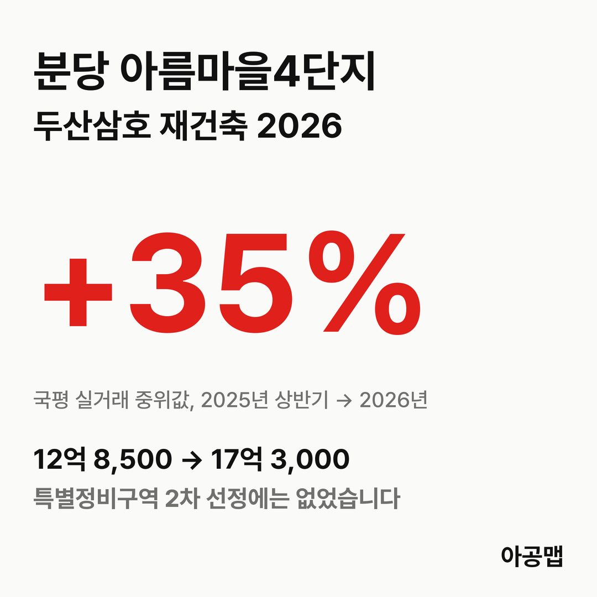
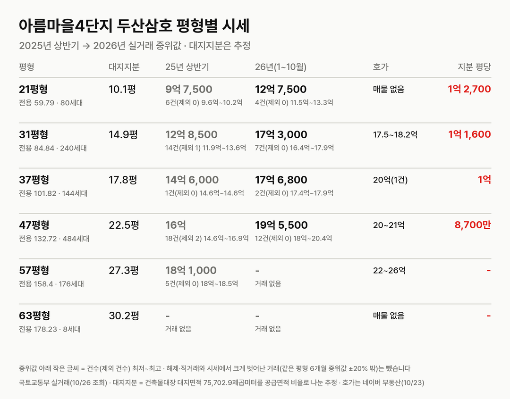
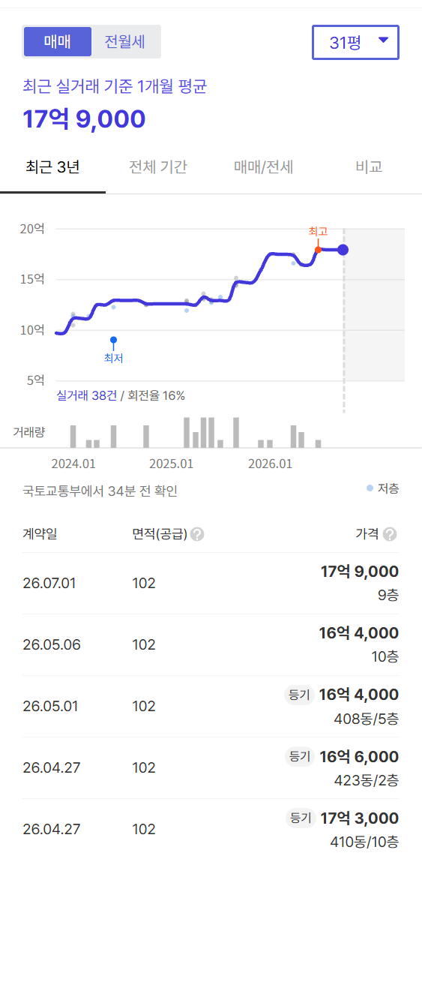
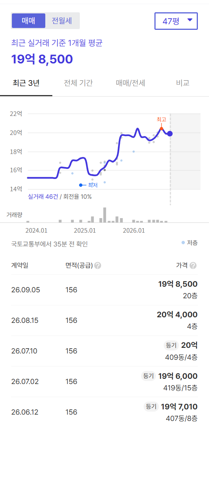
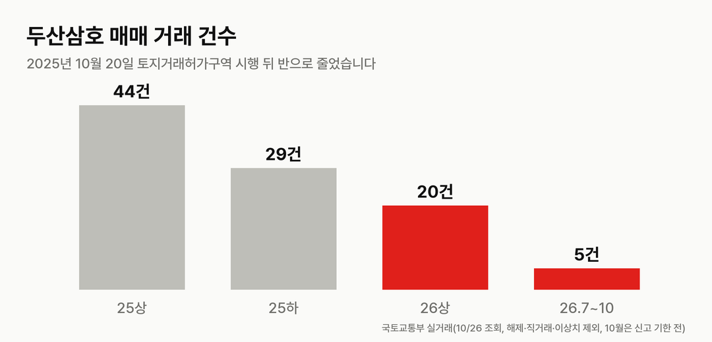
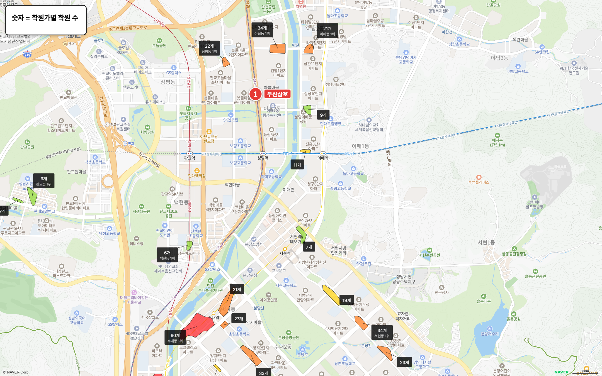
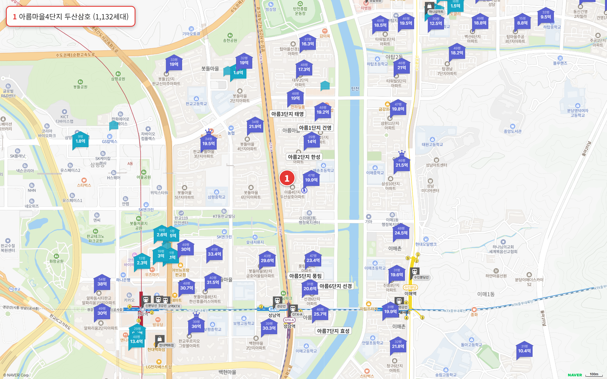

## 핵심 숫자

| 항목 | 값 | 기준 |
|---|---|---|
| 세대수 | 1,132세대(24개 동, 최고 22층) | 1992년 9월 입주 |
| 용적률·건폐율 | 198%·16% | 건축물대장 용적률 198.62% |
| 대지면적 | 75,702.9㎡ | 세대당 평균 66.9㎡(20.2평) |
| 세대당 주차대수 | 1.37대 | |
| 배정초 | 매송초(단지 안) | 도보 2분, 초품아 |
| 가까운 역 | 경강선·수인분당선 이매역 도보 14분 | GTX-A 성남역이 단지 남쪽 |

## 평형별 대지지분과 시세

| 평형 | 세대 | 대지지분(추정) | 2025년 상반기 건수(제외)·범위·중위값 | 2026년 1~10월 건수(제외)·범위·중위값 | 대지지분 1평당(2026 중위값) |
|---|---|---|---|---|---|
| 21평형(전용 59.79㎡) | 80 | 10.1평 | 6건(0) 9억 5,500만~10억 1,500만, 9억 7,500만 | 4건(0) 11억 5,000만~13억 3,000만, 12억 7,500만 | 1억 2,700만 |
| 31평형(전용 84.84㎡, 국평) | 240 | 14.9평 | 14건(1) 11억 9,000만~13억 6,000만, 12억 8,500만 | 7건(0) 16억 4,000만~17억 9,000만, 17억 3,000만 | 1억 1,600만 |
| 37평형(전용 101.82㎡) | 144 | 17.8평 | 1건(0) 14억 6,000만 | 2건(0) 17억 4,500만~17억 9,000만, 17억 6,800만 | 1억 |
| 47평형(전용 132.72㎡) | 484 | 22.5평 | 18건(2) 14억 6,000만~16억 9,000만, 16억 | 12건(0) 18억~20억 4,000만, 19억 5,500만 | 8,700만 |
| 57평형(전용 158.4㎡) | 176 | 27.3평 | 5건(0) 18억~18억 5,000만, 18억 1,000만 | 거래 없음(제외 1) | - |
| 63평형(전용 178.23㎡) | 8 | 30.2평 | 거래 없음 | 거래 없음 | - |

해제·직거래와 시세에서 크게 벗어난 거래(같은 평형 최근 6개월 중위값 ±20% 밖)는 뺐습니다. 괄호 안은 뺀 건수다.

대지지분은 건축물대장 대지면적을 평형별 공급면적 비율로 나눈 추정값이다. 47평형 이상이 668세대로 전체의 59%다. 국토교통부 실거래에는 같은 지번(이매동 133)이 '아름마을(두산)'과 '아름마을(삼호)' 두 이름으로 올라 있어 합쳐 셌다.

2025년 상반기 대비 2026년 중위값은 21평형 31%, 국평 35%, 47평형 22% 올랐다. 작은 평형이 더 오르면서 대지지분 1평당 값의 차이가 벌어졌다. 2025년 상반기 중위값 기준으로는 국평 8,600만 원, 47평형 7,100만 원이었다.

| 평형 | 매매 호가(2026-10-23) | 전세 실거래 건수(제외)·중위값(2026년 5~10월) |
|---|---|---|
| 국평 | 19건, 17억 5,000만~18억 2,000만 | 5건(0), 7억 3,000만 |
| 47평형 | 7건, 20억~21억 | 10건(0), 8억 2,400만 |
| 57평형 | 8건, 22억~26억 | 3건(1), 7억 8,000만 |
| 21평형 | 매물 없음 | 7건(0), 5억 7,000만 |

전세가율은 국평과 47평형 모두 42% 안팎이다.

## 거래량과 대출

| 기간 | 매매 건수(해제·직거래·이상치 제외) |
|---|---|
| 2025년 상반기 | 44건 |
| 2025년 하반기 | 29건 |
| 2026년 상반기 | 20건 |
| 2026년 7~10월 | 5건(10월은 신고 기한 전) |

분당구는 2025년 10월 20일부터 토지거래허가구역이다. 매수하면 2년 실거주 의무가 있고 무주택자 대출은 집값의 40%, 15억 원을 넘는 주택은 4억 원이 한도다. 중위값 기준으로 국평 17억 3,000만 원이면 현금 13억 3,000만 원, 47평형 19억 5,500만 원이면 15억 5,500만 원이 필요하다.

## 사업 단계

| 날짜 | 내용 |
|---|---|
| 2024년 | 1차 선도지구 공모에 아름마을 12구역(1단지 건영·2단지 한성·3단지 태영·4단지 두산삼호, 2,492세대)으로 신청, 미지정 |
| 2025-09-29 | 국방부 비행안전구역 변경고시, 아름마을 1~7단지 2구역→6구역(동별 최고 48층) |
| 2025-10-20 | 분당 토지거래허가구역 시행 |
| 2026-09-29 | 성남시 특별정비구역 2차 선정 5개 구역(이매촌1, 시범단지1, 파크타운, 푸른마을, 한솔마을2, 13,429세대) 발표, 아름마을 없음 |
| 2026-12(예정) | 2차 5개 구역 특별정비구역 지정·고시 |

2026년 입주민 후기에는 두산삼호의 단독 재건축과 1~3단지 통합 재건축을 두고 의견이 갈린다는 글이 반복해 올라왔다. 조합이나 추진위 공지로 확인된 다음 일정과 추정 분담금은 없다.

1+1 분양은 도시정비법상 종전 주거전용면적 범위에서 두 채를 받되 한 채는 전용 60㎡ 이하여야 한다. 전용 158.4㎡인 57평형은 면적 기준으로 국평과 전용 59㎡ 조합이 가능하다. 실제 배정은 관리처분 때 권리가액으로 정해진다.

## 학군과 생활 인프라

| 항목 | 이름 | 거리 |
|---|---|---|
| 가까운 학원가 | 야탑동 학원가(34개) | 도보 8분 |
| 가까운 학원가 | 이매동 학원가(21개) | 도보 12분 |
| 분당 최대 학원가 | 정자동 학원가(63개), 수내동 학원가(60개) | 차로 10분 안팎 |
| 공원 | 탄천, 굿모닝파크 | 도보 10분, 11분 |
| 대형마트 | 롯데마트 판교점 | 도보 19분 |
| 백화점 | 현대백화점 판교점 | 차로 5분 |
| 대형 병원 | 분당차병원 | 차로 4분 |

## 성남 입주 물량

{{table:moveins:성남}}

성남의 2027년 입주 물량은 {{v:moveins:성남:2027}}세대다. 적정 입주량은 2026년 9월 주민등록 인구를 가구당 2.5명으로 나눈 가구 수의 2%로 잡는다. 주간 시세 흐름은 아래와 같다.

{{table:weekly:성남}}

2027년 입주장이 지나면 2028·2029년 성남 입주 물량은 위 표처럼 적정 입주량에 크게 못 미친다. 여기에 분당 특별정비구역 이주가 시작되면 이주 수요가 더해진다. 2차 선정 5개 구역만 13,429세대다. 아공맵은 이 구간에서 성남의 신축 희소성이 커질 것으로 본다. 정비 일정이 뒤에 있는 아름마을은 앞 순번 구역의 이주 기간에 전세 수요를 받는 쪽에 선다. 사업 속도는 단지 간 통합 여부가 정해지는 시점에 달려 있다.

관련 리포트: [경기 시군구 주간·월간 시세](/zone/경기/#weekly-sgg)
