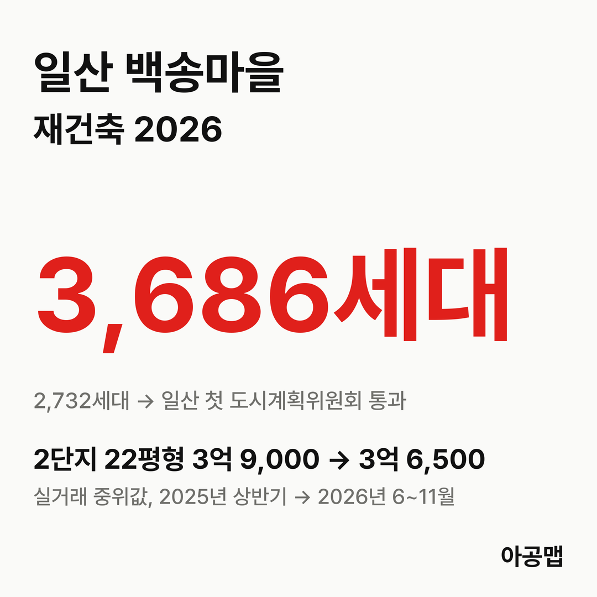
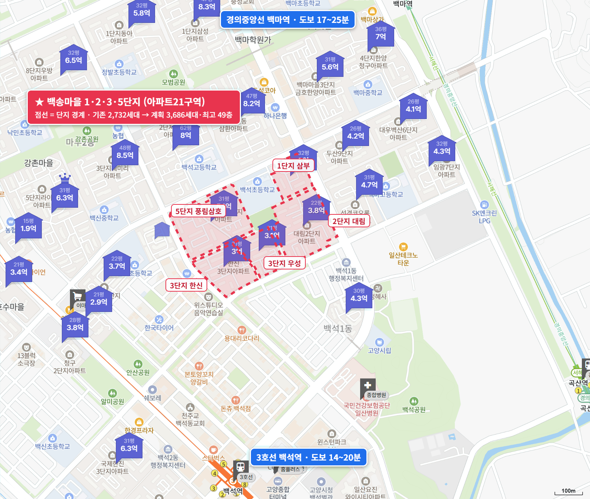
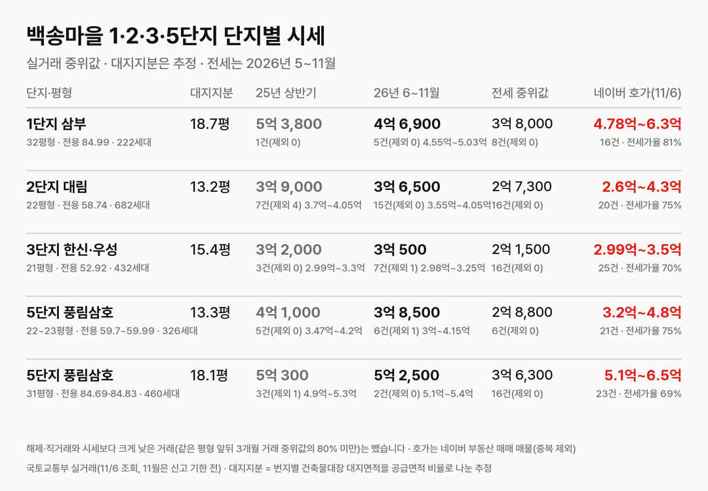
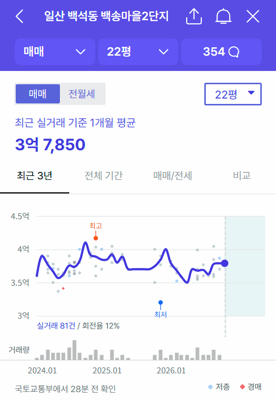
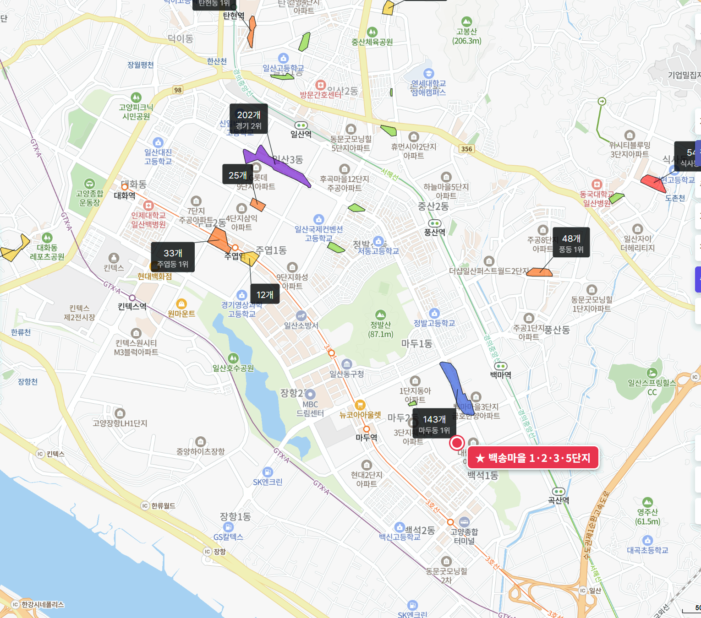

## 핵심 숫자

| 항목 | 값 | 기준 |
|---|---|---|
| 세대수 | 2,732세대(5개 단지, 42개 동) | 1992년 8월~1993년 3월 입주, 백석동 1187번지 일원 |
| 단지 구성 | 1단지 삼부 222, 2단지 대림 862, 3단지 한신 436·우성 426, 5단지 풍림삼호 786세대 | 단지 하나하나는 1,000세대 미만, 통합 재건축 |
| 용적률 | 134~165% | 건축물대장(3단지 134.27%, 2단지 164.98%) |
| 대지면적(5개 단지) | 129,700㎡ | 세대당 평균 47.5㎡(14.4평) |
| 세대당 주차대수 | 0.45~0.73대 | 단지별 |
| 가까운 역 | 3호선 백석역 도보 14~20분 | 경의중앙선 백마역 17~25분 |
| 배정초 | 고양백석초 | 구역 안, 1단지 정문 도보 1분 |

## 정비 구역과 계획안

아파트21구역은 백석동 1187번지 일원 157,742.3㎡로, 백송마을 1·2·3·5단지를 하나로 묶은 일산 선도지구다. 단지 하나하나는 1,000세대가 안 되지만 구역 전체가 한 사업이라 구역 합계로 다룬다.

| 항목 | 특별정비계획(안)(2026-05 공람) |
|---|---|
| 세대수 | 2,732세대 → 3,686세대(+954) |
| 규모 | 최고 49층 이하 |
| 용적률 | 300% 이하(종전 155.4%) |
| 사업 방식 | 조합 방식(주민투표로 결정, 추진위 승인 신청 중) |
| 존치 | 고양백석초 |

**지금은 도시계획위원회를 넘고 지정 고시를 앞둔 단계다.** 일산 선도지구 가운데 처음으로 도시계획위원회 문턱을 넘었고, 위원회 조건을 반영한 뒤 특별정비구역 지정과 특별정비계획 결정이 함께 고시된다.

| 시점 | 단계 |
|---|---|
| 25.6.5 | 고양시, 2035 노후계획도시정비 기본계획 고시(기준용적률 300%) |
| 26.4.29 | 특별정비계획 주민제안 접수 |
| 26.5.12 | 고양시, 특별정비구역 지정·특별정비계획(안) 주민공람 공고(~5월 26일) |
| 26.6.18 | 고양시의회 의견청취, 원안 채택 |
| 26.8.24 | 경관위원회 조건부 가결(보도) |
| 26.9.29 | 조합설립추진위원회 승인 신청(보도) |
| 26.10.28 | 고양시 도시계획위원회, 지정안 조건부 가결(보도) |
| 다음 | 12월 특별정비구역 지정 고시(예정) → 추진위 승인·조합 설립 |

같은 일산 선도지구의 후곡마을(7구역, 2,564 → 4,304세대)과 강촌1·2·백마1·2(16구역)는 7월에 공람했고, 강촌3·5·7·8(17구역)은 10월 30일부터 공람 중이다. 고양시는 일산 기준용적률을 300%에서 350%로 올리는 기본계획 재정비 용역을 진행 중인데, 확정된 것은 아니다. 추정 비례율은 102.75%로 보도됐고, 평형별 추정 분담금은 공식 자료로 확인하지 못했다.

## 단지별 대지지분과 시세

| 단지·평형 | 대지지분(추정) | 2025년 상반기 건수(제외)·범위·중위값 | 2026년 6~11월 건수(제외)·범위·중위값 | 대지지분 1평당(2026) |
|---|---|---|---|---|
| 1단지 삼부 32평형(전용 84.99㎡, 222세대) | 18.7평 | 1건(0) 5억 3,800만 | 5건(0) 4억 5,500만~5억 300만, 4억 6,900만 | 2,500만 |
| 2단지 대림 22평형(전용 58.74㎡, 682세대) | 13.2평 | 7건(4) 3억 7,000만~4억 500만, 3억 9,000만 | 15건(0) 3억 5,500만~4억 500만, 3억 6,500만 | 2,800만 |
| 3단지 한신·우성 21평형(전용 52.92㎡, 432세대) | 15.4평 | 3건(0) 2억 9,900만~3억 3,000만, 3억 2,000만 | 7건(1) 2억 9,800만~3억 2,500만, 3억 500만 | 2,000만 |
| 5단지 풍림삼호 22~23평형(전용 59.7~59.99㎡, 326세대) | 13.3평 | 5건(0) 3억 4,700만~4억 2,000만, 4억 1,000만 | 6건(1) 3억~4억 1,500만, 3억 8,500만 | 2,900만 |
| 5단지 풍림삼호 31평형(전용 84.69·84.83㎡, 460세대) | 18.1평 | 3건(1) 4억 9,000만~5억 3,000만, 5억 300만 | 2건(0) 5억 1,000만~5억 4,000만, 5억 2,500만 | 2,900만 |

해제·직거래와 시세보다 크게 낮은 거래(같은 평형 앞뒤 3개월 거래 중위값의 80% 미만)는 뺐습니다. 괄호 안은 뺀 건수다. 단지마다 가장 세대수가 많은 평형을 골랐고, 3단지 한신과 우성은 같은 평형이라 합쳐 셌다. 11월은 신고 기한 전이다. 대지지분은 번지별 건축물대장 대지면적을 그 번지 평형별 공급면적 비율로 나눈 추정값이다.

값은 거의 움직이지 않았다. 2025년 6~11월 대비 2026년 6~11월 중위값은 2단지 22평형 -6%, 3단지 21평형 0%, 5단지 22~23평형 +11%, 5단지 31평형 -6%, 1단지 32평형 -4%다. 단지마다 거래가 한 해 십여 건 안팎이라 숫자가 거칠지만, 방향은 분명하다. 공람, 시의회, 경관위원회, 도시계획위원회를 차례로 넘는 동안 값은 3억~5억 원대에 머물렀다.

이 연재의 다른 단지와 견주면 사업 진척이 값에 실린 시점과 폭이 다르다. 대지지분 1평당 값은 백송마을이 2,000만~2,900만 원, [수원 영통 신나무실](/danji/sinnamusil-5-yeongtong/)이 5,000만 원, [분당 매화마을2단지](/danji/maehwa2-yatap-bundang/) 25평형이 8,800만 원이다. 이주를 앞둔 영통·분당 두 단지는 2025년 상반기 대비 37~56% 올랐고, 백송마을은 도시계획위원회를 넘었는데도 그대로다.

고양의 앞으로 3년 입주 물량은 {{v:moveins3:고양}}로 적정물량의 {{v:share3:고양}}다. 백송마을의 최근 1년 상승률은 -6%~+11%다. 고양은 3년 입주가 크게 모자라는데 덜 오른 도시이고, 백송마을은 그 안에서도 아직 반영이 덜 된 곳이다. 최근 4주(10월 26일 조사까지) 주간 지수로 보면 영통 +2.4%, 군포 +2.1%, 부천 원미구 +1.7%가 오르는 동안 일산동구는 -0.2%였다. 제 판단으로는 경기에서 먼저 오른 곳과 백송마을 사이의 이 거리는 길게 보면 좁혀지는 쪽으로 움직이고, 일산은 따라 오르는 곳의 순서가 아직 오지 않은 곳이다.

| 단지·평형 | 세 낀 매물 호가 | 세 낀 매물 갭(그 집 전세 보증금 기준) | 실거주 매물 호가 | 전세 실거래 건수·중위값(2026년 5~11월) | 전세가율 |
|---|---|---|---|---|---|
| 1단지 삼부 32평형 | 5건, 4억 9,000만~5억 3,000만 | 3건, 1억 1,000만~2억 2,000만 | 11건, 4억 7,800만~6억 3,000만 | 8건, 3억 8,000만 | 81% |
| 2단지 대림 22평형 | 8건, 3억 7,500만~4억 3,000만 | 5건, 1억~1억 8,000만 | 11건, 3억 7,000만~4억 500만 | 16건, 2억 7,300만 | 75% |
| 3단지 한신·우성 21평형 | 13건, 3억~3억 3,000만 | 11건, 8,000만~1억 2,500만 | 12건, 2억 9,900만~3억 5,000만 | 16건, 2억 1,500만 | 70% |
| 5단지 풍림삼호 22~23평형 | 8건, 3억 2,000만~4억 8,000만 | 4건, 8,000만~1억 1,500만 | 11건, 3억 4,000만~4억 8,000만 | 6건, 2억 8,800만 | 75% |
| 5단지 풍림삼호 31평형 | 9건, 5억 1,000만~6억 | 5건, 1억 5,500만~2억 4,000만 | 13건, 5억 2,000만~6억 5,000만 | 16건, 3억 6,300만 | 69% |

호가는 네이버 부동산 매매 매물(2026년 11월 6일 조회, 중복 등록 92건은 하나로 셈) 145건 가운데 표의 평형만 셌고, 세 낀 매물(전세를 안고 사는 매물)과 실거주 매물(즉시·협의 입주)로 나눴다. 갭은 세 낀 매물 호가에서 그 집 전세 보증금을 뺀 값이고, 보증금이 적힌 매물만 셌다(보증부 월세 매물은 뺐다). 전세가율은 2026년 6~11월 매매 중위값 대비 전세 중위값이다.

전세가율이 69~81%로 이 연재에서 가장 높은 축이고, 세 낀 매물의 갭은 1억 원 안팎부터 있다. 3단지 21평형은 갭 8,000만~1억 2,500만 원으로 일산 첫 특별정비구역 지정을 앞둔 구역의 집을 살 수 있다. 고양은 토지거래허가구역이 아니어서 세 낀 매수가 가능하다.

## 학군과 생활 인프라

| 항목 | 이름 | 거리 |
|---|---|---|
| 배정초 | 고양백석초 | 구역 안, 1단지 정문 도보 1분 |
| 가까운 학원가 | 백마학원가(마두동 143개, 일산동구 1위) | 도보 10~18분 |
| 일산 최대 학원가 | 후곡학원가(일산동 202개) | 약 3.6km, 차량 이동 |
| 대형마트 | 이마트 일산점, 코스트코 일산점 | 도보 14분, 25분 |
| 백화점·쇼핑몰 | 벨라시타, 뉴코아아울렛 일산점, 롯데백화점 일산점 | 도보 24~39분 |
| 대형 병원 | 국민건강보험공단 일산병원 | 도보 14분 |
| 공원 | 백송공원(구역 안), 백석공원 | 도보 0~11분 |

일산동구 1위 학원가인 백마학원가와 일산병원·이마트가 걸어서 15분 안팎이고, 초등학교가 구역 안에 있다. 역은 걸어서 15~20분이라 역세권은 아니다. 입주민 후기에서는 초품아·학원가와 일산에서 가장 빠른 재건축 속도가 장점으로, 주차난과 노후가 걱정거리로 꼽힌다.

## 고양 입주 물량

{{chart:moveins:고양}}

{{table:moveins:고양}}

고양의 2027년 입주 물량은 {{v:moveins:고양:2027}}로 한 해 적정물량 {{v:need:고양}}의 {{v:share:고양:2027}}다. 2028년에는 {{v:moveins:고양:2028}}가 몰리지만, 앞으로 3년을 합치면 {{v:moveins3:고양}}로 적정물량의 {{v:share3:고양}}다. 적정물량은 2026년 9월 주민등록 인구를 가구당 2.5명으로 나눈 가구 수의 2%로 잡는다. 일산동구 매매가는 {{v:streak:일산동구}}이고, 주간 시세 흐름은 아래와 같다.

{{chart:weekly:고양 일산동구}}

{{table:weekly:고양}}

일산 선도지구 네 곳과 그 뒤를 잇는 구역만 1만 세대가 넘는다. 이 구역들이 차례로 이주하면 새 집이 모자란 고양에서 전세 수요가 늘어난다. 고양은 앞으로 3년 입주가 적정물량의 절반에도 못 미친다. 아공맵은 이 부족이 일산 전세를 먼저 받치고, 사업이 가장 앞선 백송마을부터 매매가에 실릴 것으로 본다. 이 단지의 다음 변수는 12월 지정 고시와 추진위 승인, 그리고 기준용적률 350% 상향 여부다.

## 고른 기준

- 앞으로 3년 입주 합계와 적정물량 대비 %는 자료 기준월 다음 해부터 3년(지금은 2027~2029년) 입주 예정 물량 합계를 한 해 적정물량의 3배로 나눈 값이다.
- 최근 1년 상승률은 2025년 6~11월과 2026년 6~11월 실거래 중위값을 견준 값이다. 최근 4주 주간 지수는 한국부동산원 주간 변동률 4주를 곱해 셌다.

관련 리포트: [경기 시군구 주간·월간 시세](/zone/경기/#weekly-sgg)
