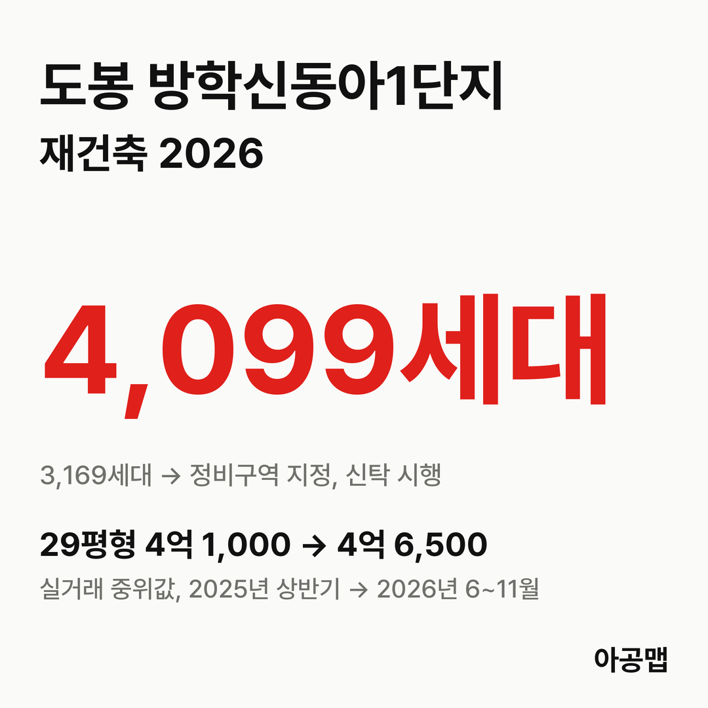
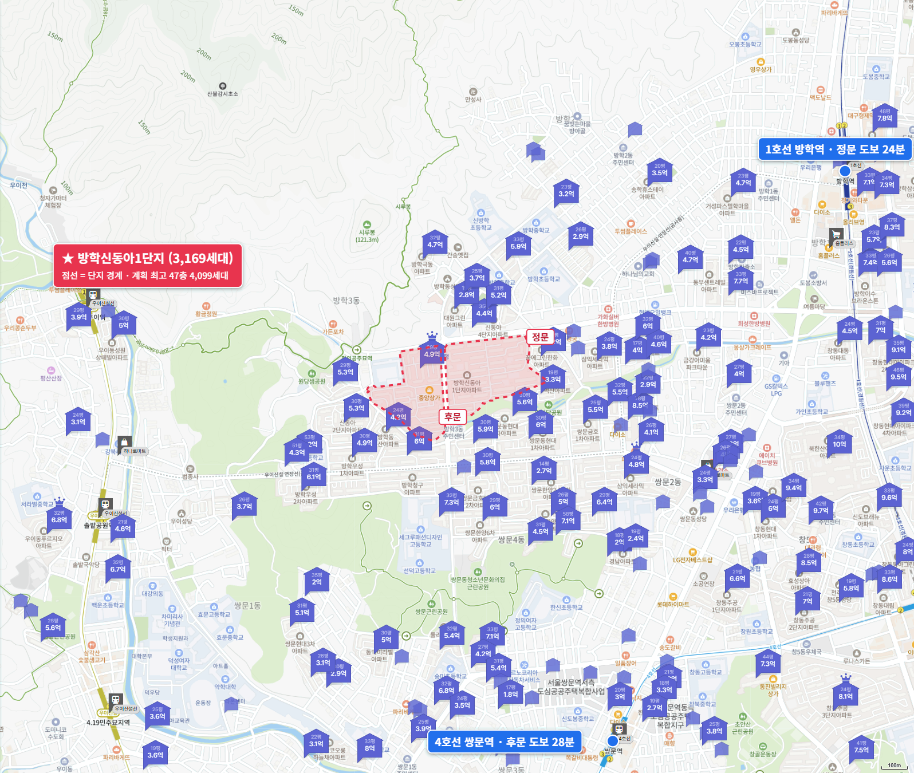
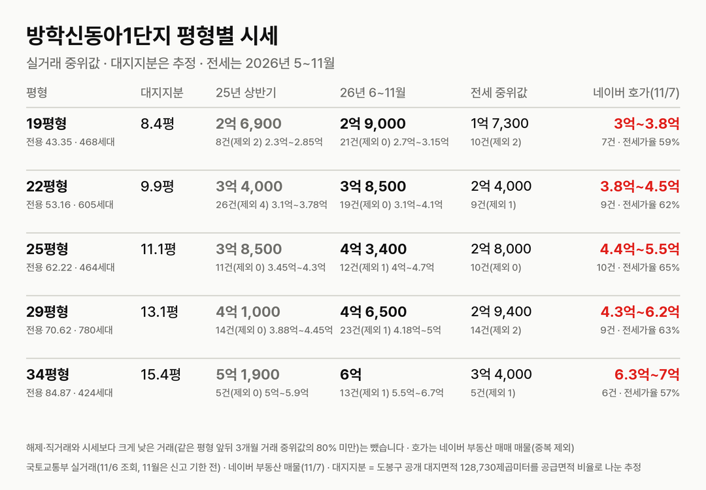
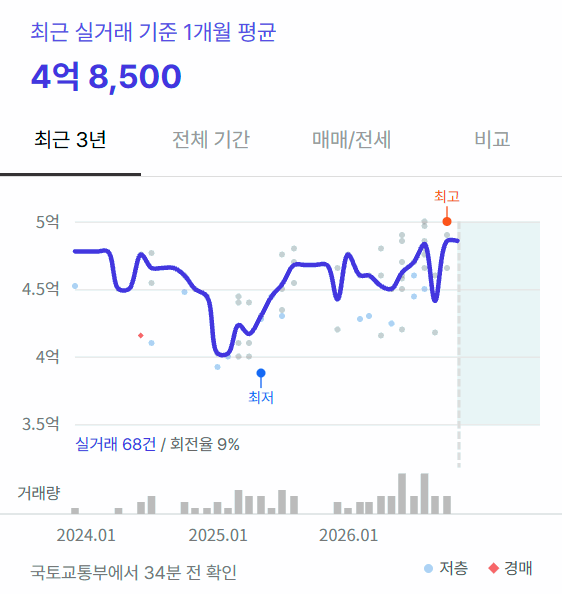
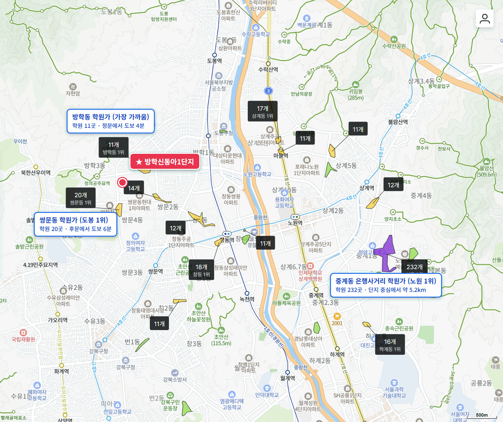

## 핵심 숫자

| 항목 | 값 | 기준 |
|---|---|---|
| 세대수 | 3,169세대(30개 동, 최고 15층) | 방학동 272 외, 도봉구 최대 재건축 |
| 준공 | 1986년 12월 사용승인 | 도봉구 추진현황은 1990년 1월 준공으로 적음 |
| 평형 | 19평형 468, 21평형 80, 22평형 605, 25평형 464, 29평형 780, 34평형 424, 40·42평형 348세대 | 34평형까지 복도식 |
| 용적률 | 201% | |
| 대지면적 | 128,730㎡ | 도봉구 공개, 세대당 평균 40.6㎡(12.3평) |
| 가까운 역 | 1호선 방학역 도보 24~32분 | 비역세권, 우이신설선 연장선 공사 중 |
| 배정초 | 서울신학초 | 도보 6~11분 |

## 정비 구역과 사업 단계

정비구역은 방학동 272번지 일원 140,872.6㎡다. 신속통합기획 자문을 거쳐 정비계획을 세웠고, 사업은 조합이 아니라 신탁사가 사업시행자(지정개발자)로 맡는다.

| 항목 | 정비계획(2025-10 고시) |
|---|---|
| 세대수 | 3,169세대 → 4,099세대(+930, 공공주택 280세대 포함) |
| 규모 | 지하 4층~지상 47층 |
| 용적률 | 299.97% |
| 사업 방식 | 신탁 방식(사업시행자 대신자산신탁) |

**지금은 사업시행자를 정하고 설계자를 뽑는 단계다.** 10월 22일 도봉구가 대신자산신탁을 지정개발자로 고시했고, 11월 6일 설계자·정비사업전문관리업자 선정 입찰을 공고했다. 신탁 방식이라 조합 설립 절차 없이 바로 시공사 선정으로 넘어간다.

| 시점 | 단계 |
|---|---|
| 22.10 | 안전진단 E등급(재건축 판정) |
| 23.12 | 신속통합기획 자문 신청 |
| 25.3.20 | 정비계획·정비구역 지정(안) 주민공람(~4월 21일) |
| 25.7.3 | 서울시 도시계획위원회 수정가결 |
| 25.10.2 | 서울시, 정비구역 지정 및 정비계획 결정 고시 |
| 26.10.22 | 도봉구, 사업시행자(지정개발자) 대신자산신탁 지정 고시 |
| 26.11.6 | 설계자·정비사업전문관리업자 선정 입찰 공고 |
| 다음 | 시공사 선정 → 통합심의 → 사업시행인가 |

정비계획 결정 때 보도된 추정 비례율은 100.97%다. 권리자 분양가는 59㎡ 약 7억 3,600만 원, 84㎡ 약 9억 2,400만 원으로 추산됐고, 기존 34평형 소유자가 새 84㎡를 받으면 약 3억 7,600만 원을 더 내고 기존 40평형 소유자가 49㎡를 받으면 약 8,500만 원을 돌려받는 예시가 나왔다(위클리한국주택경제신문 2025년 10월 13일). 일반분양가 3.3㎡당 3,360만 원을 가정한 사업 초기 추정치다.

방학동은 투기과열지구라 사업시행자 지정 고시일 뒤에 산 집은 원칙적으로 새 아파트 분양 자격이 제한되고, 장기 보유 1주택자 매물 같은 예외만 승계된다고 보도됐다. 네이버 매물 상당수가 '입주권 승계 가능'을 적은 것도 이 때문으로 보인다.

## 평형별 대지지분과 시세

| 평형 | 대지지분(추정) | 2025년 상반기 건수(제외)·범위·중위값 | 2026년 6~11월 건수(제외)·범위·중위값 | 대지지분 1평당(2026) |
|---|---|---|---|---|
| 19평형(전용 43.35㎡, 468세대) | 8.4평 | 8건(2) 2억 3,000만~2억 8,500만, 2억 6,900만 | 21건(0) 2억 7,000만~3억 1,500만, 2억 9,000만 | 3,400만 |
| 22평형(전용 53.16㎡, 605세대) | 9.9평 | 26건(4) 3억 1,000만~3억 7,800만, 3억 4,000만 | 19건(0) 3억 1,000만~4억 1,000만, 3억 8,500만 | 3,900만 |
| 25평형(전용 62.22㎡, 464세대) | 11.1평 | 11건(0) 3억 4,500만~4억 3,000만, 3억 8,500만 | 12건(1) 4억~4억 7,000만, 4억 3,400만 | 3,900만 |
| 29평형(전용 70.62㎡, 780세대) | 13.1평 | 14건(0) 3억 8,800만~4억 4,500만, 4억 1,000만 | 23건(1) 4억 1,800만~5억, 4억 6,500만 | 3,500만 |
| 34평형(전용 84.87㎡, 424세대) | 15.4평 | 5건(0) 5억~5억 9,000만, 5억 1,900만 | 13건(1) 5억 5,000만~6억 7,000만, 6억 | 3,900만 |

해제·직거래와 시세보다 크게 낮은 거래(같은 평형 앞뒤 3개월 거래 중위값의 80% 미만)는 뺐습니다. 괄호 안은 뺀 건수다. 국토교통부 실거래에는 '신동아아파트1'(방학동 271-1)로 올라 있다. 거래가 적은 21평형과 40·42평형은 표에서 뺐다. 11월은 신고 기한 전이다. 대지지분은 도봉구가 공개한 대지면적을 평형별 공급면적 비율로 나눈 추정값이다.

2025년 6~11월 대비 2026년 6~11월 중위값은 19평형 2%, 22평형 12%, 25평형 10%, 29평형 3%, 34평형 12% 올랐다. 가장 많은 29평형의 월 중위값은 2026년 내내 4억 4,000만~4억 9,000만 원 사이에 머물렀다. 정비구역 지정과 사업시행자 지정이 있었던 1년 동안 값이 거의 움직이지 않았다. 매매 건수는 2025년 상반기 65건, 하반기 34건, 2026년 상반기 83건, 6~11월 65건으로 거래는 꾸준하다.

같은 서울 외곽 재건축 단지와 견주면 값이 실린 폭이 다르다. 같은 기간 [노원 상계주공6단지](/danji/sanggye6-nowon/) 24평형은 23% 올랐고, 정비계획 공람을 마친 단계다. 방학신동아1단지는 한 단계 앞서 정비구역 지정과 사업시행자 지정을 마쳤는데 오름폭은 2~12%다. 대지지분 1평당 값도 상계주공6단지(6,200만~6,900만 원)의 절반을 조금 넘는 3,400만~3,900만 원이다. 역까지 걸어서 25분이 넘는 입지 차이를 감안해도 사업 진척에 비해 값이 덜 실렸다.

서울의 앞으로 3년 입주 물량은 적정물량의 {{v:share3:서울}}다. 서울 중심지(강남 3구·용산·성동·마포·양천)가 먼저 오르고 쉬는 동안 서울 외곽(노원·도봉·강북·금천·관악·구로)이 따라 오르는 흐름이 2019년과 2023년 이후 두 번 나타났고, 11월 2일 조사 기준 서울 중심지는 최근 12주 -0.4%로 쉬고 서울 외곽은 +4.0%로 오르는 중이다. 도봉구 주간 지수도 최근 4주(11월 2일 조사까지) +1.3%다. 방학신동아1단지의 최근 1년 상승률은 29평형 3%, 22평형 12%다. 서울 외곽이 오르는 가운데 이 단지는 아직 반영이 덜 된 곳이다. 제 판단으로는 서울 외곽이 따라 오르는 흐름이 이어지는 동안 상계주공6단지 같은 곳과 이 단지 사이의 폭은 사업 단계를 따라 좁혀질 가능성이 크고, 그다음에는 다시 서울 중심지 차례가 올 수 있다.

| 평형 | 세 낀 매물 호가 | 세 낀 매물 갭(그 집 전세 보증금 기준) | 실거주 매물 호가 | 전세 실거래 건수(제외)·중위값(2026년 5~11월) | 전세가율 |
|---|---|---|---|---|---|
| 19평형 | 없음 | - | 4건, 3억~3억 5,000만 | 10건(2), 1억 7,300만 | 59% |
| 22평형 | 3건, 3억 8,000만~4억 | 3건, 1억 5,000만~2억 1,200만 | 4건, 3억 8,000만~4억 5,000만 | 9건(1), 2억 4,000만 | 62% |
| 25평형 | 4건, 4억 4,000만~5억 | 4건, 1억 9,000만~2억 4,000만 | 5건, 4억 9,500만~5억 5,000만 | 10건(0), 2억 8,000만 | 65% |
| 29평형 | 5건, 4억 3,000만~5억 5,000만 | 3건, 2억 1,000만~3억 3,000만 | 3건, 5억 3,000만~5억 5,000만 | 14건(2), 2억 9,400만 | 63% |
| 34평형 | 없음 | - | 4건, 6억 7,900만~7억 | 5건(1), 3억 4,000만 | 57% |

호가는 네이버 부동산 매매 매물(2026년 11월 7일 조회, 중복 등록 45건은 하나로 셈) 52건 가운데 표의 평형만 셌고, 세 낀 매물(전세를 안고 사는 매물)과 실거주 매물(즉시·협의 입주)로 나눴다. 갭은 세 낀 매물 호가에서 그 집 전세 보증금을 뺀 값이고, 보증금이 적힌 매물만 셌다(보증부 월세 매물은 뺐다). 전세 실거래는 시세보다 크게 낮은 거래를 같은 기준으로 뺐다. 전세가율은 2026년 6~11월 매매 중위값 대비 전세 중위값이다.

전세가율이 57~65%로 상계주공6단지(33~42%)보다 훨씬 높고, 세 낀 22평형 매물은 갭 1억 5,000만~2억 1,200만 원이다. 도봉구는 서울 전역과 함께 2025년 10월 20일부터 토지거래허가구역이라 허가를 받아 사면 2년 동안 실거주해야 하고, 세 낀 매물은 세입자 계약이 끝나야 들어갈 수 있다. 사업시행자 지정 뒤 산 집은 분양 자격 승계 여부를 매물마다 따져야 한다.

## 학군과 생활 인프라

| 항목 | 이름 | 거리 |
|---|---|---|
| 배정초 | 서울신학초 | 도보 6~11분 |
| 가까운 학원가 | 쌍문동 학원가(20개, 도봉구 1위), 방학동 학원가(11개) | 도보 4~14분 |
| 동북권 최대 학원가 | 중계 은행사거리 학원가(232개) | 약 5km, 버스 이동 |
| 대형마트 | 홈플러스 방학점 | 도보 25분 |
| 대형 병원 | 한일병원 | 도보 32분 |
| 공원 | 발바닥공원 | 단지 서쪽에 붙어 있음, 도보 4분 |

도봉구 1위 학원가와 발바닥공원이 걸어서 10분 안팎이다. 역과 대형마트·병원은 걸어서 25분이 넘어 버스를 타야 한다. 입주민 후기에서는 단지 관리와 조용한 환경, 선덕고 학군이 장점으로, 주차난과 소형 위주 구성, 분담금 부담이 걱정거리로 꼽힌다.

## 서울 입주 물량

{{chart:moveins:서울:2027}}

서울의 2027년 입주 물량은 {{v:moveins:서울:2027}}로 한 해 적정물량의 {{v:share:서울:2027}}다. 앞으로 3년을 합쳐도 적정물량의 {{v:share3:서울}}에 그친다. 서울 전체로는 {{v:supply:서울}}이다. 도봉구 매매가는 {{v:streak:도봉구}}이고, 주간 시세 흐름은 아래와 같다.

{{chart:weekly:서울 도봉구}}

{{table:weekly:서울}}

도봉에서는 쌍문한양1차가 통합심의를 신청했고, 창동상아1차가 시공자를 뽑았으며, 창동주공18·4·19단지가 추진위원회 승인을 받았다. 방학신동아1단지까지 더하면 도봉에서만 기존 수천 세대가 차례로 이주를 앞둔다. 서울은 앞으로 3년 입주가 적정물량의 {{v:share3:서울}}에 머문다. 아공맵은 이 부족이 서울 외곽 전세를 받치고, 서울 외곽 재건축 단지 가운데 아직 덜 오른 곳에도 사업 단계마다 값이 실릴 것으로 본다. 이 단지의 다음 변수는 시공사 선정과 공사비, 그리고 우이신설선 연장선 공사 진척이다.

## 고른 기준

- 서울의 앞으로 3년 입주 합계 적정물량 대비 %는 사이트 모델의 '앞으로 3년'(앞으로 12분기 지어질 물량 ÷ 분기 적정물량 × 12)이다. 도시 글의 3년 합계(입주 예정 목록 기준)와 분자의 출처가 다르다.
- 최근 1년 상승률은 2025년 6~11월과 2026년 6~11월 실거래 중위값을 견준 값이다. 도봉구 최근 4주는 한국부동산원 주간 변동률 4주를 곱해 셌다.

관련 리포트: [서울 시군구 주간·월간 시세](/zone/서울/#weekly-sgg)
