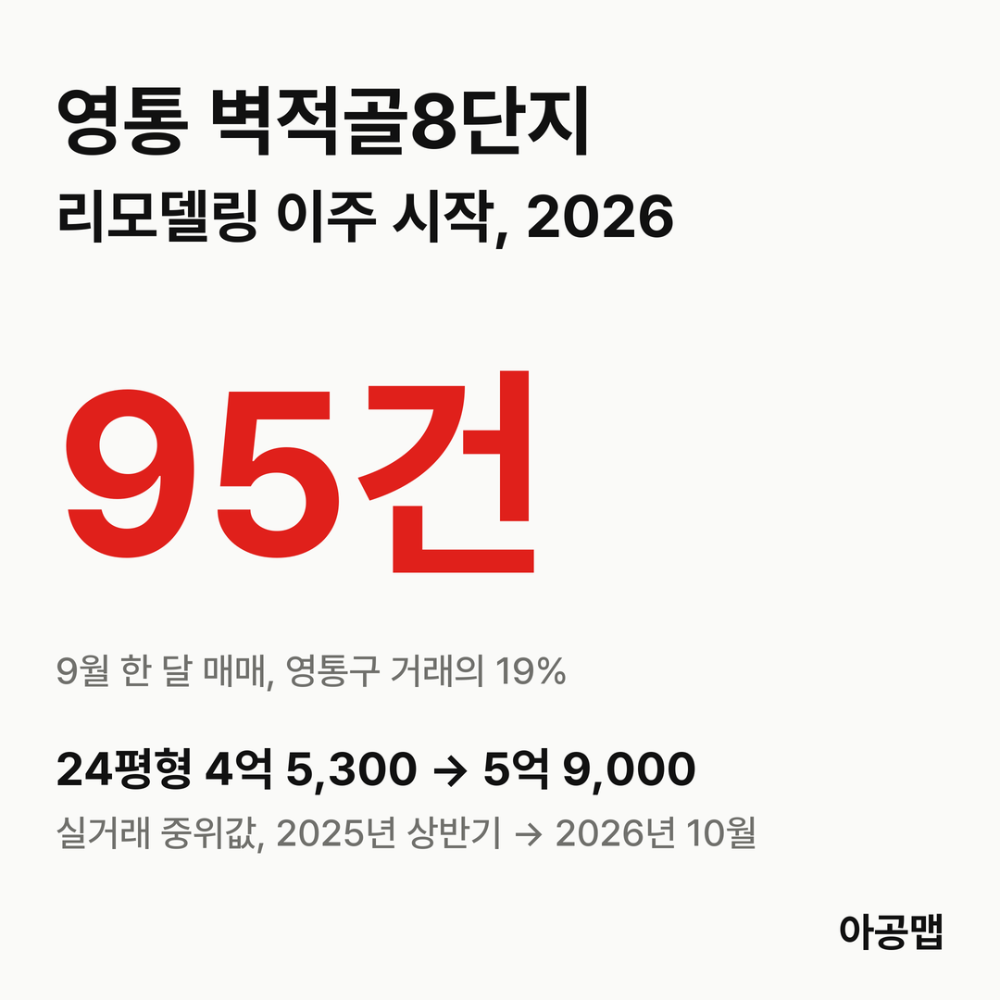
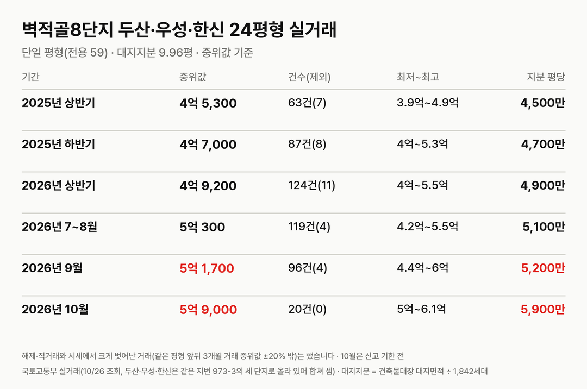
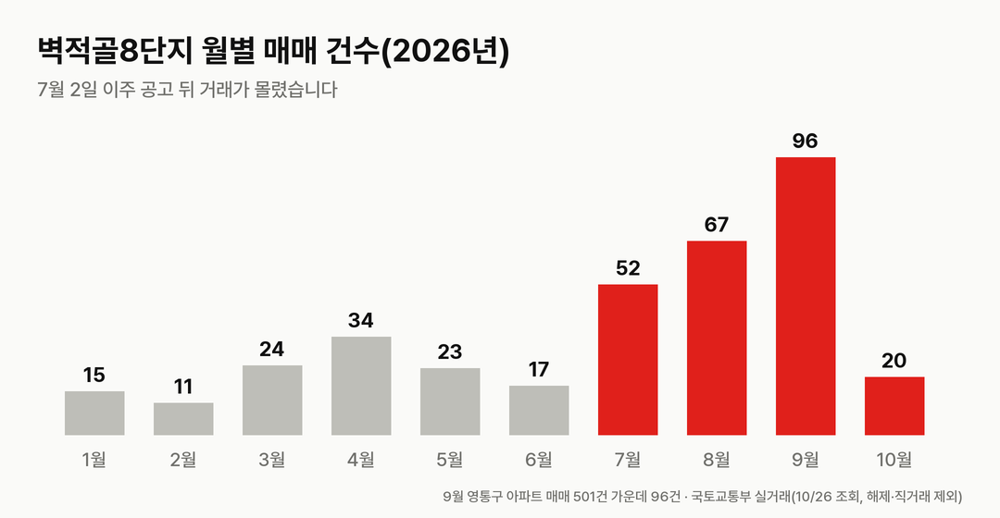
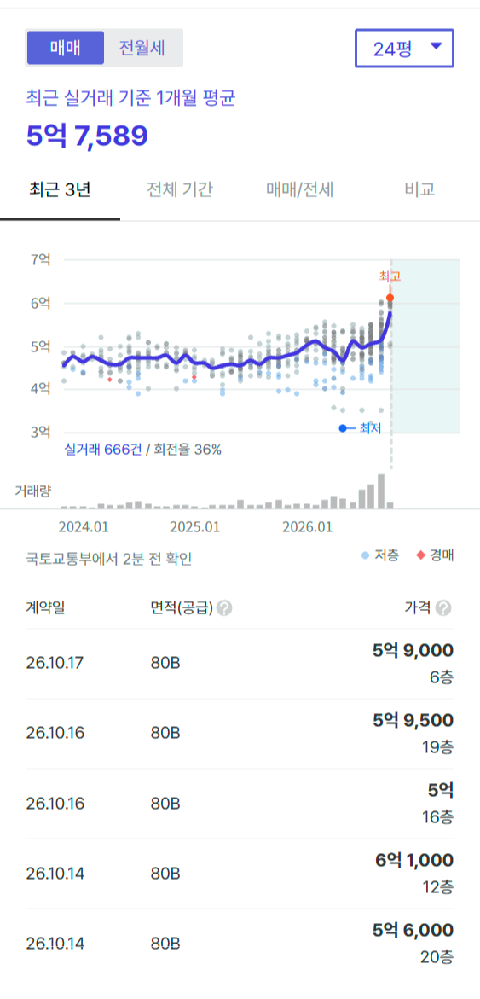
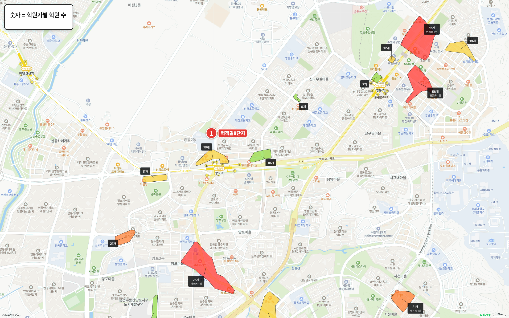
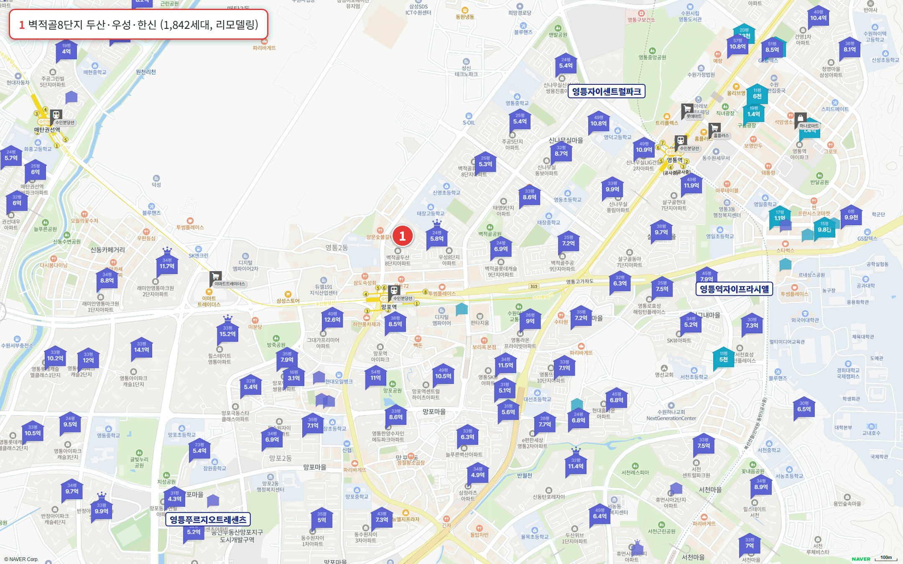

## 핵심 숫자

| 항목 | 값 | 기준 |
|---|---|---|
| 세대수 | 1,842세대(18개 동, 최고 20층) | 1997년 12월 입주 |
| 평형 | 24평형(전용 59㎡) 단일 평형 | 80A 360세대, 80B 1,482세대 |
| 대지지분 | 세대당 9.96평 | 건축물대장 대지면적 60,632.85㎡ ÷ 1,842세대 |
| 리모델링 뒤 | 2,035세대(지하 4층~최고 21층) | 증가분 193세대 |
| 이주 기간 | 2026-08-28 ~ 2026-12-27 | 이주 공고 2026-07-02 |
| 입주 목표 | 2031년 12월 | 경인일보 2026-07-11 |
| 시공사 | 대우건설 | |
| 가장 가까운 역 | 수인분당선 망포역 도보 4분 | 초역세권 |

## 사업 경과

| 날짜 | 단계 |
|---|---|
| 2021-12-29 | 리모델링주택조합 설립 인가 |
| 2024-12-26 | 사업계획승인 |
| 2025-04 | 대우건설이 3.3㎡당 공사비를 595만 원에서 795만 원으로 올리자고 요구, 분담금 총회가 6월에서 9월로 연기 |
| 2026-02 | 정기총회에서 사업비 총액·조합원 분담금 안건 통과(전체 소유자 대비 찬성 51.5%), 조합은 일부 소유자에게 매도청구소송 진행 |
| 2026-07-02 | 조합원·세입자 이주 공고 |
| 2026-07-13 ~ 07-22 | 조합원 이주비 신청 |
| 2026-08-28 | 이주 시작(12월 27일까지) |

평형별 분담금과 최종 공사비는 공개된 조합 공지나 보도로 확인하지 못해 싣지 않는다.

## 실거래 흐름

| 기간 | 건수(제외) | 최저~최고 | 중위값 | 대지지분 1평당(중위값) |
|---|---|---|---|---|
| 2025년 상반기 | 63건(7) | 3억 9,000만~4억 9,200만 | 4억 5,300만 | 4,500만 |
| 2025년 하반기 | 88건(7) | 3억 8,800만~5억 2,800만 | 4억 7,000만 | 4,700만 |
| 2026년 상반기 | 125건(10) | 3억 9,300만~5억 5,500만 | 4억 9,000만 | 4,900만 |
| 2026년 7~8월 | 119건(4) | 4억 2,000만~5억 5,000만 | 5억 300만 | 5,100만 |
| 2026년 9월 | 95건(5) | 4억 4,000만~6억 | 5억 1,300만 | 5,200만 |
| 2026년 10월 | 19건(1) | 5억~6억 600만 | 5억 9,000만 | 5,900만 |

해제·직거래와 시세에서 크게 벗어난 거래(같은 평형 최근 6개월 중위값 ±20% 밖)는 뺐습니다. 괄호 안은 뺀 건수다.

국토교통부 실거래에는 두산·우성·한신이 같은 지번(영통동 973-3)의 세 단지로 올라 있어 합쳐 셌다. 10월은 신고 기한 전 값이다.

2026년 1~6월 월 11~34건이던 매매가 이주 공고 뒤 7월 52건, 8월 67건, 9월 95건으로 늘었다. 9월 영통구 아파트 매매 501건(해제·직거래 제외) 가운데 19%가 이 단지였다. 분담금이 정해지고 이주가 시작되면서 사업 성사 여부에 대한 불확실성이 사라진 시점과 겹친다.

매매 호가는 38건이 5억 8,000만~6억 8,000만 원이다(2026-10-24). 이주 중이라 전세 매물은 없다.

영통구는 2025년 10월 20일부터 토지거래허가구역이며 무주택자 주택담보대출은 집값의 40%까지다.

## 주변 신축과 비교

영통역자이프라시엘(2026년 12월 입주 예정, 472세대) 국평(전용 84㎡) 분양권이 2026년 10월 1일 11억 1,367만 원에 거래됐다. 같은 시기 영통자이센트럴파크(2027년 3월 입주 예정, 580세대) 분양권 거래는 직거래만 있어 뺐다.

## 이름이 비슷한 단지

바로 옆 벽적골주공8단지(휴먼시아, 1,548세대)도 리모델링을 추진한다. 이 단지는 2022년 7월 포스코건설(현 포스코이앤씨)을 시공사로 선정한 별개 사업이다. 이 글의 두산·우성·한신은 '벽적골 민영8단지'로도 부른다.

## 학군과 생활 인프라

| 항목 | 이름 | 거리 |
|---|---|---|
| 배정초 | 신영초 | 도보 8분(초품아 아님) |
| 가까운 학원가 | 망포역 앞 학원가(18개) | 도보 2~4분 |
| 영통구 최대 학원가 | 망포동 학원가(76개) | 도보 18~20분 |
| 대형마트 | 트레이더스 수원점 | 도보 16~21분 |
| 공원 | 망포공원 | 도보 12~16분 |
| 대형 병원 | 아주대학교병원 | 차로 18분 |

세대당 주차대수는 0.81대다. 입주민 후기에서는 망포역 초역세권과 삼성전자 직주근접이 장점으로, 주차와 커뮤니티 시설 부족, 리모델링의 2베이 평면 한계가 단점으로 꼽힌다.

## 수원 입주 물량과 이주 수요

{{table:moveins:수원}}

수원의 2027년 입주 물량은 {{v:moveins:수원:2027}}, 2028년은 {{v:moveins:수원:2028}}다. 적정 입주량은 2026년 9월 주민등록 인구를 가구당 2.5명으로 나눈 가구 수의 2%로 잡는다. 주간 시세 흐름은 아래와 같다.

{{table:weekly:수원}}

1,842세대가 넉 달 동안 이주하는 시기와 수원 입주 물량이 적정 입주량에 크게 못 미치는 시기가 겹친다. 이주 공고 직후인 7월 초 영통구 전월세 매물은 400건으로 1년 전 965건의 절반에 못 미쳤다(경인일보 2026-07-11). 아공맵은 2031년 재입주 전까지 수원에서 신축 희소성이 커지고 전셋값이 버틸 것으로 본다. 이 단지의 다음 변수는 착공 전 동·호수 배정과 최종 분담금이다.

관련 리포트: [경기 시군구 주간·월간 시세](/zone/경기/#weekly-sgg)
