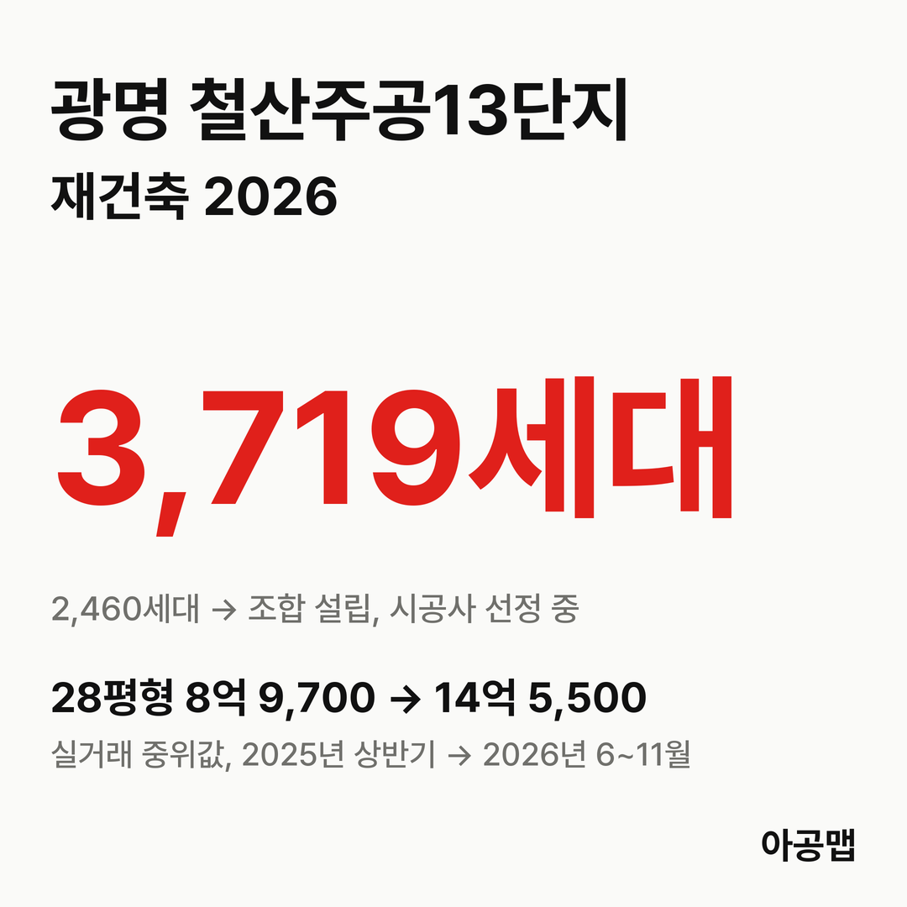
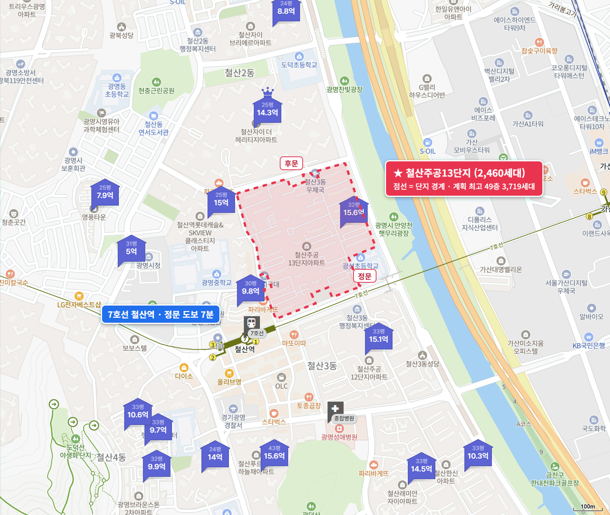
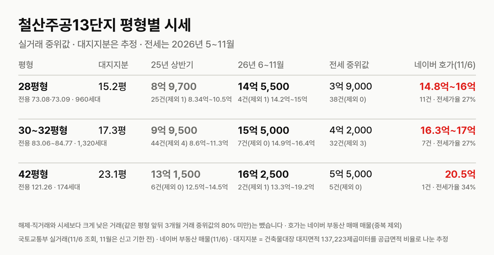
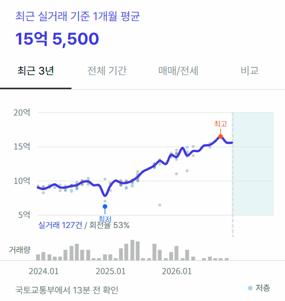
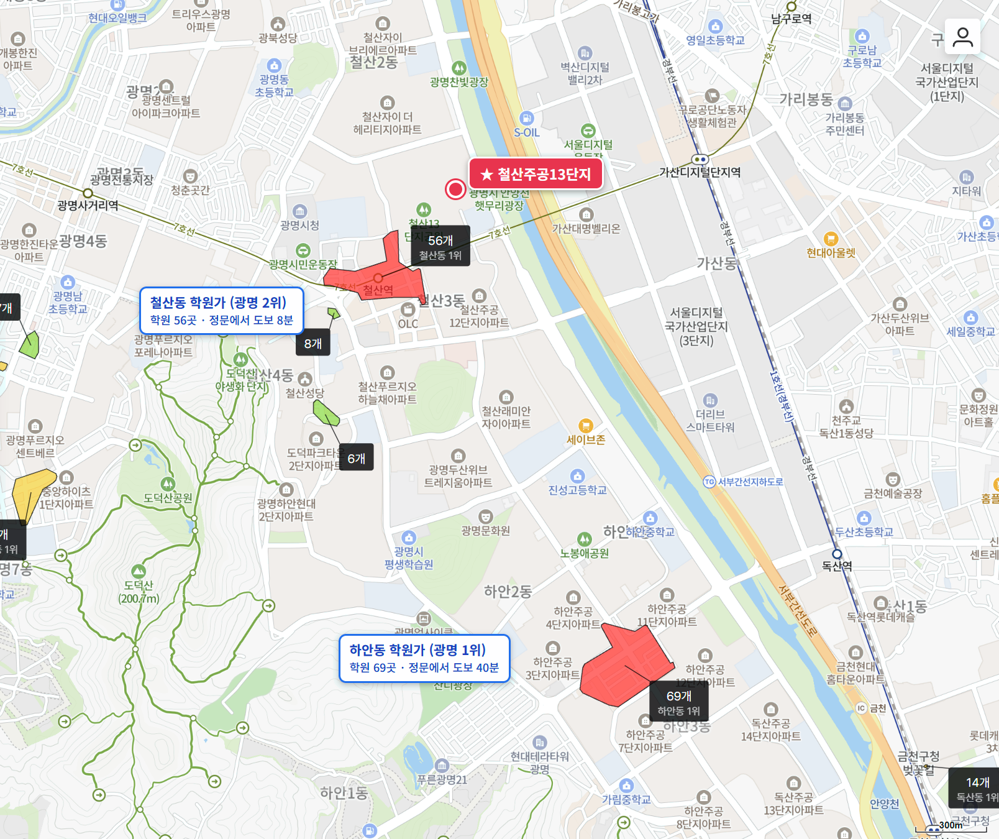

## 핵심 숫자

| 항목 | 값 | 기준 |
|---|---|---|
| 세대수 | 2,460세대(24개 동, 모두 15층) | 1986년 7월 입주, 철산동 241 |
| 평형 | 28평형 960, 30~32평형 1,320, 39·42평형 180세대 | 28~32평형 복도식 |
| 용적률·건폐율 | 171%·14% | 광명시 추진현황 170.93% |
| 대지면적 | 137,223㎡ | 세대당 평균 55.8㎡(16.9평) |
| 세대당 주차대수 | 0.73대 | |
| 가까운 역 | 7호선 철산역 도보 7~12분 | 가산디지털단지역 23~31분 |
| 배정초 | 광명광성초 | 단지 안, 초품아 |

## 정비 구역과 사업 단계

철산주공13단지 구역은 철산동 241번지 일원 164,632.4㎡로, 철산·하안지구에서 가장 먼저 정비구역 지정을 받았다.

| 항목 | 정비계획 |
|---|---|
| 세대수 | 2,460세대 → 3,719세대(+1,259) |
| 규모 | 지하 3층~지상 49층(최고 143m), 19개 동 |
| 용적률 | 170.93% → 329.92% |
| 사업 방식 | 조합 방식(조합원 2,299명) |

**지금은 조합을 세우고 시공사를 뽑는 단계다.** 10월 16일 시공자 입찰을 공고했고, 공사비는 3.3㎡당 850만 원, 입찰보증금은 400억 원이다. 입찰 마감은 11월 17일이고, 유찰되면 다시 공고해 2027년 1월 말 시공사 선정 총회를 연다는 계획이 보도됐다.

| 시점 | 단계 |
|---|---|
| 24.12.23 | 광명시, 정비계획·정비구역 지정(안) 주민공람 공고 |
| 25.3.26 | 도시계획·경관 공동위원회 조건부 의결 |
| 25.5.9 | 광명시, 정비구역 지정 고시(철산·하안지구 처음) |
| 25.7.22 | 조합설립추진위원회 승인 |
| 26.4.29 | 조합설립인가 |
| 26.10.16 | 시공자 입찰 공고(마감 11월 17일, 보도) |
| 다음 | 시공사 선정 → 통합심의 → 사업시행인가(조합 목표 2028년) → 관리처분인가(2030년) |

광명시는 8월 철산·하안 재건축 조합에 정비계획 변경 때 공공임대를 반영해 달라고 요청했고, 용적률 1% 수준으로 협의가 정리됐다고 보도됐다. 정비계획 변경 고시는 아직 없다. 추정 분담금과 비례율은 공식 자료로 확인하지 못했다.

## 평형별 대지지분과 시세

| 평형 | 대지지분(추정) | 2025년 상반기 건수(제외)·범위·중위값 | 2026년 6~11월 건수(제외)·범위·중위값 | 대지지분 1평당(2026) |
|---|---|---|---|---|
| 28평형(전용 73.08·73.09㎡, 960세대) | 15.2평 | 25건(1) 8억 3,400만~10억 5,000만, 8억 9,700만 | 4건(1) 14억 2,000만~15억, 14억 5,500만 | 9,600만 |
| 30~32평형(전용 83.06~84.77㎡, 1,320세대) | 17.3평 | 44건(4) 8억 6,000만~11억 3,000만, 9억 9,500만 | 7건(0) 14억 9,000만~16억 4,000만, 15억 5,000만 | 9,000만 |
| 42평형(전용 121.26㎡, 174세대) | 23.1평 | 6건(0) 12억 5,000만~14억 5,000만, 13억 1,500만 | 2건(1) 13억 3,000만~19억 2,000만, 16억 2,500만 | 7,000만 |

해제·직거래와 시세보다 크게 낮은 거래(같은 평형 앞뒤 3개월 거래 중위값의 80% 미만)는 뺐습니다. 괄호 안은 뺀 건수다. 국토교통부 실거래에는 '주공13'(철산동 241)으로 올라 있다. 30평형 일부와 32평형 일부는 전용면적이 같아 실거래에서 나뉘지 않으므로 한 줄로 묶었다. 11월은 신고 기한 전이다. 대지지분은 건축물대장 대지면적을 평형별 공급면적 비율로 나눈 추정값이다.

2025년 상반기 대비 2026년 6~11월 중위값은 28평형 62%, 30~32평형 56% 올랐다. 1년 전(2025년 6~11월)과 견주면 28평형 39%, 30~32평형 35%다. 매매 건수는 2025년 상반기 75건, 하반기 39건, 2026년 상반기 46건, 6~11월 10건으로 줄었다. 광명이 2025년 10월 20일 토지거래허가구역이 됐고, 투기과열지구라 2026년 4월 조합설립인가 뒤에는 조합원 지위 양도가 제한되기 때문이다(뉴시스 2026년 4월 29일). 거래가 적은 만큼 6~11월 숫자는 10건 안팎의 중위값이다.

대지지분 1평당 값은 28평형 9,600만 원, 30~32평형 9,000만 원이다. 28평형은 이 연재의 경기 단지 가운데 가장 높고, 이주를 앞둔 [분당 매화마을2단지](/danji/maehwa2-yatap-bundang/)가 8,800만~9,200만 원, [영통 신나무실](/danji/sinnamusil-5-yeongtong/)이 5,000만 원이다. 대지지분이 크고 역과 안양천을 낀 입지에 조합 설립까지 마친 단지라, 사업 진척이 값에 먼저 실렸다.

광명은 경기 핵심지(군포·구리·부천 원미구·영통·분당·동안·의왕·광명 등)에 들고, 주간 지수로 최근 4주(11월 2일 조사까지) +1.8% 오르는 중이다. 광명의 앞으로 3년 입주 물량은 적정물량의 {{v:share3:광명}}다. 철산주공13단지의 최근 1년 상승률은 35~39%다. 이 단지는 방향은 위지만 반영된 폭이 큰 곳이다. 제 판단으로는 같은 광명 안에서 아직 정비구역 공람 단계인 하안주공1·2단지 같은 곳과 이 단지 사이의 폭은 길게 보면 단계가 따라붙는 순서대로 좁혀질 가능성이 크다.

| 평형 | 네이버 매매 매물 | 전세 실거래 건수(제외)·중위값(2026년 5~11월) | 전세가율 |
|---|---|---|---|
| 28평형 | 11건, 14억 8,000만~16억 | 38건(0), 3억 9,000만 | 27% |
| 30~32평형 | 7건, 16억 3,000만~17억 | 32건(3), 4억 2,000만 | 27% |
| 42평형 | 1건, 20억 5,000만 | 5건(0), 5억 5,000만 | 34% |

호가는 네이버 부동산 매매 매물(2026년 11월 6일 조회, 중복 등록 81건은 하나로 셈) 19건이다. 세 낀 매물로 적힌 매물은 하나도 없고, 거의 모든 매물이 '조합원 지위승계 가능'과 '입주 협의'를 함께 적었다. 전세 실거래는 시세보다 크게 낮은 거래를 같은 기준으로 뺐다. 전세가율은 2026년 6~11월 매매 중위값 대비 전세 중위값이다.

전세가율이 27%로 이 연재에서 가장 낮다. 매매가와 전세가가 10억 원 넘게 벌어져 있고, 지위승계가 되는 매물만 사고팔 수 있어 매물이 19건에 그친다. 토지거래허가구역이라 허가를 받아 사면 2년 동안 실거주해야 한다.

## 학군과 생활 인프라

| 항목 | 이름 | 거리 |
|---|---|---|
| 배정초 | 광명광성초 | 단지 안, 정문 도보 0분 |
| 가까운 학원가 | 철산역 주변 철산동 학원가(56개, 광명 2위) | 정문 도보 8분 |
| 광명 최대 학원가 | 하안동 학원가(69개, 광명 1위) | 약 2.1km |
| 대형 병원 | 광명성애병원 | 도보 15분 |
| 쇼핑몰 | 마리오아울렛, 현대시티아울렛 가산점 | 도보 34~38분(안양천 건너) |
| 공원·도서관 | 안양천, 광명시립철산도서관 | 도보 5~9분 |

철산역과 광명 2위 학원가가 걸어서 10분 안팎이고, 초등학교가 단지 안에 있으며 안양천이 단지 동쪽에 붙어 있다. 대형마트와 백화점은 차로 다녀야 한다. 입주민 후기에서는 역세권·초품아·안양천과 빠른 사업 속도가 장점으로, 분담금과 공공임대 반영, 시공사 브랜드를 둘러싼 논쟁이 걱정거리로 꼽힌다.

## 광명 입주 물량

{{chart:moveins:광명}}

{{table:moveins:광명}}

광명의 2027년 입주 물량은 {{v:moveins:광명:2027}}로 한 해 적정물량 {{v:need:광명}}의 {{v:share:광명:2027}}다. 앞으로 3년을 합치면 {{v:moveins3:광명}}로 적정물량의 {{v:share3:광명}}다. 적정물량은 2026년 9월 주민등록 인구를 가구당 2.5명으로 나눈 가구 수의 2%로 잡는다. 광명 매매가는 {{v:streak:광명}}이고, 주간 시세 흐름은 아래와 같다.

{{chart:weekly:광명}}

{{table:weekly:광명}}

철산·하안지구에서는 철산주공12·13단지와 하안주공 여러 단지가 정비구역 지정을 받았거나 공람 중이고, 하안주공1·2단지는 11월 공람을 시작했다. 광명시 추진현황에 오른 철산12·13, 하안1·2·3·4단지만 기존 1만 세대가 넘고, 이 단지들이 2030년 전후로 차례로 이주한다. 아공맵은 이 부족이 광명 전세를 받치고, 사업이 앞선 철산 단지부터 값이 실리는 흐름이 이어질 것으로 본다. 이 단지의 다음 변수는 11월 17일 시공자 입찰 결과와 공사비, 그리고 정비계획 변경(공공임대 반영) 고시다.

## 고른 기준

- 앞으로 3년 입주 합계와 적정물량 대비 %는 자료 기준월 다음 해부터 3년(지금은 2027~2029년) 입주 예정 물량 합계를 한 해 적정물량의 3배로 나눈 값이다.
- 최근 1년 상승률은 2025년 6~11월과 2026년 6~11월 실거래 중위값을 견준 값이다. 광명 최근 4주는 한국부동산원 주간 변동률 4주를 곱해 셌다.

관련 리포트: [경기 시군구 주간·월간 시세](/zone/경기/#weekly-sgg)
