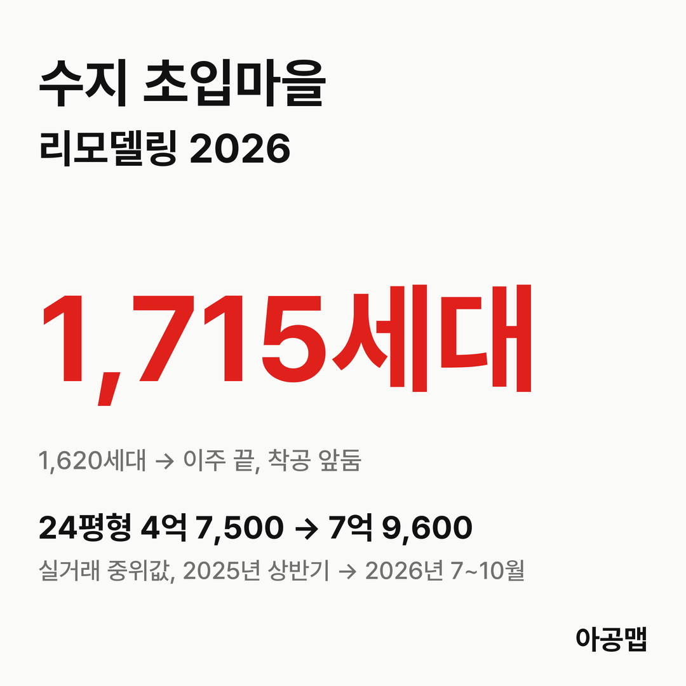
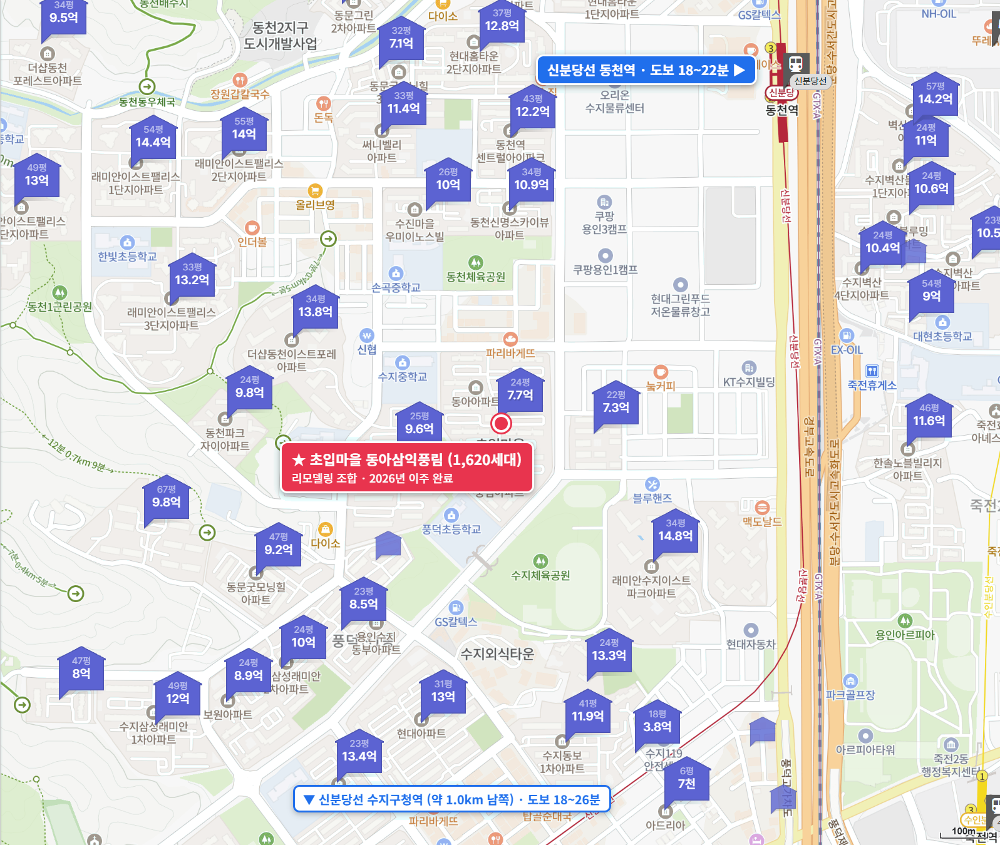
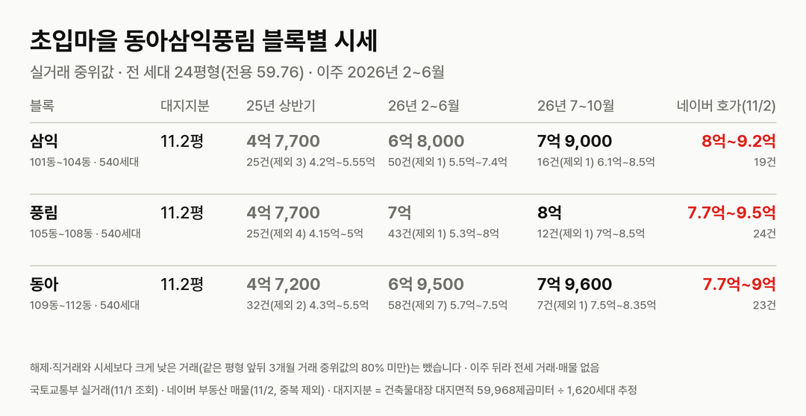
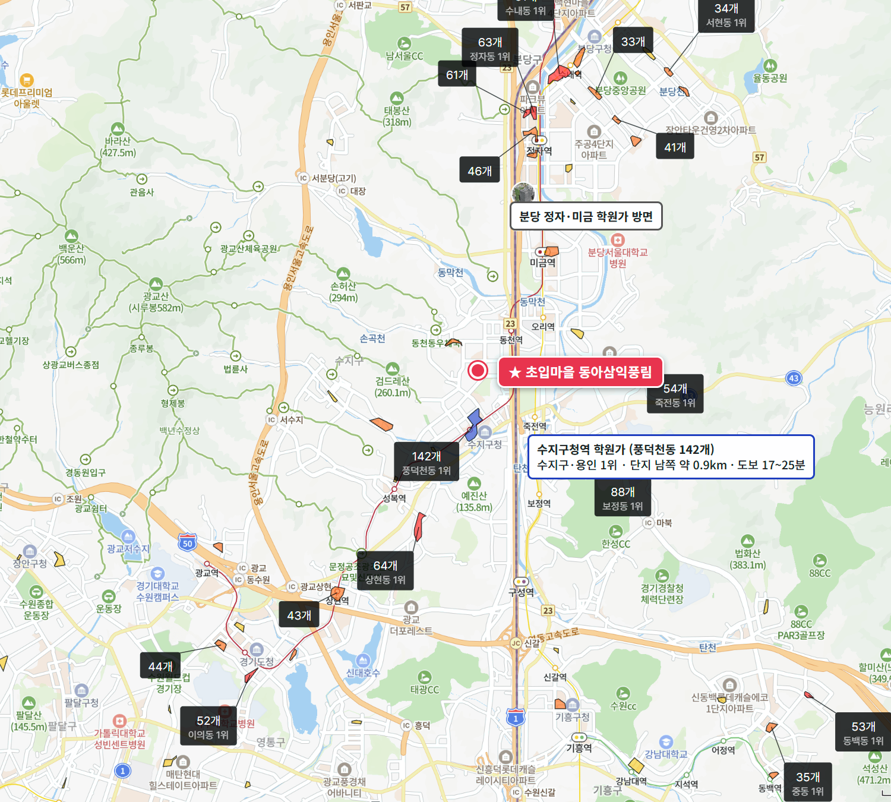

## 핵심 숫자

| 항목 | 값 | 기준 |
|---|---|---|
| 세대수 | 1,620세대(12개 동, 최고 15층) | 1994년 12월 입주, 풍덕천동 664 |
| 평형 | 24평형 1,620세대 | 전 세대 전용 59.76㎡, 복도식 |
| 단지 구성 | 삼익 101~104동, 풍림 105~108동, 동아 109~112동 | 블록마다 540세대 |
| 용적률·건폐율 | 210%·19% | 용인시 사업현황 209.90% |
| 대지면적 | 59,968㎡ | 세대당 평균 37.0㎡(11.2평) |
| 가까운 역 | 신분당선 동천역 도보 18~22분 | 수지구청역 18~26분 |
| 배정초 | 풍덕초 | 단지 남쪽에 붙어 있음, 초품아 |

## 리모델링 사업 단계

초입마을은 재건축이 아니라 리모델링이다. 삼익·풍림·동아 세 단지를 하나의 조합으로 묶어 2019년 조합을 세웠고, 2024년 8월 용인시에서 처음으로 리모델링 사업계획승인을 받았다.

| 항목 | 기존 | 리모델링 뒤(2026-08 변경승인) |
|---|---|---|
| 세대수 | 1,620세대 | 1,715세대(+95, 일반분양) |
| 규모 | 지하 1층~지상 15층, 12개 동 | 지하 3층~지상 20층, 12개 동 |
| 용적률 | 209.90% | 299.78% |
| 사업 방식 | | 수평·별동 증축, 시공 포스코이앤씨 |

**지금은 이주를 끝내고 착공을 앞둔 단계다.** 1,620세대가 4개월 이주 기간 안에 모두 나갔고, 6월부터 석면 해체와 철거 공사가 이어지고 있다. 용인시 리모델링 단지 가운데 이주까지 마친 곳은 이 단지가 처음이다.

| 시점 | 단계 |
|---|---|
| 19.9.16 | 리모델링주택조합 설립인가 |
| 22.8.9 | 용인시 도시계획위원회 심의 |
| 23.6.20 | 용인시 공동(건축·경관)위원회 심의 |
| 24.8.28 | 용인시, 주택건설사업계획 승인(용인 첫 리모델링 승인) |
| 2025-08 | 분담금 확정 총회 가결(보도) |
| 26.2.2 ~ 06-01 | 이주(1,620세대 전원 이주 완료) |
| 26.8.28 | 용인시, 사업계획 변경승인(1,713 → 1,715세대) |
| 26.9.8 | 용인시, 조합 변경인가 공고(조합원 1,626명) |
| 2026-10 | 철거 공사 중, 용인시 건축감리 입찰 |
| 다음 | 착공(연내 목표) → 일반분양 → 입주(2030년 말 목표) |

2025년 8월 분담금 확정 총회 때 보도된 조합원 분담금은 3억 5,000만 원 수준이고, 공사비는 3.3㎡당 715만 원이다. 사업계획승인 당시 배정안은 1,713세대 가운데 1,618세대가 전용 77㎡여서, 지금의 전용 59.76㎡ 조합원 대부분이 전용 77㎡(30평형)로 넓혀 들어간다. 평형별 확정 분담금은 공식 자료로 확인하지 못했다. 후기에 올라온 글에는 같은 평형 배정 1억 8,000만~2억 원, 30평형 배정 3억 3,000만~3억 6,000만 원이라는 비교표가 돈다.

## 블록별 대지지분과 시세

| 블록 | 대지지분(추정) | 2025년 상반기 건수(제외)·범위·중위값 | 2026년 2~6월(이주 기간) | 2026년 7~10월 건수(제외)·범위·중위값 | 네이버 호가 |
|---|---|---|---|---|---|
| 삼익(101~104동, 540세대) | 11.2평 | 25건(3) 4억 2,000만~5억 5,500만, 4억 7,700만 | 50건(1), 6억 8,000만 | 16건(1) 6억 1,000만~8억 5,000만, 7억 9,000만 | 19건, 8억~9억 2,000만 |
| 풍림(105~108동, 540세대) | 11.2평 | 25건(4) 4억 1,500만~5억, 4억 7,700만 | 43건(1), 7억 | 12건(1) 7억~8억 5,000만, 8억 | 24건, 7억 7,000만~9억 5,000만 |
| 동아(109~112동, 540세대) | 11.2평 | 32건(2) 4억 3,000만~5억 5,000만, 4억 7,200만 | 58건(7), 6억 9,500만 | 7건(1) 7억 5,000만~8억 3,500만, 7억 9,600만 | 23건, 7억 7,000만~9억 |

해제·직거래와 시세보다 크게 낮은 거래(같은 평형 앞뒤 3개월 거래 중위값의 80% 미만)는 뺐습니다. 괄호 안은 뺀 건수다. 국토교통부 실거래는 세 블록을 삼익아파트·풍림아파트·동아아파트로 따로 신고한다. 대지지분은 건축물대장 대지면적을 1,620세대로 나눈 추정값이다.

세 블록을 합친 중위값은 2025년 상반기 4억 7,500만 원에서 2026년 7~10월 7억 9,600만 원으로 68% 올랐다. 월 중위값은 2025년 상반기 4억 6,000만~4억 9,800만 원에 머물다가 이주 공고 직후인 12월 5억 4,000만 원, 이주가 시작된 2026년 2월 6억 5,000만 원, 이주가 끝난 6월 7억 3,000만 원, 10월 8억 3,500만 원으로 이주 단계마다 한 칸씩 올라섰다. 매매 건수는 2025년 상반기 82건, 하반기 109건, 2026년 상반기 195건, 7~10월 35건이다. 이주 기간이 손바뀜의 정점이었다.

대지지분 1평당 값은 7,100만 원이다. 이주를 앞둔 [분당 매화마을2단지](/danji/maehwa2-yatap-bundang/) 25평형(8,800만 원)보다 낮다. 분당과 수지의 입지 차이를 감안해도 초입마을은 사업이 한 단계 더 앞서 있으면서 대지지분 대비 값이 싸다.

| 구분 | 값 |
|---|---|
| 네이버 매매 매물 | 66건, 7억 7,000만~9억 5,000만 원, 중위 8억 6,500만 원 |
| 매물 조건 | 대부분 '이주비 대출 2억~3억 원대 승계' |
| 전세·월세 | 거래·매물 모두 없음(이주 완료) |
| 입주 | 2030년 말 목표, 리모델링 뒤 대부분 전용 77㎡ |

호가는 네이버 부동산 매매 매물(2026년 11월 2일 조회, 중복 등록 42건은 하나로 셈) 66건이다. 이주가 끝난 빈집이라 세 낀 매물과 실거주 매물로 나눌 수 없어 한 줄로 셌다. 매물 대부분은 조합원이 받은 이주비 대출을 넘겨받는 조건이라, 매수자가 당장 낼 현금은 호가에서 승계 대출을 뺀 돈이다.

호가 중위 8억 6,500만 원에 보도된 분담금 3억 5,000만 원을 더하면 2030년 말 전용 77㎡ 새 아파트를 약 12억 원에 사는 셈이다. 그 사이 4년 동안 살 수도, 세를 놓을 수도 없다. 수지구는 2025년 10월 20일부터 토지거래허가구역이라 허가를 받아야 사고, 빈집을 사서 2년 실거주 의무를 언제 채우는지가 입주민 후기의 단골 질문이다. 그런데도 6월 이후 62건이 신고됐다. 4년을 기다려 새 아파트로 들어갈 사람이 계속 들어오고 있다.

## 학군과 생활 인프라

| 항목 | 이름 | 거리 |
|---|---|---|
| 배정초 | 풍덕초 | 남쪽 입구 바로 앞, 초품아 |
| 가까운 학원가 | 동천동 학원가(21개) | 정문 도보 11분 |
| 수지 최대 학원가 | 수지구청역 학원가(풍덕천동 142개, 용인 1위) | 도보 17~25분 |
| 백화점 | 신세계백화점 경기점(죽전) | 도보 29~34분 |
| 대형마트 | 이마트 수지점 | 도보 26~34분 |
| 대형 병원 | 분당서울대학교병원 | 약 3.3km, 차량 이동 |
| 공원 | 수지체육공원 | 단지에 붙어 있음, 도보 3~10분 |

용인 최대 학원가인 수지구청역 학원가가 걸어서 20분 안팎이고, 풍덕초가 단지에 붙어 있다. 역까지는 걸어서 20분 가까이 걸려 역세권은 아니다. 입주민 후기에서는 1,620세대가 기간 안에 모두 이주한 조합의 속도와 이웃 리모델링 단지보다 낮은 분담금이 장점으로, 역과의 거리가 단점으로 꼽힌다.

## 용인 입주 물량

{{chart:moveins:용인}}

{{table:moveins:용인}}

용인의 2027년 입주 물량은 {{v:moveins:용인:2027}}로 한 해 적정물량 {{v:need:용인}}의 {{v:share:용인:2027}}다. 적정물량은 2026년 9월 주민등록 인구를 가구당 2.5명으로 나눈 가구 수의 2%로 잡는다. 수지구 매매가는 {{v:streak:용인 수지구}}이고, 주간 시세 흐름은 아래와 같다.

{{chart:weekly:용인 수지구}}

{{table:weekly:용인}}

초입마을 1,620세대가 빠져나간 자리는 2030년 말까지 빈다. 수지에서는 보원이 이어서 이주를 시작했고, 동부·한국도 리모델링 이주를 준비하고 있다. 리모델링으로 늘어나는 세대는 단지마다 수십~백여 세대뿐이라 수지의 새 아파트 공급을 크게 늘리지 못한다. 아공맵은 수지 리모델링 단지의 이주가 이어지는 동안 수지 전세가 받쳐지고, 그 압력이 이주를 마친 단지의 매매가를 끌어올릴 것으로 본다. 이 단지의 다음 변수는 착공 신고와 일반분양 가격이다.

관련 리포트: [경기 시군구 주간·월간 시세](/zone/경기/#weekly-sgg)
