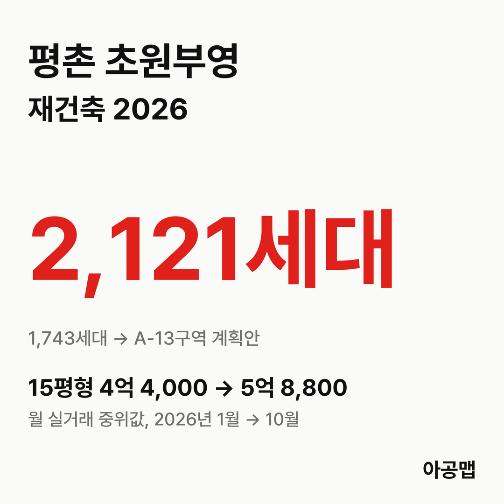
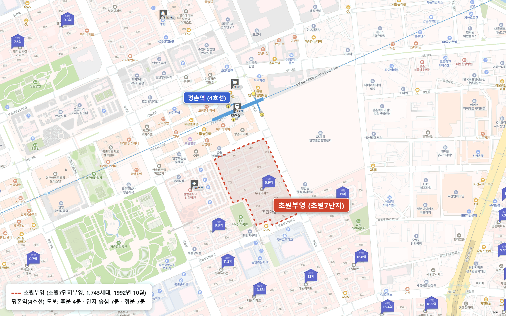
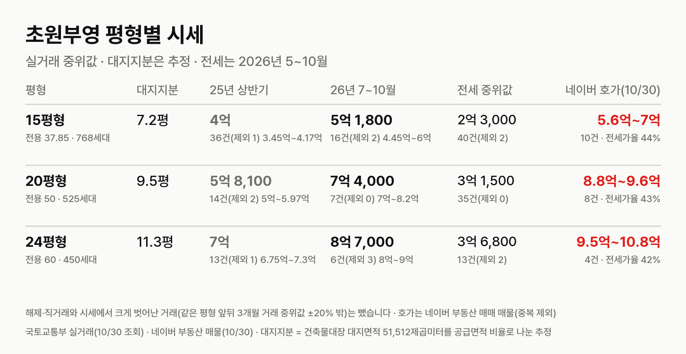
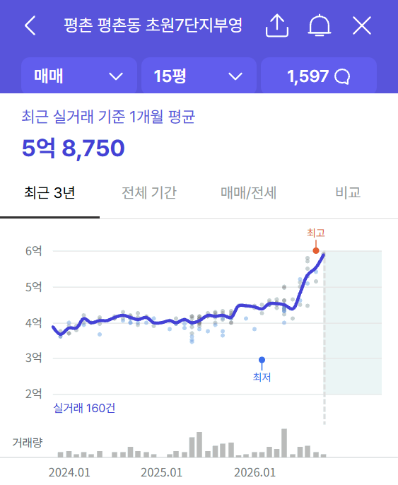
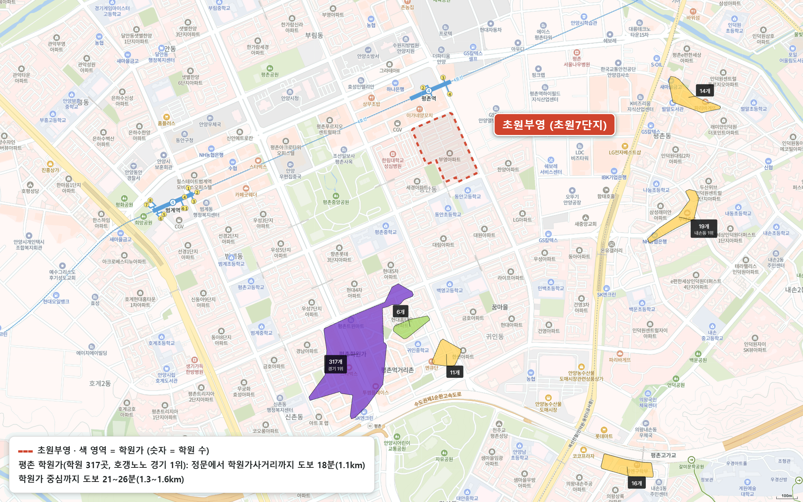

{{chart:moveins:안양}}

## 핵심 숫자

| 항목 | 값 | 기준 |
|---|---|---|
| 세대수 | 1,743세대(13개 동, 최고 15층) | 1992년 10월 입주, 복도식 |
| 평형 | 15평형 768세대, 20평형 525세대, 24평형 450세대 | 전용 37.85·50·60㎡ |
| 용적률·건폐율 | 212%·16% | 건축물대장 용적률 212.49% |
| 대지면적 | 51,512㎡ | 세대당 평균 29.6㎡(8.9평) |
| 세대당 주차대수 | 0.41대 | 지하주차장 없음 |
| 가까운 역 | 4호선 평촌역 도보 4~7분 | 후문 4분, 단지 중심 7분 |
| 배정초 | 동안초 | 정문 도보 3분, 단지 중심 5분 |

## 정비 구역과 사업 단계

초원부영은 평촌 특별정비예정구역 A-13을 혼자 쓰는 단독 구역이다.

| 항목 | 주민 계획안(2026-06 설명회) |
|---|---|
| 세대수 | 1,743세대 → 2,121가구(+378) |
| 용적률 | 기준용적률 330%, 정비용적률 375% 이하 |
| 최고 층수 | 48층 |
| 주차 | 3,222대 |
| 분양 평형 | 59·71·82·98·114·134형 |

| 시점 | 단계 |
|---|---|
| 2026-06-25 | 특별정비계획 입안 제안 주민설명회 |
| 2026-07-31 | 주민대표단, 특별정비계획 결정·구역 지정 주민제안 접수(동의 81%) |
| 2026-08-31 ~ 09-14 | 평촌 6개 구역 특별정비계획(안) 동시 공람 |
| 2026-10 | 안양시의회 의견청취(10-12 정례회 상정, 10-28 본회의) |
| 2026-10 | 신탁 방식 재건축 주민설명회 |
| 다음 | 도시계획위원회 심의 → 연말 특별정비구역 지정 목표 |

**올해 지정은 경합이다.** 평촌에 올해 배정된 7,200호 가운데 샘마을(A-19)이 2,334호를 써 4,866호가 남았고, 여기에 6개 구역 14,102호가 제안했다. 2.9배라서 올해는 2개 구역 정도만 지정될 수 있다는 보도가 나왔다. 물량을 넘으면 기준용적률 반영, 추가 기반시설, 법정 초과 주차대수, 대지 안 공지, 주민동의율 점수로 순위를 정하고, 올해 빠진 구역은 따로 신청하지 않아도 다음 해 물량으로 넘어간다. 1,743호인 A-13은 6개 구역 가운데 두 번째로 작다.

| 구역 | 단지 | 호수 |
|---|---|---|
| A-1 | 관악타운·부영·성원 | 3,386 |
| A-2 | 샛별한양1·2·3 | 2,744 |
| A-4 | 은하수한양5·샛별한양6 | 3,227 |
| A-5 | 한가람한양·삼성·두산 | 2,096 |
| A-9 | 목련두산6·우성7 | 906 |
| A-13 | 초원부영 | 1,743 |

입주민 후기에 올라온 글로는 설명회에서 비례율 약 103%, 예비사업시행자로 대신자산신탁이 소개됐고, 10월에는 대표단이 낸 기준용적률(345%)을 두고 이견이 나왔다. 시의회 의견청취 채택 여부와 도시계획위원회 날짜, 공식 추정분담금은 공개 보도로 확인하지 못해 싣지 않는다.

## 평형별 대지지분과 시세

| 평형 | 대지지분(추정) | 2025년 상반기 건수(제외)·범위·중위값 | 2026년 7~10월 건수(제외)·범위·중위값 | 대지지분 1평당(2026) |
|---|---|---|---|---|
| 15평형(전용 37.85㎡, 768세대) | 7.2평 | 36건(1) 3억 4,500만~4억 1,700만, 4억 | 16건(2) 4억 4,500만~6억, 5억 1,800만 | 7,200만 |
| 20평형(전용 50㎡, 525세대) | 9.5평 | 14건(2) 5억~5억 9,700만, 5억 8,100만 | 7건(0) 7억~8억 2,000만, 7억 4,000만 | 7,800만 |
| 24평형(전용 60㎡, 450세대) | 11.3평 | 13건(1) 6억 7,500만~7억 3,000만, 7억 | 6건(3) 8억~9억, 8억 7,000만 | 7,700만 |

해제·직거래와 시세에서 크게 벗어난 거래(같은 평형 앞뒤 3개월 거래 중위값 ±20% 밖)는 뺐습니다. 괄호 안은 뺀 건수다. 대지지분은 건축물대장 대지면적을 평형별 공급면적 비율로 나눈 추정값이다.

2025년 상반기 대비 2026년 7~10월 중위값은 15평형 29%, 20평형 27%, 24평형 24% 올랐다. 15평형 월 중위값은 1~6월 4억 3,700만~4억 5,500만 원에 머물다가 주민제안 접수 뒤 7월 4억 8,000만 원, 8월 5억 3,000만 원, 10월 5억 8,800만 원으로 올라섰다(10월은 2건, 신고 기한 전). 매매 건수는 2025년 상반기 63건, 하반기 44건, 2026년 상반기 76건, 7~10월 29건이다.

| 평형 | 세 낀 매물 호가 | 실거주 매물 호가 | 구분 못 한 매물 | 전세 실거래 건수(제외)·중위값(2026년 5~10월) | 전세가율 |
|---|---|---|---|---|---|
| 15평형 | 4건, 5억 6,000만~5억 9,000만 | 1건, 6억 1,000만 | 5건, 6억~7억 | 40건(2), 2억 3,000만 | 44% |
| 20평형 | 3건, 8억 8,000만~9억 | 5건, 9억~9억 6,000만 | 없음 | 35건(0), 3억 1,500만 | 43% |
| 24평형 | 1건, 10억 | 1건, 10억 8,000만 | 2건, 9억 5,000만~10억 | 13건(2), 3억 6,800만 | 42% |

호가는 네이버 부동산 매매 매물 22건(2026-10-30 조회, 중복 등록 16건은 하나로 셈)이고, 세 낀 매물(전세를 안고 사는 매물)과 실거주 매물(즉시·협의 입주)로 나눴다. 세 낀 매물에 그 집 전세 보증금이 적힌 매물이 없어 매물 기준 갭은 내지 못했다. 전세가율은 2026년 7~10월 매매 중위값 대비 전세 중위값이다.

호가가 실거래보다 한참 위에 있다. 20평형 실거주 매물은 9억~9억 6,000만 원인데 7~10월 실거래 중위값은 7억 4,000만 원이다. 20평형 매물이 8건뿐이라 매물 잠김에 가깝다. 같은 평형에서는 세 낀 매물이 실거주 매물보다 싸다. 동안구는 2025년 10월 20일부터 토지거래허가구역이라 허가를 받아 사면 2년 동안 실거주해야 하고, 세 낀 매물은 세입자 계약이 끝나야 들어갈 수 있다. 전세가율이 42~44%로 낮아 매매가와 전세가의 거리도 멀다.

## 학군과 생활 인프라

| 항목 | 이름 | 거리 |
|---|---|---|
| 배정초 | 동안초 | 정문 도보 3분 |
| 학원가 | 평촌 학원가(317개, 경기 최대) | 학원가사거리까지 도보 18분, 중심까지 21~26분 |
| 대형마트 | 이마트 평촌점 | 도보 6~10분 |
| 대형 병원 | 한림대학교성심병원 | 도보 6~8분 |
| 공원 | 평촌중앙공원 | 도보 7~11분 |
| 백화점 | 롯데백화점 평촌점(범계역) | 도보 24~28분 |

평촌역 역세권에 대형마트·대형 병원·중앙공원이 모두 걸어서 10분 안이고, 평촌 학원가가 같은 생활권이다. 입주민 후기에서는 이 입지와 평촌 학군이 장점으로, 15평형이 절반에 가까워 대지지분이 작고 분담금 부담이 크다는 점과 지하주차장이 없는 주차가 단점으로 꼽힌다.

## 안양 입주 물량

{{table:moveins:안양}}

안양의 2027년 입주 물량은 {{v:moveins:안양:2027}}로 한 해 적정 입주량 {{v:need:안양}}의 {{v:share:안양:2027}}다. 적정 입주량은 2026년 9월 주민등록 인구를 가구당 2.5명으로 나눈 가구 수의 2%로 잡는다. 동안구 매매가는 {{v:streak:안양 동안구}}이고, 주간 시세 흐름은 아래와 같다.

{{chart:weekly:안양 동안구}}

{{table:weekly:안양}}

평촌은 선도지구 샘마을에 이어 2차 6개 구역 14,102호가 차례로 이주를 기다린다. 해마다 지정 물량이 정해져 있어 이주가 한 해에 몰리지는 않지만, 몇 해에 걸쳐 수천 가구씩 이주 수요가 이어진다. 아공맵은 평촌 전세 수요가 정비 순번을 따라 꾸준히 받쳐질 것으로 본다. 이 단지의 다음 변수는 도시계획위원회 경합 순위, 그리고 15평형이 절반에 가까운 구성에서 나올 추정분담금이다.

관련 리포트: [경기 시군구 주간·월간 시세](/zone/경기/#weekly-sgg)
