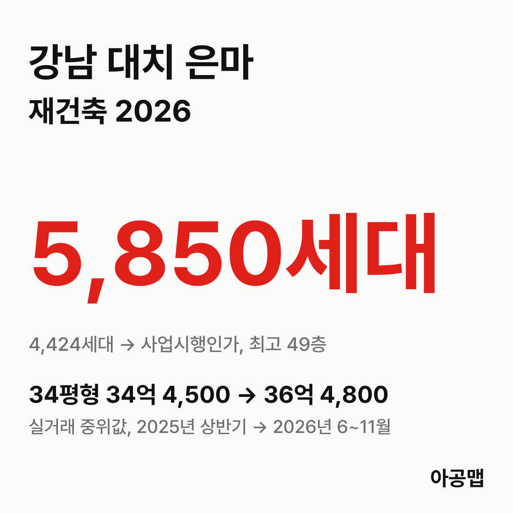
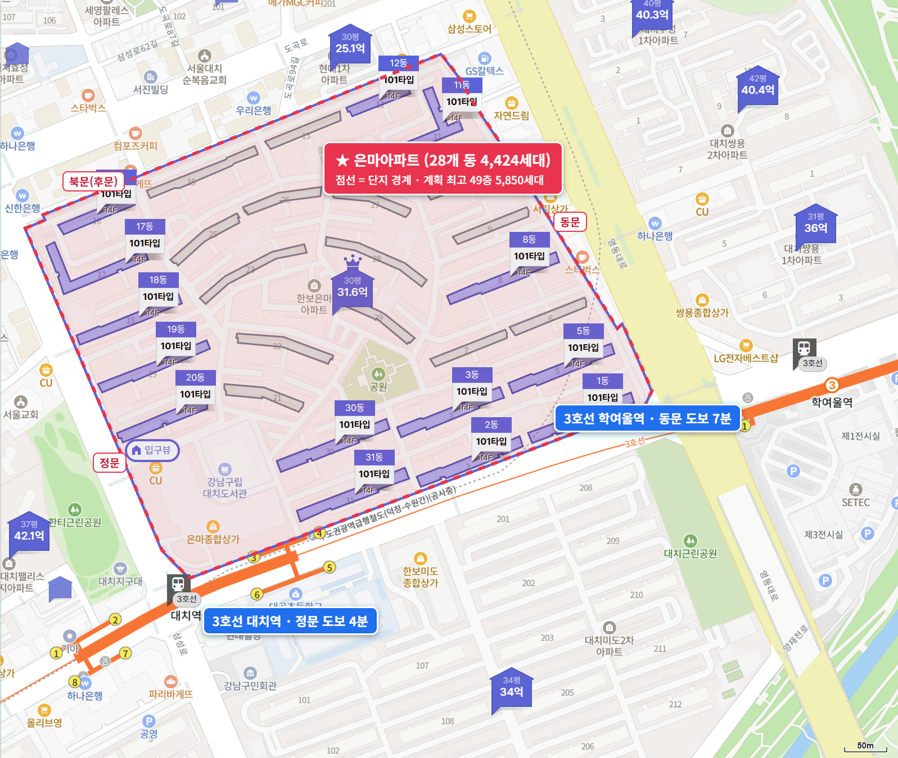
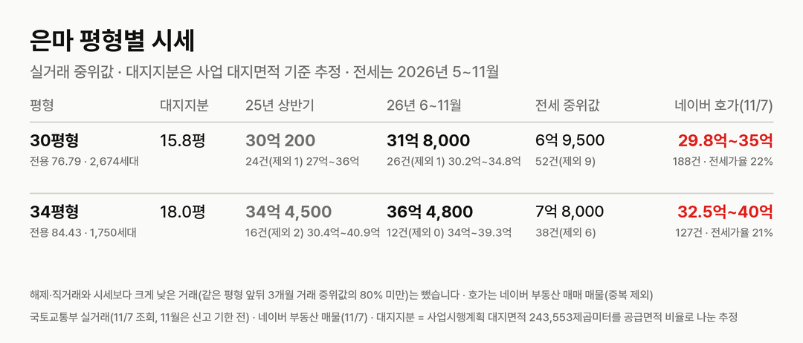
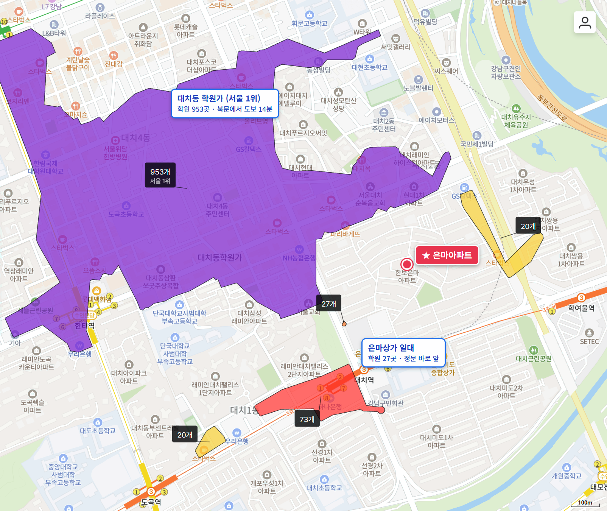

## 핵심 숫자

| 항목 | 값 | 기준 |
|---|---|---|
| 세대수 | 4,424세대(28개 동, 14층) | 1979년 8월 사용승인, 대치동 316 |
| 평형 | 30평형 2,674, 34평형 1,750세대 | 전용 76.79·84.43㎡ |
| 용적률·건폐율 | 204%·20% | |
| 사업 대지면적 | 243,553㎡ | 세대당 평균 55.1㎡(16.7평) |
| 가까운 역 | 3호선 대치역 도보 4~10분 | 학여울역 동문 도보 7분 |
| 배정초 | 서울대곡초 | 정문 도보 7분 |

## 사업 단계

은마는 2023년 2월 정비구역 지정, 9월 조합설립인가를 거쳐 2026년 7월 2일 사업시행계획인가를 받았다. 조합이 5월 22일 신청한 뒤 강남구가 법정 처리기한보다 33일 앞당겨 인가했다.

| 항목 | 사업시행계획(2026-07 인가) |
|---|---|
| 세대수 | 4,424세대 → 5,850세대(+1,426, 공공임대 909·공공분양 195 포함) |
| 규모 | 지하 6층~지상 49층, 29개 동 |
| 용적률 | 331.52%(고시문 기준) |
| 시공사 | 삼성물산·GS건설(2002년 선정, 본계약 협의 중) |

**지금은 조합원 분양신청을 마치고 관리처분을 준비하는 단계다.** 9월 23일부터 10월 30일까지 1차 분양신청을 받았고, 84㎡ 배정 1,354세대에 1순위 신청이 1,885명 몰렸다고 보도됐다. 조합은 대안설계 뒤 2차 분양신청을 거쳐 관리처분계획 총회를 열 계획이다.

| 시점 | 단계 |
|---|---|
| 23.2.16 | 정비구역 지정 |
| 23.9.26 | 조합설립인가 |
| 26.7.2 | 강남구, 사업시행계획인가 |
| 26.9.23 ~ 10.30 | 조합원 1차 분양신청 |
| 다음 | 관리처분계획 총회·인가 → 이주(조합 목표 2027년 상반기) → 착공(2028년 목표) |

비용 쪽 숫자는 무거워졌다. 강남구 고시 기준 추정 비례율은 2023년 100.47%에서 2026년 4월 83.14%로 내려왔고, 9월 분양신청 안내 기준 추정 분담금은 84㎡ 소유자가 같은 84㎡를 받으면 약 4억 3,000만 원으로 보도됐다(2025년 9월 약 1억 8,000만 원). 11월에는 재건축초과이익 부담금 예정액이 1인당 평균 약 4억 6,300만 원으로 통지됐다는 보도가 나왔다. 모두 공사비와 분양가, 감정평가에 따라 바뀌는 추정치다.

## 평형별 대지지분과 시세

| 평형 | 대지지분(추정) | 2025년 상반기 건수(제외)·범위·중위값 | 2026년 6~11월 건수(제외)·범위·중위값 | 대지지분 1평당(2026) |
|---|---|---|---|---|
| 30평형(전용 76.79㎡, 2,674세대) | 15.8평 | 24건(1) 27억~36억, 30억 200만 | 26건(1) 30억 2,000만~34억 8,000만, 31억 8,000만 | 2억 100만 |
| 34평형(전용 84.43㎡, 1,750세대) | 18.0평 | 16건(2) 30억 4,000만~40억 9,000만, 34억 4,500만 | 12건(0) 34억~39억 3,000만, 36억 4,800만 | 2억 300만 |

해제·직거래와 시세보다 크게 낮은 거래(같은 평형 앞뒤 3개월 거래 중위값의 80% 미만)는 뺐습니다. 괄호 안은 뺀 건수다. 11월은 신고 기한 전이다. 대지지분은 건축물대장에 대지면적이 비어 있어 사업시행계획 대지면적을 평형별 공급면적 비율로 나눈 추정값이다.

은마는 2025년 상반기보다는 6% 높지만, 1년 전(2025년 6~11월)보다는 30평형 12%, 34평형 11% 낮다. 30평형 월 중위값은 2025년 11월 37억 9,250만 원이 가장 높았고, 2026년 10월 31억 5,250만 원으로 17% 내려왔다. 34평형도 2025년 10월 42억 9,500만 원에서 2026년 10월 34억 3,000만 원으로 20% 낮아졌다. 사업시행인가와 분양신청이 이어진 1년 동안 값은 고점에서 내려왔다. 매매 건수는 2025년 상반기 40건, 하반기 20건, 2026년 상반기 17건, 6~11월 34건으로, 최근 들어 다시 늘었다.

서울 외곽 세 단지와 견주면 같은 1년에 방향이 갈렸다. [구로주공](/danji/guro-jugong/)은 34~43%, [노원 상계주공6단지](/danji/sanggye6-nowon/)는 23%, [도봉 방학신동아1단지](/danji/banghak1-dobong/)는 3~12% 올랐고, 은마는 11~12% 내려왔다. 사업 단계는 은마가 네 단지 가운데 가장 앞서 있다.

서울의 앞으로 3년 입주 물량은 적정물량의 {{v:share3:서울}}다. 강남 3구(강남·서초·송파)가 먼저 오르고 쉬는 동안 서울 외곽(노원·도봉·강북·금천·관악·구로)이 따라 오르는 흐름이 2019년과 2023년 이후 두 번 나타났고, 11월 2일 조사 기준 강남 3구는 최근 12주 -2.7%로 쉬고 서울 외곽은 +4.0%로 오르는 중이다. 강남구 주간 지수는 최근 4주(11월 2일 조사까지) -1.4%다. 은마는 강남 3구가 쉬는 동안 값이 내려온 곳이다. 제 판단으로는 서울 3년 입주가 적정물량의 3분의 1에 머무는 한 방향은 위이고, 서울 외곽이 따라 오르는 흐름이 이어진 다음에는 다시 강남 3구 차례가 올 수 있다.

| 평형 | 세 낀 매물 호가 | 세 낀 매물 갭(그 집 전세 보증금 기준) | 실거주 매물 호가 | 전세 실거래 건수(제외)·중위값(2026년 5~11월) | 전세가율 |
|---|---|---|---|---|---|
| 30평형 | 10건, 29억 8,000만~34억 | 2건, 22억 1,000만~22억 5,000만 | 49건, 30억~35억 | 52건(9), 6억 9,500만 | 22% |
| 34평형 | 10건, 32억 7,900만~35억 7,000만 | 1건, 27억 5,000만 | 34건, 32억 9,000만~38억 | 38건(6), 7억 8,000만 | 21% |

호가는 네이버 부동산 매매 매물(2026년 11월 7일 조회, 중복 등록 260건은 하나로 셈) 315건이고, 세 낀 매물(전세를 안고 사는 매물)과 실거주 매물(즉시·협의 입주)로 나눴다. 어느 쪽인지 적혀 있지 않은 매물이 212건으로 가장 많아 표에서 뺐다. 갭은 세 낀 매물 호가에서 그 집 전세 보증금을 뺀 값이고, 보증금이 적힌 매물만 셌다(보증부 월세 매물은 뺐다). 전세 실거래는 시세보다 크게 낮은 거래를 같은 기준으로 뺐다. 전세가율은 2026년 6~11월 매매 중위값 대비 전세 중위값이다.

매물이 300건을 넘고 30평형 호가가 30억~35억 원에 몰려 6~11월 실거래 중위값 31억 8,000만 원과 붙어 있다. 전세가율이 21~22%로 이 연재에서 가장 낮아 갭이 20억 원을 넘는다. 강남구는 서울 전역과 함께 2025년 10월 20일부터 토지거래허가구역이라 허가를 받아 사면 2년 동안 실거주해야 하고, 세 낀 매물은 세입자 계약이 끝나야 들어갈 수 있다. 이주가 2027년으로 잡혀 있어 지금 사면 실거주 기간과 이주 시점을 함께 따져야 한다.

## 학군과 생활 인프라

| 항목 | 이름 | 거리 |
|---|---|---|
| 배정초 | 서울대곡초(일부 대현초) | 정문 도보 7분 |
| 가까운 학원가 | 은마상가 일대(27개), 대치역 남쪽(73개) | 도보 0~7분 |
| 대치 학원가 | 대치동 학원가(953개, 서울 1위) | 도보 14~19분 |
| 백화점 | 롯데백화점 강남점, 현대백화점 무역센터점 | 도보 22~31분 |
| 대형 병원 | 강남세브란스병원, 삼성서울병원 | 도보 38~51분 |
| 공원 | 한티근린공원, 양재천 | 도보 8분, 25분 |

서울 1위 대치동 학원가가 걸어서 15분 안팎이고, 대치역이 정문에서 4분이다. 입주민 후기에서는 입지·학군·재건축 확정이 장점으로, 노후와 안전 문제, 분담금과 재건축초과이익 부담금, 공공임대 비중이 걱정거리로 꼽힌다.

## 서울 입주 물량

{{chart:moveins:서울:2027}}

서울의 2027년 입주 물량은 {{v:moveins:서울:2027}}로 한 해 적정물량의 {{v:share:서울:2027}}다. 앞으로 3년을 합쳐도 적정물량의 {{v:share3:서울}}에 그친다. 서울 전체로는 {{v:supply:서울}}이다. 강남구 매매가는 {{v:streak:강남구}}이고, 주간 시세 흐름은 아래와 같다.

{{chart:weekly:서울 강남구}}

{{table:weekly:서울}}

은마가 2027년 이주를 시작하면 대치동에서만 4,424세대가 한꺼번에 전셋집을 찾아 나선다. 늘어나는 세대는 1,426세대이고 입주는 2030년대다. 서울은 앞으로 3년 입주가 적정물량의 {{v:share3:서울}}에 머문다. 아공맵은 이 부족이 강남 전세를 받치고, 쉬는 구간이 끝나면 사업이 가장 앞선 은마 같은 강남 3구 재건축부터 다시 값이 실릴 것으로 본다. 이 단지의 다음 변수는 관리처분계획 총회와 확정 분담금, 재건축초과이익 부담금 확정이다.

## 고른 기준

- 서울의 앞으로 3년 입주 합계 적정물량 대비 %는 사이트 모델의 '앞으로 3년'(앞으로 12분기 지어질 물량 ÷ 분기 적정물량 × 12)이다. 도시 글의 3년 합계(입주 예정 목록 기준)와 분자의 출처가 다르다.
- 최근 1년 변화는 2025년 6~11월과 2026년 6~11월 실거래 중위값을 견준 값이고, 고점 대비는 월 중위값 기준이다. 강남구 최근 4주는 한국부동산원 주간 변동률 4주를 곱해 셌다. 강남 3구·서울 외곽 12주 값은 데이터 세션 계산이다.

관련 리포트: [서울 시군구 주간·월간 시세](/zone/서울/#weekly-sgg)
