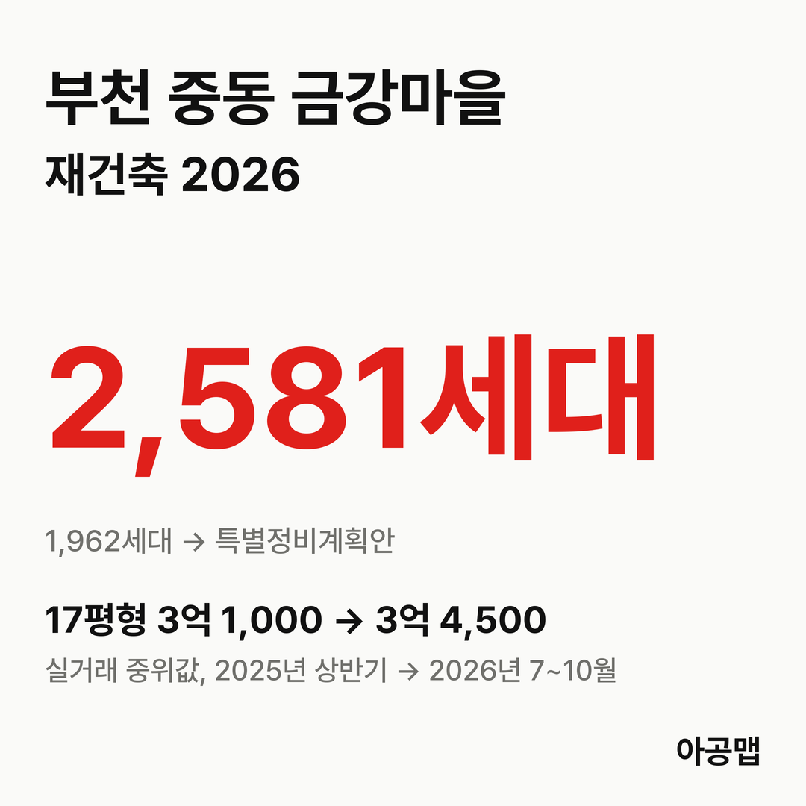
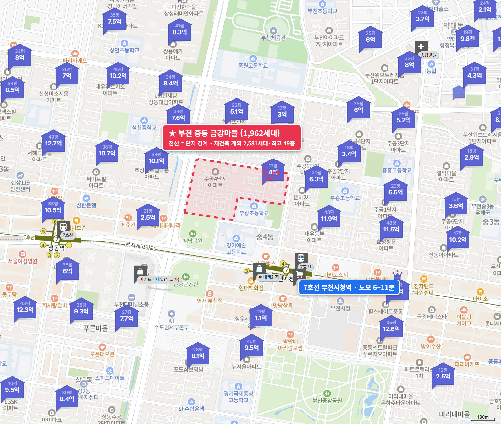
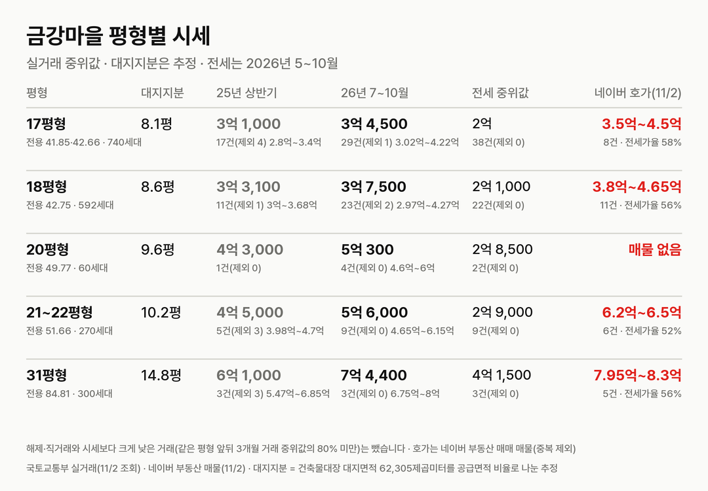
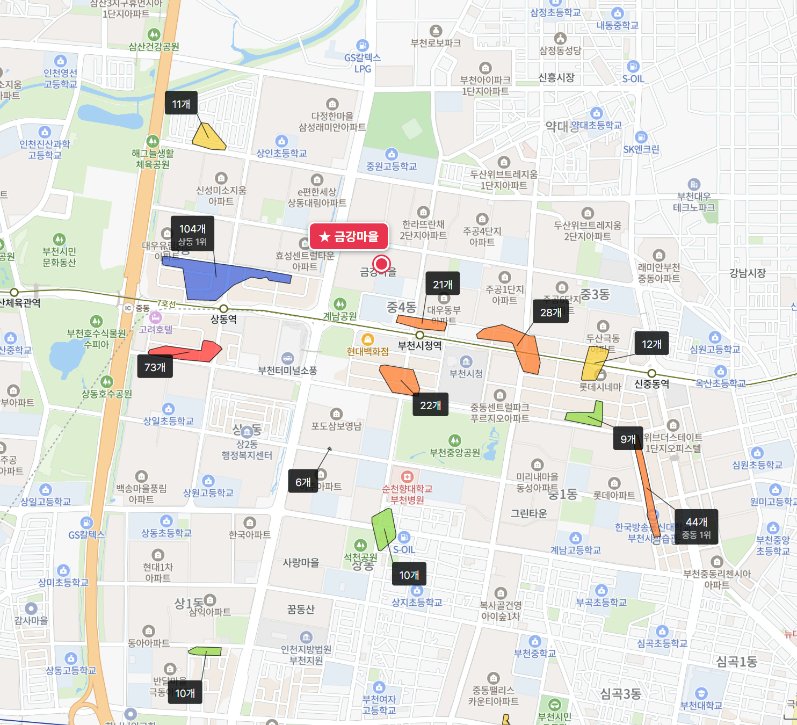

## 핵심 숫자

| 항목 | 값 | 기준 |
|---|---|---|
| 세대수 | 1,962세대(19개 동, 최고 25층) | 1994년 5월 입주, 중동 1029·1030 |
| 평형 | 17평형 740, 18평형 592, 20평형 60, 21~22평형 270, 31평형 300세대 | 소형 위주, 31평형만 계단식 |
| 용적률·건폐율 | 1029번지 184%, 1030번지 220% | 건축물대장 |
| 대지면적 | 62,305㎡ | 세대당 평균 31.8㎡(9.6평) |
| 세대당 주차대수 | 0.46대 | |
| 가까운 역 | 7호선 부천시청역 도보 6~11분 | 상동역 12~17분 |
| 배정초 | 부광초 | 단지 남쪽에 붙어 있음, 초품아 |

## 정비 구역과 계획안

금강마을 구역은 중동 1030번지 일원 84,458㎡로, 1029번지(743세대)와 1030번지(1,219세대) 두 단지를 묶은 통합 재건축이다.

| 항목 | 특별정비계획(안)(2026-10 공람) |
|---|---|
| 세대수 | 1,962세대 → 2,581세대(+619) |
| 규모 | 최고 49층(160m 이하) |
| 용적률 | 정비용적률 350% 이하 |
| 사업 방식 | 신탁 방식(사업시행예정자 우리자산신탁) |
| 존치 | 부광초, 금강어린이공원 |

**지금은 지정 제안 수용 뒤 공람을 마친 단계다.** 부천시가 제안을 받아들이고 계획안을 공람한 것이고, 특별정비구역 지정은 시의회 의견청취와 노후계획도시·경관 공동위원회 심의를 거쳐 나온다.

| 시점 | 단계 |
|---|---|
| 26.2.10 | 부천시, 중동 특별정비구역 지정 추진계획 공고(주민제안 방식, 지정 물량 22,200호 이내) |
| 26.6.15 | 재건축 준비위원회·우리자산신탁 업무협약 |
| 2026-08 | 우리자산신탁 예비사업시행자 선정 |
| 26.9.3 ~ 09-15 | 주민설명회, 지정 제안 동의서 접수 |
| 26.9.18 | 특별정비구역 지정 제안 |
| 26.9.30 | 부천시, 제안 수용 통보(후기에 올라온 부천시 공문) |
| 2026-10 ~ 10-20 | 특별정비계획(안) 주민공람 |
| 다음 | 11월 시의회 의견청취 → 12월 위원회 심의 → 구역 지정 |

공람 자료를 요약한 보도로는 추정 비례율이 105.95%다. 같은 시기 공람한 중동 5개 구역의 추정 비례율은 중흥 107.29%, 금강 105.95%, 사랑·꿈동산 104.4%, 반달A 103.1%, [포도마을](/danji/podo-sambo-yeongnam/) 101.77%다. 다섯 구역 모두 용적률 350%를 받았으니, 비례율 차이는 종전 세대수와 대지 조건에서 나온다. 9월 설명회 보도에 나온 추정 분담금 예시는 31평형(전용 84.81㎡)이 새 84㎡를 받으면 약 3억 7,600만 원, 21~22평형(전용 51.66㎡)이 새 84㎡를 받으면 약 5억 5,100만 원이다. 공식 고시 숫자가 아니라 사업 초기 추정치다.

## 평형별 대지지분과 시세

| 평형 | 대지지분(추정) | 2025년 상반기 건수(제외)·범위·중위값 | 2026년 7~10월 건수(제외)·범위·중위값 | 대지지분 1평당(2026) |
|---|---|---|---|---|
| 17평형(전용 41.85·42.66㎡, 740세대) | 8.1평 | 17건(4) 2억 8,000만~3억 4,000만, 3억 1,000만 | 29건(1) 3억 300만~4억 2,200만, 3억 4,500만 | 4,300만 |
| 18평형(전용 42.75㎡, 592세대) | 8.6평 | 11건(1) 3억~3억 6,800만, 3억 3,100만 | 23건(2) 2억 9,700만~4억 2,700만, 3억 7,500만 | 4,400만 |
| 20평형(전용 49.77㎡, 60세대) | 9.6평 | 1건(0) 4억 3,000만 | 4건(0) 4억 6,000만~6억, 5억 300만 | 5,200만 |
| 21~22평형(전용 51.66㎡, 270세대) | 10.2평 | 5건(3) 3억 9,800만~4억 7,000만, 4억 5,000만 | 9건(0) 4억 6,500만~6억 1,500만, 5억 6,000만 | 5,500만 |
| 31평형(전용 84.81㎡, 300세대) | 14.8평 | 3건(3) 5억 4,700만~6억 8,500만, 6억 1,000만 | 3건(0) 6억 7,500만~8억, 7억 4,400만 | 5,000만 |

해제·직거래와 시세보다 크게 낮은 거래(같은 평형 앞뒤 3개월 거래 중위값의 80% 미만)는 뺐습니다. 괄호 안은 뺀 건수다. 국토교통부 실거래에는 두 번지가 모두 '금강마을(주공)'(중동 1029)로 올라 있어 합쳐 셌다. 대지지분은 두 번지 건축물대장 대지면적을 합쳐 평형별 공급면적 비율로 나눈 추정값이다. 21평형과 22평형은 전용면적이 같아 실거래에서 나뉘지 않으므로 한 줄로 묶었다.

2025년 상반기 대비 2026년 7~10월 중위값은 17평형 11%, 18평형 13%, 21~22평형 24%, 31평형 22% 올랐다. 오름은 거의 다 최근 두 달에 몰렸다. 17평형 월 중위값은 2025년 1월부터 2026년 8월까지 2억 9,400만~3억 3,800만 원 사이를 오갔는데, 지정 제안이 들어간 9월 3억 7,500만 원, 공람이 열린 10월 3억 9,500만 원으로 뛰었다(10월은 4건, 신고 기한 전). 매매 건수는 2025년 상반기 37건, 하반기 60건, 2026년 상반기 84건, 7~10월 68건이다.

대지지분 1평당 값은 4,300만~5,500만 원으로 같은 중동 포도마을(5,600만~7,000만 원)보다 낮다. 포도마을 국평(14.3평)은 7~10월 중위값 7억 9,900만 원, 대지지분 1평당 5,600만 원이다. 금강마을 31평형(14.8평)은 대지지분이 더 크고 추정 비례율도 4%포인트 높은데 값은 5,500만 원 낮은 7억 4,400만 원이다.

| 평형 | 세 낀 매물 호가 | 세 낀 매물 갭(그 집 전세 보증금 기준) | 실거주 매물 호가 | 전세 실거래 건수·중위값(2026년 5~10월) | 전세가율 |
|---|---|---|---|---|---|
| 17평형 | 4건, 3억 9,000만~4억 5,000만 | 3건, 2억 1,200만~2억 9,300만 | 3건, 3억 9,000만~4억 2,000만 | 38건, 2억 | 58% |
| 18평형 | 8건, 4억~4억 6,500만 | 3건, 2억 2,700만~2억 7,000만 | 3건, 3억 8,000만~4억 5,000만 | 22건, 2억 1,000만 | 56% |
| 20평형 | 없음 | - | 없음 | 2건, 2억 8,500만 | 57% |
| 21~22평형 | 2건, 6억 2,000만~6억 3,000만 | 1건, 3억 6,000만 | 4건, 6억 2,000만~6억 5,000만 | 9건, 2억 9,000만 | 52% |
| 31평형 | 1건, 8억 3,000만 | 1건, 6억 | 4건, 7억 9,500만~8억 3,000만 | 3건, 4억 1,500만 | 56% |

호가는 네이버 부동산 매매 매물(2026년 11월 2일 조회, 중복 등록 25건은 하나로 셈) 30건이고, 세 낀 매물(전세를 안고 사는 매물)과 실거주 매물(즉시·협의 입주)로 나눴다. 17평형 1건(3억 5,000만 원)은 어느 쪽인지 적혀 있지 않았다. 갭은 세 낀 매물 호가에서 그 집 전세 보증금을 뺀 값이고, 보증금이 적힌 매물만 셌다(보증부 월세 매물은 뺐다). 전세가율은 2026년 7~10월 매매 중위값 대비 전세 중위값이다.

17평형 호가는 3억 9,000만~4억 5,000만 원으로 7~10월 중위값 3억 4,500만 원보다 위에 있지만, 10월 실거래 중위값 3억 9,500만 원과는 붙어 있다. 실거래가 공람 뒤 호가를 따라잡은 셈이다. 전세가율이 56~58%라 17평형은 갭 2억 원대로 살 수 있다. 부천은 토지거래허가구역이 아니어서 세 낀 매수가 가능하다.

## 학군과 생활 인프라

| 항목 | 이름 | 거리 |
|---|---|---|
| 배정초 | 부광초 | 단지에 붙어 있음, 초품아 |
| 가까운 학원가 | 부천시청역 북쪽 중동 학원가(21개) | 도보 6~10분 |
| 부천 최대 학원가 | 상동 학원가(104개, 원미구 1위) | 도보 15~19분 |
| 백화점·쇼핑몰 | 현대백화점 중동점, 뉴코아아울렛 부천점 | 도보 7~12분 |
| 대형마트 | 이마트 중동점 | 도보 8~13분 |
| 대형 병원 | 순천향대학교 부천병원 | 도보 18~23분 |
| 공원 | 금강어린이공원, 부천중앙공원 | 도보 2~6분, 18~24분 |

부천시청역과 현대백화점·이마트·뉴코아가 걸어서 10분 안팎이고, 부천 최대인 상동 학원가도 걸어서 15~19분이다. 입주민 후기에서는 이 생활 인프라와 재건축 속도가 장점으로, 구축 누수와 17평형에서 20평대로 갈아타기 어려운 가격 차가 걱정거리로 꼽힌다.

## 부천 입주 물량

{{chart:moveins:부천}}

{{table:moveins:부천}}

부천의 2027년 입주 물량은 {{v:moveins:부천:2027}}로 한 해 적정물량 {{v:need:부천}}의 {{v:share:부천:2027}}다. 적정물량은 2026년 9월 주민등록 인구를 가구당 2.5명으로 나눈 가구 수의 2%로 잡는다. 원미구 매매가는 {{v:streak:부천 원미구}}이고, 주간 시세 흐름은 아래와 같다.

{{chart:weekly:부천 원미구}}

{{table:weekly:부천}}

중동 5개 구역이 한꺼번에 공람을 마쳤고, 기존 세대만 1만 1,700여 세대다. 계획안 목표대로라면 2030년 무렵 이 구역들의 이주가 몰린다. 아공맵은 중동 이주가 시작되는 시기에 부천 전세 수요가 크게 늘고, 그 압력이 아직 대지지분 대비 값이 싼 금강마을 같은 소형 위주 단지의 매매가를 끌어올릴 것으로 본다. 이 단지의 다음 변수는 11월 시의회 의견청취와 12월 위원회 심의, 그리고 지정 뒤 나올 확정 비례율이다.

관련 리포트: [경기 시군구 주간·월간 시세](/zone/경기/#weekly-sgg)
