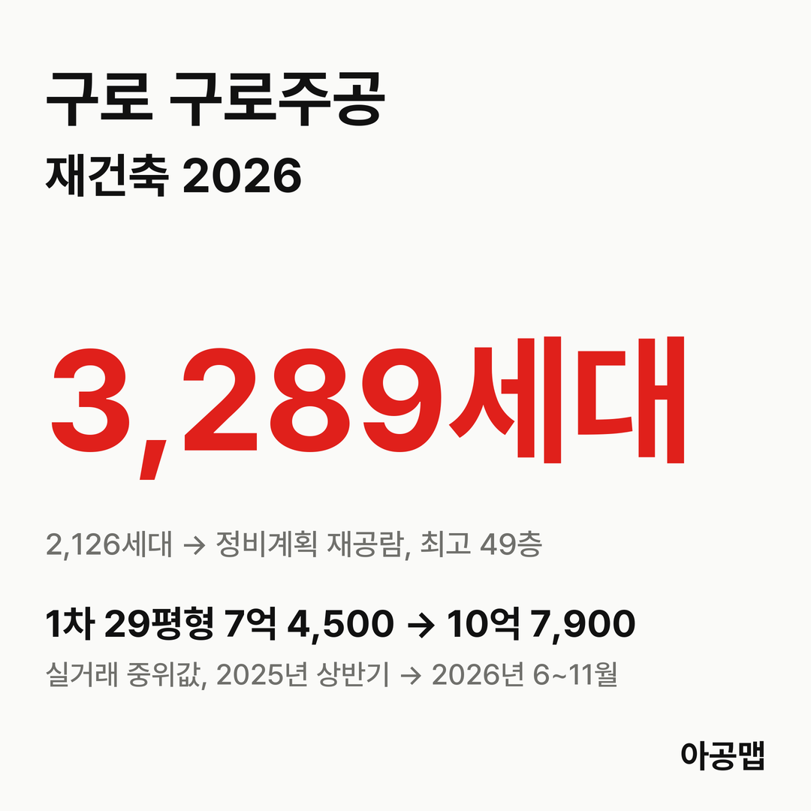
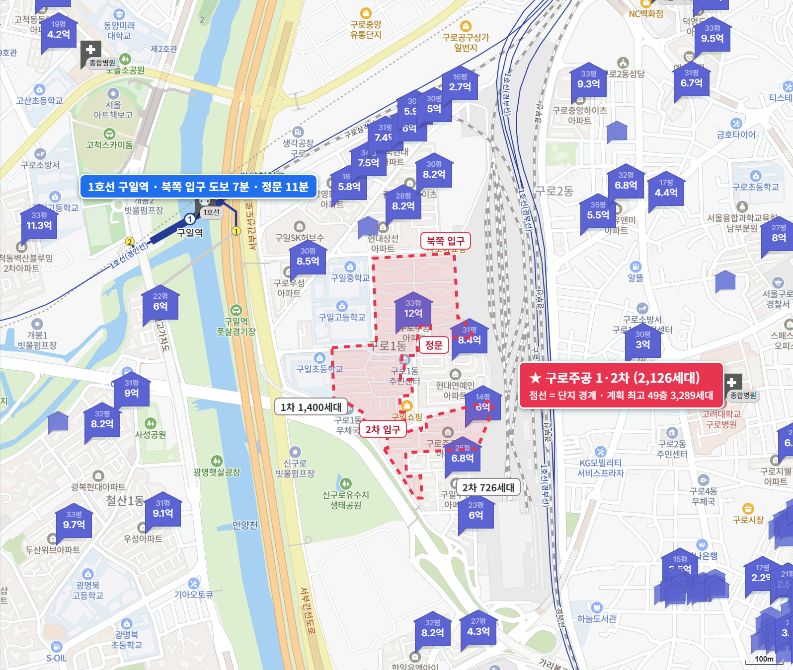
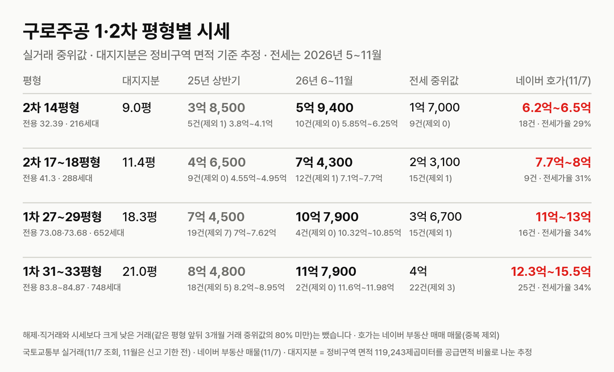
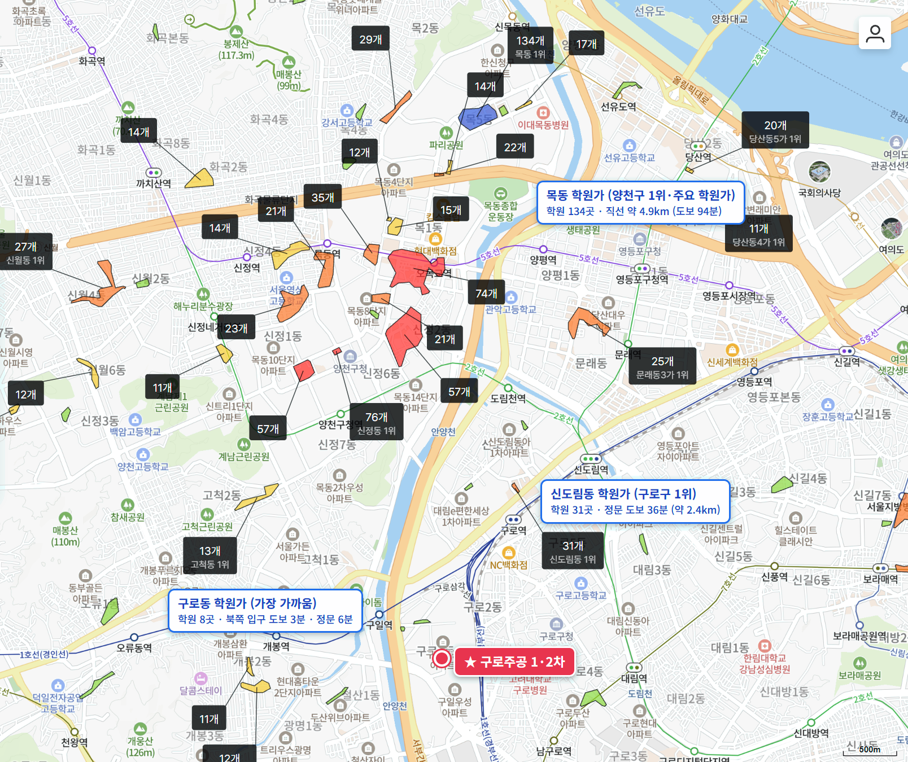

## 핵심 숫자

| 항목 | 값 | 기준 |
|---|---|---|
| 세대수 | 2,126세대(1차 1,400·2차 726, 19개 동, 최고 15층) | 1차 1986년 6월·2차 1987년 7월 사용승인, 구로동 685-222·223 |
| 평형 | 1차 27~33평형, 2차 14~26평형 | 1차는 모두 전용 73~85㎡, 2차는 소형 위주 |
| 용적률·건폐율 | 1차 153%·11%, 2차 156%·13% | |
| 정비구역 면적 | 119,243㎡ | 세대당 평균 56.1㎡(17.0평) |
| 가까운 역 | 1호선 구일역 도보 7~14분 | 가산디지털단지역 25~32분 |
| 배정초 | 서울구일초 | 1차 단지 안, 도보 3~4분 |

## 정비 구역과 계획안

구로주공 구역은 구로동 685-222 일대 119,243.2㎡로, 1차와 2차를 하나로 묶은 재건축이다. 준공업지역이라 2024년 서울시 정비기본계획 개정으로 법적상한 용적률이 250%에서 400%로 열렸다.

| 항목 | 정비계획(안)(2026-09 재공람) |
|---|---|
| 세대수 | 2,126세대 → 3,289세대(+1,163, 공공주택 334세대 포함) |
| 규모 | 32개 동, 지하 3층~지상 최고 49층 |
| 용적률 | 건축계획 329.35%(법적상한 400%), 사업성 보정계수 2.0 |
| 사업 방식 | 조합 방식(재공람 공고문 기준) |

**지금은 서울시 심의를 넘고 정비구역 지정 고시를 앞둔 단계다.** 수권분과 수정가결 내용을 반영해 구로구가 다시 공람했고, 고시가 나면 조합설립추진위원회를 세우는 순서다. 후기에 올라온 글에는 추진위 설립 동의율을 넘겼다는 현수막 소식이 있다.

| 시점 | 단계 |
|---|---|
| 18 | 안전진단 D등급(조건부 재건축, 보도) |
| 26.3.19 | 구로구, 정비구역 지정·정비계획 결정(안) 공람 공고(~4월 20일) |
| 26.8.5 | 서울시 도시계획위원회 신속통합기획 수권분과 수정가결 |
| 26.9.23 | 구로구, 수정안 재공람 공고(~10월 23일) |
| 다음 | 정비구역 지정 고시 → 추진위원회 승인 → 조합 설립 |

재공람 공고문을 바탕으로 보도된 추정 비례율은 105.46%다. 권리자 분양가는 59㎡ 약 9억 6,500만 원, 84㎡ 약 12억 8,000만 원, 114㎡ 약 16억 2,500만 원으로 추산됐고, 기존 33평형 소유자가 114㎡를 신청하면 약 6억 원을 더 내는 예시가 나왔다(위클리한국주택경제신문 2026년 10월 1일, 디벨로퍼뉴스 2026년 10월 13일). 감정평가 전 추정치다.

## 평형별 대지지분과 시세

| 평형 | 대지지분(추정) | 2025년 상반기 건수(제외)·범위·중위값 | 2026년 6~11월 건수(제외)·범위·중위값 | 대지지분 1평당(2026) |
|---|---|---|---|---|
| 2차 14평형(전용 32.39㎡, 216세대) | 9.0평 | 5건(1) 3억 8,000만~4억 1,000만, 3억 8,500만 | 10건(0) 5억 8,500만~6억 2,500만, 5억 9,400만 | 6,600만 |
| 2차 17~18평형(전용 41.3㎡, 288세대) | 11.4평 | 9건(0) 4억 5,500만~4억 9,500만, 4억 6,500만 | 12건(1) 7억 1,000만~7억 7,000만, 7억 4,300만 | 6,500만 |
| 1차 27~29평형(전용 73.08·73.68㎡, 652세대) | 18.3평 | 19건(7) 7억~7억 6,200만, 7억 4,500만 | 4건(0) 10억 3,300만~10억 8,500만, 10억 7,900만 | 5,900만 |
| 1차 31~33평형(전용 83.8~84.87㎡, 748세대) | 21.0평 | 18건(5) 8억 2,000만~8억 9,500만, 8억 4,800만 | 2건(0) 11억 6,000만~11억 9,800만, 11억 7,900만 | 5,600만 |

해제·직거래와 시세보다 크게 낮은 거래(같은 평형 앞뒤 3개월 거래 중위값의 80% 미만)는 뺐습니다. 괄호 안은 뺀 건수다. 국토교통부 실거래에는 '주공1'(685-222)과 '주공2'(685-223)로 따로 올라 있다. 전용면적이 같은 평형은 한 줄로 묶었다. 11월은 신고 기한 전이다. 대지지분은 건축물대장에 대지면적이 비어 있어 정비구역 면적을 1·2차 평형별 공급면적 비율로 나눈 추정값이고, 구역 면적에 도로 등이 들어 있어 실제보다 클 수 있다.

2025년 6~11월 대비 2026년 6~11월 중위값은 2차 14평형 35%, 2차 17~18평형 43%, 1차 27~29평형 34%, 1차 31~33평형 34% 올랐다. 2차 17~18평형 월 중위값은 2025년 상반기 4억 6,000만~4억 7,500만 원에서 2026년 4월 7억 2,600만 원, 9월 7억 5,500만 원이 됐다. 매매 건수는 2025년 상반기 54건, 하반기 44건, 2026년 상반기 59건, 6~11월 29건이다. 1차 큰 평형은 6~11월 거래가 2~4건뿐이라 중위값이 거칠다.

같은 서울 외곽 재건축 단지끼리 보면 값이 실린 시기와 폭이 다르다. 같은 기간 [도봉 방학신동아1단지](/danji/banghak1-dobong/)는 정비구역 지정과 신탁 시행자 지정을 마치고도 3~12%, [노원 상계주공6단지](/danji/sanggye6-nowon/)는 정비계획 공람 뒤 23%, 구로주공은 서울시 심의 뒤 34~43%다. 사업 단계로는 방학신동아1단지가 가장 앞서는데, 오름폭은 구로주공이 가장 크다.

서울의 앞으로 3년 입주 물량은 적정물량의 {{v:share3:서울}}다. 강남 3구(강남·서초·송파)가 먼저 오르고 쉬는 동안 서울 외곽(노원·도봉·강북·금천·관악·구로)이 따라 오르는 흐름이 2019년과 2023년 이후 두 번 나타났고, 11월 2일 조사 기준 강남 3구는 최근 12주 -2.7%로 쉬고 서울 외곽은 +4.0%로 오르는 중이다. 구로구 주간 지수도 최근 4주(11월 2일 조사까지) +1.1%다. 구로주공의 최근 1년 상승률은 34~43%다. 이 단지는 서울 외곽 안에서 방향은 위지만 반영된 폭이 큰 곳이다. 제 판단으로는 서울 외곽이 따라 오르는 흐름이 이어지는 동안 방학신동아1단지 같은 곳과 이 단지 사이의 폭은 사업 단계를 따라 좁혀질 가능성이 크고, 그다음에는 다시 강남 3구 차례가 올 수 있다.

| 평형 | 세 낀 매물 호가 | 세 낀 매물 갭(그 집 전세 보증금 기준) | 실거주 매물 호가 | 전세 실거래 건수(제외)·중위값(2026년 5~11월) | 전세가율 |
|---|---|---|---|---|---|
| 2차 14평형 | 3건, 6억 5,000만 | 2건, 5억~5억 1,100만 | 14건, 6억 2,000만~6억 5,000만 | 9건(0), 1억 7,000만 | 29% |
| 2차 17~18평형 | 2건, 7억 8,000만~7억 9,000만 | 2건, 5억 6,000만 | 7건, 7억 7,000만~8억 | 15건(1), 2억 3,100만 | 31% |
| 1차 27~29평형 | 3건, 11억 3,000만~11억 5,000만 | 1건, 8억 1,500만 | 9건, 11억~13억 | 15건(1), 3억 6,700만 | 34% |
| 1차 31~33평형 | 2건, 13억~13억 5,000만 | 2건, 9억 5,000만 | 23건, 12억 3,000만~15억 5,000만 | 22건(3), 4억 | 34% |

호가는 네이버 부동산 매매 매물(2026년 11월 7일 조회, 중복 등록 345건은 하나로 셈) 77건 가운데 표의 평형만 셌고, 세 낀 매물(전세를 안고 사는 매물)과 실거주 매물(즉시·협의 입주)로 나눴다. 갭은 세 낀 매물 호가에서 그 집 전세 보증금을 뺀 값이고, 보증금이 적힌 매물만 셌다(보증부 월세 매물은 뺐다). 전세 실거래는 시세보다 크게 낮은 거래를 같은 기준으로 뺐다. 전세가율은 2026년 6~11월 매매 중위값 대비 전세 중위값이다.

전세가율이 29~34%로 낮아 2차 14평형도 갭이 5억 원이다. 구로구는 서울 전역과 함께 2025년 10월 20일부터 토지거래허가구역이라 허가를 받아 사면 2년 동안 실거주해야 하고, 세 낀 매물은 세입자 계약이 끝나야 들어갈 수 있다. 표의 평형에서 실거주 매물은 53건으로 세 낀 매물 10건의 다섯 배가 넘는다.

## 학군과 생활 인프라

| 항목 | 이름 | 거리 |
|---|---|---|
| 배정초 | 서울구일초 | 1차 단지 안, 도보 3~4분 |
| 가까운 학원가 | 구로동 학원가(8개, 구로동 1위) | 도보 3~7분 |
| 구로 최대 학원가 | 신도림동 학원가(31개, 구로구 1위) | 도보 33~36분 |
| 목동 학원가 | 목동(134개, 양천구 1위) | 약 4.9km, 차량 이동 |
| 대형마트 | 코스트코 고척점 | 도보 39분 |
| 대형 병원 | 고려대학교 구로병원 | 도보 31분 |
| 공원 | 신구로유수지생태공원, 안양천 | 도보 8~21분 |

구일초·중·고가 단지에 붙어 있고 가산·구로디지털단지로 출퇴근하기 가깝다. 대형마트·백화점·대형 병원은 걸어서 30분이 넘는다. 입주민 후기에서는 학교와 넓은 동 간격, 안양천, 직주근접이 장점으로, 주차난과 노후, 재건축 기간이 길다는 점이 걱정거리로 꼽힌다.

## 서울 입주 물량

{{chart:moveins:서울:2027}}

서울의 2027년 입주 물량은 {{v:moveins:서울:2027}}로 한 해 적정물량의 {{v:share:서울:2027}}다. 앞으로 3년을 합쳐도 적정물량의 {{v:share3:서울}}에 그친다. 서울 전체로는 {{v:supply:서울}}이다. 구로구 매매가는 {{v:streak:구로구}}이고, 주간 시세 흐름은 아래와 같다.

{{chart:weekly:서울 구로구}}

{{table:weekly:서울}}

구로에서는 구로우성이 조합을 세웠고, 구로주공은 정비구역 지정을 앞두고 있다. 두 단지가 조합 설립과 이주로 나아가면 구로에서만 수천 세대의 이주 수요가 생긴다. 서울은 앞으로 3년 입주가 적정물량의 {{v:share3:서울}}에 머문다. 아공맵은 이 부족이 서울 외곽 전세를 받치고, 서울 외곽 재건축 단지에 사업 단계마다 값이 실리는 흐름이 이어질 것으로 본다. 이 단지의 다음 변수는 정비구역 지정 고시와 추진위원회 승인이다.

## 고른 기준

- 서울의 앞으로 3년 입주 합계 적정물량 대비 %는 사이트 모델의 '앞으로 3년'(앞으로 12분기 지어질 물량 ÷ 분기 적정물량 × 12)이다. 도시 글의 3년 합계(입주 예정 목록 기준)와 분자의 출처가 다르다.
- 최근 1년 상승률은 2025년 6~11월과 2026년 6~11월 실거래 중위값을 견준 값이다. 구로구 최근 4주는 한국부동산원 주간 변동률 4주를 곱해 셌다. 강남 3구·서울 외곽 12주 값은 데이터 세션 계산이다.

관련 리포트: [서울 시군구 주간·월간 시세](/zone/서울/#weekly-sgg)
