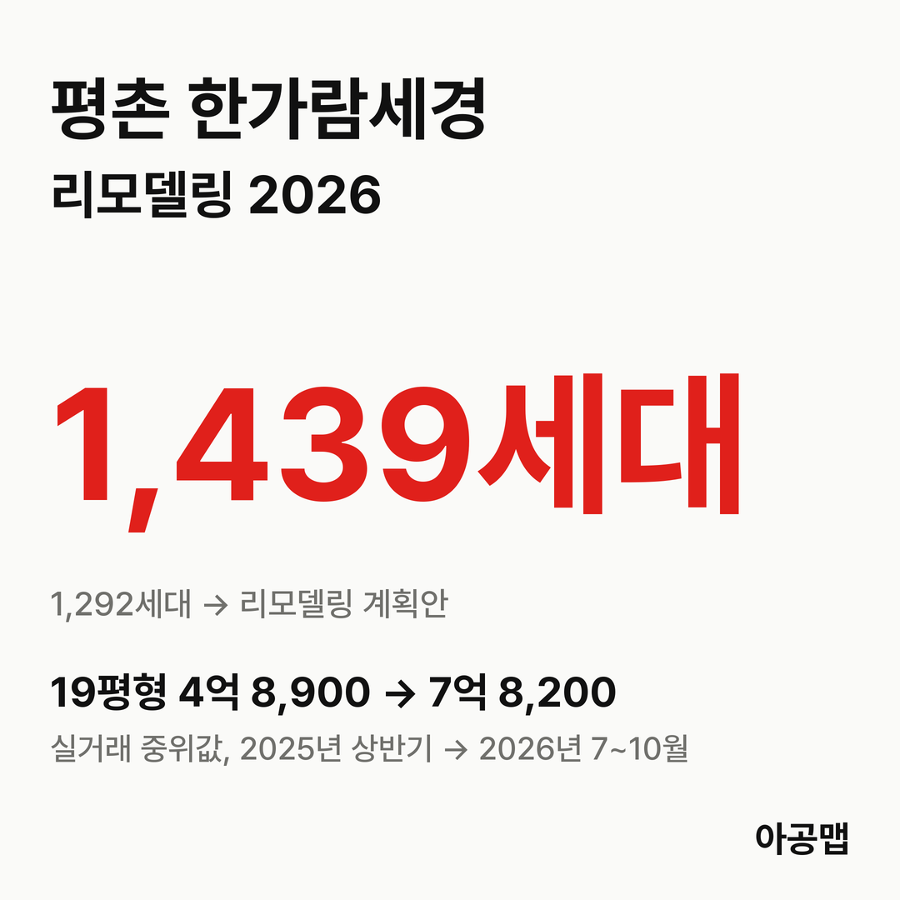
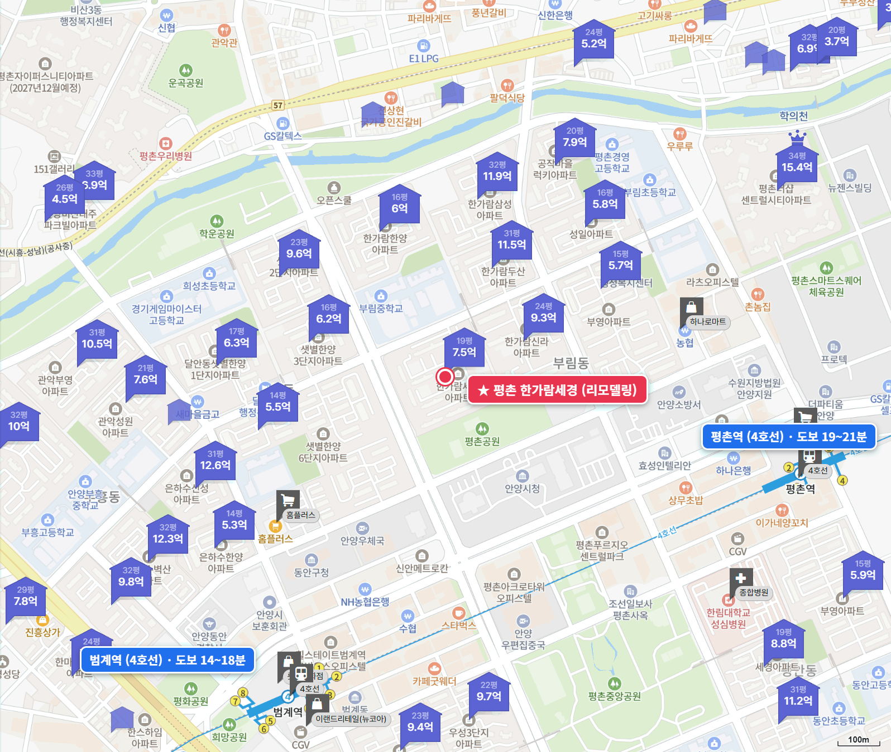
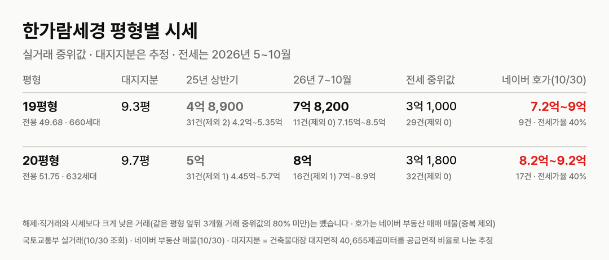
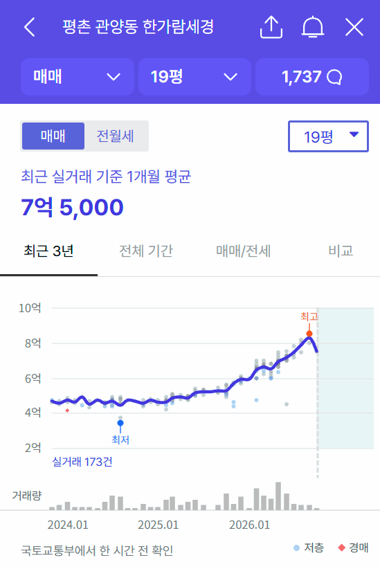
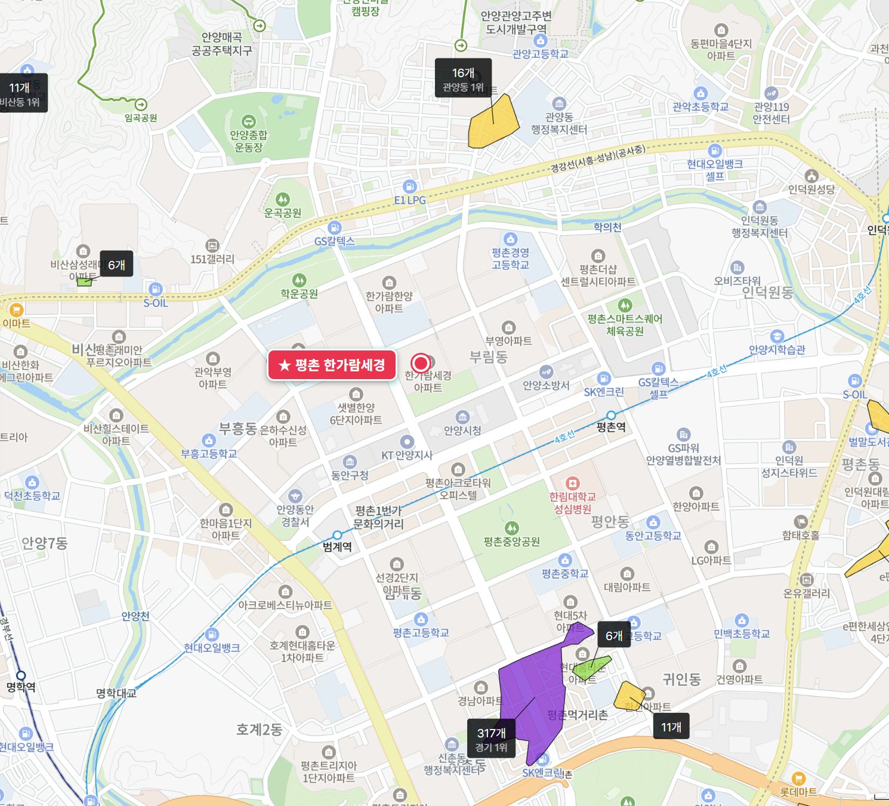

{{chart:moveins:안양}}

## 핵심 숫자

| 항목 | 값 | 기준 |
|---|---|---|
| 세대수 | 1,292세대(11개 동, 최고 23층) | 1996년 11월 입주, 관양동 1589 |
| 평형 | 19평형 660, 20평형 632세대 | 전용 49.68·51.75㎡, 복도식 |
| 용적률·건폐율 | 197%·16% | 건축물대장 용적률 196.74% |
| 대지면적 | 40,655㎡ | 세대당 평균 31.5㎡(9.5평) |
| 세대당 주차대수 | 0.59대 | |
| 가까운 역 | 4호선 범계역 도보 14~18분 | 평촌역 19~20분 |
| 배정초 | 부안초 | 정문 도보 4분, 초품아 |

## 리모델링 사업 단계

한가람세경은 재건축이 아니라 리모델링이다. 2023년 12월 조합이 현대건설을 시공자로 뽑았고, 그때 계획은 기존 동을 고쳐 쓰면서 옆으로 늘리는 수평증축으로 지하 4층~지상 27층, 1,439세대다.

| 항목 | 계획(2023-12 시공자 선정 기준) |
|---|---|
| 세대수 | 1,292세대 → 1,439세대(+147, 일반분양) |
| 사업 방식 | 리모델링주택조합, 수평증축 |
| 시공자 | 현대건설 |
| 평면 | 복도식 → 계단식 전환, 지하주차장 연결(후기에 올라온 글) |

**지금은 건축심의 소위원회 단계다.** 9월 22일 안양시 건축위원회는 이 안건을 '소위원회 수권위임'으로 의결했다. 재심의가 아니라 본위원회가 낸 보완 의견을 소위원회가 확인해 마무리하는 결론이다. 보완 의견은 509동 앞 문주 슬림화, 기존 동의 바닥충격음 대책, 달안로 보도 폭 2m 이상 확보, 통경축을 가리는 10층 동 수정, 수평증축 동의 구조 안전성 검토 같은 설계 항목이고, 단지 안 유치원·상가 부지는 매입해 부대시설로 쓰면 좋겠다는 권고가 붙었다.

| 시점 | 단계 |
|---|---|
| 2023-12 | 시공자 현대건설 선정 |
| 2026-01-15 | 안양시, 리모델링주택조합 변경인가 공고 |
| 2026-02-27 | 안양시 도시계획위원회, 도시관리계획 부합·기반시설 영향 심의 조건부수용 |
| 2026-07-07 | 건축심의 접수(후기에 올라온 글) |
| 2026-09-22 | 안양시 건축위원회, 소위원회 수권위임 |
| 다음 | 소위원회 의결 → 동의서(75%) → 사업계획승인 신청 → 권리변동계획·분담금 → 이주 |

리모델링은 세대수가 50세대 이상 늘면 도시계획위원회에서 기반시설 영향을 따로 본다. 한가람세경은 그 심의와 건축심의를 올해 안에 모두 넘겼다. 남은 큰 관문은 소유자 75% 동의를 받아 내는 사업계획승인이다. 이주 시점과 분담금은 조합 공식 숫자가 나오지 않았고, 후기에 올라온 글에는 2028~2029년 이주 예상과 분담금 추정을 두고 엇갈리는 이야기가 있어 싣지 않는다.

## 평형별 대지지분과 시세

| 평형 | 대지지분(추정) | 2025년 상반기 건수(제외)·범위·중위값 | 2026년 7~10월 건수(제외)·범위·중위값 | 대지지분 1평당(2026) |
|---|---|---|---|---|
| 19평형(전용 49.68㎡, 660세대) | 9.3평 | 31건(2) 4억 2,000만~5억 3,500만, 4억 8,900만 | 11건(0) 7억 1,500만~8억 5,000만, 7억 8,200만 | 8,400만 |
| 20평형(전용 51.75㎡, 632세대) | 9.7평 | 31건(1) 4억 4,500만~5억 7,000만, 5억 | 16건(1) 7억~8억 9,000만, 8억 | 8,200만 |

해제·직거래와 시세보다 크게 낮은 거래(같은 평형 앞뒤 3개월 거래 중위값의 80% 미만)는 뺐습니다. 괄호 안은 뺀 건수다. 대지지분은 건축물대장 대지면적을 평형별 공급면적 비율로 나눈 추정값이다.

2025년 상반기 대비 2026년 7~10월 중위값은 두 평형 모두 60% 올랐다. 19평형 월 중위값은 2025년 상반기 4억 6,000만~5억 500만 원에서 12월 5억 9,600만 원, 도시계획위원회가 열린 2026년 2월 6억 5,000만 원, 5월 6억 9,500만 원, 건축위원회가 열린 9월 8억 3,000만 원으로 심의 단계마다 한 칸씩 올라섰다(9월은 3건). 매매 건수는 2025년 상반기 62건, 하반기 61건, 2026년 상반기 92건, 7~10월 27건이다.

같은 평촌에서 재건축을 추진하는 [초원부영](/danji/chowon-bueong-pyeongchon/) 20평형은 대지지분이 9.5평으로 한가람세경 20평형(9.7평)과 거의 같은데, 같은 기간 27% 올라 7~10월 중위값이 7억 4,000만 원이다. 대지지분이 같아도 심의를 두 번 넘긴 리모델링 단지가 6,000만 원 더 비싸고 오름폭은 두 배를 넘는다. 시장은 대지지분보다 사업이 어디까지 왔는지에 값을 매기고 있다.

| 평형 | 세 낀 매물 호가 | 세 낀 매물 갭(그 집 전세 보증금 기준) | 실거주 매물 호가 | 전세 실거래 건수·중위값(2026년 5~10월) | 전세가율 |
|---|---|---|---|---|---|
| 19평형 | 없음 | - | 9건, 7억 2,000만~9억 | 29건, 3억 1,000만 | 40% |
| 20평형 | 6건, 8억 2,500만~8억 5,000만 | 3건, 5억 6,000만~5억 7,500만 | 10건, 8억 2,000만~9억 2,000만 | 32건, 3억 1,800만 | 40% |

호가는 네이버 부동산 매매 매물(2026-10-30 조회, 중복 등록 22건은 하나로 셈) 26건이고, 세 낀 매물(전세를 안고 사는 매물)과 실거주 매물(즉시·협의 입주)로 나눴다. 20평형 1건(9억 1,000만 원)은 중개사마다 적힌 내용이 달라 어느 쪽인지 가리지 못했다. 갭은 세 낀 매물 호가에서 그 집 전세 보증금을 뺀 값이고, 보증금이 적힌 3건만 셌다. 전세가율은 2026년 7~10월 매매 중위값 대비 전세 중위값이다.

실거주 매물 호가 대부분이 8억 5,000만~9억 원에 몰려 있어 7~10월 실거래 중위값보다 5,000만~1억 원 위다. 전세가율은 40%로 낮고, 세 낀 매물의 갭이 5억 6,000만 원을 넘는다. 동안구는 2025년 10월 20일부터 토지거래허가구역이라 허가를 받아 사면 2년 동안 실거주해야 하고, 세 낀 매물은 세입자 계약이 끝나야 들어갈 수 있다. 세 낀 20평형 매물(8억 2,500만~8억 5,000만 원)이 실거주 매물보다 조금 싼 것도 이 때문이다.

## 학군과 생활 인프라

| 항목 | 이름 | 거리 |
|---|---|---|
| 배정초 | 부안초 | 정문 도보 4분, 초품아 |
| 가까운 학원가 | 관양동 학원가(16개) | 도보 22~26분 |
| 평촌 최대 학원가 | 범계~평촌 학원가(평촌동 317개, 경기 1위) | 도보 25~30분 |
| 백화점·쇼핑몰 | 롯데백화점 평촌점, 뉴코아아울렛 평촌점 | 도보 15~21분 |
| 대형마트 | 홈플러스 평촌점 | 도보 9~13분 |
| 대형 병원 | 한림대학교성심병원 | 도보 19~20분 |
| 공원·관공서 | 평촌공원(단지 바로 남쪽), 안양시청 | 도보 4~6분, 5~6분 |

평촌공원과 시청이 단지 바로 앞이고 범계 상권은 걸어서 15분 안팎이다. 경기 1위 학원가인 범계~평촌 학원가까지는 걸어서 25분이 넘어 학원가 단지라고 하기는 어렵다. 입주민 후기에서는 공원 앞 남향 조망과 부안초가 장점으로, 단지 안 상권이 약한 점과 분담금이 걱정거리로 꼽힌다.

## 안양 입주 물량

{{table:moveins:안양}}

안양의 2027년 입주 물량은 {{v:moveins:안양:2027}}로 한 해 적정 입주량 {{v:need:안양}}의 {{v:share:안양:2027}}다. 적정 입주량은 2026년 9월 주민등록 인구를 가구당 2.5명으로 나눈 가구 수의 2%로 잡는다. 동안구 매매가는 {{v:streak:안양 동안구}}이고, 주간 시세 흐름은 아래와 같다.

{{chart:weekly:안양 동안구}}

{{table:weekly:안양}}

리모델링은 기존 동을 남기고 고치는 방식이라 늘어나는 세대가 147세대뿐이고, 입주 물량을 크게 늘리지 못한다. 대신 공사 기간에 1,292세대가 한꺼번에 이주하고, 평촌에서는 재건축 구역과 다른 리모델링 단지의 이주도 차례로 이어진다. 아공맵은 신축이 모자란 평촌에서 이주 수요가 전세를 받쳐 줄 것으로 본다. 이 단지의 다음 변수는 소위원회 의결과 사업계획승인용 75% 동의, 그리고 그 뒤에 나올 공식 분담금이다.

관련 리포트: [경기 시군구 주간·월간 시세](/zone/경기/#weekly-sgg)
