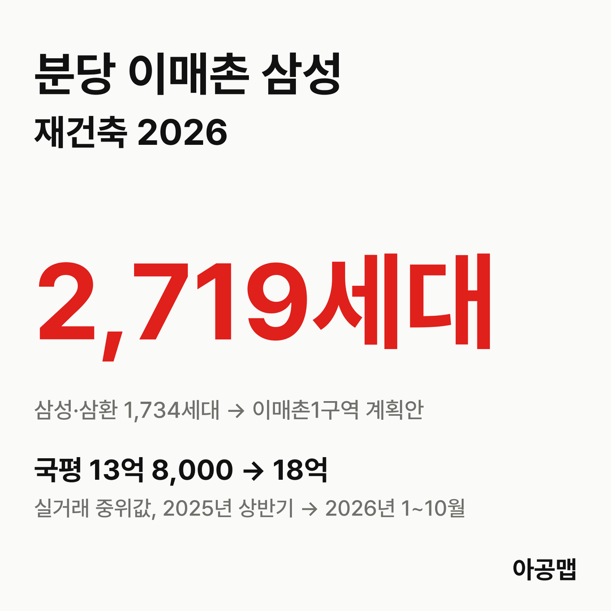
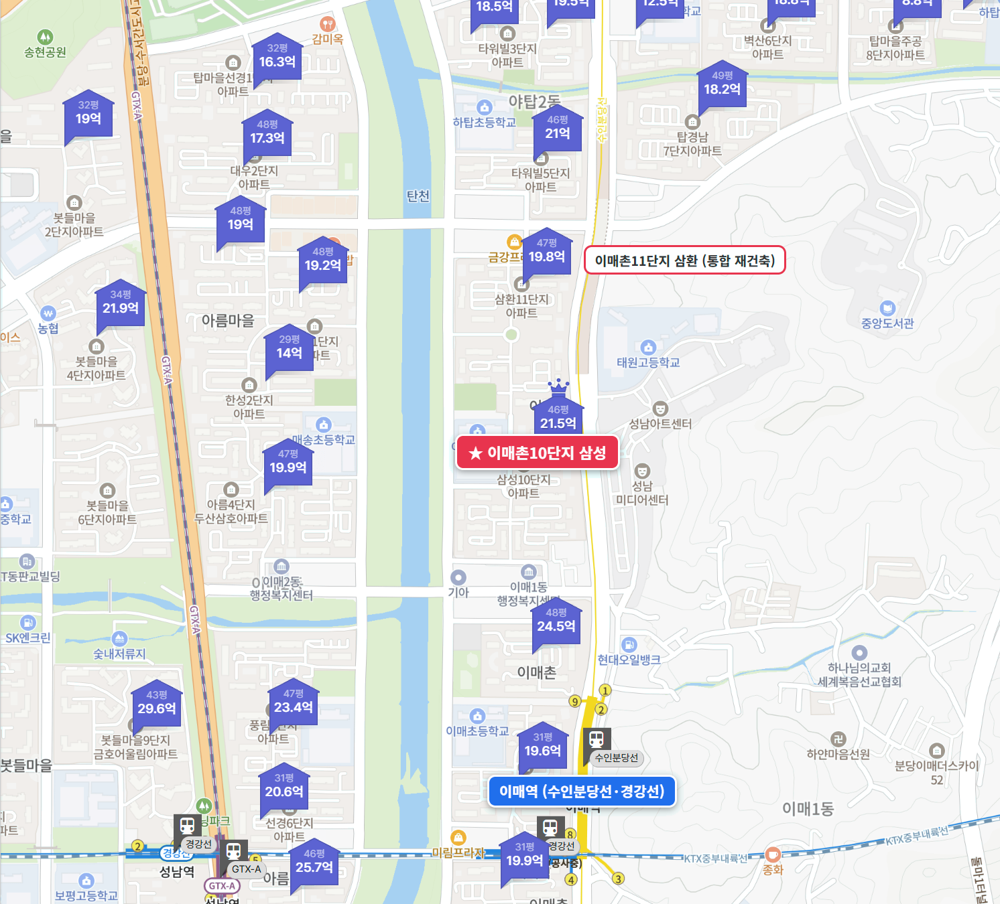
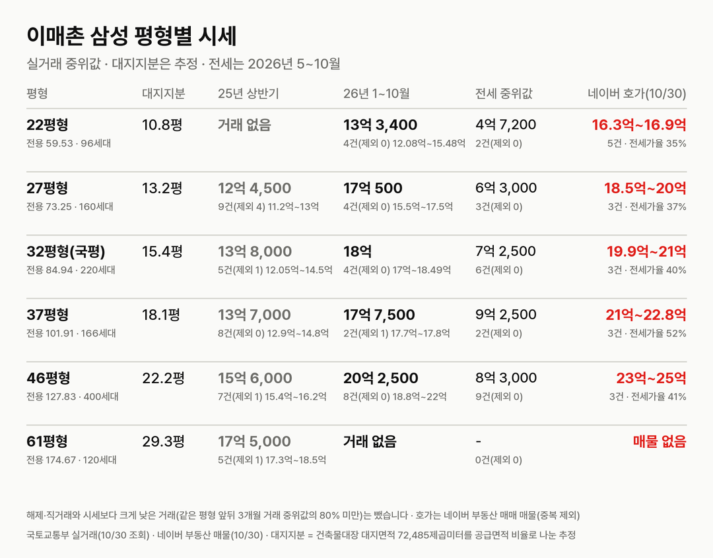
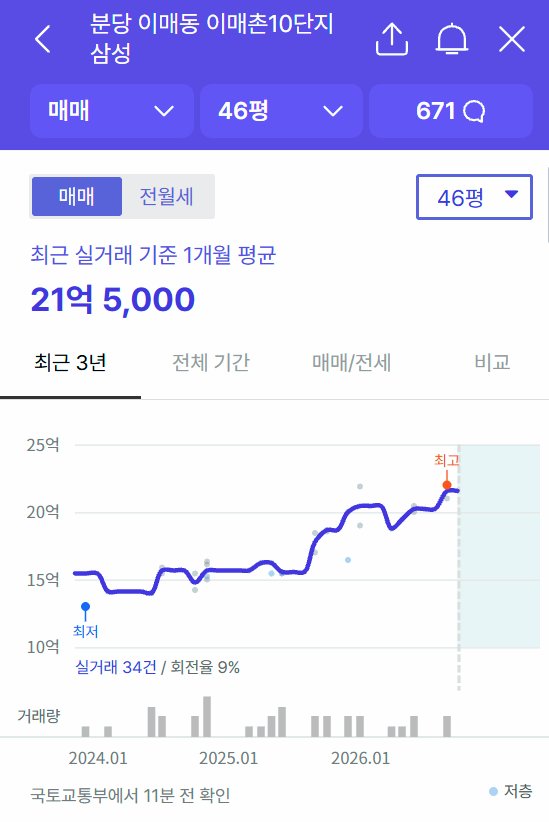
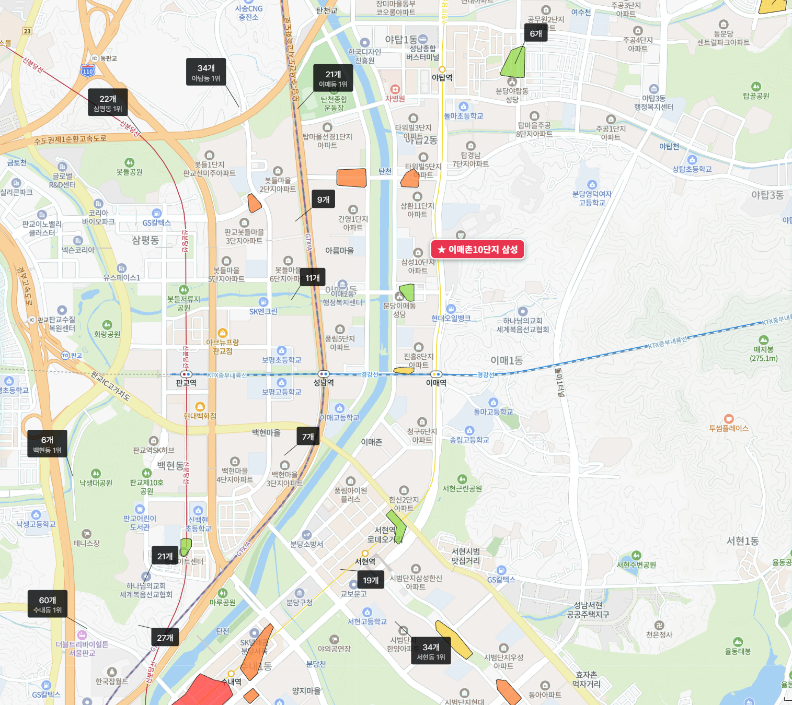

## 핵심 숫자

| 항목 | 값 | 기준 |
|---|---|---|
| 세대수 | 1,162세대(27개 동, 최고 21층) | 1994년 4월 입주, 이매동 100 |
| 평형 | 22평형 96, 27평형 160, 32평형(국평) 220, 37평형 166, 46평형 400, 61평형 120세대 | 전용 59.53~174.67㎡, 중대형 위주 |
| 용적률·건폐율 | 196%·17% | 건축물대장 용적률 196.41% |
| 대지면적 | 72,485㎡ | 세대당 평균 62.4㎡(18.9평) |
| 세대당 주차대수 | 1.26대 | |
| 가까운 역 | 수인분당선·경강선 이매역 도보 7~15분 | 후문 7분, GTX-A 성남역 17~22분 |
| 학교 | 하탑초 도보 7분, 이매중은 단지 바로 옆 | |

## 정비 구역과 사업 단계

이매촌1구역(분당 17구역)은 이매동 100번지 이매촌 삼성(1,162세대)과 99번지 이매촌 삼환(572세대, 1994년 9월 입주)을 묶은 구역이다. 두 단지 소유자가 통합 주민대표단을 꾸려 통합개발·통합정산에 합의했고, 한국자산신탁이 신탁 방식으로 사업을 맡는다.

| 항목 | 특별정비계획(안) |
|---|---|
| 세대수 | 1,734세대 → 2,719세대(+985) |
| 용적률 | 196% → 338% 이하 |
| 최고 층수 | 39층 |
| 사업 방식 | 신탁 방식(한국자산신탁) |

| 시점 | 단계 |
|---|---|
| 2025-12 | 한국자산신탁·통합재건축추진위원회 업무협약 |
| 2026-07-08 | 성남시에 특별정비구역 지정 제안서 제출 |
| 2026-09-29 | 분당 2차 특별정비구역 5곳에 선정(제안 수용) |
| 2026-09-29 ~ 10-13 | 특별정비계획(안) 주민공람 |
| 2026-10-08 | 성남시의회 의견청취안 채택 |
| 다음 | 경관위원회·경기도 협의·도시계획위원회 심의 → 2026년 12월 지정·고시 목표 |

2차 선정 5곳은 이매촌1(1,734세대), 시범단지1(4,200세대), 파크타운(3,025세대), 푸른마을(2,598세대), 한솔마을2(1,872세대)로 모두 13,429세대다. 같은 이매동의 [아름마을4단지](/danji/areum4-imae/)는 이번 선정에 들지 못했다. 이매촌 삼성·삼환은 2025년 1차 분당 선도지구 공모에서는 선정되지 않았다. 추정분담금은 공개 보도로 확인하지 못해 싣지 않는다.

## 평형별 대지지분과 시세

| 평형 | 대지지분(추정) | 2025년 상반기 건수(제외)·범위·중위값 | 2026년 1~10월 건수(제외)·범위·중위값 | 대지지분 1평당(2026) |
|---|---|---|---|---|
| 22평형(전용 59.53㎡, 96세대) | 10.8평 | 거래 없음 | 4건(0) 12억 800만~15억 4,800만, 13억 3,400만 | 1억 2,400만 |
| 27평형(전용 73.25㎡, 160세대) | 13.2평 | 9건(4) 11억 2,000만~13억, 12억 4,500만 | 4건(0) 15억 5,000만~17억 5,000만, 17억 500만 | 1억 2,900만 |
| 32평형(전용 84.94㎡, 국평, 220세대) | 15.4평 | 5건(1) 12억 500만~14억 5,000만, 13억 8,000만 | 4건(0) 17억~18억 4,900만, 18억 | 1억 1,700만 |
| 37평형(전용 101.91㎡, 166세대) | 18.1평 | 8건(0) 12억 9,000만~14억 8,000만, 13억 7,000만 | 2건(1) 17억 7,000만~17억 8,000만, 17억 7,500만 | 9,800만 |
| 46평형(전용 127.83㎡, 400세대) | 22.2평 | 7건(1) 15억 4,000만~16억 2,000만, 15억 6,000만 | 8건(0) 18억 8,000만~22억, 20억 2,500만 | 9,100만 |
| 61평형(전용 174.67㎡, 120세대) | 29.3평 | 5건(1) 17억 3,000만~18억 5,000만, 17억 5,000만 | 거래 없음 | - |

해제·직거래와 시세보다 크게 낮은 거래(같은 평형 앞뒤 3개월 거래 중위값의 80% 미만)는 뺐습니다. 괄호 안은 뺀 건수다. 국토교통부 실거래에는 '이매촌(삼성)'으로 올라 있다. 대지지분은 건축물대장 대지면적을 평형별 공급면적 비율로 나눈 추정값이다.

2025년 상반기 대비 2026년 1~10월 중위값은 27평형 37%, 국평 30%, 37평형 30%, 46평형 30% 올랐다. 매매 건수는 2025년 상반기 34건, 하반기 21건, 2026년 상반기 18건, 7~10월 4건으로 줄었다. 분당구가 2025년 10월 20일 토지거래허가구역이 된 뒤 손바뀜이 끊기다시피 했는데도 거래된 값은 계속 올랐다. 팔 사람이 버티는 구간이다.

| 평형 | 세 낀 매물 호가 | 세 낀 매물 갭(그 집 전세 보증금 기준) | 실거주 매물 호가 | 전세 실거래 건수·중위값(2026년 5~10월) | 전세가율 |
|---|---|---|---|---|---|
| 22평형 | 2건, 16억 3,000만~16억 5,000만 | 11억 1,000만~11억 8,000만 | 1건, 16억 9,000만 | 2건, 4억 7,200만 | 35% |
| 27평형 | 1건, 20억 | 13억 7,000만 | 2건, 18억 5,000만~19억 9,000만 | 3건, 6억 3,000만 | 37% |
| 국평 | 1건, 21억(보증부 월세) | - | 2건, 19억 9,000만~21억 | 6건, 7억 2,500만 | 40% |
| 37평형 | 1건, 21억(보증부 월세) | - | 2건, 22억~22억 8,000만 | 2건, 9억 2,500만 | 52% |
| 46평형 | 1건, 24억(보증부 월세) | - | 2건, 23억~25억 | 9건, 8억 3,000만 | 41% |

호가는 네이버 부동산 매매 매물(2026-10-30 조회, 중복 등록 68건은 하나로 셈) 17건이고, 세 낀 매물(전세를 안고 사는 매물)과 실거주 매물(즉시·협의 입주)로 나눴다. 갭은 세 낀 매물 호가에서 그 집 전세 보증금을 뺀 값이고, 보증부 월세 매물은 갭에서 뺐다. 전세가율은 2026년 1~10월 매매 중위값 대비 전세 중위값이고, 61평형은 매물이 없다.

호가는 실거래 중위값보다 2억~4억 원 위에 있다. 국평 실거주 매물 19억 9,000만~21억 원은 1~10월 중위값 18억 원보다 2억~3억 원 높다. 2차 선정 직후 급매가 거둬지고 호가가 1억 원 넘게 올랐다는 입주민 후기도 있다. 토지거래허가구역이라 허가를 받아 사면 2년 동안 실거주해야 하고, 15억 원 넘는 집의 주택담보대출 한도는 4억 원이다. 국평 실거주 매물 20억 원을 사려면 현금 16억 원이 든다. 세 낀 매물은 세입자 계약이 끝나야 들어갈 수 있다.

## 학군과 생활 인프라

| 항목 | 이름 | 거리 |
|---|---|---|
| 학교 | 하탑초, 이매중 | 하탑초 정문 도보 7분, 이매중은 단지 바로 옆 |
| 가까운 학원가 | 이매동 학원가(단지 북쪽 21개, 후문 남쪽 9개) | 도보 3~4분 |
| 다음 학원가 | 야탑동 학원가(34개) | 정문 도보 7분 |
| 분당 최대 학원가 | 수내·정자 학원가(정자동 63개 등) | 직선 약 3.8km |
| 쇼핑 | NC백화점 야탑점 | 정문 도보 17분 |
| 대형마트 | 홈플러스 야탑점 | 정문 도보 22분 |
| 대형 병원 | 분당차병원 | 정문 도보 14분 |
| 공원·문화 | 탄천, 성남아트센터 | 도보 9분, 6분 |

이매중이 단지 옆에 붙어 있고 동네 학원가가 걸어서 몇 분 거리다. 입주민 후기에서는 이 학군과 탄천·성남아트센터 산책권, 이매역과 GTX-A 성남역, 판교 직주근접이 장점으로 꼽힌다.

## 성남 입주 물량

{{chart:moveins:성남}}

{{table:moveins:성남}}

성남의 2027년 입주 물량은 {{v:moveins:성남:2027}}로 한 해 적정물량 {{v:need:성남}}의 {{v:share:성남:2027}}다. 적정물량은 2026년 9월 주민등록 인구를 가구당 2.5명으로 나눈 가구 수의 2%로 잡는다. 분당구 매매가는 {{v:streak:분당구}}이고, 주간 시세 흐름은 아래와 같다.

{{chart:weekly:성남 분당구}}

{{table:weekly:성남}}

2027년 입주장이 지나면 2028·2029년 성남 입주 물량은 적정물량에 크게 못 미친다. 그 시기에 1차 선도지구에 이어 2차 5개 구역 13,429세대가 차례로 이주를 시작한다. 아공맵은 분당 전세가 정비 순번을 따라 오르고, 그 압력이 이미 지정된 구역의 매매가를 받칠 것으로 본다. 이 단지의 다음 변수는 12월 구역 지정·고시 뒤 나올 추정분담금과 시공사 선정이다.

관련 리포트: [경기 시군구 주간·월간 시세](/zone/경기/#weekly-sgg)
