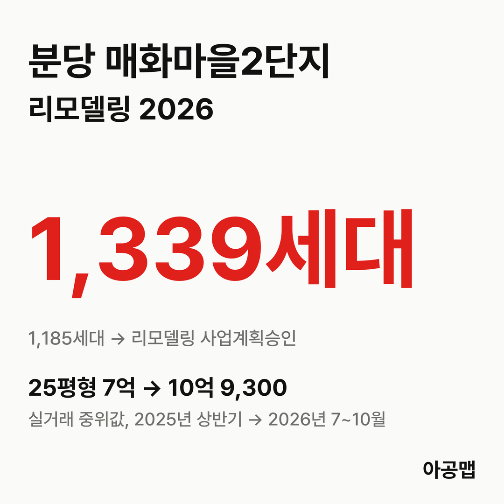
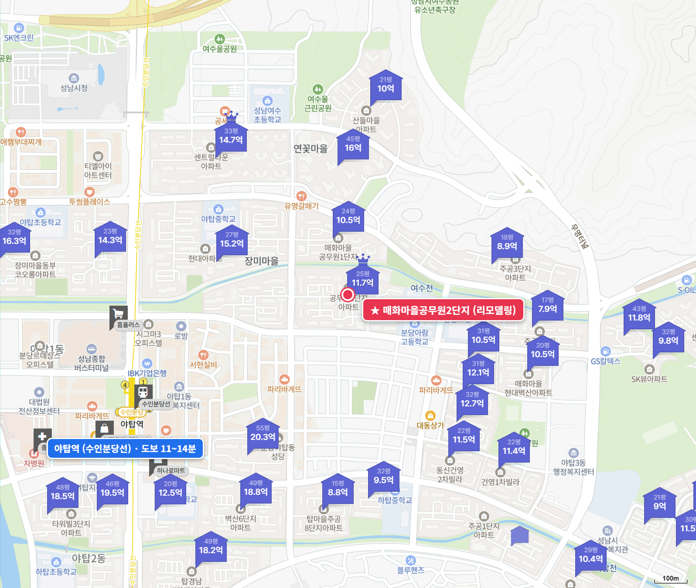
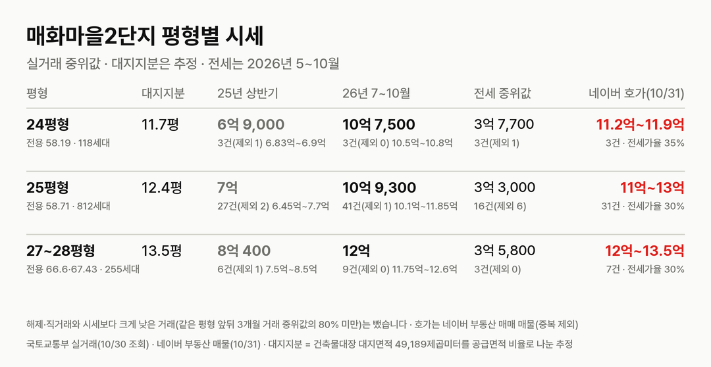
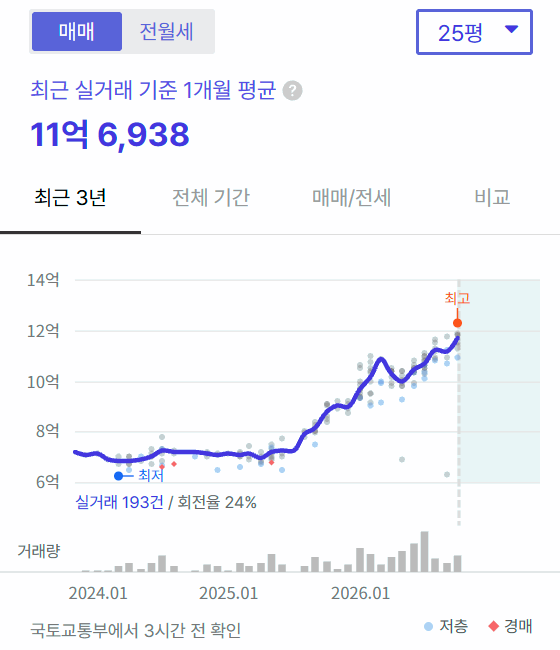
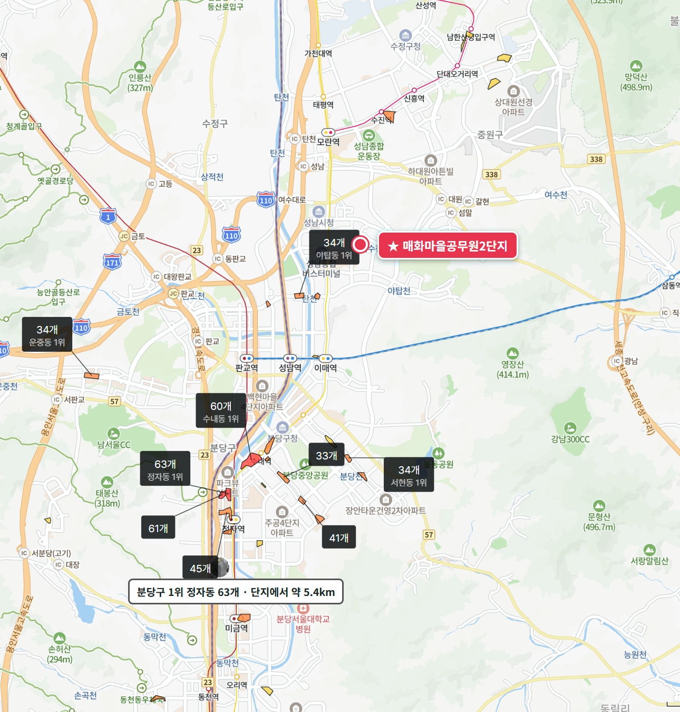

## 핵심 숫자

| 항목 | 값 | 기준 |
|---|---|---|
| 세대수 | 1,185세대(17개 동, 최고 21층) | 1995년 7월 입주, 야탑동 215 |
| 평형 | 24평형 118, 25평형 812, 27~28평형 255세대 | 전용 58.19·58.71·66.6·67.43㎡, 복도식 |
| 용적률·건폐율 | 201%·15% | 건축물대장 용적률 200.69% |
| 대지면적 | 49,189㎡ | 세대당 평균 41.5㎡(12.6평) |
| 세대당 주차대수 | 1.06대 | |
| 가까운 역 | 수인분당선 야탑역 도보 11~14분 | 후문 11분 |
| 배정초 | 중탑초 | 정문 도보 4분 |

## 리모델링 사업 단계

매화마을2단지는 재건축이 아니라 리모델링이다. 2024년 8월 31일 조합이 포스코이앤씨를 시공사로 뽑았고, 그때 계획은 1,185세대를 1,339세대로 늘리는 것이다.

| 항목 | 계획 |
|---|---|
| 세대수 | 1,185세대 → 1,339세대(+154, 일반분양) |
| 사업 방식 | 리모델링주택조합, 수평증축과 별동 증축 |
| 시공사 | 포스코이앤씨(총 공사비 약 5,500억 원) |
| 평형 배정 | 25평형 → 31평형, 27~28평형 → 35평형(후기에 올라온 글) |

**지금은 사업계획승인을 받고 이주를 앞둔 단계다.** 리모델링은 사업계획승인(리모델링 허가 포함)을 받으면 남은 인허가가 거의 없고, 분담금을 정하는 총회와 이주가 뒤따른다. 이 단지는 승인 고시 뒤 9개월 만에 조합 총회를 열었고, 10월에는 조합원 1,184명, 토지 사용권원 99.92%로 조합 변경인가를 받았다.

| 시점 | 단계 |
|---|---|
| 2021-05-07 | 리모델링주택조합 설립인가 |
| 2024-08-31 | 시공사 포스코이앤씨 선정 |
| 2025-10-02 | 성남시, 리모델링 허가·주택건설사업계획 조건부 승인 고시 |
| 2026-07-04 | 조합 총회(분담금 총회) |
| 2026-10-07 | 성남시, 조합 설립(변경)인가 공고 |
| 다음 | 이주(조합 목표 2026년 말, 시공사 일정 보도 2027년) → 착공 → 완공(조합 목표 2031년 5월) |

이주 시점은 출처마다 다르다. 7월 총회 무렵 조합 목표는 '2026년 말 이주'였고, 8월 시공사 일정 보도는 '2027년 이주·착공 추진'이다. 10월 매물 문구에는 '2027년 2월부터 이주 계획'이 여럿 보인다. 이주 시작 공고는 10월 말까지 성남시 게시판과 기사에서 확인되지 않는다. 9월에는 1층 필로티 상향에 필요한 안전진단 재조사 결과를 두고 성남시 회신이 나왔다는 입주민 글이 올라와, 인허가에 걸려 있던 문제가 풀렸다는 이야기가 많다. 확정 분담금은 공식 숫자를 확인하지 못해 싣지 않는다.

## 평형별 대지지분과 시세

| 평형 | 대지지분(추정) | 2025년 상반기 건수(제외)·범위·중위값 | 2026년 7~10월 건수(제외)·범위·중위값 | 대지지분 1평당(2026) |
|---|---|---|---|---|
| 24평형(전용 58.19㎡, 118세대) | 11.7평 | 3건(1) 6억 8,300만~6억 9,000만, 6억 9,000만 | 3건(0) 10억 5,000만~10억 8,000만, 10억 7,500만 | 9,200만 |
| 25평형(전용 58.71㎡, 812세대) | 12.4평 | 27건(2) 6억 4,500만~7억 7,000만, 7억 | 41건(1) 10억 1,000만~11억 8,500만, 10억 9,300만 | 8,800만 |
| 27~28평형(전용 66.6·67.43㎡, 255세대) | 13.5평 | 6건(1) 7억 5,000만~8억 5,000만, 8억 400만 | 9건(0) 11억 7,500만~12억 6,000만, 12억 | 8,900만 |

해제·직거래와 시세보다 크게 낮은 거래(같은 평형 앞뒤 3개월 거래 중위값의 80% 미만)는 뺐습니다. 괄호 안은 뺀 건수다. 대지지분은 건축물대장 대지면적을 평형별 공급면적 비율로 나눈 추정값이다. 27평형과 28평형은 전용면적이 같아 실거래에서 나뉘지 않으므로 한 줄로 묶었다.

2025년 상반기 대비 2026년 7~10월 중위값은 24평형 56%, 25평형 56%, 27~28평형 49% 올랐다. 25평형 월 중위값은 2025년 상반기 6억 8,300만~7억 2,000만 원에 머물다가 사업계획승인 고시가 난 10월 8억 8,000만 원, 2026년 2월 10억 1,750만 원, 총회 뒤 8월 11억 1,700만 원, 10월 11억 5,750만 원으로 올라섰다. 매매 건수는 2025년 상반기 36건, 하반기 40건, 2026년 상반기 85건, 7~10월 53건이다.

같은 분당에서 재건축 구역에 선정된 [이매촌10단지 삼성](/danji/imae10-samsung-bundang/) 27평형은 대지지분이 13.2평으로 이 단지 27~28평형(13.5평)과 비슷한데, 2025년 상반기 대비 2026년 1~10월 37% 올랐고 대지지분 1평당 값은 1억 2,900만 원이다. 매화마을2단지는 오름폭이 더 크고 대지지분 1평당 값은 8,900만 원으로 여전히 3분의 2 수준이다. 거래량도 다르다. 분당구가 2025년 10월 20일 토지거래허가구역이 된 뒤 이매촌 삼성은 7~10월 4건으로 거래가 끊기다시피 했지만, 매화마을2단지는 같은 기간 53건이 손바뀜했다. 이주가 눈앞인 단지에는 허가 구역 안에서도 매수가 이어진다.

| 평형 | 세 낀 매물 호가 | 세 낀 매물 갭(그 집 전세 보증금 기준) | 실거주 매물 호가 | 전세 실거래 건수·중위값(2026년 5~10월) | 전세가율 |
|---|---|---|---|---|---|
| 24평형 | 없음 | - | 3건, 11억 2,000만~11억 9,000만 | 3건, 3억 7,700만 | 35% |
| 25평형 | 4건, 11억 7,000만~12억 3,000만 | 1건, 8억 1,000만 | 22건, 11억~13억 | 16건, 3억 3,000만 | 30% |
| 27~28평형 | 1건, 12억 | 1건, 7억 7,000만 | 4건, 12억 5,000만~13억 5,000만 | 3건, 3억 5,800만 | 30% |

호가는 네이버 부동산 매매 매물(2026-10-31 조회, 중복 등록 31건은 하나로 셈) 41건이고, 세 낀 매물(전세를 안고 사는 매물)과 실거주 매물(즉시·협의 입주)로 나눴다. 어느 쪽인지 적혀 있지 않은 매물 7건(12억~13억 5,000만 원)은 따로 셌다. 갭은 세 낀 매물 호가에서 그 집 전세 보증금을 뺀 값이고, 보증금이 적힌 매물만 셌다(보증부 월세 매물은 뺐다). 전세가율은 2026년 7~10월 매매 중위값 대비 전세 중위값이다.

25평형 실거주 매물 호가는 11억~13억 원이고 7~10월 실거래 중위값 10억 9,300만 원보다 위에 있다. 입주민 후기에는 10월 28일 12억 3,000만 원 계약이 올라와 있어 호가와 실거래의 거리가 좁혀지고 있다. 전세가율은 30%로 낮고, 세 낀 매물의 갭은 8억 원 안팎이다. 이주가 시작되면 세입자도 집을 비워야 하므로 세 낀 매물의 전세 보증금은 이주비 대출로 돌려줘야 한다.

## 학군과 생활 인프라

| 항목 | 이름 | 거리 |
|---|---|---|
| 배정초 | 중탑초 | 정문 도보 4분 |
| 가까운 학원가 | 야탑동 학원가(6개) | 도보 7~8분 |
| 야탑 최대 학원가 | 야탑역 서쪽 야탑동 학원가(34개) | 도보 34~37분 |
| 분당 최대 학원가 | 정자동 학원가(63개, 분당구 1위) | 약 5.4km, 차량 이동 |
| 백화점 | NC백화점 야탑점 | 도보 17~20분 |
| 대형마트 | 홈플러스 야탑점 | 도보 12~15분 |
| 대형 병원 | 분당차병원(권역응급의료센터) | 도보 21~24분 |
| 공원 | 매향공원, 여수천 산책로 | 도보 3~7분 |

야탑역 상권과 홈플러스·NC백화점·분당차병원·버스터미널이 걸어서 닿고, 단지 옆 여수천 산책로가 탄천까지 이어진다. 분당 학원가 중심인 정자동·수내동은 차로 다녀야 한다. 입주민 후기에서는 생활 편의와 사업 속도가 장점으로, 리모델링 뒤 2베이 동서향과 3베이 남향 배정의 차이, 이주 일정이 밀릴 가능성이 걱정거리로 꼽힌다.

## 성남 입주 물량

{{chart:moveins:성남}}

{{table:moveins:성남}}

성남의 2027년 입주 물량은 {{v:moveins:성남:2027}}로 한 해 적정물량 {{v:need:성남}}의 {{v:share:성남:2027}}다. 적정물량은 2026년 9월 주민등록 인구를 가구당 2.5명으로 나눈 가구 수의 2%로 잡는다. 분당구 매매가는 {{v:streak:분당구}}이고, 주간 시세 흐름은 아래와 같다.

{{chart:weekly:성남 분당구}}

{{table:weekly:성남}}

이 단지가 이주하면 야탑동에서만 1,185세대가 한꺼번에 전셋집을 찾아 나선다. 같은 포스코이앤씨 사업장인 이웃 매화마을1단지도 이주를 준비하고 있고, 분당 재건축 선도지구와 2차 구역의 이주도 뒤를 잇는다. 2027년은 성남 입주 물량이 적정물량을 넘는 입주장이라 이 이주 수요를 받아 줄 새 집이 있지만, 2028년(적정물량의 {{v:share:성남:2028}})과 2029년({{v:share:성남:2029}})에는 입주 물량이 거의 끊긴다. 리모델링으로 늘어나는 세대도 154세대뿐이다. 아공맵은 2027년 입주장이 지나면 이주 수요가 몰린 분당 전세가 먼저 오르고, 그 압력이 이주 단계에 들어선 단지의 매매가를 받칠 것으로 본다. 이 단지의 다음 변수는 이주 시작 공고와 확정 분담금이다.

관련 리포트: [경기 시군구 주간·월간 시세](/zone/경기/#weekly-sgg)
