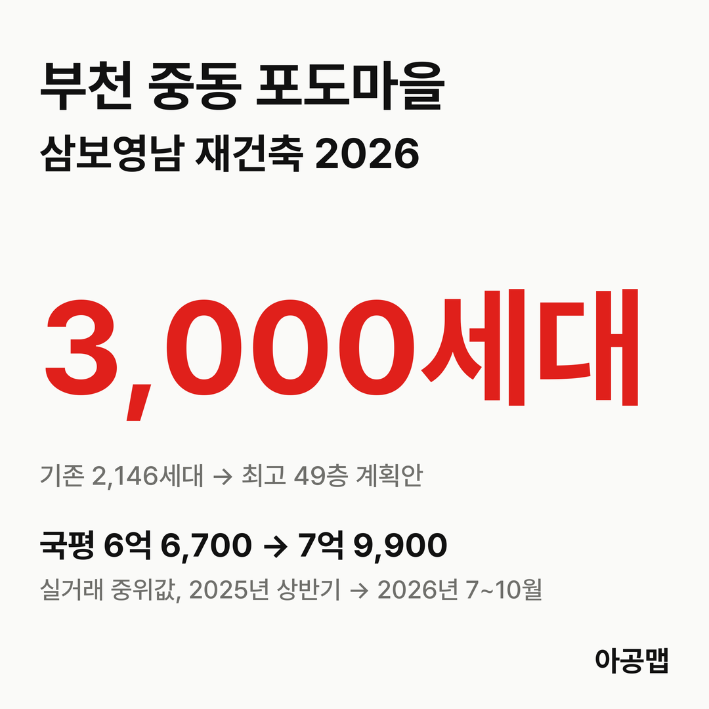
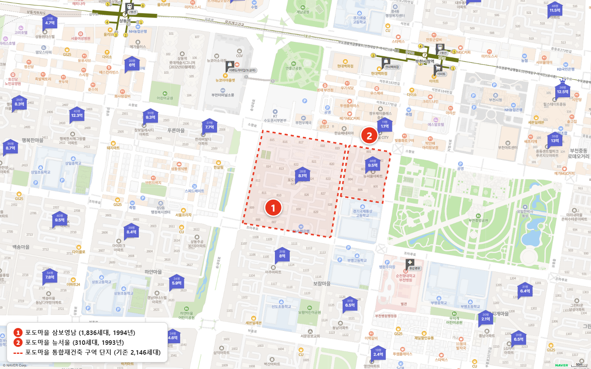
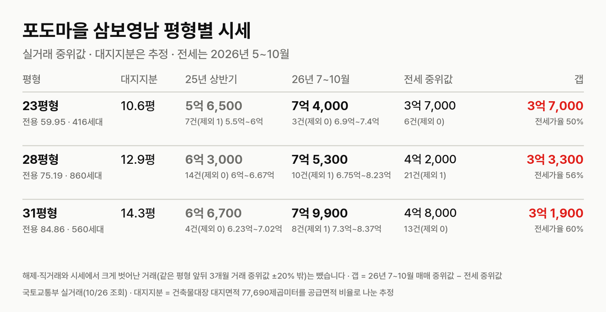
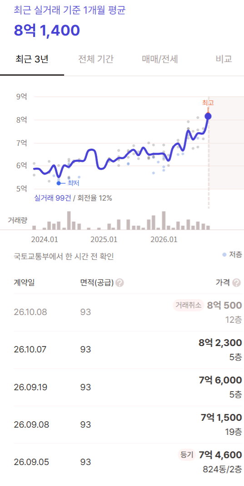
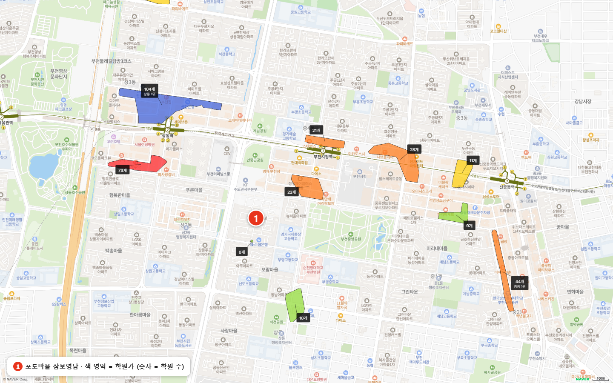

## 핵심 숫자

| 항목 | 값 | 기준 |
|---|---|---|
| 세대수 | 1,836세대(24개 동, 최고 26층) | 1994년 10월 입주 |
| 평형 | 23평형 416세대, 28평형 860세대, 31평형 560세대 | 전용 59.95·75.19·84.85㎡ |
| 용적률·건폐율 | 212%·18.5% | 건축물대장 |
| 대지면적 | 77,690㎡ | 세대당 평균 42.3㎡(12.8평) |
| 세대당 주차대수 | 1.09대 | |
| 가까운 역 | 7호선 부천시청역 도보 6~11분 | 단지 출입구별 |
| 배정초 | 신도초 | 도보 9분 |

## 정비 구역과 계획안

포도마을 구역은 중동 1170번지 삼보영남(1,836세대)과 1171번지 뉴서울(310세대, 1993년 입주, 대형 평형만)을 합친 122,159.9㎡다.

| 항목 | 계획안(2026-10 공람) |
|---|---|
| 세대수 | 2,146세대 → 3,000세대(+854) |
| 최고 층수 | 49층 |
| 용적률 | 상한용적률 350% |
| 사업시행예정자 | 한국토지신탁 |

세대수는 확정이 아니며 주민 의견 수렴과 심의 과정에서 바뀔 수 있다.

| 시점 | 단계 |
|---|---|
| 2026-06-19 | 예비사업시행자(한국토지신탁) 지정 신청 |
| 2026-09-14 | 주민대표단·예비사업시행자의 특별정비구역 지정 제안 |
| 2026-09 | 부천시 제안 수용 통보 |
| 2026-10-06 ~ 10-20 | 특별정비계획(안) 주민공람 |
| 2026-11 · 12 | 시의회 의견청취 · 도시계획위원회 심의 |
| 2027년 1분기 | 특별정비구역 지정(목표) |
| 2027년 2분기 | 사업시행자 선정 |
| 2028년 1분기 | 시공자 선정 |
| 2029년 2분기 · 4분기 | 사업시행계획인가 · 관리처분계획인가 |
| 2030년 2분기 | 이주 시작 |
| 2031년 4분기 | 착공·일반분양 |
| 2036년 3분기 | 준공·입주 |

2027년 이후 일정은 계획안의 목표다. 지정 제안 수용 통보와 예비사업시행자 신청일은 입주민 후기에 올라온 부천시 공문을 기준으로 적었다. 추정 분담금과 비례율은 공식 공고로 확인하지 못해 싣지 않는다.

## 평형별 대지지분과 시세

| 평형 | 대지지분(추정) | 2025년 상반기 건수(제외)·범위·중위값 | 2026년 7~10월 건수(제외)·범위·중위값 | 대지지분 1평당(2026) |
|---|---|---|---|---|
| 23평형(전용 59.95㎡) | 10.6평 | 7건(1) 5억 5,000만~6억, 5억 6,500만 | 3건(0) 6억 9,000만~7억 4,000만, 7억 4,000만 | 7,000만 |
| 28평형(전용 75.19㎡) | 12.9평 | 14건(0) 6억~6억 6,700만, 6억 3,000만 | 10건(1) 6억 7,500만~8억 2,300만, 7억 5,300만 | 5,800만 |
| 31평형(전용 84.85㎡, 국평) | 14.3평 | 4건(0) 6억 2,300만~7억 200만, 6억 6,700만 | 8건(1) 7억 3,000만~8억 3,700만, 7억 9,900만 | 5,600만 |

해제·직거래와 시세에서 크게 벗어난 거래(같은 평형 앞뒤 3개월 거래 중위값 ±20% 밖)는 뺐습니다. 괄호 안은 뺀 건수다. 국토교통부 실거래에는 '포도마을(삼보)'와 '포도마을(영남)'이 같은 지번(중동 1170)으로 올라 있어 합쳐 셌다. 대지지분은 건축물대장 대지면적을 평형별 공급면적 비율로 나눈 추정값이다.

2025년 상반기 대비 2026년 7~10월 중위값은 23평형 31%, 28평형 19%, 국평 20% 올랐다. 매매 건수는 2025년 상반기 25건, 하반기 36건, 2026년 상반기 57건, 7~10월 21건이다(10월은 신고 기한 전).

| 평형 | 매매 호가(2026-10-26) | 전세 실거래 건수(제외)·중위값(2026년 5~10월) | 갭 | 전세가율 |
|---|---|---|---|---|
| 23평형 | 2건, 7억 4,000만~7억 5,500만 | 6건(0), 3억 7,000만 | 3억 7,000만 | 50% |
| 28평형 | 3건, 8억 3,000만~8억 5,000만 | 21건(1), 4억 2,000만 | 3억 3,300만 | 56% |
| 국평 | 4건, 8억 1,000만~8억 7,500만 | 13건(0), 4억 8,000만 | 3억 1,900만 | 60% |

갭은 2026년 7~10월 매매 중위값에서 전세 중위값을 뺀 값이다. 부천은 토지거래허가구역이 아니다. 매매 매물은 세 평형을 합쳐 9건이다.

## 학군과 생활 인프라

| 항목 | 이름 | 거리 |
|---|---|---|
| 가까운 학원가 | 부천시청역 남쪽 중동 학원가(22개) | 도보 6~10분 |
| 부천 최대 학원가 | 상동역 일대 상동 학원가(104개) | 도보 18~23분 |
| 백화점 | 현대백화점 중동점 | 도보 5~10분 |
| 대형마트 | 이마트 중동점, 뉴코아아울렛 부천점 | 도보 6~13분 |
| 공원 | 부천중앙공원 | 도보 9~13분 |
| 대형 병원 | 순천향대학교 부천병원 | 도보 7~11분 |

백화점·마트·대형 병원·중앙공원이 모두 도보권이다. 입주민 후기에서는 평지라는 점과 생활 인프라가 장점으로, 주차 부족과 녹물·배관 동파 같은 구축 노후가 단점으로 꼽힌다.

## 부천 입주 물량

{{table:moveins:부천}}

부천의 2027년 입주 물량은 {{v:moveins:부천:2027}}로 한 해 적정 입주량 {{v:need:부천}}의 {{v:share:부천:2027}}다. 적정 입주량은 2026년 9월 주민등록 인구를 가구당 2.5명으로 나눈 가구 수의 2%로 잡는다. 원미구 매매가는 {{v:streak:부천 원미구}}이다.

{{table:weekly:부천}}

부천은 2027년 이후 입주 물량이 적정 입주량에 못 미치는 해가 이어진다. 포도마을 이주는 계획안 기준 2030년 2분기로, 중동에서 함께 정비계획을 낸 반달A·금강·중흥·사랑꿈동산 구역의 이주와 시기가 겹칠 수 있다. 아공맵은 중동 정비구역 이주가 본격화하는 시기에 부천 전세 수요가 늘어날 것으로 본다. 이 단지의 다음 변수는 12월 도시계획위원회 심의와 2027년 사업시행자 선정 뒤 나올 추정 분담금이다.

관련 리포트: [경기 시군구 주간·월간 시세](/zone/경기/#weekly-sgg)
