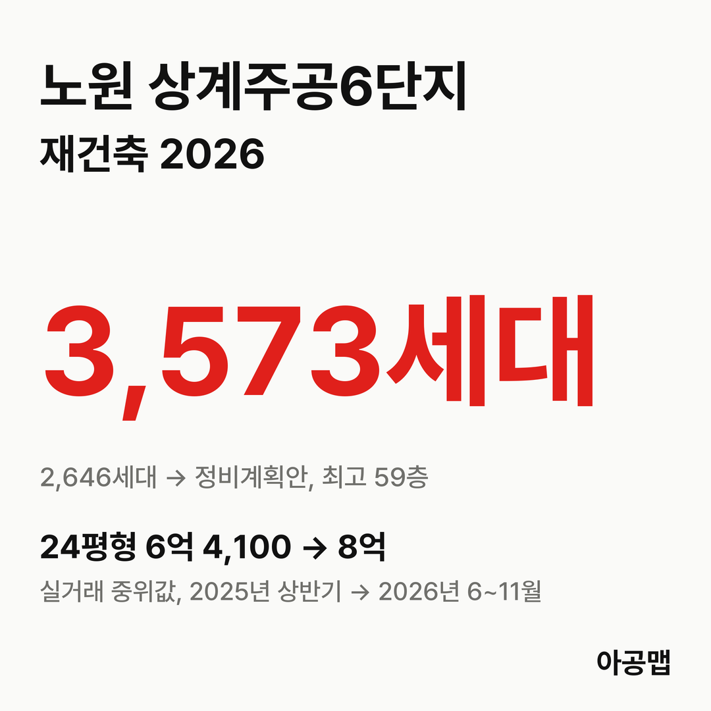
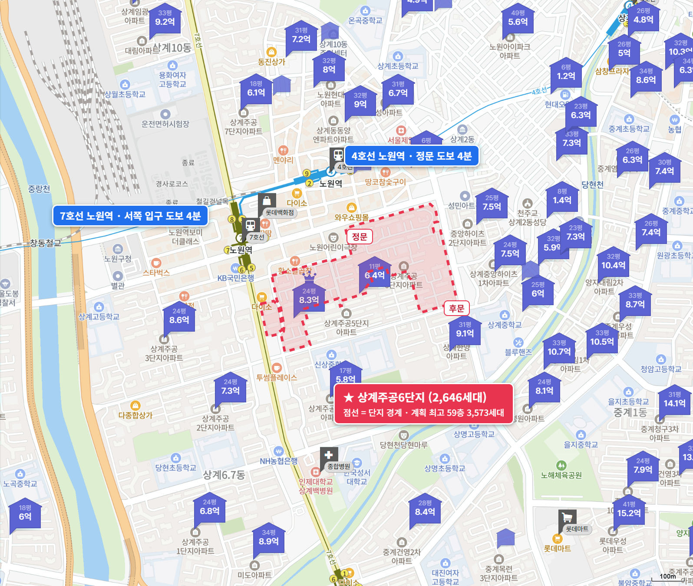
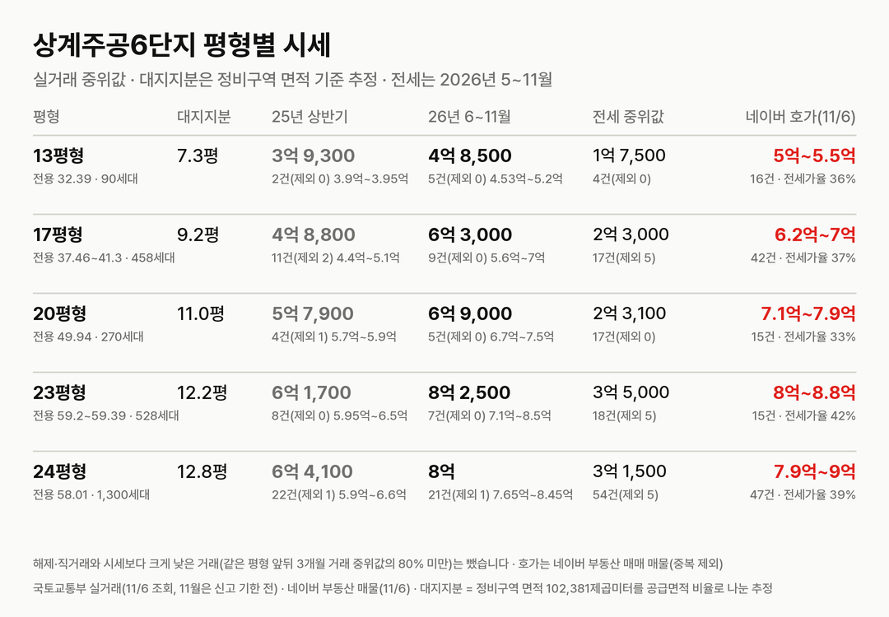
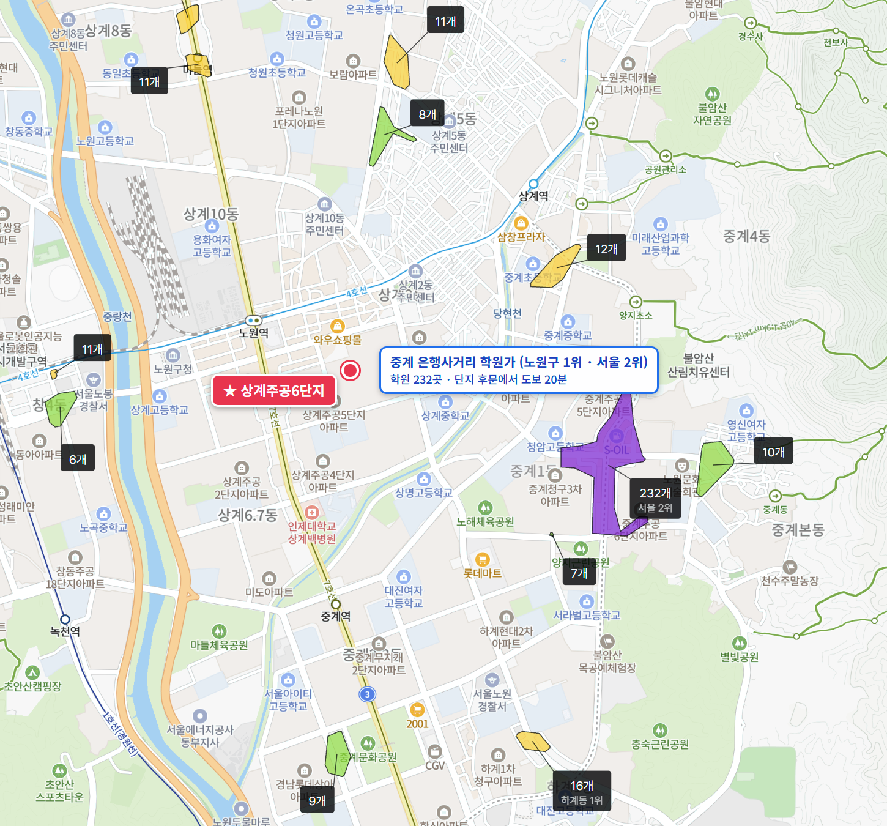

## 핵심 숫자

| 항목 | 값 | 기준 |
|---|---|---|
| 세대수 | 2,646세대(28개 동, 최고 15층) | 1988년 5월 입주, 상계동 720 일대 |
| 평형 | 13평형 90, 17평형 458, 20평형 270, 23평형 528, 24평형 1,300세대 | 전용 32~59㎡, 소형 위주 |
| 용적률·건폐율 | 193%·15% | |
| 정비구역 면적 | 102,381㎡ | 세대당 평균 38.7㎡(11.7평) |
| 세대당 주차대수 | 0.31대 | |
| 가까운 역 | 4·7호선 노원역 도보 4~7분 | 더블 역세권 |
| 배정초 | 서울상수초 | 도보 3~5분 |

## 정비 구역과 계획안

상계주공6단지 구역은 상계동 720 일대 102,380.8㎡다. 신속통합기획으로 추진하는 상계주공 단지 가운데 처음으로 정비계획 공람 단계에 들어갔다.

| 항목 | 정비계획(안)(2026-07 공람) |
|---|---|
| 세대수 | 2,646세대 → 3,573세대(+927, 공공주택 653세대 포함) |
| 규모 | 최고 59층, 35개 동 |
| 용적률 | 획지1 정비계획용적률 307.28%(법적상한 432.61%), 획지2 563.87% |
| 용도지역 | 일부를 3종일반주거에서 준주거로 상향, 사업성보정계수 1.77 |
| 사업 방식 | 조합 방식(추진위원회 승인) |

**지금은 공람을 마치고 정비구역 지정을 기다리는 단계다.** 노원구가 정비계획과 정비구역 지정안을 공람한 것이고, 정비구역 지정은 서울시 도시계획위원회 심의를 거쳐 고시된다. 추진위원회는 10월 정비사업전문관리업자와 설계자 선정 계획을 보고했다.

| 시점 | 단계 |
|---|---|
| 23.1 | 재건축 안전진단 통과 |
| 23.11 | 상계주공 단지 가운데 처음으로 신속통합기획 자문 신청 |
| 25.12.18 | 서울시, 상계 택지개발지구 지구단위계획 결정(변경) 고시(6단지는 특별계획구역12) |
| 26.3.20 | 조합설립추진위원회 승인(동의율 59.73%) |
| 26.6.4 | 노원구, 추진위원회 승인 고시 |
| 26.7.16 | 노원구, 정비계획 수립 및 정비구역 지정(안) 공람 공고(~8월 18일) |
| 다음 | 서울시 도시계획위원회 심의 → 정비구역 지정 고시 → 조합 설립 |

정비계획 수립 과정에서 공개된 추정 추가분담금은 전용 32㎡ 소유자가 새 84㎡를 받으면 약 7억 6,500만 원, 59㎡를 받으면 약 4억 4,800만 원, 49㎡를 받으면 약 2억 9,200만 원이다(헤럴드경제 2026년 11월 4일). 13평형 소유자가 국평을 받으려면 지금 집값보다 큰 돈을 더 내야 한다는 뜻이다. 후기에 올라온 글에는 조합 설립 동의율 70%를 넘겼다는 이야기가 있다.

## 평형별 대지지분과 시세

| 평형 | 대지지분(추정) | 2025년 상반기 건수(제외)·범위·중위값 | 2026년 6~11월 건수(제외)·범위·중위값 | 대지지분 1평당(2026) |
|---|---|---|---|---|
| 13평형(전용 32.39㎡, 90세대) | 7.3평 | 2건(0) 3억 9,000만~3억 9,500만, 3억 9,300만 | 5건(0) 4억 5,300만~5억 2,000만, 4억 8,500만 | 6,600만 |
| 17평형(전용 37.46~41.3㎡, 458세대) | 9.2평 | 11건(2) 4억 4,000만~5억 1,000만, 4억 8,800만 | 9건(0) 5억 6,000만~7억, 6억 3,000만 | 6,900만 |
| 20평형(전용 49.94㎡, 270세대) | 11.0평 | 4건(1) 5억 7,000만~5억 9,000만, 5억 7,900만 | 5건(0) 6억 7,000만~7억 5,000만, 6억 9,000만 | 6,300만 |
| 23평형(전용 59.2~59.39㎡, 528세대) | 12.2평 | 8건(0) 5억 9,500만~6억 5,000만, 6억 1,700만 | 7건(0) 7억 1,000만~8억 5,000만, 8억 2,500만 | 6,700만 |
| 24평형(전용 58.01㎡, 1,300세대) | 12.8평 | 22건(1) 5억 9,000만~6억 6,000만, 6억 4,100만 | 21건(1) 7억 6,500만~8억 4,500만, 8억 | 6,200만 |

해제·직거래와 시세보다 크게 낮은 거래(같은 평형 앞뒤 3개월 거래 중위값의 80% 미만)는 뺐습니다. 괄호 안은 뺀 건수다. 국토교통부 실거래에는 '상계주공6(고층)'(상계동 720)으로 올라 있다. 11월은 신고 기한 전이다. 대지지분은 건축물대장에 대지면적이 비어 있어 정비구역 면적을 평형별 공급면적 비율로 나눈 추정값이고, 구역 면적에 도로 등이 들어 있어 실제보다 클 수 있다.

2025년 6~11월 대비 2026년 6~11월 중위값은 13평형 24%, 17평형 27%, 20평형 16%, 23평형 28%, 24평형 23% 올랐다. 24평형 월 중위값은 2025년 내내 6억~6억 6,000만 원 안팎에 머물다가 추진위원회 승인 무렵인 2026년 3월 7억 5,750만 원, 공람이 열린 7월 7억 9,900만 원, 10월 8억 3,000만 원으로 올라섰다. 매매 건수는 2025년 상반기 47건, 하반기 67건, 2026년 상반기 115건, 6~11월 37건이다.

같은 상계동 재건축 단지끼리도 값이 실린 시기와 폭이 다르다. 같은 기간 중위값은 관리처분을 앞둔 상계주공5단지 전용 32㎡가 30%(최근 6개월 3건), 10월 15일 정비구역 지정 고시가 난 상계보람 전용 69㎡가 19% 올랐다. 이 단지 24평형은 그 사이인 23%다.

서울의 앞으로 3년 입주 물량은 적정물량의 {{v:share3:서울}}다. 상계주공6단지 24평형의 최근 1년 상승률은 23%다. 서울 중심지(강남 3구·용산·성동·마포·양천)가 먼저 오르고 쉬는 동안 서울 외곽(노원·도봉·강북·금천·관악·구로)이 따라 오르는 흐름이 2019년과 2023년 이후 두 번 나타났고, 11월 2일 조사 기준 서울 중심지는 최근 12주 -0.4%로 쉬고 서울 외곽은 +4.0%로 오르는 중이다. 노원구 주간 지수도 최근 4주(11월 2일 조사까지) +0.9%다. 상계주공6단지는 서울 외곽 안에서 방향은 위이고, 사업 진척만큼 값이 실리는 중인 곳이다. 제 판단으로는 서울 외곽이 따라 오르는 흐름이 이어지는 동안 상계 재건축 단지 사이의 폭 차이는 단계가 앞서는 순서대로 좁혀질 가능성이 크고, 그다음에는 다시 서울 중심지 차례가 올 수 있다.

| 평형 | 세 낀 매물 호가 | 세 낀 매물 갭(그 집 전세 보증금 기준) | 실거주 매물 호가 | 전세 실거래 건수(제외)·중위값(2026년 5~11월) | 전세가율 |
|---|---|---|---|---|---|
| 13평형 | 5건, 5억~5억 5,000만 | 3건, 3억 2,000만~3억 5,000만 | 10건, 5억~5억 5,000만 | 4건(0), 1억 7,500만 | 36% |
| 17평형 | 8건, 6억 3,000만~7억 | 3건, 4억 6,000만~5억 | 34건, 6억 2,000만~7억 | 17건(5), 2억 3,000만 | 37% |
| 20평형 | 3건, 7억 1,000만~7억 6,000만 | 1건, 5억 5,000만 | 11건, 7억 4,000만~7억 9,000만 | 17건(0), 2억 3,100만 | 33% |
| 23평형 | 4건, 8억 1,000만~8억 3,000만 | 3건, 5억~5억 3,000만 | 11건, 8억~8억 8,000만 | 18건(5), 3억 5,000만 | 42% |
| 24평형 | 9건, 7억 9,000만~8억 6,000만 | 4건, 5억 1,000만~6억 | 35건, 7억 9,000만~9억 | 54건(5), 3억 1,500만 | 39% |

호가는 네이버 부동산 매매 매물(2026년 11월 6일 조회, 중복 등록 369건은 하나로 셈) 135건이고, 세 낀 매물(전세를 안고 사는 매물)과 실거주 매물(즉시·협의 입주)로 나눴다. 갭은 세 낀 매물 호가에서 그 집 전세 보증금을 뺀 값이고, 보증금이 적힌 매물만 셌다(보증부 월세 매물은 뺐다). 전세 실거래는 시세보다 크게 낮은 거래를 같은 기준으로 뺐다. 전세가율은 2026년 6~11월 매매 중위값 대비 전세 중위값이다.

24평형 실거주 매물 호가는 7억 9,000만~9억 원으로 6~11월 실거래 중위값 8억 원과 붙어 있다. 전세가율이 33~42%로 낮아 세 낀 매물의 갭이 5억 원 안팎이다. 노원구는 서울 전역과 함께 2025년 10월 20일부터 토지거래허가구역이라 허가를 받아 사면 2년 동안 실거주해야 하고, 세 낀 매물은 세입자 계약이 끝나야 들어갈 수 있다. 표의 평형에서 실거주 매물은 101건으로 세 낀 매물 29건의 세 배가 넘는다.

## 학군과 생활 인프라

| 항목 | 이름 | 거리 |
|---|---|---|
| 배정초 | 서울상수초 | 도보 3~5분 |
| 노원 최대 학원가 | 중계 은행사거리 학원가(232개, 노원구 1위·서울 2위) | 도보 20~29분 |
| 백화점 | 롯데백화점 노원점 | 도보 8분 |
| 대형마트 | 롯데마트 중계점 | 도보 20분 |
| 대형 병원 | 인제대학교 상계백병원 | 도보 13분 |
| 공원 | 당현천근린공원 | 도보 15분 |

4·7호선 노원역과 롯데백화점, 노원 문화의 거리가 걸어서 10분 안이고, 서울 2위 학원가인 중계 은행사거리 학원가까지 걸어서 20분대다. 입주민 후기에서는 더블 역세권과 생활 편의가 장점으로, 주차난과 1988년 소형 구축의 인테리어 부담, 임대 653세대 비율이 걱정거리로 꼽힌다.

## 서울 입주 물량

{{chart:moveins:서울:2027}}

서울의 2027년 입주 물량은 {{v:moveins:서울:2027}}로 한 해 적정물량의 {{v:share:서울:2027}}다. 앞으로 3년을 합쳐도 적정물량의 {{v:share3:서울}}에 그친다. 서울 전체로는 {{v:supply:서울}}이다. 노원구 매매가는 {{v:streak:노원구}}이고, 주간 시세 흐름은 아래와 같다.

{{chart:weekly:서울 노원구}}

{{table:weekly:서울}}

상계·중계에서는 5단지가 관리처분을 앞두고 있고, 보람이 10월 정비구역 지정을 받았으며, 9·14단지가 7,112세대 통합 계획으로 자문을 신청했다. 이 단지들이 차례로 이주하면 서울 외곽에서만 수천 세대가 전셋집을 찾아 나선다. 서울은 앞으로 3년 입주가 적정물량의 {{v:share3:서울}}에 머문다. 아공맵은 이 부족이 노원 전세를 받치고, 정비 단계가 앞서는 상계 재건축 단지부터 매매가에 실릴 것으로 본다. 이 단지의 다음 변수는 서울시 도시계획위원회 심의와 정비구역 지정 고시, 그리고 조합 설립이다.

## 고른 기준

- 서울의 앞으로 3년 입주 합계 적정물량 대비 %는 사이트 모델의 '앞으로 3년'(앞으로 12분기 지어질 물량 ÷ 분기 적정물량 × 12)이다. 도시 글의 3년 합계(입주 예정 목록 기준)와 분자의 출처가 다르다.
- 최근 1년 상승률은 2025년 6~11월과 2026년 6~11월 실거래 중위값을 견준 값이다. 상계주공5단지와 상계보람은 가장 거래가 많은 평형으로 셌다. 노원구 최근 4주 주간 지수는 한국부동산원 주간 변동률 4주를 곱해 셌다.

관련 리포트: [서울 시군구 주간·월간 시세](/zone/서울/#weekly-sgg)
