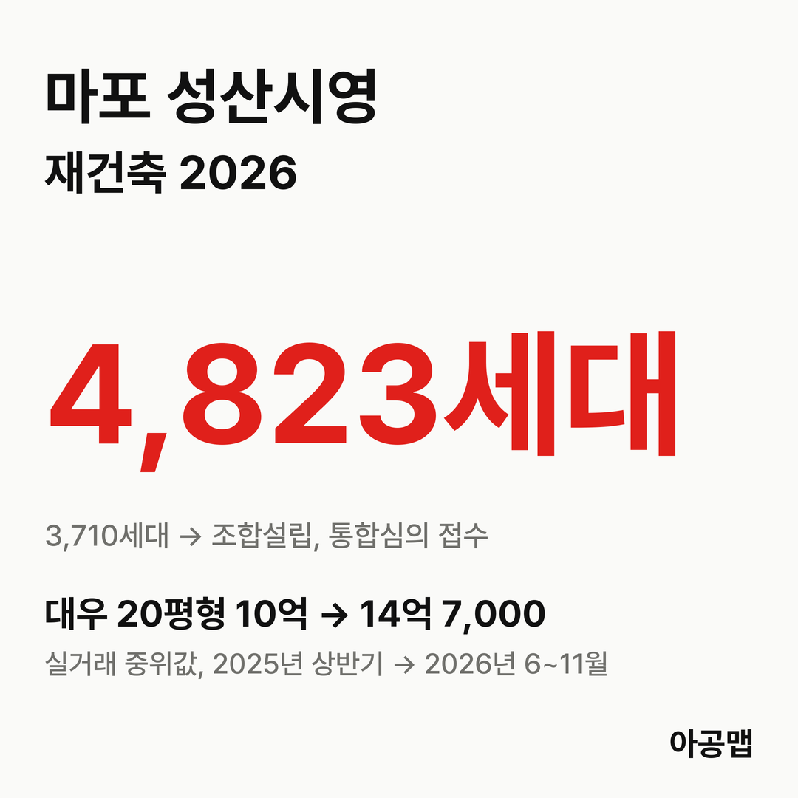
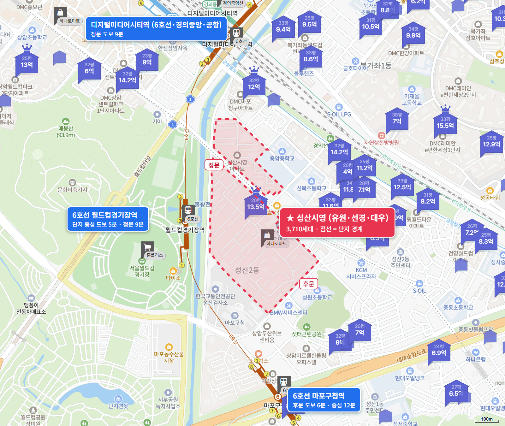
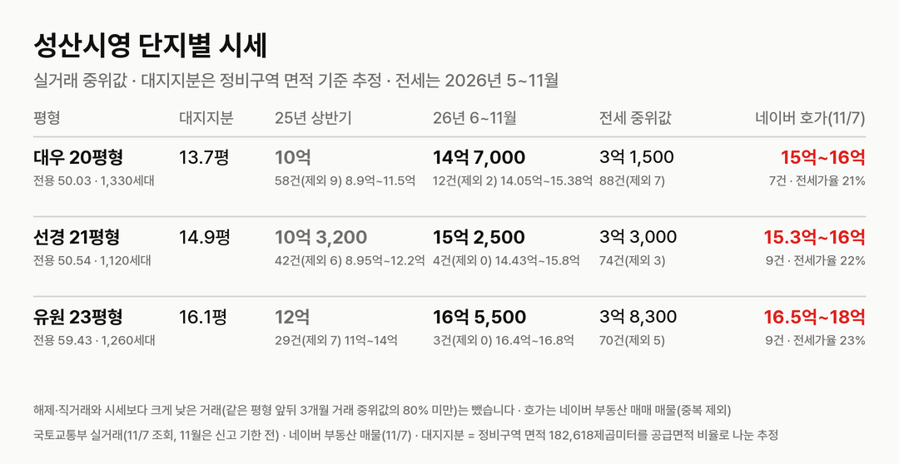
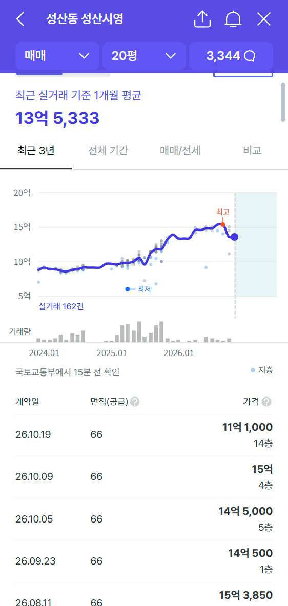
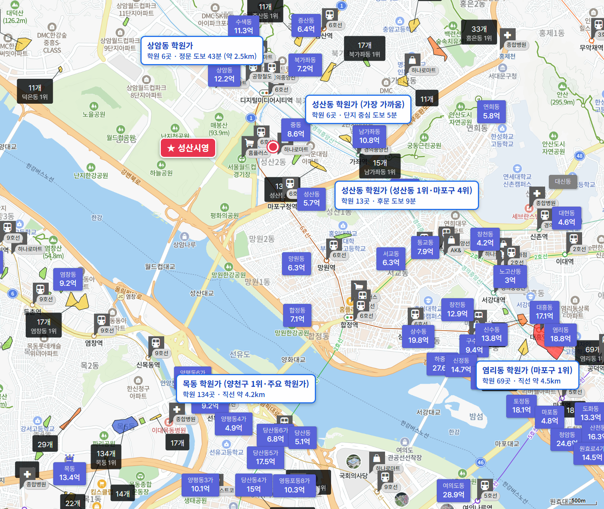

## 핵심 숫자

| 항목 | 값 | 기준 |
|---|---|---|
| 세대수 | 3,710세대(대우 1,330·선경 1,120·유원 1,260, 33개 동, 14층) | 1986년 6월 사용승인, 성산동 446 |
| 평형 | 대우 20평형, 선경 21평형, 유원 23평형 | 전용 50.03·50.54·59.43㎡, 복도식 |
| 용적률·건폐율 | 148%·10% | |
| 정비구역 면적 | 182,618㎡ | 세대당 평균 49.2㎡(14.9평) |
| 가까운 역 | 6호선 월드컵경기장역 도보 5분 | |
| 배정초 | 서울신북초 | 도보 6분 |

## 사업 단계

성산시영은 유원·선경·대우 세 단지를 하나로 묶은 재건축이다. 2023년 12월 정비구역으로 지정됐고, 추진위원회 승인 9개월 만인 2025년 12월 조합을 세웠다.

| 항목 | 정비계획(2023-12 고시) | 변경안(2026-04 의결·접수, 보도) |
|---|---|---|
| 세대수 | 3,710세대 → 4,823세대(임대 516) | 4,833세대 |
| 규모 | 최고 40층(120m) | 최고 46층(144m) |
| 용적률 | 299.96% | |
| 사업 방식 | 조합 방식 | |

**지금은 조합을 세우고 통합심의를 앞둔 단계다.** 8월 환경영향평가 초안 공람을 마쳤고, 서울시가 생태면적률 보완을 요구해 본안을 다듬는 중이라고 보도됐다. 조합은 연내 통합심의와 2027년 상반기 시공사 선정을 목표로 한다.

| 시점 | 단계 |
|---|---|
| 23.12.28 | 서울시, 정비계획 결정·정비구역 지정 고시 |
| 25.3.14 | 조합설립추진위원회 승인 |
| 25.12.22 | 조합설립인가(동의율 93.71%) |
| 26.4.25 | 임시총회, 최고 46층 정비계획 변경안 의결(보도) |
| 26.8.6 | 마포구, 환경영향평가서 초안 공람 공고(~9월 4일) |
| 다음 | 통합심의 → 시공사 선정(2027년 상반기 목표) → 사업시행인가 |

2023년 고시 기준 추정 비례율은 100.46%다. 감정평가 뒤 공식 분담금은 아직 없고, 언론 시뮬레이션에서 대우 50~59㎡ 소유자가 84㎡를 받으면 약 8억 원을 더 낸다는 추정이 나온 정도다.

## 단지별 대지지분과 시세

| 단지·평형 | 대지지분(추정) | 2025년 상반기 건수(제외)·범위·중위값 | 2026년 6~11월 건수(제외)·범위·중위값 | 대지지분 1평당(2026) |
|---|---|---|---|---|
| 대우 20평형(전용 50.03㎡, 1,330세대) | 13.7평 | 58건(9) 8억 9,000만~11억 5,000만, 10억 | 12건(2) 14억 500만~15억 3,900만, 14억 7,000만 | 1억 700만 |
| 선경 21평형(전용 50.54㎡, 1,120세대) | 14.9평 | 42건(6) 8억 9,500만~12억 2,000만, 10억 3,200만 | 4건(0) 14억 4,300만~15억 8,000만, 15억 2,500만 | 1억 300만 |
| 유원 23평형(전용 59.43㎡, 1,260세대) | 16.1평 | 29건(7) 11억~14억, 12억 | 3건(0) 16억 4,000만~16억 8,000만, 16억 5,500만 | 1억 300만 |

해제·직거래와 시세보다 크게 낮은 거래(같은 평형 앞뒤 3개월 거래 중위값의 80% 미만)는 뺐습니다. 괄호 안은 뺀 건수다. 국토교통부 실거래에는 '성산시영(대우)'·'성산시영(선경)'·'성산시영(유원)'으로 따로 올라 있다. 11월은 신고 기한 전이다. 대지지분은 건축물대장에 대지면적이 비어 있어 정비구역 면적을 단지별 공급면적 비율로 나눈 추정값이고, 구역 면적에 도로 등이 들어 있어 실제보다 클 수 있다.

2025년 6~11월 대비 2026년 6~11월 중위값은 대우 20평형 29%, 선경 21평형 24%, 유원 23평형 18% 올랐다. 오름은 2025년 하반기에 몰렸다. 대우 20평형 월 중위값은 2025년 6월 10억 4,000만 원에서 12월 13억 9,000만 원으로 뛰었고, 2026년 6월부터 10월까지는 14억~14억 8,000만 원 사이에서 제자리다. 매매 건수는 2025년 상반기 129건, 하반기 115건에서 2026년 상반기 11건, 6~11월 14건으로 줄었다. 서울 전역이 2025년 10월 20일부터 토지거래허가구역이고, 투기과열지구에서는 조합설립인가 뒤 조합원 지위 양도가 원칙적으로 제한되기 때문이다. 거래가 적은 만큼 2026년 중위값은 몇 건의 값이다.

강남 3구(강남·서초·송파)와 마포·용산·성동은 지금 자리가 갈린다. 같은 1년에 [강남 은마](/danji/eunma-daechi/)는 사업시행인가 뒤 11~12% 내려왔고, 성산시영은 조합 설립 뒤 18~29% 올랐다. 주간 지수로도 강남구는 {{v:streak:강남구}}이고, 마포구는 {{v:streak:마포구}}이다.

서울의 앞으로 3년 입주 물량은 적정물량의 {{v:share3:서울}}다. 강남 3구(강남·서초·송파)가 먼저 오르고 쉬는 동안 서울 외곽(노원·도봉·강북·금천·관악·구로)이 따라 오르는 흐름이 2019년과 2023년 이후 두 번 나타났고, 11월 2일 조사 기준 강남 3구는 최근 12주 -2.4%로 쉬고 서울 외곽은 +4.0%로 오르는 중이다. 마포구는 같은 12주 +2.6%, 최근 4주 +1.0%로 강남 3구와 달리 오르고 있다. 성산시영의 최근 1년 상승률은 18~29%이고, 2026년 6월부터는 제자리다. 이 단지는 마포·용산·성동 안에서 방향은 위지만 반영된 폭이 큰 곳이다. 제 판단으로는 거래가 묶인 동안 값은 사업 단계를 따라 움직이고, 통합심의와 시공사 선정이 다음 계단이 될 가능성이 크다.

| 단지·평형 | 네이버 매매 매물 | 전세 실거래 건수(제외)·중위값(2026년 5~11월) | 전세가율 |
|---|---|---|---|
| 대우 20평형 | 7건, 15억~16억 | 88건(7), 3억 1,500만 | 21% |
| 선경 21평형 | 9건, 15억 3,000만~16억 | 74건(3), 3억 3,000만 | 22% |
| 유원 23평형 | 9건, 16억 5,000만~18억 | 70건(5), 3억 8,300만 | 23% |

호가는 네이버 부동산 매매 매물(2026년 11월 7일 조회, 중복 등록 142건은 하나로 셈) 25건이고, 세 낀 매물은 3건, 실거주 매물은 21건이다. 보증금이 적힌 세 낀 매물은 선경 21평형 1건(15억 3,000만 원, 보증금 3억 3,000만 원)뿐이라 갭은 약 12억 원이다. 전세 실거래는 시세보다 크게 낮은 거래를 같은 기준으로 뺐다. 전세가율은 2026년 6~11월 매매 중위값 대비 전세 중위값이다.

매물은 25건으로 세대수에 비해 매우 적고, 호가는 6~11월 실거래 중위값보다 3,000만~1억 원 위다. 전세가율은 21~23%로 은마 다음으로 낮다. 토지거래허가구역이라 허가를 받아 사면 2년 동안 실거주해야 하고, 조합원 지위가 넘어가는지 매물마다 따져야 한다.

## 학군과 생활 인프라

| 항목 | 이름 | 거리 |
|---|---|---|
| 배정초 | 서울신북초(일부 성원초) | 도보 6분 |
| 가까운 학원가 | 성산동 학원가(6~13개) | 도보 5~13분 |
| 마포 최대 학원가 | 염리동 학원가(69개, 마포구 1위) | 약 4.5km, 차량 이동 |
| 대형마트 | 홈플러스 월드컵점 | 도보 9분 |
| 쇼핑몰 | 롯데몰 상암DMC점(2029년 개장 예정) | 도보 15분 |
| 공원 | 월드컵공원, 망원한강공원 | 도보 18분, 37분 |

6호선 월드컵경기장역이 걸어서 5분이고, 홈플러스와 월드컵공원·불광천·한강이 가깝다. 큰 학원가와 대형 병원은 차로 다녀야 한다. 입주민 후기에서는 평지와 공원·한강, 빠른 사업 속도가 장점으로, 주차난과 복도식 20평대 구축, 강남과의 거리가 걱정거리로 꼽힌다.

## 서울 입주 물량

{{chart:moveins:서울:2027}}

서울의 2027년 입주 물량은 {{v:moveins:서울:2027}}로 한 해 적정물량의 {{v:share:서울:2027}}다. 앞으로 3년을 합쳐도 적정물량의 {{v:share3:서울}}에 그친다. 서울 전체로는 {{v:supply:서울}}이다. 마포구 매매가는 {{v:streak:마포구}}이고, 주간 시세 흐름은 아래와 같다.

{{chart:weekly:서울 마포구}}

{{table:weekly:서울}}

성산시영이 시공사를 뽑고 사업시행인가를 거쳐 이주하면 상암·성산 일대에서 3,710세대가 한꺼번에 전셋집을 찾아 나선다. 늘어나는 세대는 1,100여 세대이고 입주는 2030년대다. 서울은 앞으로 3년 입주가 적정물량의 {{v:share3:서울}}에 머문다. 아공맵은 이 부족이 마포 전세를 받치고, 마포·용산·성동 재건축에도 사업 단계마다 값이 실리는 흐름이 이어질 것으로 본다. 이 단지의 다음 변수는 통합심의 결과와 46층 정비계획 변경 고시, 시공사 선정이다.

## 고른 기준

- 서울의 앞으로 3년 입주 합계 적정물량 대비 %는 사이트 모델의 '앞으로 3년'(앞으로 12분기 지어질 물량 ÷ 분기 적정물량 × 12)이다. 도시 글의 3년 합계(입주 예정 목록 기준)와 분자의 출처가 다르다.
- 최근 1년 상승률은 2025년 6~11월과 2026년 6~11월 실거래 중위값을 견준 값이다. 마포구 최근 4주·12주는 한국부동산원 주간 변동률을 곱해 셌다. 강남 3구·서울 외곽 12주 값은 데이터 세션 계산이다.

관련 리포트: [서울 시군구 주간·월간 시세](/zone/서울/#weekly-sgg)
