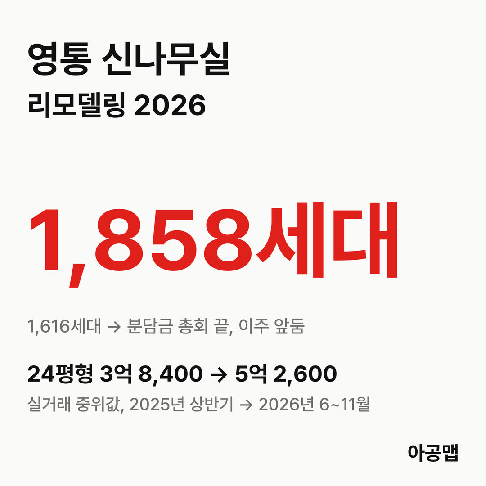
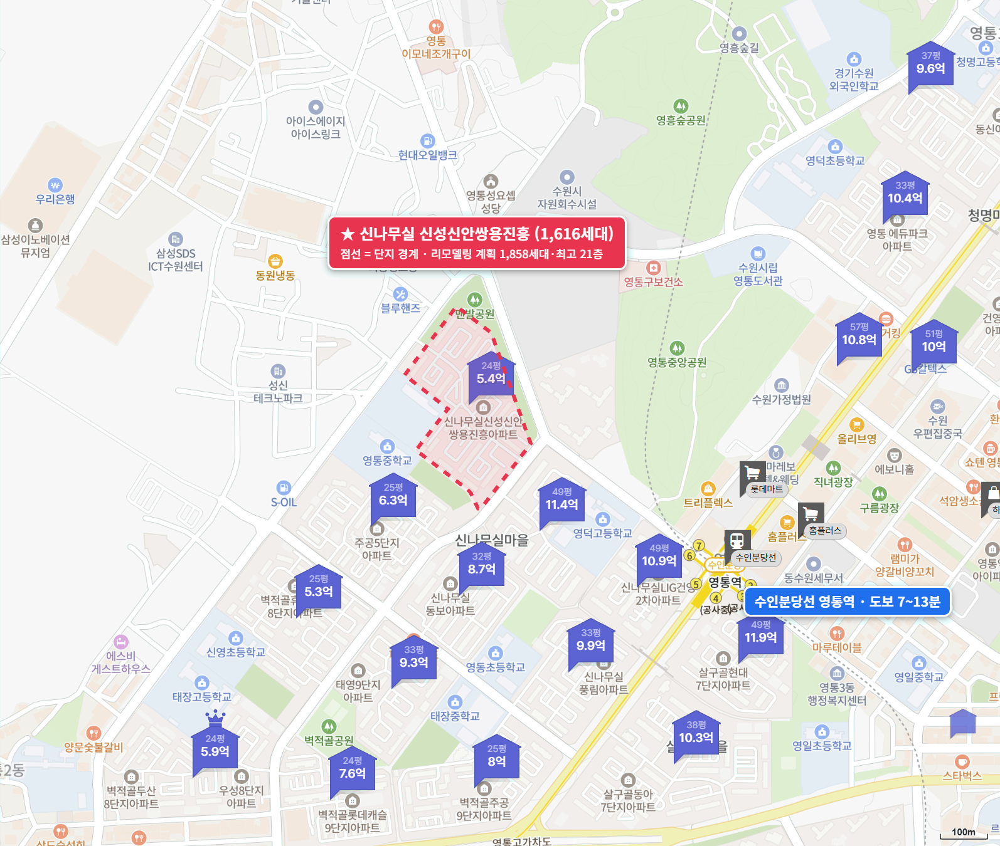
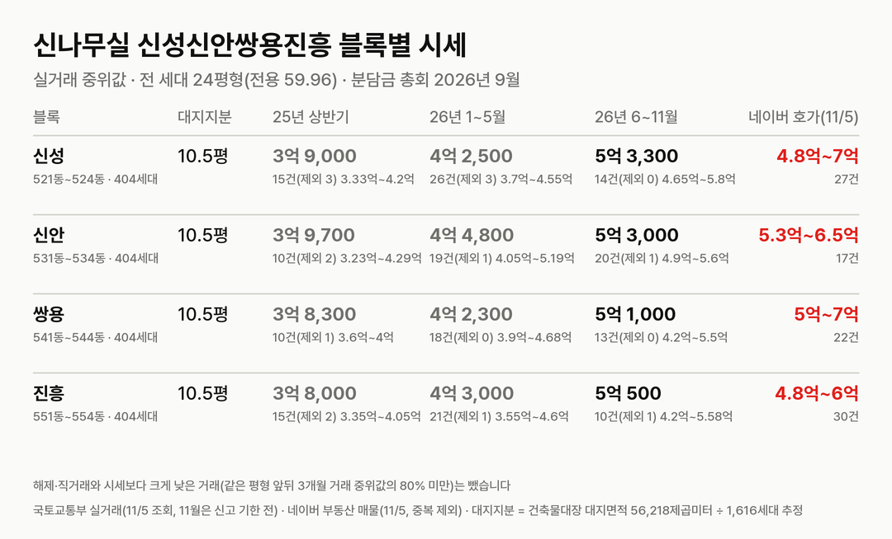
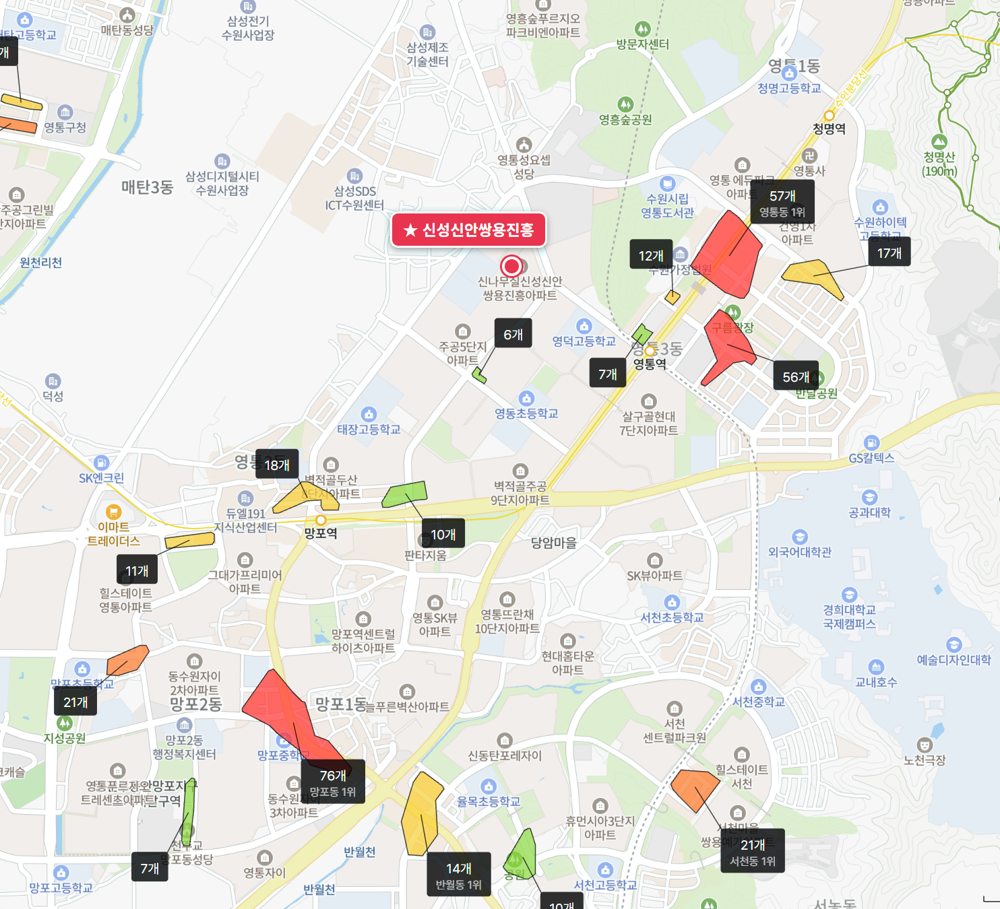

## 핵심 숫자

| 항목 | 값 | 기준 |
|---|---|---|
| 세대수 | 1,616세대(16개 동, 최고 20층) | 1997년 12월 입주, 영통동 963-2 |
| 평형 | 24평형 1,616세대 | 전 세대 전용 59.96㎡, 계단식 |
| 단지 구성 | 신성 521~524동, 신안 531~534동, 쌍용 541~544동, 진흥 551~554동 | 블록마다 404세대 |
| 용적률·건폐율 | 219%·18% | 건축물대장 용적률 219.26% |
| 대지면적 | 56,218㎡ | 세대당 평균 34.8㎡(10.5평) |
| 세대당 주차대수 | 1.02대 | |
| 가까운 역 | 수인분당선 영통역 도보 7~13분 | 망포역 17~21분 |
| 배정초 | 영통초 | 후문 도보 1분, 초품아 |

## 리모델링 사업 단계

신성·신안·쌍용·진흥 네 단지를 하나로 묶은 리모델링이다. 2024년 10월 수원시에서 처음으로 리모델링 사업계획승인을 받았다.

| 항목 | 기존 | 리모델링 뒤(2024-10 사업계획승인) |
|---|---|---|
| 세대수 | 1,616세대 | 1,858세대(+242, 일반분양) |
| 규모 | 16개 동, 최고 20층 | 19개 동, 지하 4층~지상 18~21층 |
| 사업 방식 | | 수평·별동 증축, 시공 디엘이앤씨·현대엔지니어링 |
| 평형 배정 | 전용 59㎡ | 조합원 전용 72㎡대, 일반분양 64~84㎡ |

**지금은 분담금을 확정하고 이주를 앞둔 단계다.** 9월 정기총회에서 사업계획 변경, 공사 본계약, 권리변동계획 변경과 조합원 분담금 확정안이 모두 가결됐다. 조합원 1,373명 가운데 726명이 참여했고 안건마다 684~694명이 찬성했다. 보도된 평균 분담금은 약 3억 3,000만 원이다.

| 시점 | 단계 |
|---|---|
| 20.12 | 리모델링주택조합 설립인가 |
| 24.6.17 | 사업계획승인 신청 |
| 24.10.22 | 수원시, 주택건설사업계획 승인(수원 첫 리모델링 승인, 건축허가 의제) |
| 26.9.12 | 정기총회, 분담금 확정·공사 본계약 가결 |
| 다음 | 주택도시보증공사 보증·이주비 대출 → 이주(조합 목표 2027년 1분기) → 착공 |

총회 뒤 조합 안팎의 반대도 있다. 후기에 올라온 글에는 리모델링 해산과 재건축 전환을 주장하는 쪽이 총회 결의 무효 소송과 조합장 해임 동의서를 모으고 있다는 이야기가 있다. 이주비 대출도 변수다. 조합장은 10·15 대책 뒤 이주비 마련이 쉽지 않다고 말했고(경인일보 2026년 11월 3일), 매수 시기에 따라 이주비 대출 조건이 달라진다는 안내문이 후기에 올라와 있다.

## 블록별 대지지분과 시세

| 블록 | 대지지분(추정) | 2025년 상반기 건수(제외)·범위·중위값 | 2026년 1~5월 | 2026년 6~11월 건수(제외)·범위·중위값 | 네이버 호가 |
|---|---|---|---|---|---|
| 신성(521~524동, 404세대) | 10.5평 | 15건(3) 3억 3,300만~4억 2,000만, 3억 9,000만 | 26건(3), 4억 2,500만 | 14건(0) 4억 6,500만~5억 8,000만, 5억 3,300만 | 27건, 4억 8,000만~7억 |
| 신안(531~534동, 404세대) | 10.5평 | 10건(2) 3억 2,300만~4억 2,900만, 3억 9,700만 | 19건(1), 4억 4,800만 | 20건(1) 4억 9,000만~5억 6,000만, 5억 3,000만 | 17건, 5억 3,000만~6억 5,000만 |
| 쌍용(541~544동, 404세대) | 10.5평 | 10건(1) 3억 6,000만~4억, 3억 8,300만 | 18건(0), 4억 2,300만 | 13건(0) 4억 2,000만~5억 5,000만, 5억 1,000만 | 22건, 5억~7억 |
| 진흥(551~554동, 404세대) | 10.5평 | 15건(2) 3억 3,500만~4억 500만, 3억 8,000만 | 21건(1), 4억 3,000만 | 10건(1) 4억 2,000만~5억 5,800만, 5억 500만 | 30건, 4억 8,000만~6억 |

해제·직거래와 시세보다 크게 낮은 거래(같은 평형 앞뒤 3개월 거래 중위값의 80% 미만)는 뺐습니다. 괄호 안은 뺀 건수다. 국토교통부 실거래는 네 블록을 신나무실신성·신안·쌍용·진흥으로 따로 신고한다. 11월은 신고 기한 전이다. 대지지분은 건축물대장 대지면적을 1,616세대로 나눈 추정값이다.

네 블록을 합친 중위값은 2025년 상반기 3억 8,400만 원에서 2026년 6~11월 5억 2,600만 원으로 37% 올랐다. 월 중위값은 2025년 내내 3억 6,000만~4억 원대 초반에 머물렀고, 2026년 1~5월 4억 1,000만~4억 4,000만 원, 6월 4억 9,000만 원, 7월 5억 2,500만 원으로 올라선 뒤 총회가 열린 9월 이후 5억 3,000만~5억 4,500만 원에 머물고 있다. 매매 건수는 2025년 상반기 50건, 하반기 53건, 2026년 1~5월 84건, 6~11월 57건이다. 대지지분 1평당 값은 5,000만 원이다.

같은 영통 리모델링 단지끼리 보면 오른 시기와 폭이 다르다. 2025년 6~11월 대비 2026년 6~11월 실거래 중위값은 이 단지 24평형이 35%, 2026년 5월 사업계획승인을 받은 벽적골주공8단지 전용 59㎡가 27%, 8월부터 이주 중인 [벽적골8단지 두산우성한신](/danji/byeokjeokgol8-yeongtong/) 전용 59㎡가 10%다. 세 단지 모두 방향은 위이고, 다른 것은 그 방향이 값에 언제 얼마나 실렸는가다.

수원의 앞으로 3년 입주 물량은 {{v:moveins3:수원}}로 적정물량의 {{v:share3:수원}}다. 이 단지의 최근 1년 상승률은 35%다. 수원은 3년 입주가 크게 모자라면서 이미 많이 오른 도시이고, 이 단지는 그 안에서도 방향은 위지만 반영된 폭이 큰 곳이다. 1년 동안 10% 오른 벽적골8단지 두산우성한신은 같은 부족 속에서 아직 반영이 덜 된 곳이다. 제 판단으로는 같은 동네 리모델링 단지 사이의 이 상승 폭 차이는 길게 보면 좁혀지는 쪽으로 움직일 가능성이 크다.

| 구분 | 세 낀 매물 | 실거주 매물 | 구분 못 한 매물 | 전세 실거래 건수(제외)·중위값(2026년 5~11월) | 전세가율 |
|---|---|---|---|---|---|
| 24평형 | 23건, 4억 8,000만~6억 5,000만 | 62건, 4억 8,000만~7억 | 11건, 5억~6억 5,000만 | 64건(7), 2억 8,000만 | 53% |

호가는 네이버 부동산 매매 매물(2026년 11월 5일 조회, 중복 등록 92건은 하나로 셈) 96건이고, 세 낀 매물(전세를 안고 사는 매물)과 실거주 매물(즉시·협의 입주)로 나눴다. 세 낀 매물 가운데 그 집 전세 보증금이 적힌 14건의 갭은 2억 3,000만~4억 원, 중위 2억 9,800만 원이다(보증부 월세 매물은 뺐다). 전세 실거래는 시세보다 크게 낮은 거래를 같은 기준으로 뺐다. 전세가율은 2026년 6~11월 매매 중위값 대비 전세 중위값이다.

매물이 96건으로 단지 규모에 비해 많고, 중위 호가 5억 5,000만 원이 6~11월 실거래 중위값 5억 2,600만 원과 붙어 있다. 영통구는 2025년 10월 20일부터 토지거래허가구역이라 허가를 받아 사면 2년 동안 실거주해야 하고, 세 낀 매물은 세입자 계약이 끝나야 들어갈 수 있다. 이주가 2027년 1분기로 잡혀 있어 지금 사면 이주비 대출 조건과 실거주 시점을 함께 따져야 한다.

## 학군과 생활 인프라

| 항목 | 이름 | 거리 |
|---|---|---|
| 배정초 | 영통초 | 후문 도보 1분, 초품아 |
| 가까운 학원가 | 영통역 동쪽 영통동 학원가(57개, 영통동 1위) | 도보 17~22분 |
| 영통 최대 학원가 | 망포동 학원가(76개, 영통구 1위) | 도보 34~37분 |
| 대형마트 | 홈플러스 영통점 | 도보 12~18분 |
| 백화점·쇼핑몰 | 갤러리아백화점 광교점, 롯데몰 광교점 | 약 4km, 차량 이동 |
| 대형 병원 | 아주대학교병원 | 약 4km, 차량 이동 |
| 공원 | 영통중앙공원 | 도보 6~11분 |

영통역과 삼성디지털시티가 가깝고, 영통초가 단지에 붙어 있다. 큰 학원가와 백화점·대형 병원은 차로 다녀야 한다. 입주민 후기에서는 영통역·삼성전자 출퇴근·초품아와 사업 일정이 정해진 점이 장점으로, 분담금과 이주비 부담, 조합 운영을 둘러싼 갈등이 걱정거리로 꼽힌다.

## 수원 입주 물량

{{chart:moveins:수원}}

{{table:moveins:수원}}

수원의 2027년 입주 물량은 {{v:moveins:수원:2027}}로 한 해 적정물량 {{v:need:수원}}의 {{v:share:수원:2027}}다. 2028년은 {{v:share:수원:2028}}, 2029년은 {{v:share:수원:2029}}로, 앞으로 3년 합계는 {{v:moveins3:수원}}로 적정물량의 {{v:share3:수원}}다. 적정물량은 2026년 9월 주민등록 인구를 가구당 2.5명으로 나눈 가구 수의 2%로 잡는다. 영통구 매매가는 {{v:streak:영통구}}이고, 주간 시세 흐름은 아래와 같다.

{{chart:weekly:수원 영통구}}

{{table:weekly:수원}}

영통에서는 벽적골8단지 두산우성한신이 이주 중이고, 이 단지가 2027년 1분기, 벽적골주공8단지가 2027년 중 이주를 계획한다. 세 단지만 5,000세대가 넘는다. 리모델링으로 늘어나는 세대는 단지마다 수백 세대에 그쳐, 수원의 앞으로 3년 입주가 적정물량의 {{v:share3:수원}}에 그치는 부족을 메우지 못한다. 아공맵은 영통 리모델링 이주가 이어지는 동안 수원 전세가 받쳐지고, 그 압력이 이주 단계 단지들의 매매가를 계속 위로 밀 것으로 본다. 이 단지의 다음 변수는 이주 기간 공고와 이주비 대출 조건이다.

## 고른 기준

- 앞으로 3년 입주 합계와 적정물량 대비 %는 자료 기준월 다음 해부터 3년(지금은 2027~2029년) 입주 예정 물량 합계를 한 해 적정물량의 3배로 나눈 값이다.
- 최근 1년 상승률은 2025년 6~11월과 2026년 6~11월 실거래 중위값을 견준 값이고, 같은 기준으로 해제·직거래와 시세보다 크게 낮은 거래를 뺐다. 벽적골 두 단지는 가장 거래가 많은 전용 59㎡ 평형으로 셌다.

관련 리포트: [경기 시군구 주간·월간 시세](/zone/경기/#weekly-sgg)
