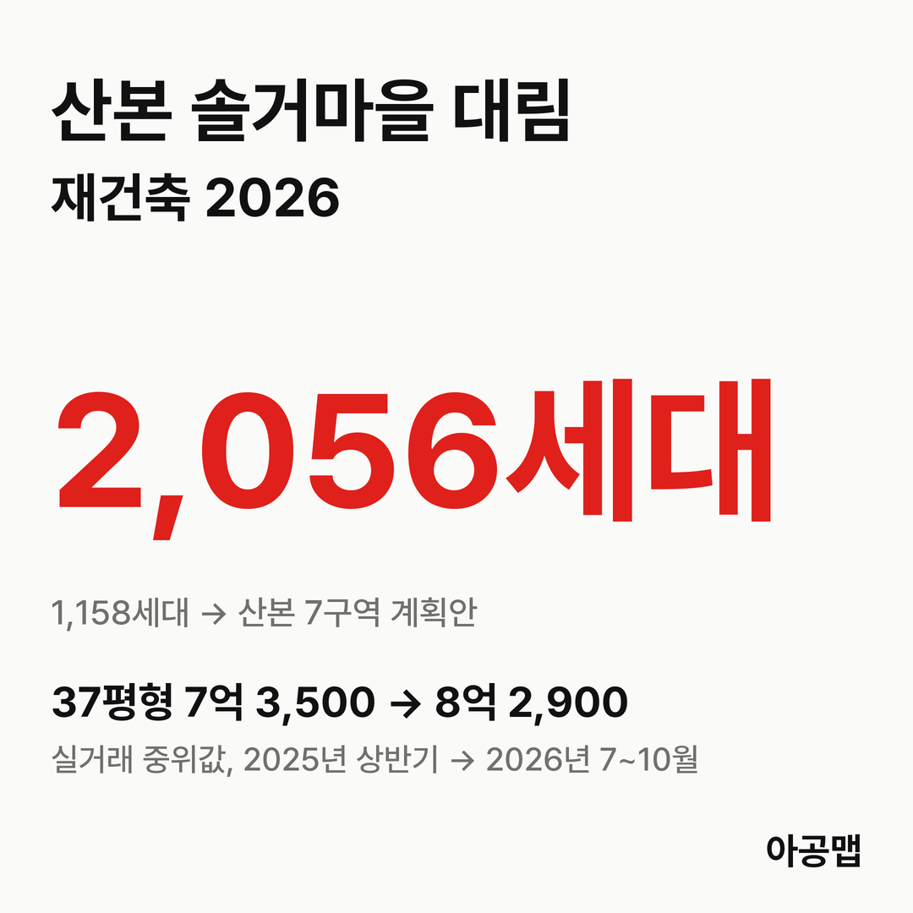
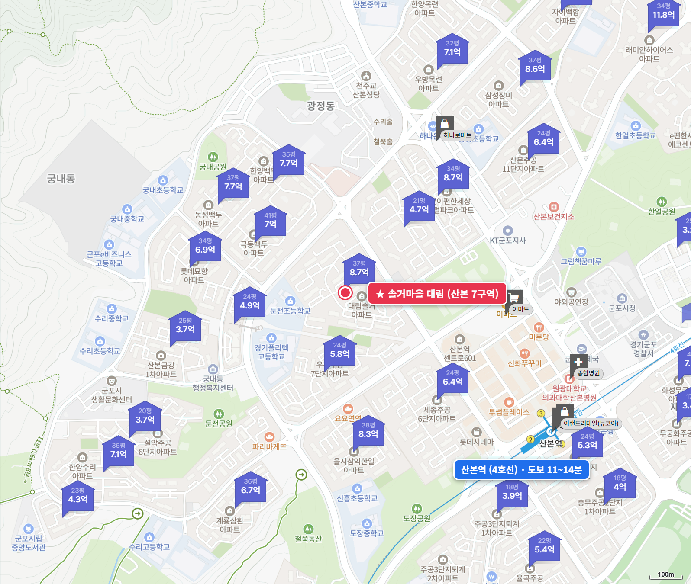
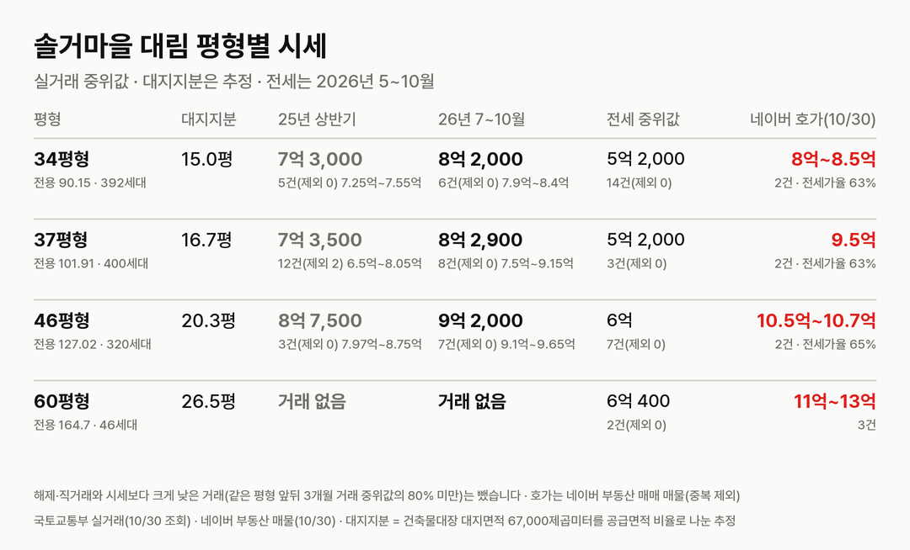
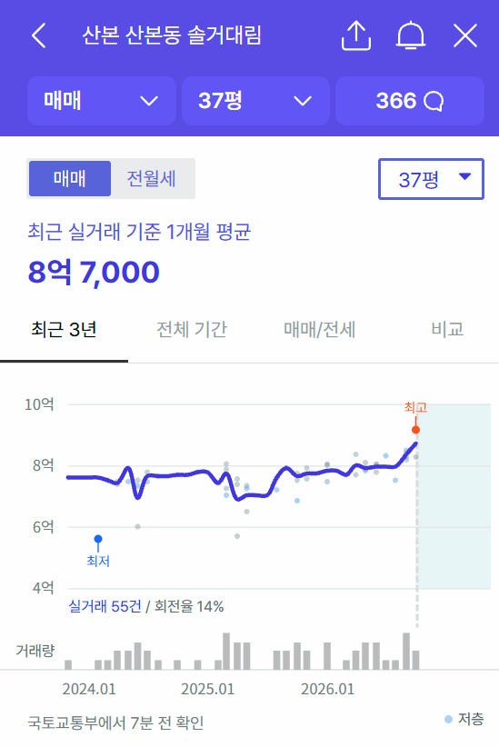
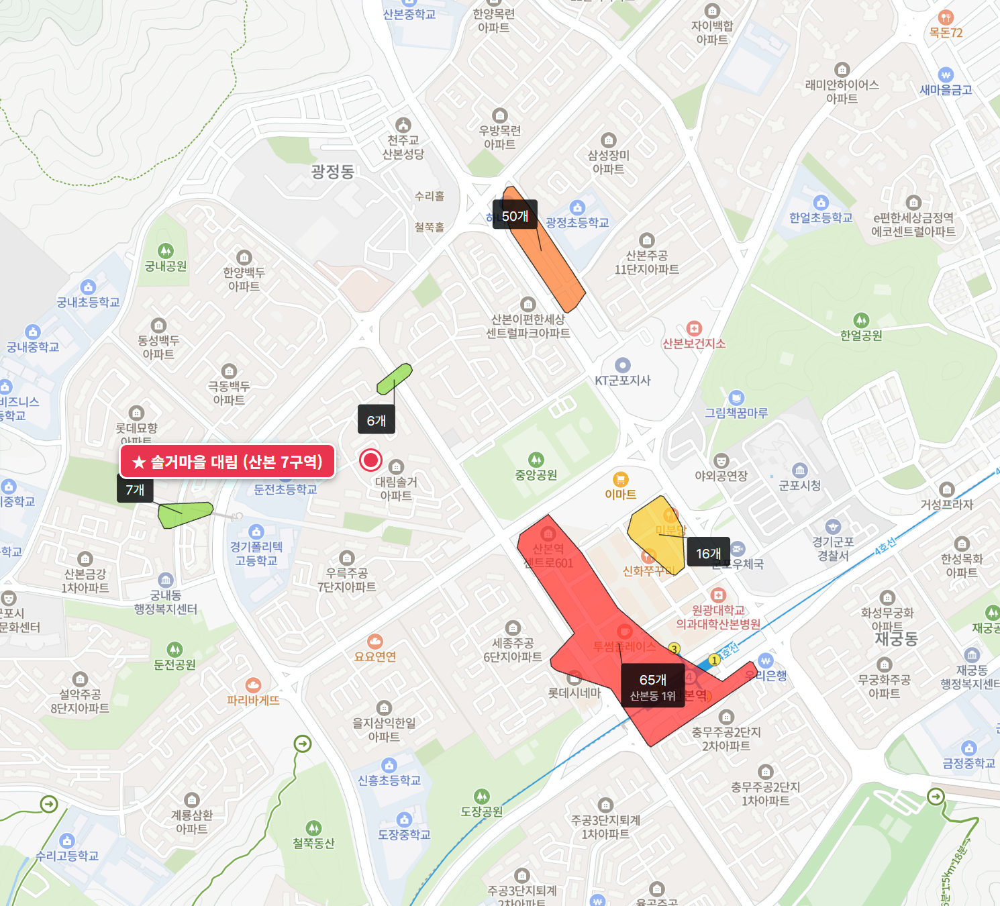

{{chart:moveins:군포}}

## 핵심 숫자

| 항목 | 값 | 기준 |
|---|---|---|
| 세대수 | 1,158세대(16개 동, 최고 25층) | 1993년 9월 입주, 산본동 1146 |
| 평형 | 34평형 392, 37평형 400, 46평형 320, 60평형 46세대 | 전용 90.15·101.91·127.02·164.7㎡, 모두 중대형 |
| 용적률·건폐율 | 221%·15% | 건축물대장 용적률 220.54% |
| 대지면적 | 67,000㎡ | 세대당 평균 57.9㎡(17.5평) |
| 세대당 주차대수 | 1.02대 | |
| 가까운 역 | 4호선 산본역 도보 11~14분 | 후문 11분 |
| 배정초 | 둔전초 | 단지 바로 옆, 정문 도보 6분 |

## 정비 구역과 사업 단계

산본 7구역은 산본동 1146번지 일원 99,173.7㎡로, 솔거마을 대림 한 단지가 쓰는 단독 구역이다.

| 항목 | 주민 계획안(2026-10 공람) |
|---|---|
| 세대수 | 1,158세대 → 2,056가구(+898) |
| 사업 방식 | 신탁 방식(예비사업시행자 한국토지신탁) |
| 공람 | 2026-10-27 ~ 11-13, 군포시청 별관 2층 도시정비과 |
| 사업 기간 | 착수 2026년, 준공 예정 2035년 |

**지금은 '지정 제안 수용' 단계다.** 군포시가 주민 과반 동의와 구비 서류를 확인하고 제안을 받아들인 것이고, 특별정비구역 지정은 공람과 주민 의견 수렴, 관계기관 협의를 거친 뒤에 나온다.

| 시점 | 단계 |
|---|---|
| 2026-07 | 한국토지신탁 예비사업시행자 지정 |
| 2026-08-11 | 특별정비계획(안) 군포시 제출(주민대표단 안내문) |
| 2026-09 | 노후계획도시 자문위원회 자문 |
| 2026-10-23 | 군포시, 예비사업시행자 승인·고시 |
| 2026-10-26 | 군포시, 7구역 특별정비구역 지정 제안 수용 |
| 2026-10-27 ~ 11-13 | 특별정비계획(안) 주민공람 |
| 다음 | 주민 의견·관계기관 협의 → 12월 말 지정 여부 결정 |

같은 날 군포시는 3-1구역(율곡·퇴계 4,034 → 5,183가구), 12구역(신안모란·한양목련·우방목련 2,548 → 4,080가구), 13구역(동백우성 624 → 1,111가구)의 제안도 함께 받았다. 7구역은 기존 세대 대비 1.78배로 늘려 4개 구역 가운데 13구역과 함께 증가율이 가장 높다. [율곡주공3단지](/danji/yulgok3-sanbon/) 편에서 다룬 3-1구역과 같은 차수다. 공람 자료에는 토지등소유자별 분담금 추산액이 들어 있지만 숫자는 공개 보도로 확인하지 못해 싣지 않는다.

## 평형별 대지지분과 시세

| 평형 | 대지지분(추정) | 2025년 상반기 건수(제외)·범위·중위값 | 2026년 7~10월 건수(제외)·범위·중위값 | 대지지분 1평당(2026) |
|---|---|---|---|---|
| 34평형(전용 90.15㎡, 392세대) | 15.0평 | 5건(0) 7억 2,500만~7억 5,500만, 7억 3,000만 | 6건(0) 7억 9,000만~8억 4,000만, 8억 2,000만 | 5,500만 |
| 37평형(전용 101.91㎡, 400세대) | 16.7평 | 12건(2) 6억 5,000만~8억 500만, 7억 3,500만 | 8건(0) 7억 5,000만~9억 1,500만, 8억 2,900만 | 5,000만 |
| 46평형(전용 127.02㎡, 320세대) | 20.3평 | 3건(0) 7억 9,700만~8억 7,500만, 8억 7,500만 | 7건(0) 9억 1,000만~9억 6,500만, 9억 2,000만 | 4,500만 |
| 60평형(전용 164.7㎡, 46세대) | 26.5평 | 거래 없음 | 거래 없음 | - |

해제·직거래와 시세보다 크게 낮은 거래(같은 평형 앞뒤 3개월 거래 중위값의 80% 미만)는 뺐습니다. 괄호 안은 뺀 건수다. 대지지분은 건축물대장 대지면적을 평형별 공급면적 비율로 나눈 추정값이다.

2025년 상반기 대비 2026년 7~10월 중위값은 34평형 12%, 37평형 13%, 46평형 5% 올랐다. 매매 건수는 2025년 상반기 20건, 하반기 24건, 2026년 상반기 39건, 7~10월 21건이다. 같은 날 지정 제안이 수용된 율곡주공3단지 22평형이 같은 기간 50% 오른 것과 비교하면 오름폭이 4분의 1 수준이다. 대지지분은 율곡 22평형(9.8평)의 1.5~2배인데 대지지분 1평당 값은 4,500만~5,500만 원으로 율곡(5,000만~5,300만 원)과 비슷하거나 낮다. 대지지분에 비해 가격이 덜 오른 쪽이다.

| 평형 | 세 낀 매물 호가 | 세 낀 매물 갭(그 집 전세 보증금 기준) | 실거주 매물 호가 | 전세 실거래 건수·중위값(2026년 5~10월) | 전세가율 |
|---|---|---|---|---|---|
| 34평형 | 1건, 8억(보증부 월세) | - | 1건, 8억 5,000만 | 14건, 5억 2,000만 | 63% |
| 37평형 | 1건, 9억 5,000만 | 3억 8,000만 | 1건, 9억 5,000만 | 3건, 5억 2,000만 | 63% |
| 46평형 | 없음 | - | 2건, 10억 5,000만~10억 7,000만 | 7건, 6억 | 65% |
| 60평형 | 없음 | - | 3건, 11억~13억 | 2건, 6억 400만 | - |

호가는 네이버 부동산 매매 매물(2026-10-30 조회, 중복 등록 16건은 하나로 셈) 9건이고, 세 낀 매물(전세를 안고 사는 매물)과 실거주 매물(즉시·협의 입주)로 나눴다. 갭은 세 낀 매물 호가에서 그 집 전세 보증금을 뺀 값이고, 보증부 월세 매물은 갭에서 뺐다. 전세가율은 2026년 7~10월 매매 중위값 대비 전세 중위값이다.

매물이 9건뿐이고 실거주 매물 호가는 실거래 중위값보다 3,000만~1억 5,000만 원 위에 있다. 전세가율이 63~65%로 높아 매매가와 전세가가 가깝다. 군포는 토지거래허가구역이 아니어서 세 낀 매수가 가능하다.

## 학군과 생활 인프라

| 항목 | 이름 | 거리 |
|---|---|---|
| 배정초 | 둔전초 | 단지 바로 옆, 초품아 |
| 가까운 학원가 | 정문 앞 산본동 학원가(6개), 한숲사거리 학원가 | 도보 0~5분 |
| 산본 최대 학원가 | 산본역~중심상가 산본동 학원가(65개, 군포 최대) | 후문 도보 8분, 정문 11분 |
| 쇼핑몰 | 롯데피트인 산본점, 뉴코아아울렛 산본점 | 도보 7~14분 |
| 대형마트 | 이마트 산본점 | 후문 도보 6분 |
| 대형 병원 | 원광대학교 산본병원 | 도보 12~15분 |
| 공원·도서관 | 산본 중앙공원, 산본도서관 | 도보 6~7분, 1분 |

산본 중심상가와 군포 최대 학원가가 걸어서 10분 안팎이고, 둔전초가 단지 옆에 붙어 있다. 입주민 후기에서는 이 입지와 우륵7단지 사이의 차 없는 산책로가 장점으로, 재건축 분담금과 이자 부담이 걱정거리로 꼽힌다.

## 군포 입주 물량

{{table:moveins:군포}}

군포의 2027년 입주 물량은 {{v:moveins:군포:2027}}로 한 해 적정 입주량 {{v:need:군포}}의 {{v:share:군포:2027}}다. 적정 입주량은 2026년 9월 주민등록 인구를 가구당 2.5명으로 나눈 가구 수의 2%로 잡는다. 군포 매매가는 {{v:streak:군포}}이고, 주간 시세 흐름은 아래와 같다.

{{chart:weekly:군포}}

{{table:weekly:군포}}

군포는 2027년부터 2029년까지 해마다 입주 물량이 적정 입주량에 못 미친다. 같은 날 수용된 산본 4개 구역만 기존 8,364가구이고, 이주가 이어지면 신축이 모자란 군포에서 전세 수요가 늘어난다. 아공맵은 이 단지처럼 대지지분이 크고 가격이 덜 오른 중대형 구축이 정비 일정이 확정되는 대로 키를 맞출 것으로 본다. 이 단지의 다음 변수는 공람 자료의 분담금 추산액과 12월 말 특별정비구역 지정이다.

관련 리포트: [경기 시군구 주간·월간 시세](/zone/경기/#weekly-sgg)
