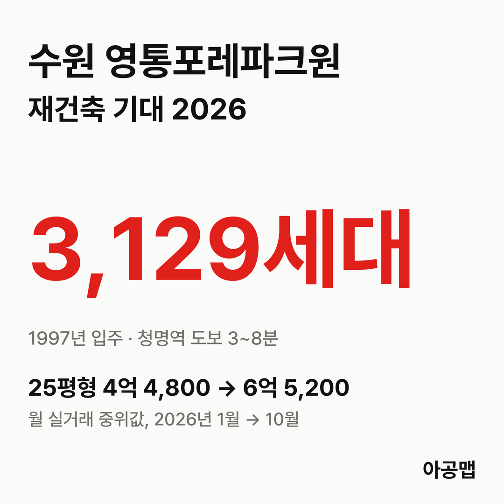
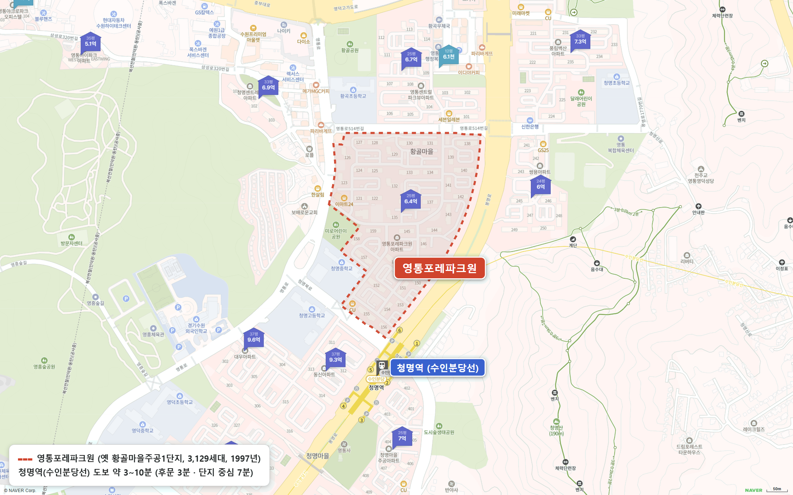
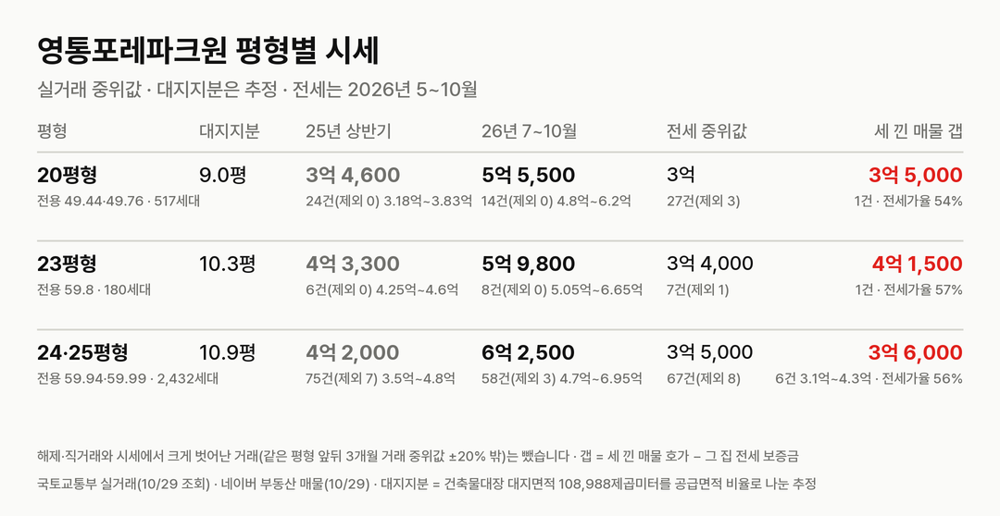
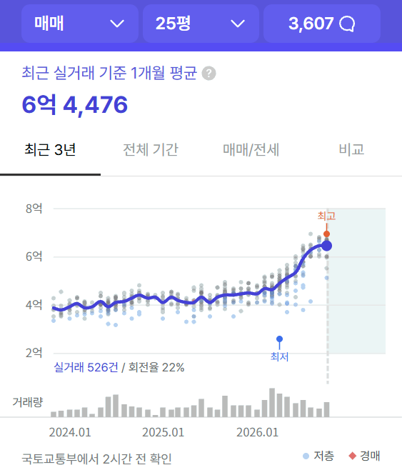
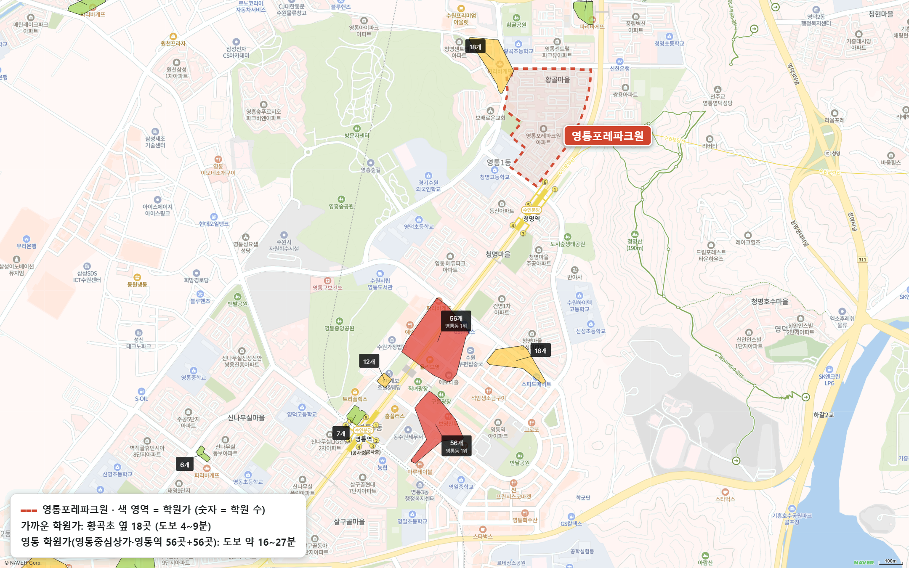

## 핵심 숫자

| 항목 | 값 | 기준 |
|---|---|---|
| 세대수 | 3,129세대(39개 동, 최고 20층) | 1997년 12월 입주, 옛 이름 황골마을주공1단지 |
| 평형 | 20평형 517세대, 23평형 180세대, 24·25평형 2,432세대 | 전용 49.44~59.99㎡, 모두 소형 |
| 용적률·건폐율 | 216%·17% | 건축물대장 용적률 215.75% |
| 대지면적 | 108,988㎡ | 세대당 평균 34.8㎡(10.5평) |
| 세대당 주차대수 | 0.89대 | |
| 가까운 역 | 수인분당선 청명역 도보 3~8분 | 후문 3분, 단지 중심 7분 |
| 배정초 | 황곡초 | 정문 도보 3분, 단지 중심 8분 |

## 정비 단계

영통지구(약 2만 7,000세대)는 2024년 시행된 노후계획도시 특별법의 대상이고, 수원시가 정비기본계획을 세우는 중이다. 기본계획이 확정되면 선도지구 공모가 열린다. 2026년 9월 17일에는 경기도가 영통에서 노후계획도시 정책설명회를 열었고, 10월에는 영통 살구골7단지 등에서 신탁 방식 통합재건축 설명회가 잡혔다.

**영통포레파크원은 아직 정비구역도, 추진 주체도 정해지지 않은 '기대 단계'다.** 재건축 추진준비위원회나 주민대표단 구성, 공식 동의서 징구, 통합재건축 권역은 공식 자료로 확인되지 않았다. 입주민 후기에 올라온 글로는 2026년 5월 재건축·리모델링 논의가 시작됐고, 7월 재건축 쪽 소통방 참여자가 300명을 넘었다. 리모델링은 반대 의견이 많다. 후기마다 선도지구 선정에 소유주 동의율이 가장 중요하다는 말이 되풀이된다.

| 시점 | 단계 |
|---|---|
| 1997-12 | 황골마을주공1단지 입주 |
| 2024 | 노후계획도시 특별법 시행, 영통지구 대상 |
| 2026-05 | 입주민 재건축·리모델링 논의 시작(후기) |
| 2026-07 | 재건축 소통방 300명 넘음(후기) |
| 2026-09-17 | 경기도 영통 노후계획도시 정책설명회 |
| 다음 | 영통 정비기본계획 확정 → 선도지구 공모 |

## 평형별 대지지분과 시세

| 평형 | 대지지분(추정) | 2025년 상반기 건수(제외)·범위·중위값 | 2026년 7~10월 건수(제외)·범위·중위값 | 대지지분 1평당(2026) |
|---|---|---|---|---|
| 20평형(전용 49.44·49.76㎡, 517세대) | 9.0평 | 24건(0) 3억 1,800만~3억 8,300만, 3억 4,600만 | 14건(0) 4억 8,000만~6억 2,000만, 5억 5,500만 | 6,100만 |
| 23평형(전용 59.8㎡, 180세대) | 10.3평 | 6건(0) 4억 2,500만~4억 6,000만, 4억 3,300만 | 8건(0) 5억 500만~6억 6,500만, 5억 9,800만 | 5,800만 |
| 24·25평형(전용 59.94·59.99㎡, 2,432세대) | 10.9평 | 75건(7) 3억 5,000만~4억 8,000만, 4억 2,000만 | 59건(2) 4억 7,000만~6억 9,500만, 6억 2,500만 | 5,700만 |

해제·직거래와 시세보다 크게 낮은 거래(같은 평형 앞뒤 3개월 거래 중위값의 80% 미만)는 뺐습니다. 괄호 안은 뺀 건수다. 국토교통부 실거래에는 옛 이름 '황골마을주공1'(영통동 955-1)로 올라 있다. 대지지분은 건축물대장 대지면적을 평형별 공급면적 비율로 나눈 추정값이다.

2025년 상반기 대비 2026년 7~10월 중위값은 20평형 60%, 23평형 38%, 24·25평형 49% 올랐다. 세대의 75%를 차지하는 전용 59.99㎡ 월 중위값은 1월 4억 4,800만 원에서 6월 5억 4,700만 원, 10월 6억 5,200만 원이 됐다(10월은 18건, 신고 기한 전). 매매 건수는 2025년 상반기 105건, 하반기 101건, 2026년 상반기 171건, 7~10월 81건이다. 정비구역 지정도 추진 주체도 없는 단지에서 이만큼 올랐다는 것은 영통 소형 구축 자체가 모자라다는 뜻이다.

| 평형 | 세 낀 매물 호가 | 세 낀 매물 갭(그 집 전세 보증금 기준) | 실거주 매물 호가 | 전세 실거래 건수(제외)·중위값(2026년 5~10월) | 전세가율 |
|---|---|---|---|---|---|
| 20평형 | 3건, 5억 5,000만~6억 | 3억 5,000만(전세 1건, 나머지 2건은 월세) | 4건, 6억 4,000만~7억 | 27건(3), 3억 | 54% |
| 23평형 | 1건, 7억 | 4억 1,500만 | 2건, 6억 3,000만 | 7건(1), 3억 4,000만 | 57% |
| 24·25평형 | 11건, 6억~7억 5,000만(중위 6억 5,000만) | 6건, 3억 1,000만~4억 3,000만(중위 3억 6,000만) | 20건, 6억 5,000만~7억 5,000만(중위 7억) | 67건(8), 3억 5,000만 | 56% |

호가는 네이버 부동산 매매 매물(2026-10-29 조회, 중복 등록 37건은 하나로 셈) 44건이고, 세 낀 매물(전세를 안고 사는 매물)과 실거주 매물(즉시·협의 입주)로 나눴다. 갭은 세 낀 매물 호가에서 그 집 전세 보증금을 뺀 값이고, 보증금이 적히지 않았거나 월세인 매물은 갭에서 뺐다. 전세가율은 2026년 7~10월 매매 중위값 대비 전세 중위값이다.

24·25평형 중위 호가는 세 낀 매물 6억 5,000만 원, 실거주 매물 7억 원으로 5,000만 원 차이가 난다. 영통구는 2025년 10월 20일부터 토지거래허가구역이라 허가를 받아 사면 2년 동안 실거주해야 하고, 무주택자 주택담보대출은 집값의 40%까지다. 세 낀 매물은 세입자 계약이 끝나야 들어갈 수 있어 살 수 있는 사람이 좁고, 그만큼 호가가 낮다. 실거주 매물 7억 원을 사려면 대출 한도 2억 8,000만 원을 빼고 4억 2,000만 원의 현금이 든다.

## 학군과 생활 인프라

| 항목 | 이름 | 거리 |
|---|---|---|
| 학교 | 황곡초, 청명중·청명고 | 황곡초 정문 도보 3분, 청명중·고는 단지 남서쪽 옆 |
| 가까운 학원가 | 황곡초 옆 영통동 학원가(18개) | 도보 4~9분 |
| 영통 대표 학원가 | 영통역~영통중심상가 학원가(56개 두 곳) | 도보 16~27분 |
| 쇼핑몰 | 수원프리미엄아울렛 | 도보 6~11분 |
| 대형마트 | 홈플러스 영통점 | 도보 20~24분 |
| 대형 병원 | 아주대학교병원 | 직선 약 3.4km, 차로 이동 |
| 공원 | 황골공원, 영흥숲공원·영흥수목원 | 도보 6~11분, 11~16분 |

청명역 초역세권이고 초·중·고가 단지 옆에 있다. 입주민 후기에서는 역세권과 대단지 환금성이 장점으로, 세대당 0.89대인 주차와 구축 소형 평면이 단점으로 꼽힌다.

## 수원 입주 물량

{{chart:moveins:수원}}

{{table:moveins:수원}}

수원의 2027년 입주 물량은 {{v:moveins:수원:2027}}, 2028년은 {{v:moveins:수원:2028}}로 한 해 적정물량 {{v:need:수원}}의 {{v:share:수원:2027}}, {{v:share:수원:2028}}다. 적정물량은 2026년 9월 주민등록 인구를 가구당 2.5명으로 나눈 가구 수의 2%로 잡는다. 영통구 매매가는 {{v:streak:영통구}}이고, 주간 시세 흐름은 아래와 같다.

{{chart:weekly:수원 영통구}}

{{table:weekly:수원}}

수원은 2027·2028년 입주 물량이 적정물량의 3분의 1 수준에 머문다. 같은 영통동의 벽적골8단지 1,842세대가 2026년 8월부터 리모델링 이주에 들어가 전세 수요가 이미 늘었다. 아공맵은 영통 구축 소형의 매매·전세가 모두 버틸 것으로 본다. 이 단지의 다음 변수는 영통 정비기본계획의 기준용적률과 선도지구 공모 시점, 그리고 어느 단지와 통합재건축 권역으로 묶이느냐다.

관련 리포트: [경기 시군구 주간·월간 시세](/zone/경기/#weekly-sgg)
