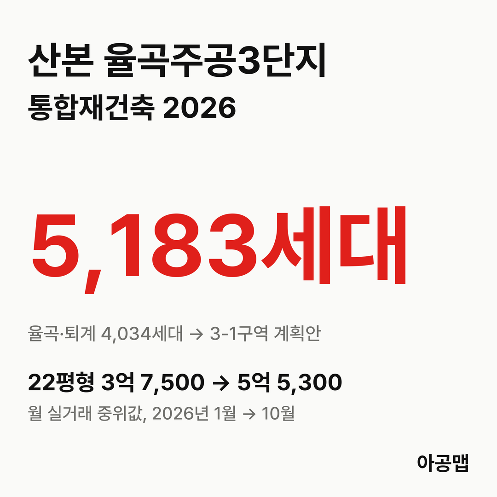
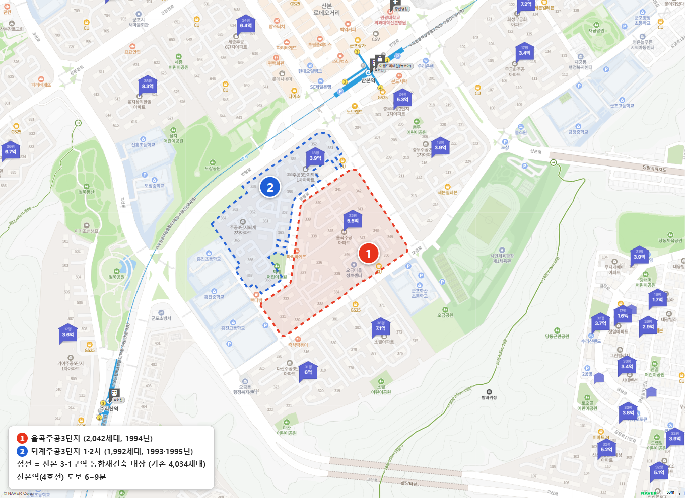
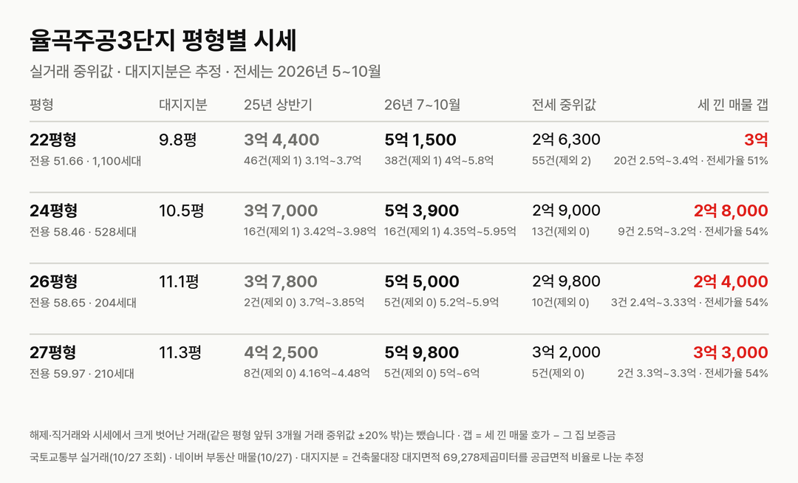
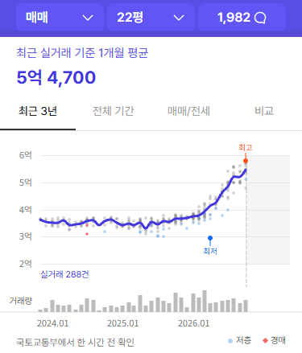
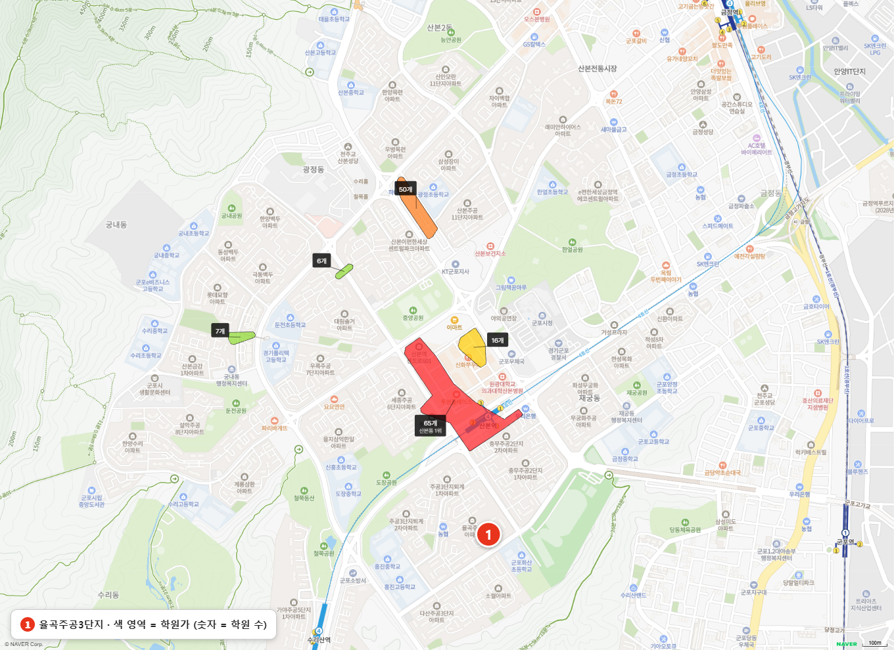

{{chart:moveins:군포}}

## 핵심 숫자

| 항목 | 값 | 기준 |
|---|---|---|
| 세대수 | 2,042세대(21개 동, 최고 25층) | 1994년 5월 입주 |
| 평형 | 22평형 1,100세대, 24평형 528세대, 26평형 204세대, 27평형 210세대 | 전용 51.66·58.46·58.65·59.97㎡ |
| 용적률·건폐율 | 226%·15% | 건축물대장 용적률 225.8% |
| 대지면적 | 69,278㎡ | 세대당 평균 33.9㎡(10.3평) |
| 세대당 주차대수 | 0.41대 | |
| 가까운 역 | 4호선 산본역 도보 6~9분 | 단지 북쪽 출입구 기준 6분 |
| 배정초 | 흥진초 | 도보 4~7분, 흥진중·흥진고가 단지 옆 |

## 정비 구역과 사업 단계

산본 3-1구역은 금정동 876번지 율곡주공3단지(2,042세대)와 875번지 퇴계주공3단지 1차(1,011세대, 1993년 입주)·2차(981세대, 1995년 입주)를 합친 구역이다.

| 항목 | 주민 계획안(2026-10 공람) |
|---|---|
| 세대수 | 4,034세대 → 5,183세대(+1,149) |
| 사업 방식 | 공공·신탁 방식 절차(군포시 설명) |
| 공람 | 2026-10-27 ~ 11-13, 군포시청 도시정비과 |
| 공람 자료 | 토지이용·교통·재원조달계획, 토지등소유자별 분담금 추산액 |

**지금은 '지정 제안 수용' 단계다.** 군포시가 주민 과반 동의와 구비 서류를 확인하고 제안을 받아들인 것이고, 특별정비구역 지정은 공람과 주민 의견 수렴, 관계기관 협의를 거친 뒤에 나온다. 세대수는 이 과정에서 바뀔 수 있다.

| 시점 | 단계 |
|---|---|
| 2020-12 | 리모델링주택조합 설립인가 |
| 2022-04 | 리모델링 안전진단 통과(수평증축 가능 C등급) |
| 2023-07 | 리모델링 도시계획·경관 통합심의 조건부 통과 |
| 2024-08 | 리모델링 추정분담금 4억 500만~4억 7,000만 원 공개, 조합이 '리모델링 지속·선도지구 참여·해산' 설문 |
| 2024-11 | 1기 신도시 선도지구 선정에서 빠짐 |
| 2026-08 | 주민대표단이 특별정비계획안 사전자문 요청 |
| 2026-09 | 노후계획도시 자문위원회 자문, 보완안 제출 |
| 2026-10-26 | 군포시, 3-1구역 특별정비구역 지정 제안 수용 |
| 2026-10-27 ~ 11-13 | 특별정비계획(안) 주민공람 |
| 다음 | 주민 의견·관계기관 협의 → 특별정비구역 지정 |

2024년 리모델링 추정분담금은 당시 실거래가(3억 원대 중반)를 넘었고, 이때부터 재건축 전환 요구가 커졌다. 입주민 후기에 올라온 글로는 2026년 2월 통합재건축 주민대표단 동의가 50%를 넘었고, 10월 21일 리모델링 조합 해산 동의가 75%를 넘었다. 해산총회는 아직 열리지 않았고 날짜도 나오지 않았다. 재건축 추정분담금은 이번 공람 자료에 들어 있지만 숫자는 공개 보도로 확인하지 못해 싣지 않는다.

## 평형별 대지지분과 시세

| 평형 | 대지지분(추정) | 2025년 상반기 건수(제외)·범위·중위값 | 2026년 7~10월 건수(제외)·범위·중위값 | 대지지분 1평당(2026) |
|---|---|---|---|---|
| 22평형(전용 51.66㎡) | 9.8평 | 46건(1) 3억 1,000만~3억 7,000만, 3억 4,400만 | 38건(1) 4억~5억 8,000만, 5억 1,500만 | 5,200만 |
| 24평형(전용 58.46㎡) | 10.5평 | 16건(1) 3억 4,200만~3억 9,800만, 3억 7,000만 | 16건(1) 4억 3,500만~5억 9,500만, 5억 3,900만 | 5,100만 |
| 26평형(전용 58.65㎡) | 11.1평 | 2건(0) 3억 7,000만~3억 8,500만, 3억 7,800만 | 5건(0) 5억 2,000만~5억 9,000만, 5억 5,000만 | 5,000만 |
| 27평형(전용 59.97㎡) | 11.3평 | 8건(0) 4억 1,600만~4억 4,800만, 4억 2,500만 | 5건(0) 5억~6억, 5억 9,800만 | 5,300만 |

해제·직거래와 시세에서 크게 벗어난 거래(같은 평형 앞뒤 3개월 거래 중위값 ±20% 밖)는 뺐습니다. 괄호 안은 뺀 건수다. 대지지분은 건축물대장 대지면적을 평형별 공급면적 비율로 나눈 추정값이다.

2025년 상반기 대비 2026년 7~10월 중위값은 22평형 50%, 24평형 46% 올랐다. 22평형 월 중위값은 1월 3억 7,500만 원에서 6월 4억 6,000만 원, 10월 5억 5,300만 원으로 올라섰다(10월은 10건, 신고 기한 전). 매매 건수는 2025년 상반기 72건, 하반기 100건, 2026년 상반기 122건, 7~10월 64건이다. 리모델링 분담금이 집값을 넘던 2024년과 달리, 재건축 구역 제안이 속도를 내면서 거래와 가격이 함께 붙었다.

| 평형 | 세 낀 매물 호가 | 세 낀 매물 갭(그 집 보증금 기준) | 실거주 매물 호가 | 전세 실거래 건수(제외)·중위값(2026년 5~10월) | 전세가율 |
|---|---|---|---|---|---|
| 22평형 | 27건, 5억~6억(중위 5억 5,000만) | 20건, 2억 5,000만~3억 4,000만(중위 3억) | 17건, 5억 2,000만~6억(중위 5억 8,000만) | 55건(2), 2억 6,300만 | 51% |
| 24평형 | 12건, 5억~6억 5,000만(중위 5억 4,000만) | 9건, 2억 5,000만~3억 2,000만(중위 2억 8,000만) | 8건, 5억 8,000만~6억 5,000만(중위 5억 9,500만) | 13건(0), 2억 9,000만 | 54% |
| 26평형 | 5건, 5억~6억 3,000만 | 3건, 2억 4,000만~3억 3,300만 | 1건, 6억 | 10건(0), 2억 9,800만 | 54% |
| 27평형 | 3건, 5억 7,000만~5억 8,000만 | 2건, 3억 3,000만 | 없음 | 5건(0), 3억 2,000만 | 54% |

호가는 네이버 부동산 매매 매물(2026-10-27 조회, 중복 등록 73건은 하나로 셈)이고, 세 낀 매물(전세를 안고 사는 매물)과 실거주 매물(즉시·협의 입주)로 나눴다. 갭은 세 낀 매물 호가에서 그 집 전세 보증금을 뺀 값이고, 보증금이 적히지 않았거나 월세인 매물은 갭에서 뺐다. 전세가율은 2026년 7~10월 매매 중위값 대비 전세 중위값이다. 27평형 칸에는 같은 전용 59.97㎡인 25B평 타입을 합쳤다.

같은 평형에서 세 낀 매물이 실거주 매물보다 싸다. 22평형 중위 호가는 세 낀 매물 5억 5,000만 원, 실거주 매물 5억 8,000만 원이고, 24평형은 5억 4,000만 원과 5억 9,500만 원이다. 세 낀 매물의 보증금은 대부분 2억 2,000만~2억 8,000만 원으로, 지금 나온 전세 매물(2억 9,000만~3억 5,000만 원)보다 낮다. 그래서 22평형은 3억 원 안팎을 들고 들어가야 한다. 군포는 토지거래허가구역이 아니어서 세 낀 매수가 가능하다.

## 학군과 생활 인프라

| 항목 | 이름 | 거리 |
|---|---|---|
| 학교 | 흥진초·흥진중·흥진고 | 단지 옆, 초품아 |
| 가까운 학원가 | 산본역 앞 산본동 학원가(65개, 군포 최대) | 도보 10~13분 |
| 다음 학원가 | 산본동 북쪽 광정동 쪽 학원가(50개) | 도보 24~31분 |
| 쇼핑몰 | 롯데피트인 산본점, 뉴코아아울렛 산본점 | 도보 7~12분 |
| 대형마트 | 이마트 산본점 | 도보 14~19분 |
| 대형 병원 | 원광대학교 산본병원 | 도보 11~16분 |
| 공원 | 오금공원, 산본 중앙공원 | 도보 4~10분, 19~24분 |

산본역 역세권과 중심상가, 초·중·고가 모두 걸어서 닿는다. 입주민 후기에서는 이 생활권이 가장 큰 장점으로, 세대당 0.41대인 주차와 복도식 구조의 단열·층간소음이 단점으로 꼽힌다.

## 군포 입주 물량

{{table:moveins:군포}}

군포의 2027년 입주 물량은 {{v:moveins:군포:2027}}로 한 해 적정 입주량 {{v:need:군포}}의 {{v:share:군포:2027}}다. 적정 입주량은 2026년 9월 주민등록 인구를 가구당 2.5명으로 나눈 가구 수의 2%로 잡는다. 군포 매매가는 {{v:streak:군포}}이고, 주간 시세 흐름은 아래와 같다.

{{chart:weekly:군포}}

{{table:weekly:군포}}

군포는 2027년부터 2029년까지 해마다 입주 물량이 적정 입주량에 못 미친다. 이번에 지정 제안이 수용된 산본 4개 구역만 기존 8,364가구이고, 이 구역들의 이주가 비슷한 시기에 몰리면 신축이 모자란 군포에서 전세 수요가 늘어난다. 아공맵은 4개 구역 가운데 가장 큰 3-1구역의 이주가 산본 전세 수요를 끌어올리는 첫 물량이 될 것으로 본다. 이 단지의 다음 변수는 공람 자료의 분담금 추산액과 리모델링 해산총회, 특별정비구역 지정 시점이다.

관련 리포트: [경기 시군구 주간·월간 시세](/zone/경기/#weekly-sgg)
