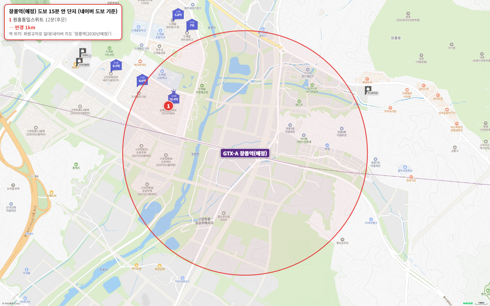
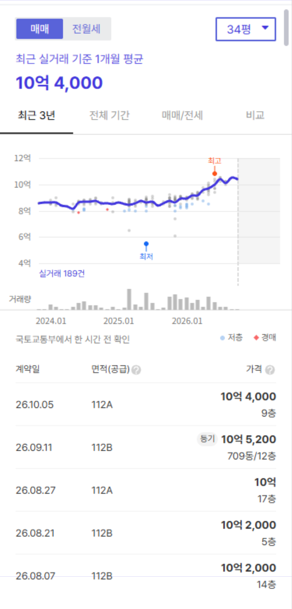
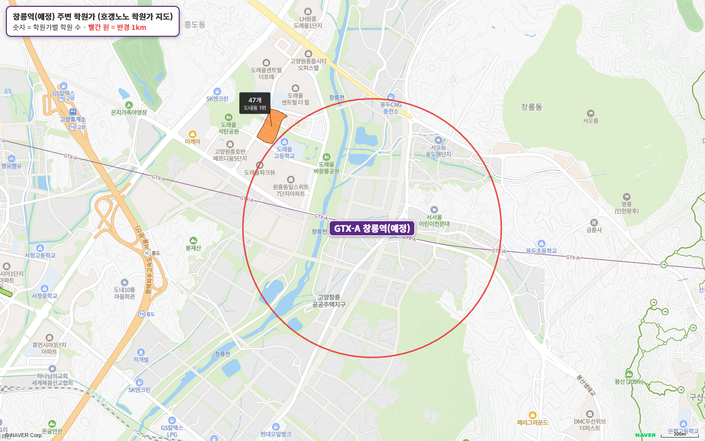

GTX-A 창릉역은 아직 개통 전인 역입니다. 2025년 3월 착공했고 2030년 개통 예정이에요. 역 예정지는 고양창릉 공공주택지구 안, 화랑교차로 동쪽입니다.

역 예정지에서 도보 15분 이내에 있는 기존 아파트는 **고양원흥동일스위트 한 곳**뿐입니다. 국평 실거래는 2026년 5~10월 28건, 8억 5,000만~10억 8,000만 원이고 중위값은 9억 9,500만 원이에요.

나머지 자리는 창릉 신도시 공공주택 블록이 채웁니다. 역 도보 10~13분 거리 두 블록(1,659세대)이 2028년 1월 입주 예정이에요.

## 고른 기준

- 역 위치: 개통 전이라 출입구가 없습니다. 네이버 지도의 '창릉역(2030년 예정)' 위치를 역으로 삼았습니다.
- 범위: 네이버 지도 도보 길찾기로 15분 이내인 기존 아파트 전부입니다.
- 평형: 24평형(전용 59㎡)이 있으면 24평형, 없으면 국평(전용 84㎡)을 대표로 씁니다.
- 세대수 등급: 1,000세대 이상 대단지는 훌륭, 700세대 이상은 안정, 500세대 이상은 최소선입니다.
- 출퇴근 등급: 주요 업무지구 네 곳까지 30분 이내는 매우 우수, 1시간 이내는 우수, 1시간 30분 이내는 양호입니다.

## 출퇴근 시간: 지금은 버스, 개통 뒤 서울역 10분

| 업무지구 | 지금 소요 시간 | 환승 | 지금 경로 |
|---|---|---|---|
| 광화문 | 49분 | 1회 | 075B번 버스 → 1200번 버스 광화문 |
| 여의도 | 54분 | 2회 | 075B번 버스 → 6호선 디지털미디어시티 → 5호선 여의도 |
| 삼성(강남) | 85분 | 2회 | 075B번 버스 → 6호선 디지털미디어시티 → 2호선 삼성 |
| 판교 | 94분 | 2회 | 7728번 버스 → 6호선 새절 → 9401-1번 버스 판교 |

지금은 역이 없어서 버스로 지하철역까지 나가야 합니다. 광화문 49분, 여의도 54분은 우수, 삼성 85분은 양호이고, 판교 94분은 양호 기준(1시간 30분)을 넘습니다.

개통 뒤 시간은 국토교통부 교통대책이 밝힌 숫자가 있습니다. 서울역 방면은 40분에서 10분으로 줄고, 여의도 방면은 50분에서 25분으로 줄어듭니다(여의도는 GTX-A만이 아니라 교통대책 전체를 시행했을 때 기준). 서울역 10분이면 대곡역(광화문 28분)보다 서울 도심에 가까워져요.

## 도보 15분 이내 기존 아파트 1곳

| 단지 | 평형 | 역 도보 | 세대수(등급) | 입주 | 용적률 | 매매 실거래(5~10월) | 세 낀 매물 호가 | 실거주 매물 호가 | 전세(8~10월) | 갭(세 낀 매물) |
|---|---|---|---|---|---|---|---|---|---|---|
| 고양원흥동일스위트 | 국평 | 12분 | 1,257(훌륭) | 2018 | 205% | 28건(제외 1건) 8.5억~10.8억, 중위 9억 9,500 | 13건 10.3억~11.5억 | 30건 10.3억~11.5억 | 중위 5억 2,000 (16건) | 5.5억~7.9억 |

실거래는 2026년 5~10월 국평(전용 84㎡) 신고분이고, 해제·직거래와 시세에서 크게 벗어난 거래(같은 평형, 거래 달 앞뒤 3개월 거래 중위값의 ±20% 밖)는 뺐습니다. 호가는 같은 집이 여러 중개사로 올라온 것을 하나로 셌고, 세입자가 있어 전세를 안고 사는 세 낀 매물과 바로 들어가 살 수 있는 실거주 매물(즉시·협의 입주)로 나눴습니다. 갭은 세 낀 매물의 호가에서 그 집의 전세 보증금을 뺀 값입니다(월세 낀 매물은 뺐습니다). 실거주 매물 수에는 설명 없이 입주가능일만 즉시입주로 적힌 매물이 들어 있습니다.

1,257세대 대단지이고 2018년 입주했습니다. 24평형이 없어 국평이 대표 평형이에요. 배정초(흥도초)가 도보 4분이고 평지입니다.

시세는 올해 한 단계 올라섰어요. 5월 거래는 9억 원대 중반이 많았는데 7월부터는 10억 원대가 이어져 마지막 거래(10월 5일)가 10억 4,000만 원입니다. 지금 매물은 세 낀 집 13건, 바로 들어가 살 수 있는 집 30건이고 호가는 둘 다 10억 3,000만~11억 5,000만 원이에요.

도보 15분을 조금 넘는 곳으로는 도래울파크뷰(18분), 도래울센트럴파크(21분), 원흥호반베르디움더퍼스트(22분)가 있습니다.

## 역 둘레를 채울 창릉 신도시 블록

| 블록 | 세대수 | 공급 유형 | 입주 예정(모집공고 기준) | 지금 역 도보 |
|---|---|---|---|---|
| A-4 | 900 | 신혼희망타운(공공분양) 603 · 행복주택 297 | 2028년 1월 | 10분 |
| S-5 | 759 | 공공분양 | 2028년 1월 | 13분 |
| S-6 | 430 | 공공분양 | 2027년 12월 | 20분 |
| S-4 | 1,024 | 공공분양 | 2030년 3월 | 22분 |
| S-3 | 1,282 | 이익공유형 분양 | 2030년 2월 | 35분 |
| S-1 | 494 | 민간참여 공공분양 | 2029년 5월 | 60분 |

역에서 가장 가까운 A-4블록과 S-5블록은 이미 분양을 마쳤고 2028년 1월 입주 예정입니다. 역 개통(2030년)보다 2년 먼저 입주하는 셈이에요.

## 학군과 학원가

역 반경 1km 안에는 학원가가 없습니다. 가장 가까운 도내동(원흥·도래울) 학원가(학원 47개)가 1km 바로 밖, 원흥동일스위트 바로 북쪽이에요. 덕양구에서 가장 큰 화정동 학원가(59개)는 차로 11분입니다.

## 생활 인프라: 마트·공원·병원

| 구분 | 시설 | 거리 |
|---|---|---|
| 공원 | 도래울바람물공원 | 도보 10분 |
| 아울렛 | 롯데아울렛 고양점 · 이케아 고양점 | 차로 2분 |
| 대형마트 | 롯데마트 고양점 | 차로 8분 |
| 복합쇼핑몰 | 스타필드 고양 | 차로 10분 |
| 대형 병원 | 명지병원 | 차로 11분 |
| 공연장 | 고양어울림누리 | 차로 11분 |
| 도서관 | 고양시립 삼송도서관 | 차로 12분 |
| 백화점 | 롯데백화점 일산점 | 차로 18분 |

도보권은 공원 정도이고, 아울렛과 이케아는 차로 2분입니다. 신도시 상업용지가 채워지기 전까지는 차가 있어야 하는 동네예요.

## 고양 공급, 2028년 상반기에 입주가 몰립니다

고양의 2027년 입주 물량은 {{v:moveins:고양:2027}}로 한 해 적정 입주량({{v:need:고양}})의 {{v:share:고양:2027}}에 그치고, 2028년에는 {{v:moveins:고양:2028}}(적정의 {{v:share:고양:2028}})가 잡혀 있어 상반기에 입주가 몰립니다. 창릉 A-4·S-5블록 1,659세대도 여기에 들어갑니다.

{{table:moveins:고양}}

창릉역이 있는 덕양구 매매는 {{v:streak:덕양구}}, 전세는 {{v:streak:덕양구:전세}}입니다. 고양 주간 시세 흐름은 아래와 같습니다.

{{table:weekly:고양}}

**제 판단으로는 2027년까지는 입주 물량이 적어 덕양구 오름세가 이어지고, 2028년 상반기 입주장이 서면 창릉·원흥 일대 전셋값이 먼저 조정받습니다.** 역 개통은 그 뒤인 2030년이라, 개통 효과와 입주장이 시기상 겹치지 않아요.

시군구별 주간·월간 시세는 [경기 리포트 표](/zone/%EA%B2%BD%EA%B8%B0/#weekly-sgg)에서 볼 수 있습니다.

적정 입주량은 주민등록 인구를 가구당 2.5명으로 나눈 가구 수의 2%로 잡았습니다. 매매는 대표 평형의 2026년 5~10월 실거래에서 해제·직거래와 같은 평형 거래 달 앞뒤 3개월 중위값의 ±20% 밖 거래를 뺀 값이고, 전세는 8~10월 월세 없는 전세 실거래의 중위값입니다.
