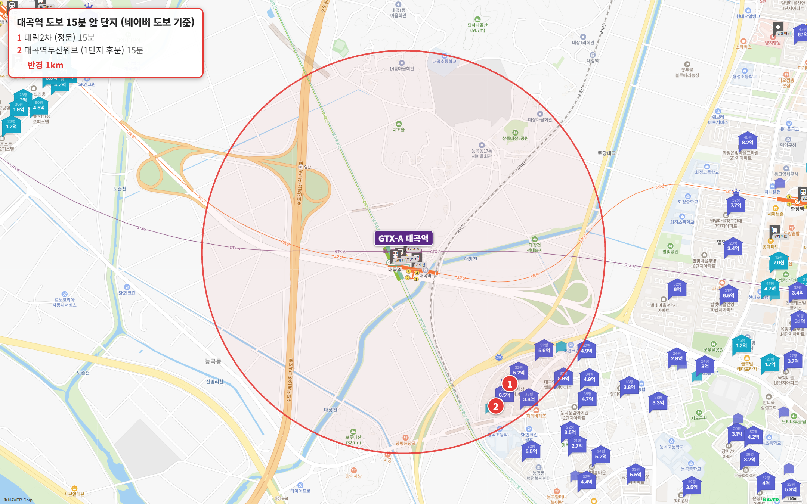
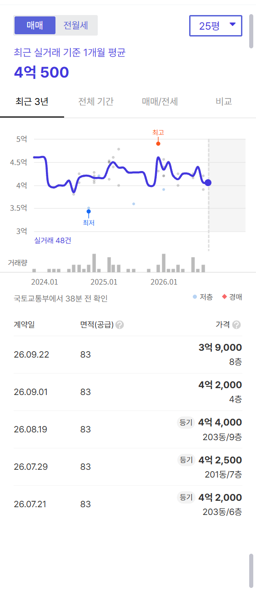
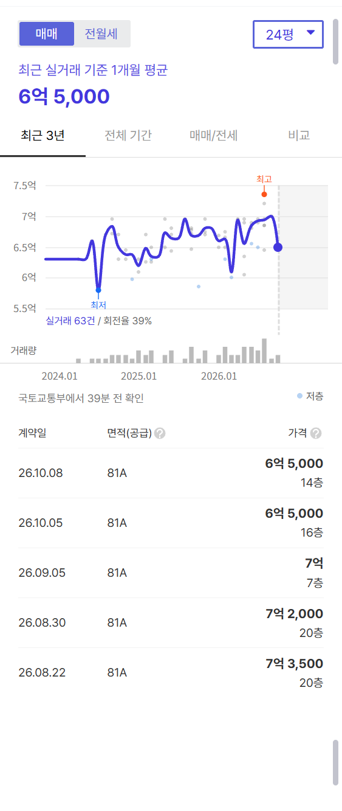
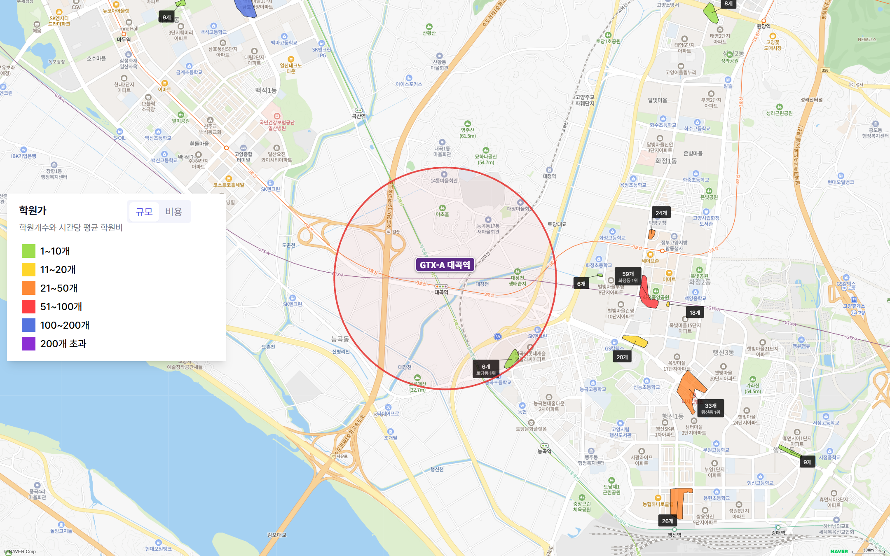

대곡역에서 도보 15분 이내 아파트를 전부 세어 봤어요.

2곳입니다. 그것도 둘 다 딱 15분이에요.

역 반경 1km 안이 대부분 논밭과 개발제한구역이거든요.

GTX-A에 3호선·경의중앙선·서해선·교외선까지 다섯 개 노선이 서는 환승역인데, 역 앞에 아파트가 없습니다.

**그래도 광화문 28분이에요. 이 연재에서 광화문까지 30분 안에 닿는 역은 대곡역이 처음입니다.**

## 이 글은 이렇게 셌습니다

대곡역에서 도보 15분 이내(네이버 지도 도보 길찾기 기준) 아파트를 빠짐없이 담았어요.

평형은 24평형(전용 59㎡)이 있으면 24평형, 없으면 국평(전용 84㎡, 34평형)입니다.

세대수는 1,000세대 이상 대단지(훌륭), 700 이상 안정, 500 이상 최소선입니다. 500세대 미만 소규모 단지는 역에 가까워도 사지 마세요.

주요 업무지구까지 출퇴근 시간은 30분 안이면 매우 우수, 1시간 안이면 우수, 1시간 30분 안이면 양호로 봅니다.

## 출퇴근 시간, 광화문 28분이고 여의도 35분입니다

| 업무지구 | 소요 시간 | 환승 | 경로 |
|---|---|---|---|
| 광화문 | 28분 | 1회 | GTX-A 서울역 → 1호선 시청역 |
| 여의도 | 35분 | 2회 | GTX-A 서울역 → 1호선 노량진 → 9호선 여의도 |
| 삼성(강남) | 56분 | 2회 | GTX-A 서울역 → 4호선 사당 → 2호선 삼성 |
| 판교 | 63분 | 1회 | GTX-A 서울역 → 9000번 버스 판교 |

GTX-A로 서울역까지 가서 1호선 한 번 환승하면 광화문이 28분이에요. 매우 우수입니다.

여의도 35분, 삼성 56분은 우수고요.

판교만 63분으로 양호입니다.

**3편 킨텍스역보다 한 정거장 서울 쪽이라 광화문이 7분 빨라요.** 킨텍스가 35분, 대곡이 28분입니다.

## 도보 15분 이내 아파트 2곳

| 단지 | 평형 | 역 도보 | 세대수(등급) | 입주 | 용적률 | 매매 실거래(5~10월) | 세 낀 매물 호가 | 실거주 매물 호가 | 전세(8~10월) | 갭(세 낀 매물) |
|---|---|---|---|---|---|---|---|---|---|---|
| 대림2차 | 24평형 | 15분 | 640(최소선) | 1997 | 222% | 8건(제외 1건) 3.9억~4.4억, 중위 4억 2,000 | 14건 4.1억~4.8억 | 11건 4억~5억 | 중위 2억 8,000 (5건) | 1.4억~2.6억 |
| 대곡역두산위브 | 24평형 | 15분 | 643(최소선) | 2023 | 257% | 16건(제외 3건) 6.35억~7.35억, 중위 6억 9,000 | 8건 6.9억~8억 | 9건 6.6억~7.7억 | 중위 4억 2,500 (13건) | 2.7억~3.5억 |

실거래는 2026년 5~10월 대표 평형 신고분이고, 해제·직거래와 시세에서 크게 벗어난 거래(같은 평형, 거래 달 앞뒤 3개월 거래 중위값의 ±20% 밖)는 뺐습니다. 호가는 같은 집이 여러 중개사로 올라온 것을 하나로 셌고, 세입자가 있어 전세를 안고 사는 세 낀 매물과 바로 들어가 살 수 있는 실거주 매물(즉시·협의 입주)로 나눴습니다. 갭은 세 낀 매물의 호가에서 그 집의 전세 보증금을 뺀 값입니다(월세 낀 매물은 뺐습니다). 실거주 매물 수에는 설명 없이 입주가능일만 즉시입주로 적힌 매물이 들어 있습니다.

두 곳 모두 역 남동쪽 토당동에 나란히 붙어 있어요.

한 곳은 1997년 입주한 구축, 한 곳은 2023년 입주한 신축이에요. 둘 다 평지 단지입니다.

17분부터는 토당금강KCC, 대곡역롯데캐슬엘클라씨, 능곡풍림아이원 같은 단지가 이어져요. 이번 글에서는 15분 선을 지켰습니다.

## 4억대 24평형, 대림2차 중위 4억 2,000만 원

**대림2차 24평형**

640세대(최소선), 1997년 입주(29년 차), 역 도보 15분이에요.

5~10월 실거래 여덟 건(해제 1건 제외)이 3억 9,000만~4억 4,000만 원이고 중위값은 4억 2,000만 원입니다. 세 낀 매물 14건 가운데 보증금이 확인된 11건의 갭은 1억 4,000만~2억 6,000만 원이에요.

**이 연재에서 지금까지 본 24평형 가운데 가장 싼 값이고, 갭도 가장 작습니다.**

입주민 후기에는 승강기를 교체해 구축치고 깨끗하고 조용하다는 글, 지하 2층까지 주차장이 있어 주차 걱정이 적다는 글이 많아요.

아쉬운 점도 분명해요.

역까지 가는 길이 논길이라 밤에 무섭다는 지적, 복도식 구축이라 저층 벌레와 여름철 배수구 냄새 같은 노후 문제가 나옵니다.

매물이 25건(세 낀 매물 14건·실거주 매물 11건) 나와 있어 매도 경쟁이 붙어 있다는 글도 있고요.

## 신축 24평형, 대곡역두산위브 중위 6억 9,000만 원

**대곡역두산위브 24평형**

643세대(최소선), 2023년 입주, 역 도보 15분이에요.

5~10월 실거래 열여섯 건(해제 2건·직거래 1건 제외)이 6억 3,500만~7억 3,500만 원이고 중위값은 6억 9,000만 원입니다. 보증금이 확인된 세 낀 매물 6건의 갭은 2억 7,000만~3억 5,000만 원이에요.

신축이라 조경과 관리가 좋고, 한강과 들판 쪽으로 트인 조망이 좋다는 입주민 후기가 많아요.

배정초(능곡초)까지 도보 5분으로 두 곳 가운데 더 가깝습니다.

단점은 역 앞 도로와 상권이 아직 정비되지 않았다는 것, 그리고 가까운 마트와 학원이 적다는 거예요.

같은 15분, 같은 24평형인데 중위값이 2억 7,000만 원 차이가 납니다.

29년 차 구축과 3년 차 신축의 차이예요.

## 학군과 학원가는 어떨까요

| 단지 | 배정초(도보) | 경사 | 용적률 | 세대수 등급 |
|---|---|---|---|---|
| 대림2차 | 능곡초 9분 | 평지 | 222% | 최소선 |
| 대곡역두산위브 | 능곡초 5분 | 평지 | 257% | 최소선 |

배정초는 두 곳 모두 능곡초예요. 두산위브 도보 5분, 대림2차 도보 9분입니다.

학원가는 약해요.

역에서 1km 안에는 토당동 학원가 한 곳, 학원 6개뿐입니다.

가까운 큰 학원가는 화정역 일대(59개)가 차로 6분, 일산 마두동(144개)이 차로 9분이에요.

**아이가 초등학교 고학년이 되면 학원 때문에 차를 타야 하는 동네입니다.**

## 생활 인프라: 마트·공원·병원

| 구분 | 시설 | 거리 |
|---|---|---|
| 공원 | 대장천 생태습지 | 도보 17분 |
| 아울렛 | 롯데아울렛 고양터미널점 | 차로 4분 |
| 대형마트 | 롯데마트 화정점 | 차로 5분 |
| 대형 병원 | 명지병원 | 차로 5분 |
| 공연장 | 고양어울림누리 | 차로 5분 |
| 도서관 | 고양시립 행신도서관 | 차로 6분 |
| 백화점 | 롯데백화점 일산점 | 차로 11분 |
| 큰 공원 | 일산호수공원 | 차로 11분 |

도보권 생활 인프라는 대장천 생태습지(도보 17분)뿐이에요.

롯데아울렛 고양터미널점이 차로 4분, 롯데마트 화정점이 차로 5분, 대형 병원(명지병원)도 차로 5분입니다.

백화점과 일산호수공원은 차로 11분이에요. 3편 킨텍스역이 몰세권이었다면, 대곡역은 차가 있어야 하는 역입니다.

## 같은 고양인데 덕양구는 오르고 일산은 내렸습니다

대곡역이 있는 덕양구 매매는 {{v:streak:덕양구}}이고, 바로 옆 킨텍스역의 일산동구 매매는 {{v:streak:일산동구}}입니다. 같은 GTX-A, 같은 고양시인데 방향이 반대예요. 고양 주간 시세 흐름은 아래와 같습니다.

{{table:weekly:고양}}

공급은 고양 전체가 같은 조건이에요. 고양의 2027년 입주 물량은 {{v:moveins:고양:2027}}로 한 해 적정 입주량({{v:need:고양}})의 {{v:share:고양:2027}}에 그치고, 2028년에는 {{v:moveins:고양:2028}}(적정의 {{v:share:고양:2028}})가 잡혀 있어 상반기에 입주가 몰립니다.

{{table:moveins:고양}}

**제 판단으로는 2027년까지는 입주 물량이 부족해 덕양구 오름세가 이어지고, 2028년 상반기 입주장이 서면 전셋값부터 조정받습니다.** 역 앞 지식융합단지 개발이 이야기되고 있지만, 그해 시세를 정하는 건 결국 입주 물량이에요.

시군구별 주간·월간 시세는 [경기 리포트 표](/zone/%EA%B2%BD%EA%B8%B0/#weekly-sgg)에서 볼 수 있습니다.

적정 입주량은 주민등록 인구를 가구당 2.5명으로 나눈 가구 수의 2%로 잡았습니다. 매매는 대표 평형의 2026년 5~10월 실거래에서 해제·직거래와 같은 평형 거래 달 앞뒤 3개월 중위값의 ±20% 밖 거래를 뺀 값이고, 전세는 8~10월 월세 없는 전세 실거래의 중위값입니다.
