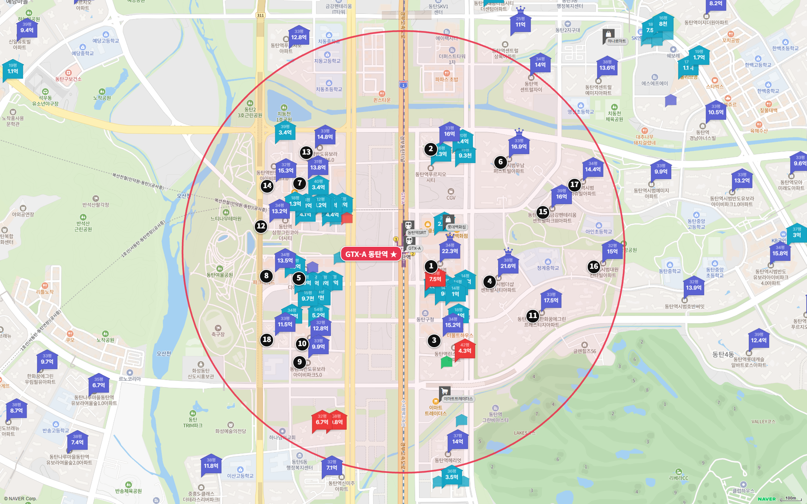
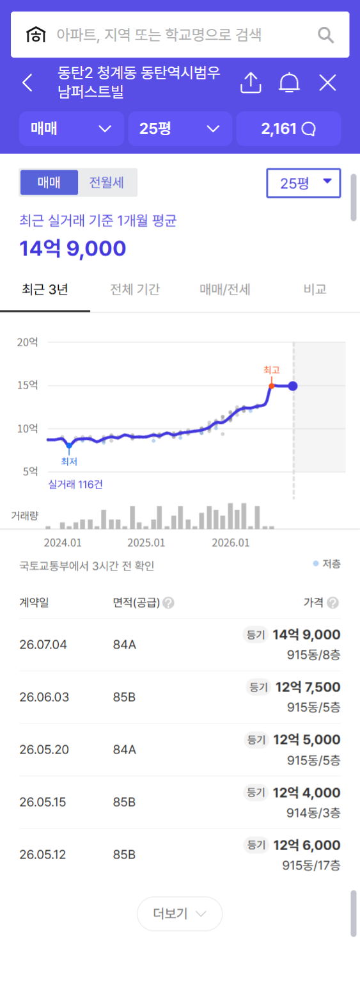
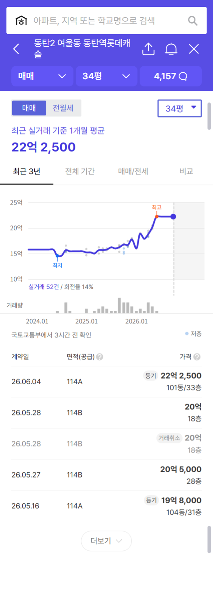
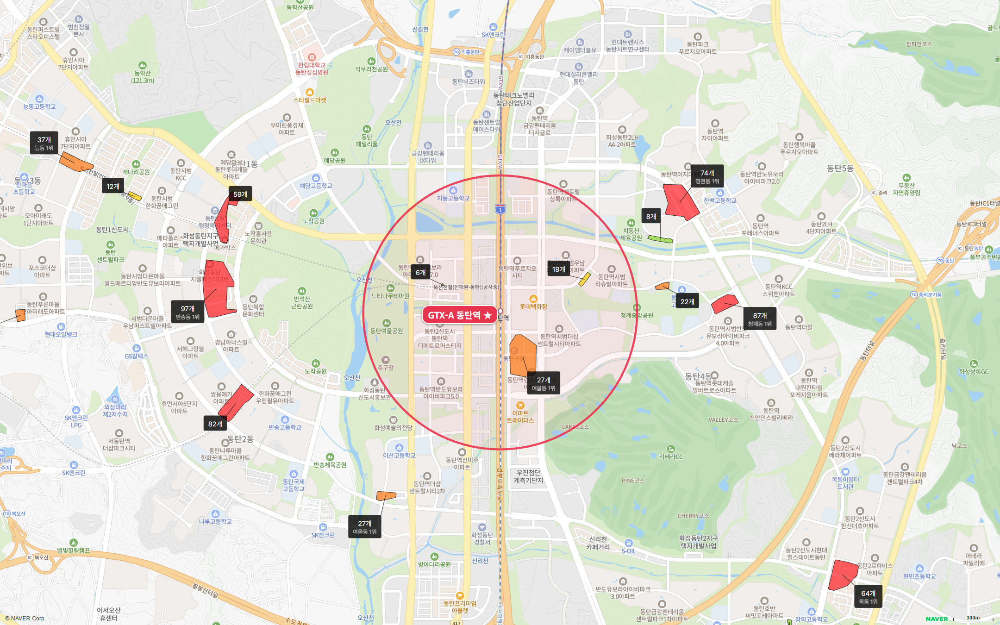

동탄역 도보 15분 이내 아파트는 14곳입니다. 그중 24평형이 있는 단지는 세 곳이고, 가장 싼 반도유보라아이비파크5.0도 2026년 5~10월 실거래 중위값이 10억 6,000만 원이에요.

**24평형 세 곳 모두 중위값이 10억 원을 넘습니다.** 동탄구가 토지거래허가구역이라 대출을 최대로 받아도 24평형 마지막 거래 기준으로 현금 7억~9억 원이 필요해요.

## 고른 기준

- 범위: 네이버 지도 도보 길찾기로 단지 출입구에서 역 출입구까지 15분 이내인 아파트 전부입니다.
- 평형: 24평형(전용 59㎡)이 있으면 24평형, 없으면 국평(전용 84㎡ 안팎)을 대표로 씁니다.
- 세대수 등급: 1,000세대 이상 대단지는 훌륭, 700세대 이상은 안정, 500세대 이상은 최소선입니다. 500세대 미만 소규모 단지는 역과 가까워도 권하지 않습니다.
- 출퇴근 등급: 주요 업무지구 네 곳까지 30분 이내는 매우 우수, 1시간 이내는 우수, 1시간 30분 이내는 양호입니다.

## 출퇴근 시간: 판교 22분, 삼성 49분

| 업무지구 | 소요 시간 | 환승 | 경로 |
|---|---|---|---|
| 판교 | 22분 | 1회 | GTX-A 성남역 → 경강선 판교 |
| 삼성(강남) | 49분 | 2회 | GTX-A 수서 → 수인분당선 선릉 → 2호선 삼성 |
| 여의도 | 67분 | 2회 | GTX-A 수서 → 3호선 고속터미널 → 9호선 여의도 |
| 광화문 | 72분 | 2회 | GTX-A 수서 → 3호선 → 5호선 광화문 |

판교는 매우 우수, 삼성은 우수 등급입니다. 여의도와 광화문은 1시간을 넘어 양호 등급이에요.

강남·판교 쪽 직장이라면 직주근접 면에서 경쟁력이 있는 역입니다. 1편 운정중앙역과는 방향이 정반대예요. 운정은 광화문이 36분으로 가깝고 삼성이 64분으로 멀었습니다.

## 도보 15분 이내 아파트 14곳

| 단지 | 평형 | 역 도보 | 세대수(등급) | 입주 | 용적률 | 매매 실거래(5~10월) | 호가 | 전세(8~10월) | 필요 현금(마지막 실거래 기준) |
|---|---|---|---|---|---|---|---|---|---|
| 반도유보라아이비파크5.0 | 24평형 | 12분 | 545(최소선) | 2017 | 219% | 4건 9.8억~11.7억, 중위 10억 6,000 | 13.0~13.4억 | 중위 3억 7,500 (4건) | 7억 200 |
| 반도유보라아이비파크6.0 | 24평형 | 15분 | 532(최소선) | 2017 | 209% | 8건(제외 3건) 10.9억~13.95억, 중위 12억 5,000 | 14.9억(1건) | 중위 4억 5,000 (1건) | 8억 3,100 |
| 시범우남퍼스트빌 | 24평형 | 10분 | 1,442(훌륭) | 2015 | 171% | 9건(제외 1건) 12.4억~14.9억, 중위 12억 6,000 | - | 중위 5억 100 (6건) | 8억 9,400 |
| 삼정그린코아더베스트 | 국평(전용 81㎡) | 14분 | 183(비추) | 2022 | 599% | 8건(제외 1건) 11.7억~13.95억, 중위 12억 5,300 | 15.5~16.0억 | 중위 6억 (5건) | 7억 8,000 |
| 동탄역파라곤 | 국평(전용 80㎡) | 13분 | 424(비추) | 2021 | 398% | 7건(제외 1건) 11억~13.5억, 중위 12억 | 14.0~15.0억 | 중위 5억 9,000 (4건) | 8억 1,000 |
| 유림노르웨이숲 | 국평 | 12분 | 312(비추) | 2021 | 598% | 9건(제외 2건) 11.45억~14.5억, 중위 13억 | 15.2~17.5억 | 중위 4억 7,300 (3건) | 8억 1,000 |
| 반도유보라아이비파크8.0 | 국평(전용 86㎡) | 12분 | 671(최소선) | 2018 | 399% | 7건(제외 2건) 13.05억~15억, 중위 13억 9,000 | 16.8~17.8억 | 중위 5억 1,000 (6건) | 8억 8,200 |
| 동탄역린스트라우스 | 국평 | 8분 | 617(최소선) | 2018 | 400% | 5건(제외 1건) 13억~15.2억, 중위 14억 | 16.0~17.1억 | 중위 5억 3,600 (3건) | 11억 2,000 |
| 반도유보라아이비파크7.0 | 국평(전용 86㎡) | 15분 | 710(안정) | 2019 | 399% | 8건(제외 1건) 12.8억~15.45억, 중위 14억 | 16.0~18.0억 | 중위 5억 8,800 (4건) | 11억 4,500 |
| 동탄역예미지시그너스 | 국평(전용 85㎡) | 7분 | 498(비추) | 2021 | 399% | 12건(제외 1건) 13.9억~17.2억, 중위 15억 1,500 | 15.8~17.7억 | 중위 6억 1,800 (4건) | 12억 |
| 시범더샵센트럴시티 | 국평(전용 85㎡) | 8분 | 874(안정) | 2015 | 209% | 6건(제외 1건) 14.45억~17.5억, 중위 15억 8,500 | 19.5~20.0억 | 중위 7억 5,000 (5건) | 13억 5,000 |
| 시범한화꿈에그린프레스티지 | 국평(전용 85㎡) | 13분 | 1,817(훌륭) | 2015 | 197% | 12건(제외 1건) 14.15억~18.4억, 중위 15억 8,300 | 15.6~19.0억 | 중위 7억 (9건) | 14억 4,000 |
| 동탄역롯데캐슬 | 국평(전용 85㎡) | 2분 | 940(안정) | 2021 | 486% | 4건(제외 2건) 19.8억~22.25억, 중위 20억 2,500 | 23.0~24.0억 | 중위 7억 1,400 (3건) | 18억 2,500 |
| 동탄역디에트르퍼스티지 ※ | 국평 | 9분 | 531(최소선) | 2025 | 599% | 아직 매매 실거래 없음(입주 직후) | - | - | - |

※ 표시는 입주 2년 안 신축입니다. 입주 직후 거래는 분양가 수준일 수 있어 호가와 차이가 큽니다. 실거래는 2026년 5~10월 대표 평형 신고분이고, 해제·직거래와 시세에서 크게 벗어난 거래(같은 평형 중위값의 ±20% 밖)는 뺐습니다. 필요 현금은 마지막 실거래에서 대출 한도(집값의 40%, 15억 초과 4억·25억 초과 2억)를 뺀 값입니다(세금·수수료 빼고).

14곳 가운데 9곳이 용적률 398~599%의 고밀 주상복합이에요. 나머지 5곳은 2015~2017년 입주한 일반 아파트로 용적률 171~219%입니다.

## 24평형 세 곳: 중위 10억 6,000만~12억 6,000만 원

**반도유보라아이비파크5.0**은 545세대(최소선), 역 도보 12분입니다. 5~10월 실거래 4건이 9억 8,000만~11억 7,000만 원(중위 10억 6,000만 원)이고, 6월 3일 11억 7,000만 원 거래가 마지막이에요. 현재 호가는 13억~13억 4,000만 원입니다. 여울초가 직선 210m로 초등학교 도보권입니다.

**반도유보라아이비파크6.0**은 532세대(최소선), 역 도보 15분입니다. 해제 3건을 뺀 5~10월 실거래 8건이 10억 9,000만~13억 9,500만 원(중위 12억 5,000만 원)이고, 마지막은 10월 19일 13억 8,500만 원이에요. 호가 14억 9,000만 원 매물 1건이 나와 있습니다.

**시범우남퍼스트빌**은 1,442세대로 24평형 단지 가운데 유일한 대단지(훌륭)입니다. 역 도보 10분이고, 7월 4일 14억 9,000만 원에 거래됐어요. 5월 거래가 12억 4,000만~12억 6,000만 원이었으니 두 달 사이 2억 원 넘게 올랐습니다.

## 토허제 석 달, 거래절벽

동탄구는 2026년 7월 1일 투기과열지구·조정대상지역으로 지정됐고, 7월 5일부터 토지거래허가구역입니다. 집을 사려면 허가를 받고 직접 살아야 하며, 무주택자 대출도 집값의 40%로 줄었어요.

거래는 크게 줄었습니다. 이 14곳의 매매는 5월 139건, 6월 81건, 7월 11건이었고 8~10월은 석 달을 합쳐 11건이에요(10월은 신고 기한이 남아 있어요).

**거래는 줄었지만 호가는 꺾이지 않았습니다.** 14곳 대부분의 현재 호가가 마지막 실거래보다 높고, 동탄구 매매도 오름세가 이어지고 있어요(아래 화성 주간 시세 표).

역 앞 동탄역롯데캐슬 국평은 6월 22억 2,500만 원에 거래됐습니다. 대출 한도 4억 원을 빼면 현금 18억 원이 넘게 필요해요.

## 학군과 학원가

| 단지 | 가까운 초등학교(직선) | 용적률 | 세대수 등급 |
|---|---|---|---|
| 동탄역롯데캐슬 | 청계초 620m | 486% | 안정 |
| 동탄역예미지시그너스 | 아인초 1.1km | 399% | 비추 |
| 동탄역린스트라우스 | 청계초 500m | 400% | 최소선 |
| 시범더샵센트럴시티 | 청계초 240m | 209% | 안정 |
| 동탄역디에트르퍼스티지 | 여울초 450m | 599% | 최소선 |
| 시범우남퍼스트빌 | 아인초 610m | 171% | 훌륭 |
| 반도유보라아이비파크8.0 | 치동초 850m | 399% | 최소선 |
| 유림노르웨이숲 | 여울초 410m | 598% | 비추 |
| 반도유보라아이비파크5.0 | 여울초 210m | 219% | 최소선 |
| 동탄역파라곤 | 여울초 190m | 398% | 비추 |
| 시범한화꿈에그린프레스티지 | 청계초 290m | 197% | 훌륭 |
| 삼정그린코아더베스트 | 여울초 740m | 599% | 비추 |
| 반도유보라아이비파크6.0 | 치동초 580m | 209% | 최소선 |
| 반도유보라아이비파크7.0 | 치동초 910m | 399% | 안정 |

초등학교가 가장 가까운 곳은 동탄역파라곤(여울초 190m), 반도유보라아이비파크5.0(여울초 210m), 시범더샵센트럴시티(청계초 240m)입니다.

역 반경 1km 안에 학원가 세 곳, 학원 52개가 있습니다. 동탄에서 가장 큰 반송동 학원가(97개)는 역에서 2km쯤, 청계동 학원가(87개)는 1.6km쯤이에요.

## 생활 인프라: 마트·공원·병원

| 구분 | 시설 | 거리 |
|---|---|---|
| 백화점 | 롯데백화점 동탄점 | 도보 3분 |
| 대형마트 | 이마트 트레이더스 | 도보 10분 |
| 공원 | 동탄여울공원 | 도보 18분 |
| 대형마트 | 이마트 · 홈플러스 | 직선 2.1~2.4km |
| 아울렛 | 롯데프리미엄아울렛 동탄 | 직선 3.5km |
| 쇼핑 | 이케아 동탄 | 직선 3.1km |
| 공원 | 동탄호수공원 | 약 3.6km |
| 대형 병원 | 한림대학교동탄성심병원 | 차로 3.5km |

백화점이 역과 붙어 있는 몰세권입니다. 트레이더스도 도보 10분이에요.

## 규제로 묶인 동안 화성 공급은

화성의 2027년 입주 물량은 {{v:moveins:화성:2027}}세대, 2028년은 {{v:moveins:화성:2028}}세대입니다. 두 해 모두 적정 입주량의 절반 안팎이에요.

{{table:moveins:화성}}

화성 주간 시세 흐름은 아래와 같습니다.

{{table:weekly:화성}}

**제 판단으로는 토허제가 거래를 멈춘 것이지 시세의 방향을 바꾼 것은 아닙니다.** 2027년 입주 물량이 적정의 절반에 그쳐, 허가구역이 풀리면 눌려 있던 매수 수요가 다시 나옵니다.

시군구별 주간·월간 시세는 [경기 리포트 표](/zone/%EA%B2%BD%EA%B8%B0/#weekly-sgg)에서 볼 수 있습니다.

적정 입주량은 주민등록 인구를 가구당 2.5명으로 나눈 가구 수의 2%로 잡았습니다. 매매는 대표 평형의 2026년 5~10월 실거래에서 해제·직거래와 중위값 ±20% 밖 거래를 뺀 값이고, 전세는 8~10월 월세 없는 전세 실거래의 중위값입니다.
