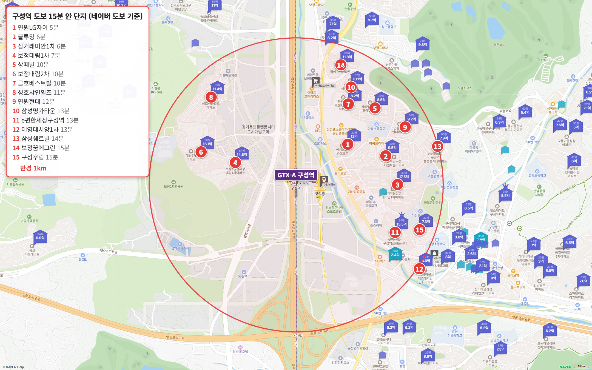
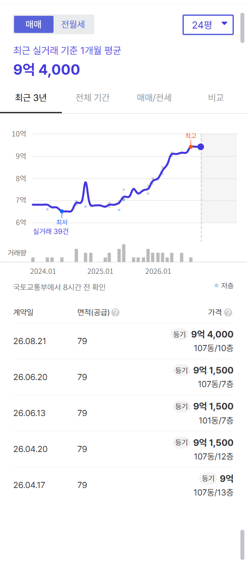
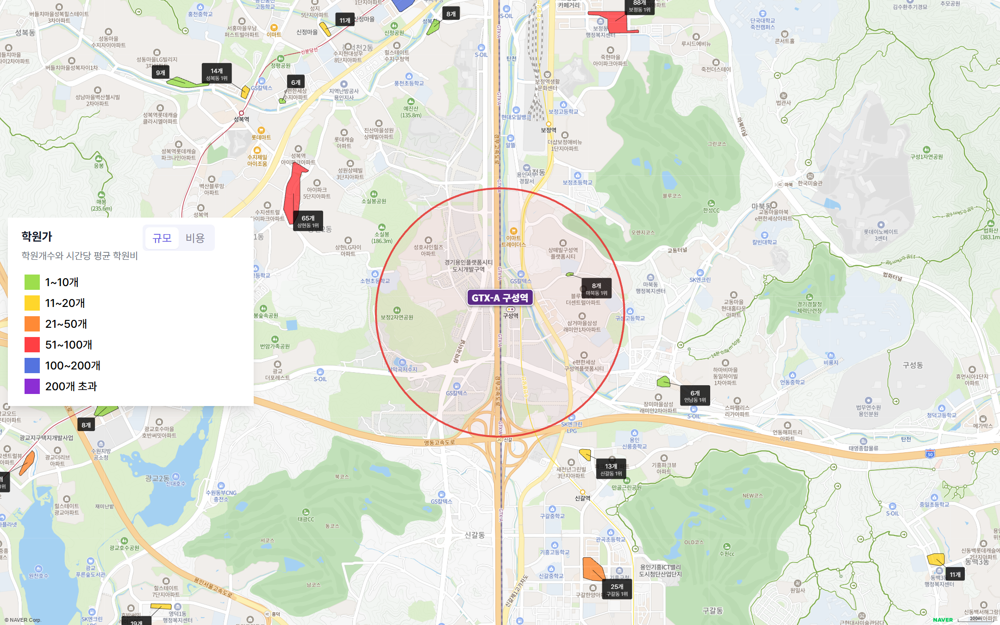

구성역에서 도보 15분 이내 아파트를 전부 세어 봤어요.

15곳입니다.

판교까지 15분, 삼성까지 37분.

지금까지 본 GTX 역 가운데 출퇴근 시간이 가장 짧은 역이에요.

그런데 500세대가 넘고 10억 아래로 살 수 있는 곳은 두 곳뿐이었어요.

블루밍구성더센트럴 24평형 중위 9억 1,500만 원, 상떼빌구성역플랫폼시티 국평 중위 8억 2,000만 원(2026년 5~10월 실거래).

**30대 첫 집으로 본다면 저라면 이 두 곳부터 봅니다.**

## 이 글은 이렇게 셌습니다

구성역에서 도보 15분 이내(네이버 지도 도보 길찾기 기준) 아파트를 빠짐없이 담았어요.

평형은 24평형(전용 59㎡)이 있으면 24평형, 없으면 국평(전용 84㎡, 34평형), 둘 다 없으면 가장 작은 평형입니다.

세대수는 1,000세대 이상 대단지(훌륭), 700 이상 안정, 500 이상 최소선입니다. 500세대 미만 소규모 단지는 역에 가까워도 사지 마세요.

주요 업무지구까지 출퇴근 시간은 30분 안이면 매우 우수, 1시간 안이면 우수, 1시간 30분 안이면 양호로 봅니다.

## 출퇴근 시간, 판교 15분이고 삼성 37분입니다

| 업무지구 | 소요 시간 | 환승 | 경로 |
|---|---|---|---|
| 판교 | 15분 | 1회 | GTX-A 성남역 → 경강선 판교 |
| 삼성(강남) | 37분 | 2회 | GTX-A 수서 → 수인분당선 선릉 → 2호선 삼성 |
| 여의도 | 59분 | 2회 | GTX-A 수서 → 수인분당선 선정릉 → 9호선 여의도 |
| 광화문 | 62분 | 2회 | GTX-A 수서 → 3호선 종로3가 → 5호선 광화문 |

판교는 GTX-A로 성남역까지 가서 경강선으로 환승하면 15분이에요. 매우 우수입니다.

삼성 37분, 여의도 59분도 우수고요.

광화문만 62분으로 양호입니다.

**강남·판교·여의도 셋을 모두 1시간 안에 가는 역은 지금까지 구성역이 처음입니다.**

2편 동탄역은 판교 22분·삼성 49분이었어요.

## 도보 15분 이내 아파트 15곳

| 단지 | 평형 | 역 도보 | 세대수(등급) | 입주 | 용적률 | 매매 실거래(5~10월) | 호가 | 전세(8~10월) | 필요 현금(마지막 실거래 기준) |
|---|---|---|---|---|---|---|---|---|---|
| 구성우림 | 24평형 | 15분 | 362(비추) | 1998 | 257% | 3건 6.3억~6.65억, 중위 6억 3,500 | 6.8억(1건) | 중위 3억 8,900 (1건) | 3억 7,800 |
| 연원마을현대 | 24평형 | 12분 | 424(비추) | 2000 | 227% | 7억 2,000 (5/30, 1건) | 매물 없음 | - | 4억 3,200 |
| 블루밍구성더센트럴 | 24평형 | 6분 | 1,576(훌륭) | 2000 | 222% | 3건 9.15억~9.4억, 중위 9억 1,500 | 11.5억(1건) | 중위 4억 1,000 (4건) | 5억 6,400 |
| e편한세상구성역플랫폼시티 | 24평형 | 13분 | 999(안정) | 2024 | 247% | 2건 11.4억~12.15억, 중위 11억 7,800 | 매물 없음 | 중위 4억 8,500 (3건) | 6억 8,400 |
| 연원마을삼성명가타운 | 24평형 | 13분 | 424(비추) | 2002 | 174% | 거래 없음 | 매물 없음 | - | - |
| 상떼빌구성역플랫폼시티 | 국평 | 10분 | 691(최소선) | 2000 | 204% | 10건 7.25억~8.8억, 중위 8억 2,000 | 8.5~9.3억 | 중위 4억 2,000 (7건) | 5억 1,000 |
| 용화마을태영데시앙1차 | 국평 | 13분 | 321(비추) | 2003 | 199% | 10건 6.9억~8.95억, 중위 8억 700 | 8.85~9.13억 | 중위 4억 1,000 (6건) | 5억 3,700 |
| 성호샤인힐즈 | 국평 | 11분 | 777(안정) | 2005 | 99% | 14건(제외 3건) 10.45억~11.8억, 중위 11억 1,000 | 11.0~12.0억 | 중위 3억 6,000 (9건) | 6억 9,300 |
| 연원마을LG자이 | 국평 | 5분 | 396(비추) | 1999 | 178% | 7건(제외 1건) 10.92억~12.2억, 중위 11억 1,000 | 12.1~14.0억 | 중위 5억 3,500 (6건) | 7억 2,000 |
| 삼거마을삼성래미안1차 | 국평 | 6분 | 1,282(훌륭) | 2002 | 193% | 8건(제외 1건) 10.2억~14억, 중위 12억 6,500 | 14.0~14.5억 | 중위 5억 5,000 (1건) | 8억 4,000 |
| 연원마을금호베스트빌 | 국평 | 10분 | 144(비추) | 2002 | 99% | 거래 없음 | 10.5~10.9억 | 중위 4억 5,200 (1건) | - |
| 삼성쉐르빌구성역플랫폼시티 | 전용 148㎡ | 14분 | 316(비추) | 2002 | 192% | 4건 7.3억~7.95억, 중위 7억 6,000 | 8.0~8.25억 | 중위 5억 2,500 (2건) | 4억 6,800 |
| 보정한화꿈에그린 | 전용 101㎡ | 15분 | 379(비추) | 2012 | 199% | 11건 9.19억~11.8억, 중위 10억 7,000 | 11.8~13.5억 | 중위 5억 2,500 (9건) | 7억 800 |
| 보정1차대림e편한세상 | 전용 142㎡ | 7분 | 232(비추) | 2002 | 98% | 14억 4,000 (6/3, 1건) | 매물 없음 | - | 8억 6,400 |
| 용인보정대림2차 | 전용 143㎡ | 10분 | 133(비추) | 2005 | 86% | 거래 없음 | 16.0억(1건) | - | - |

실거래는 2026년 5~10월 대표 평형 신고분이고, 해제·직거래와 시세에서 크게 벗어난 거래(같은 평형 중위값의 ±20% 밖)는 뺐습니다. 필요 현금은 마지막 실거래에서 대출 한도(집값의 40%, 15억 초과 4억·25억 초과 2억)를 뺀 값입니다(세금·수수료 빼고).

역 바로 옆은 플랫폼시티 개발 부지라 비어 있어요. 아파트는 대부분 역 동쪽 마북동에 있고, 서쪽 보정동에 몇 곳이 있습니다.

대부분 1998~2005년 입주한 구축입니다(입주 21~28년 차). 신축은 2024년 입주한 e편한세상구성역플랫폼시티 한 곳이에요.

15곳 가운데 10곳이 500세대 미만 소규모 단지입니다. 역에 가까운 단지가 많아도 고를 수 있는 곳은 생각보다 적어요.

## 500세대 넘고 10억 아래, 두 곳

**블루밍구성더센트럴 24평형, 중위 9억 1,500만 원**

1,576세대로 15곳 가운데 세대수가 가장 많은 대단지예요(세대수 등급 '훌륭'). 2000년 입주, 역 도보 6분입니다.

마북초 도보 3분이고, 단지 안에 어린이집·운동시설이 많다는 입주민 후기가 많아요.

아쉬운 점도 분명해요.

경사지 단지라 앞동과 뒷동의 역 접근성과 시세가 다르고, 승강기 교체 전이라는 입주민 불만이 나옵니다.

5~10월 24평형 거래는 세 건, 9억 1,500만~9억 4,000만 원이고 마지막은 8월 9억 4,000만 원입니다. 지금 호가는 11억 5,000만 원 한 건이에요.

**상떼빌구성역플랫폼시티 국평, 중위 8억 2,000만 원**

691세대(최소선), 2000년 입주, 역 도보 10분이에요.

마북초와 맞닿은 초품아로, 도보 1분입니다. 15곳 가운데 학교가 가장 가까워요.

5~10월 실거래가 10건(7억 2,500만~8억 8,000만 원)이라 시세 확인이 쉬운 곳이기도 합니다.

단점은 경사지 단지이고, 구축이라 지하주차장이 동과 연결되지 않는다는 거예요.

둘 다 대출을 40%까지 받으면 현금이 5억~5억 6천 필요해요.

## 나머지 단지는 왜 뺐을까요

가장 싼 24평형은 구성우림(6억 3,000만~6억 6,500만 원)과 연원마을현대(7억 2,000만 원)예요.

하지만 둘 다 500세대 미만 소규모 단지입니다(362세대, 424세대). 역에 가까워도 사지 마세요.

2024년 입주한 e편한세상구성역플랫폼시티 24평형은 6월에 11억 4,000만 원이었어요.

999세대에 마성초를 품은 초품아 신축이라 10억 위에서 고를 수 있다면 먼저 볼 곳입니다.

국평 가운데 1,000세대가 넘는 대단지는 삼거마을삼성래미안1차(1,282세대, 12억 8,000만 원)예요.

## 토허제 석 달, 거래절벽이 왔습니다

기흥구는 7월 5일부터 토지거래허가구역이에요. 동탄과 같은 날 묶였습니다.

집을 사면 직접 살아야 하고, 무주택자 대출은 집값의 40%까지예요.

이 15곳의 매매는 5월 58건, 6월 89건이었는데 8~10월 석 달은 34건입니다(10월은 신고가 덜 끝났을 수 있어요).

그래서 표에는 갭 대신 대출 40%일 때 필요한 현금을 적었어요.

## 학군과 학원가는 어떨까요

| 단지 | 배정초(도보) | 경사 | 용적률 | 세대수 등급 |
|---|---|---|---|---|
| 연원마을LG자이 | 마북초 7분 | 평지 | 178% | 비추 |
| 블루밍구성더센트럴 | 마북초 3분 | 약간 언덕 | 222% | 훌륭 |
| 삼거마을삼성래미안1차 | 마성초 9분 | 약간 언덕 | 193% | 훌륭 |
| 보정1차대림e편한세상 | 소현초 18분 | 약간 언덕 | 98% | 비추 |
| 상떼빌구성역플랫폼시티 | 마북초 1분 | 약간 언덕 | 204% | 최소선 |
| 연원마을금호베스트빌 | 마북초 14분 | 약간 언덕 | 99% | 비추 |
| 용인보정대림2차 | 소현초 15분 | 약간 언덕 | 86% | 비추 |
| 성호샤인힐즈 | 소현초 13분 | 약간 언덕 | 99% | 안정 |
| 연원마을현대 | 마북초 5분 | 언덕 | 227% | 비추 |
| e편한세상구성역플랫폼시티 | 마성초 5분 | 평지 | 247% | 안정 |
| 연원마을삼성명가타운 | 마북초 9분 | 약간 언덕 | 174% | 비추 |
| 용화마을태영데시앙1차 | 구성초 3분 | 평지 | 199% | 비추 |
| 삼성쉐르빌구성역플랫폼시티 | 마북초 7분 | 언덕 | 192% | 비추 |
| 구성우림 | 구성초 3분 | 평지 | 257% | 비추 |
| 보정한화꿈에그린 | 보정초 15분 | 약간 언덕 | 199% | 비추 |

배정초는 가까운 편이에요.

상떼빌(마북초 1분), 블루밍(마북초 3분), 태영데시앙1차·구성우림(구성초 3분)이 도보 3분 안입니다.

학원가는 약해요.

역에서 1km 안에는 마북동 학원가 한 곳, 학원 8개뿐입니다.

가장 큰 학원가는 수지구청역 일대(143개)로 차로 7분, 보정동(88개)이 차로 6분이에요.

## 생활 인프라: 마트·공원·병원

| 구분 | 시설 | 거리 |
|---|---|---|
| 대형마트 | 트레이더스 구성점 | 도보 11분 |
| 마트 | 구성농협 하나로마트 | 도보 14분 |
| 공원 | 마북근린공원 | 도보 20분 |
| 도서관 | 구성도서관 | 도보 23분 |
| 백화점 | 신세계 사우스시티(죽전) | 차로 5분 |
| 쇼핑몰 | 롯데몰 수지점 | 차로 8분 |
| 큰 공원 | 광교호수공원 | 차로 8분 |
| 공연장 | 용인포은아트홀 | 차로 7분 |
| 대형 병원 | 용인세브란스병원 | 차로 7분 |

트레이더스 도보 11분, 하나로마트 도보 14분이에요.

백화점(신세계 사우스시티)은 차로 5분, 롯데몰 수지점과 광교호수공원은 차로 8분입니다.

대형 병원은 용인세브란스병원이 차로 7분이에요.

## 규제로 막아 둔 동안, 용인 공급은 어떨까요

용인의 2027년 입주 물량은 {{v:moveins:용인:2027}}, 2028년은 {{v:moveins:용인:2028}}입니다. 한 해 적정 입주량({{v:need:용인}})과 견주면 2027년은 {{v:share:용인:2027}}, 2028년은 {{v:share:용인:2028}} 수준입니다.

{{table:moveins:용인}}

구성역이 있는 기흥구 매매는 {{v:streak:기흥구}}, 전세는 {{v:streak:기흥구:전세}}입니다. 용인 주간 시세 흐름은 아래와 같습니다.

{{table:weekly:용인}}

**제 판단으로는 2027년까지는 신축이 부족해 상승세가 이어집니다.** 2028년에도 입주 물량이 적정에 못 미쳐, 2028년까지는 신축 부족이 이어지는 쪽입니다. 그 뒤 방향은 그해 입주 물량이 정합니다.

시군구별 주간·월간 시세는 [경기 리포트 표](/zone/%EA%B2%BD%EA%B8%B0/#weekly-sgg)에서 볼 수 있습니다.

적정 입주량은 주민등록 인구를 가구당 2.5명으로 나눈 가구 수의 2%로 잡았습니다. 매매는 대표 평형의 2026년 5~10월 실거래에서 해제·직거래와 중위값 ±20% 밖 거래를 뺀 값이고, 전세는 8~10월 월세 없는 전세 실거래의 중위값입니다.
