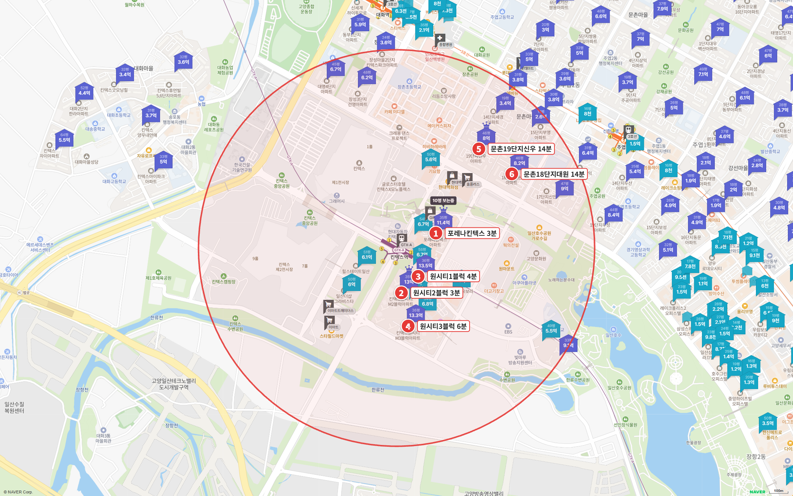
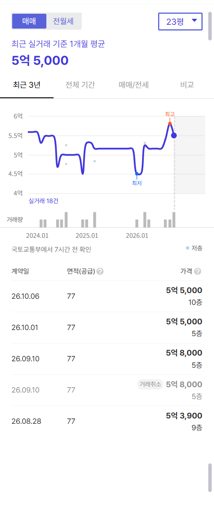
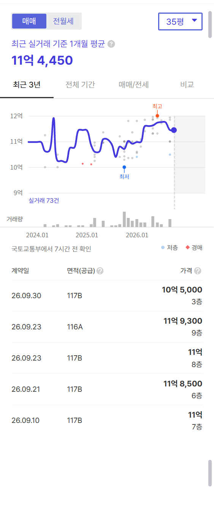
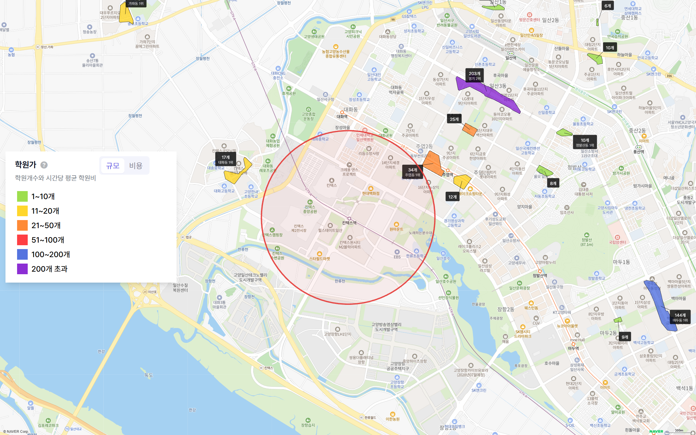

킨텍스역 도보 15분 이내에 있는 아파트는 6곳이 전부입니다. 역 둘레의 땅 대부분이 전시장과 업무시설 용지라서 주거 단지가 적어요.

6곳 가운데 24평형이 있는 단지는 문촌마을19단지신우 하나입니다. 1994년에 입주했고, 2026년 5~10월 실거래 네 건의 중위값이 5억 5,000만 원이에요.

**역 바로 앞 신축 국평은 11억 원대부터 시작합니다. 5억대 예산으로 킨텍스역 도보권을 고른다면 선택지는 문촌마을19단지 한 곳으로 좁혀집니다.**

## 고른 기준

- 범위: 네이버 지도 도보 길찾기로 단지 출입구에서 역 출입구까지 15분 이내인 아파트 전부입니다.
- 평형: 24평형(전용 59㎡)이 있으면 24평형, 없으면 국평(전용 84㎡), 둘 다 없으면 가장 작은 평형을 대표로 씁니다.
- 세대수 등급: 1,000세대 이상 대단지는 훌륭, 700세대 이상은 안정, 500세대 이상은 최소선입니다. 500세대 미만 소규모 단지는 역과 가까워도 권하지 않습니다.
- 출퇴근 등급: 주요 업무지구 네 곳(광화문·여의도·삼성·판교)까지 30분 이내는 매우 우수, 1시간 이내는 우수, 1시간 30분 이내는 양호입니다.

## 출퇴근 시간: 광화문 35분, 삼성 61분

| 업무지구 | 소요 시간 | 환승 | 경로 |
|---|---|---|---|
| 광화문 | 35분 | 1회 | GTX-A 서울역 → 1호선 시청역 |
| 여의도 | 43분 | 2회 | GTX-A 서울역 → 1호선 노량진 → 9호선 여의도 |
| 삼성(강남) | 61분 | 2회 | GTX-A 서울역 → 4호선 사당 → 2호선 삼성 |
| 판교 | 68분 | 1회 | GTX-A 서울역 → 9000번 버스 판교 |

서울 도심 쪽은 강합니다. 서울역에서 한 번만 환승하면 광화문 35분, 여의도 43분으로 둘 다 우수 등급이에요.

강남 쪽은 약합니다. GTX-A 서울역~삼성 구간이 아직 이어지지 않아서 삼성 61분, 판교 68분은 양호 등급에 머뭅니다.

1편 운정중앙역과 출퇴근 조건이 거의 같아요. 광화문은 운정이 36분, 킨텍스가 35분입니다.

## 도보 15분 이내 아파트 6곳

| 단지 | 평형 | 역 도보 | 세대수(등급) | 입주 | 용적률 | 매매 실거래(5~10월) | 호가 | 전세(8~10월) | 갭(중위값 차) |
|---|---|---|---|---|---|---|---|---|---|
| 문촌마을19단지신우 | 24평형 | 14분 | 658(최소선) | 1994 | 175% | 4건(제외 1건) 5.39억~5.8억, 중위 5억 5,000 | 5.9억(1건) | 중위 3억 (1건) | - |
| 한화포레나킨텍스 | 국평 | 3분 | 1,100(훌륭) | 2019 | 689% | 17건 10.5억~12억, 중위 11억 7,000 | 11.0~12.5억 | 중위 6억 5,000 (8건) | 5억 2,000 |
| 킨텍스원시티2블럭 | 국평 | 3분 | 959(안정) | 2019 | 359% | 20건(제외 3건) 11.9억~14.18억, 중위 12억 8,000 | 12.0~13.75억 | 중위 6억 6,200 (11건) | 6억 1,800 |
| 킨텍스원시티3블럭 | 국평 | 6분 | 782(안정) | 2019 | 359% | 17건(제외 1건) 11.65억~14억, 중위 12억 9,000 | 12.5~14.0억 | 중위 7억 (6건) | 5억 9,000 |
| 킨텍스원시티1블럭 | 국평 | 4분 | 297(비추) | 2019 | 358% | 8건(제외 1건) 12억~13.6억, 중위 12억 7,800 | 12.6~13.5억 | 중위 6억 6,200 (3건) | 6억 1,600 |
| 문촌마을18단지대원 | 전용 101㎡ | 14분 | 378(비추) | 1995 | 184% | 2건 7.57억~7.7억, 중위 7억 6,400 | 7.5~8.0억 | 중위 4억 5,000 (2건) | - |

실거래는 2026년 5~10월 대표 평형 신고분이고, 해제·직거래와 시세에서 크게 벗어난 거래(같은 평형, 거래 달 앞뒤 3개월 거래 중위값의 ±20% 밖)는 뺐습니다. 갭은 매매 3건 이상·전세 3건 이상일 때 두 중위값의 차이입니다.

단지는 두 무리로 나뉩니다. 역에서 도보 3~6분 거리에는 2019년 입주한 초역세권 신축 네 곳(한화포레나킨텍스, 킨텍스원시티 1·2·3블럭)이 있고, 도보 14분 거리 문촌마을에는 1990년대 중반 입주한 구축 두 곳이 있어요.

## 5억대 24평형: 문촌마을19단지신우

658세대로 세대수 등급은 최소선입니다. 입주 32년 차 구축이고, 역까지 도보 14분이에요.

5~10월 실거래는 해제 1건을 빼고 네 건, 5억 3,900만~5억 8,000만 원 사이였습니다. 현재 24평형 호가는 5억 9,000만 원 매물 1건뿐이라 매물이 귀한 편이에요.

입주민 후기에서는 역까지 도보로 출퇴근한다는 글이 많습니다. 역으로 가는 길에 원형육교를 돌아야 했는데 그 아래 횡단보도가 생긴다는 소식도 올라와 있어요. 걱정으로는 재건축 추진이 더디다는 점이 자주 나옵니다.

## 역 앞 신축 국평: 중위 11억 7,000만~12억 9,000만 원

**한화포레나킨텍스**는 1,100세대 대단지이고 역 도보 3분입니다. 5~10월 실거래 17건의 중위값이 11억 7,000만 원으로 신축 네 곳 가운데 가장 낮고, 갭도 5억 2,000만 원으로 가장 작아요. 용적률 689%의 고밀 주상복합이라 동간 거리가 좁고, 관리비가 높다는 입주민 후기가 많습니다.

**킨텍스원시티**는 1·2·3블럭이 나란히 있습니다. 2블럭(959세대)과 3블럭(782세대)은 안정 등급이고, 1블럭은 297세대예요. 5~10월 실거래 중위값은 12억 7,800만~12억 9,000만 원입니다. 커뮤니티와 호수공원 조망을 장점으로 꼽는 후기가 많고, 배정초(한류초)가 도보 16~20분이라 사설 셔틀을 쓴다는 불만도 함께 나옵니다.

문촌마을18단지대원은 전용 101㎡ 단일 평형이고 378세대 소규모 단지라 대표 비교에서는 뺐습니다.

## 학군과 학원가

| 단지 | 배정초(도보) | 용적률 | 세대수 등급 |
|---|---|---|---|
| 한화포레나킨텍스 | 한류초 14분 | 689% | 훌륭 |
| 킨텍스원시티2블럭 | 한류초 19분 | 359% | 안정 |
| 킨텍스원시티1블럭 | 한류초 16분 | 358% | 비추 |
| 킨텍스원시티3블럭 | 한류초 20분 | 359% | 안정 |
| 문촌마을19단지신우 | 한수초 10분 | 175% | 최소선 |
| 문촌마을18단지대원 | 한수초 4분 | 184% | 비추 |

배정초는 문촌마을 쪽이 가깝고, 신축 네 곳은 모두 도보 14분이 넘습니다.

역 반경 1km 안에는 학원가가 없습니다. 가장 가까운 주엽동 학원가(학원 34개)가 1km를 조금 넘고, 일산에서 가장 큰 후곡 학원가(203개)는 2.2km, 차로 7분 거리예요. 아이를 키울 집이라면 학원 이동을 계산에 넣어야 하는 역입니다. 이 지역 매수층의 중심이 바로 그 학령기 자녀를 둔 가구이기도 해요.

## 생활 인프라: 몰세권

| 구분 | 시설 | 거리 |
|---|---|---|
| 대형마트 | 트레이더스 일산점 | 도보 6분 |
| 쇼핑몰 | 스타필드마켓 일산 · 원마운트 | 도보 6~9분 |
| 백화점 | 현대백화점 킨텍스점 | 도보 11분 |
| 공원 | 일산호수공원 | 도보 18분 |
| 도서관 | 주엽어린이도서관 | 도보 18분 |
| 아울렛 | 뉴코아아울렛 일산점 | 차로 8분 |
| 공연장 | 고양아람누리 | 차로 6분 |
| 대형 병원 | 인제대 일산백병원 | 차로 3분 |

장보기와 쇼핑은 이 역의 가장 큰 강점입니다. 대형마트·쇼핑몰·백화점이 모두 도보권이에요. 1편 운정중앙역은 백화점까지 차로 12분이었습니다.

## GTX가 열린 뒤에도 일산동구 시세는 내렸습니다

킨텍스원시티가 있는 일산동구 매매는 {{v:streak:일산동구}}입니다. GTX-A 서울역 구간이 개통한 2024년 12월 말 무렵부터 내림세가 이어진 셈이에요. 같은 기간 전세는 {{v:streak:일산동구:전세}}입니다. 고양 주간 시세 흐름은 아래와 같습니다.

{{table:weekly:고양}}

공급 일정은 이렇습니다. 고양의 2027년 입주 물량은 {{v:moveins:고양:2027}}로 한 해 적정 입주량({{v:need:고양}})의 {{v:share:고양:2027}}에 그치고, 2028년에는 {{v:moveins:고양:2028}}(적정의 {{v:share:고양:2028}})가 잡혀 있어 상반기에 입주가 몰립니다.

{{table:moveins:고양}}

**제 판단으로는 2027년까지는 입주 물량이 적어 전셋값이 버티고, 2028년 상반기 입주장이 서면 전셋값부터 조정받습니다.** GTX는 출퇴근 시간을 줄였지만 일산 시세의 방향은 결국 그해 입주 물량이 정합니다.

시군구별 주간·월간 시세는 [경기 리포트 표](/zone/%EA%B2%BD%EA%B8%B0/#weekly-sgg)에서 볼 수 있습니다.

적정 입주량은 주민등록 인구를 가구당 2.5명으로 나눈 가구 수의 2%로 잡았습니다. 매매는 대표 평형의 2026년 5~10월 실거래에서 해제·직거래와 같은 평형 거래 달 앞뒤 3개월 중위값의 ±20% 밖 거래를 뺀 값이고, 전세는 8~10월 월세 없는 전세 실거래의 중위값입니다.
