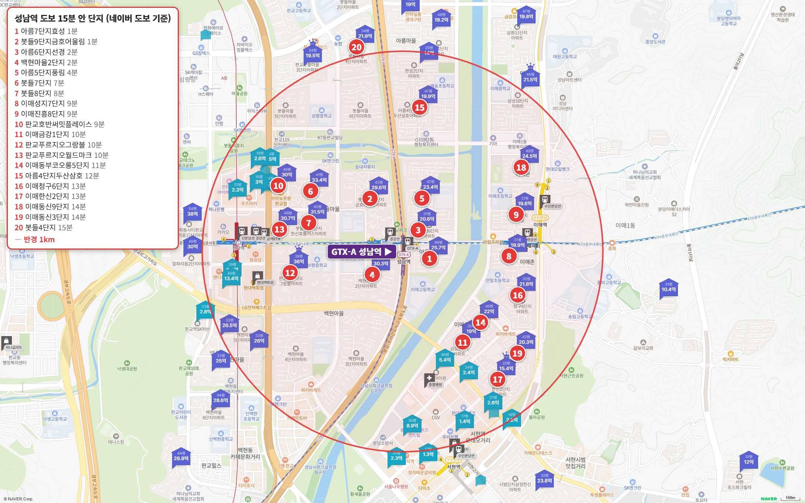
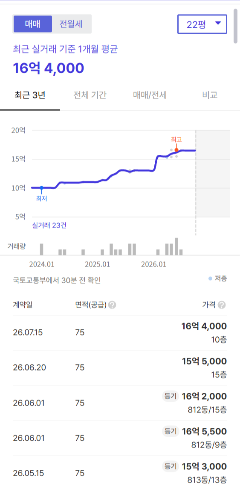
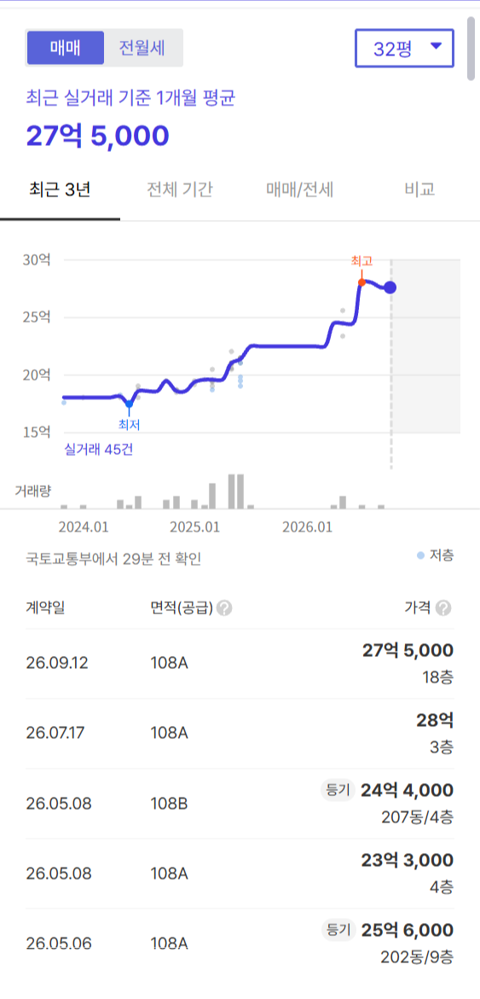
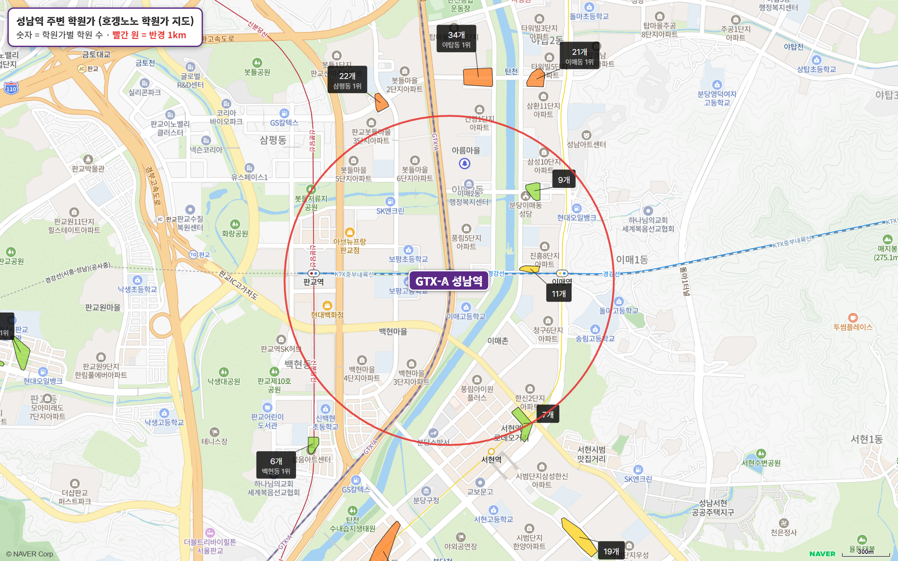

성남역에서 도보 15분 이내 아파트를 전부 세어 봤어요.

20곳입니다.

판교까지 6분, 삼성까지 30분.

이 연재에서 본 GTX 역 가운데 주요 업무지구 네 곳을 모두 1시간 안에 닿는 역은 성남역이 처음이에요.

그런데 가장 싼 24평형도 호가가 16억 3,000만 원입니다.

**토지거래허가구역이라 대출은 4억까지, 현금이 12억 3,000만 원 있어야 살 수 있어요.**

## 이 글은 이렇게 셌습니다

성남역에서 도보 15분 이내(네이버 지도 도보 길찾기 기준) 아파트를 빠짐없이 담았어요. 임대 단지 세 곳은 뺐습니다.

평형은 24평형(전용 59㎡)이 있으면 24평형, 없으면 국평(전용 84㎡, 34평형), 둘 다 없으면 가장 작은 평형입니다.

세대수는 1,000세대 이상 대단지(훌륭), 700 이상 안정, 500 이상 최소선입니다. 500세대 미만 소규모 단지는 역에 가까워도 사지 마세요.

주요 업무지구까지 출퇴근 시간은 30분 안이면 매우 우수, 1시간 안이면 우수, 1시간 30분 안이면 양호로 봅니다.

## 출퇴근 시간, 판교 6분이고 삼성 30분입니다

| 업무지구 | 소요 시간 | 환승 | 경로 |
|---|---|---|---|
| 판교 | 6분 | 0회 | 경강선 판교 |
| 삼성(강남) | 30분 | 2회 | GTX-A 수서 → 수인분당선 선릉 → 2호선 삼성 |
| 여의도 | 50분 | 2회 | 경강선 판교 → 신분당선 신논현 → 9호선 여의도 |
| 광화문 | 55분 | 2회 | GTX-A 수서 → 3호선 종로3가 → 5호선 광화문 |

판교는 경강선으로 한 정거장, 6분이에요. 삼성은 GTX-A로 수서까지 가서 두 번 환승해 30분입니다. 둘 다 매우 우수예요.

여의도 50분, 광화문 55분도 우수고요.

**4편 구성역은 광화문이 62분, 5편 대곡역은 판교가 63분이었어요.** 네 곳이 모두 1시간 안에 들어오는 역은 지금까지 성남역 하나입니다.

## 도보 15분 이내 아파트 20곳

| 단지 | 평형 | 역 도보 | 세대수(등급) | 입주 | 용적률 | 매매 실거래(5~10월) | 호가 | 전세(8~10월) | 필요 현금(호가 최저 기준) |
|---|---|---|---|---|---|---|---|---|---|
| 아름마을5단지풍림 | 24평형 | 4분 | 876(안정) | 1993 | 204% | 거래 없음 | 18.9억(1건) | 중위 5억 3,000 (2건) | 14억 9,000 |
| 이매촌8단지진흥 | 24평형 | 9분 | 832(안정) | 1993 | 214% | 6건 15.3억~16.55억, 중위 16억 3,000 | 18.2억 | 중위 5억 6,400 (2건) | 14억 2,000 |
| 아름마을4단지두산삼호 | 24평형 | 12분 | 1,132(훌륭) | 1992 | 198% | 거래 없음 | 매물 없음 | 중위 5억 8,100 (3건) | - |
| 이매촌6단지청구 | 24평형 | 13분 | 710(안정) | 1992 | 174% | 7건 16억~16.8억, 중위 16억 5,000 | 16.3억~17억 | 중위 6억 5,000 (3건) | 12억 3,000 |
| 이매촌9단지동신 | 24평형 | 14분 | 458(비추) | 1992 | 190% | 16억 3,000 (7/6, 1건) | 18.5억 | 중위 6억 3,000 (4건) | 14억 5,000 |
| 이매촌3단지동신 | 24평형 | 14분 | 460(비추) | 1992 | 190% | 거래 없음 | 18.1억 | - | 14억 1,000 |
| 봇들마을4단지 | 24평형 | 15분 | 748(안정) | 2009 | 149% | 2건 18.8억~19.4억, 중위 19억 1,000 | 19.5억~20억 | 중위 6억 5,000 (3건) | 15억 5,000 |
| 아름마을6단지선경 | 국평 | 2분 | 370(비추) | 1993 | 183% | 6건 18.8억~20.7억, 중위 20억 1,200 | 20.5억~22억 | 중위 7억 500 (6건) | 16억 5,000 |
| 백현마을2단지 | 국평 | 2분 | 772(안정) | 2009 | 183% | 5건(제외 1건) 23.3억~28억, 중위 25억 6,000 | 28억~29억 | 중위 9억 5,000 (3건) | 26억 |
| 봇들마을7단지 | 국평 | 7분 | 585(최소선) | 2009 | 199% | 7건 24.5억~28.5억, 중위 27억 | 26.5억~28억 | 중위 10억 4,500 (2건) | 24억 5,000 |
| 봇들마을8단지 | 국평 | 8분 | 447(비추) | 2009 | 199% | 거래 없음 | 29억~31.5억 | 중위 10억 2,000 (1건) | 27억 |
| 이매촌7단지성지 | 국평 | 9분 | 304(비추) | 1992 | 162% | 2건 18.1억~19.88억, 중위 18억 9,900 | 19.5억~21억 | 중위 7억 3,500 (7건) | 15억 5,000 |
| 이매촌1단지금강 | 국평 | 10분 | 588(최소선) | 1992 | 211% | 9건 17.5억~19억, 중위 18억 2,000 | 19.5억~21억 | 중위 7억 (3건) | 15억 5,000 |
| 이매촌2단지한신 | 국평 | 13분 | 1,184(훌륭) | 1992 | 210% | 2건(제외 2건) 19.5억~19.57억, 중위 19억 5,400 | 20억(1건) | 중위 6억 9,700 (6건) | 16억 |
| 아름마을7단지효성 | 전용 101㎡ | 1분 | 388(비추) | 1994 | 211% | 20억 5,000 (6/3, 1건) | 25억~25.5억 | - | 21억 |
| 봇들마을9단지금호어울림 | 전용 101㎡ | 1분 | 850(안정) | 2009 | 184% | 28억 3,000 (6/19, 1건) | 28.8억~31.5억 | 중위 10억 (3건) | 26억 8,000 |
| 판교호반써밋플레이스 | 전용 131㎡ | 9분 | 178(비추) | 2012 | 299% | 29억 9,500 (8/26, 1건) | 30억~32억 | 중위 16억 2,000 (1건) | 28억 |
| 판교푸르지오그랑블 | 전용 98㎡ | 10분 | 948(안정) | 2011 | 199% | 31억 (7/10, 1건) | 35억~36.5억 | 중위 12억 7,900 (2건) | 33억 |
| 판교푸르지오월드마크 | 전용 128㎡ | 10분 | 142(비추) | 2013 | 299% | 30억 6,500 (6/4, 1건) | 32억 | 중위 16억 (1건) | 30억 |
| 이매촌5단지동부코오롱 | 전용 101㎡ | 11분 | 264(비추) | 1993 | 211% | 거래 없음 | 23억(1건) | 중위 7억 5,000 (1건) | 19억 |

실거래는 2026년 5~10월 대표 평형 신고분이고, 해제·직거래와 시세에서 크게 벗어난 거래(같은 평형 중위값의 ±20% 밖)는 뺐습니다. 필요 현금은 호가 최저(매물이 없으면 마지막 실거래)에서 대출 한도(집값의 40%, 15억 초과 4억·25억 초과 2억)를 뺀 값입니다(세금·수수료 빼고).

역을 사이에 두고 단지가 둘로 나뉘어요.

동쪽 이매동은 1992~1994년 입주한 1기 신도시 구축 12곳, 서쪽 판교 쪽 백현동·삼평동은 2009~2013년 입주한 준신축 8곳입니다.

20곳 가운데 9곳이 500세대 미만 소규모 단지예요. 역 도보 2분 아름마을6단지선경(370세대)도 여기에 들어갑니다.

## 24평형 가장 싼 곳, 이매촌6단지청구 16억 5,000만 원

**이매촌6단지청구 24평형**

710세대(안정), 1992년 입주, 역 도보 13분이에요.

5~10월에 일곱 건, 16억~16억 8,000만 원에 거래됐고 마지막은 9월 16억 5,000만 원입니다. 호가는 16억 3,000만~17억 원, 매물이 18건으로 20곳 가운데 24평형 매물이 가장 많아요.

배정초(안말초)까지 도보 6분이고 평지예요.

전세 중위값은 6억 5,000만 원, 전세가율이 39%라 전세로 메울 수 있는 몫도 작습니다.

**이매촌8단지진흥 24평형, 16억 4,000만 원**

832세대(안정), 1993년 입주, 역 도보 9분이에요. 이매역은 바로 앞이고요.

5~10월 여섯 건이 15억 3,000만~16억 5,500만 원이었는데, 지금 호가는 18억 2,000만 원 세 건이라 실거래와 1억 8,000만 원 괴리가 있어요.

24평형 단지 가운데 세대수 등급 '훌륭'인 대단지는 아름마을4단지두산삼호(1,132세대) 하나뿐이에요. 그런데 5~10월 24평형 실거래가 없고, 현재 매물도 없습니다(매물 잠김).

2009년 입주한 준신축 24평형은 봇들마을4단지(748세대)예요. 용적률 149%로 20곳 가운데 가장 낮고, 7월 18억 8,000만 원에 거래됐습니다.

## 역 앞 국평은 27억 5,000만 원입니다

**백현마을2단지 국평, 27억 5,000만 원**

772세대(안정), 2009년 입주, 역 도보 2분 초역세권이에요. 9월 거래가 마지막이고 호가는 28억~29억 원입니다.

입주민 후기에는 성남역이 단지에 붙어 있고 판교역도 도보 10분, 보평초·중·고가 모여 있다는 글이 많아요.

2009년 준공이라 입주할 때 샷시 교체 같은 인테리어 부담이 있다는 질문도 자주 올라옵니다.

이매동 쪽 국평은 호가 19억 5,000만~22억 원대예요. 이매촌1단지금강(588세대)이 7월 19억 원, 호가 19억 5,000만~21억 원입니다.

## 토허제 1년, 8월부터 거래가 줄었습니다

분당구는 2025년 10월 20일부터 토지거래허가구역이에요. 집을 사면 직접 살아야 하고, 무주택자 대출은 집값의 40%까지, 15억이 넘으면 4억, 25억이 넘으면 2억까지입니다.

이 20곳의 매매는 5월 44건, 6월 38건, 7월 33건이었는데 8~10월 석 달은 26건이에요(10월은 신고가 덜 끝났을 수 있어요).

그래서 표에는 갭 대신, 호가 최저로 살 때 대출 한도를 빼고 필요한 현금을 적었어요.

거래는 줄었지만 시세는 오르고 있어요. 분당구 매매는 오름세가 길게 이어지고 있습니다(아래 성남 주간 시세 표).

## 학군과 학원가는 어떨까요

| 단지 | 배정초(도보) | 경사 | 용적률 | 세대수 등급 |
|---|---|---|---|---|
| 아름마을7단지효성 | 이매초 10분 | 평지 | 211% | 비추 |
| 봇들마을9단지금호어울림 | 보평초 3분 | 평지 | 184% | 안정 |
| 아름마을6단지선경 | 이매초 8분 | 평지 | 183% | 비추 |
| 백현마을2단지 | 보평초 4분 | 평지 | 183% | 안정 |
| 아름마을5단지풍림 | 이매초 8분 | 평지 | 204% | 안정 |
| 봇들마을7단지 | 보평초 7분 | 평지 | 199% | 최소선 |
| 봇들마을8단지 | 보평초 7분 | 평지 | 199% | 비추 |
| 이매촌7단지성지 | 안말초 4분 | 평지 | 162% | 비추 |
| 이매촌8단지진흥 | 이매초 3분 | 평지 | 214% | 안정 |
| 판교호반써밋플레이스 | 보평초 8분 | 평지 | 299% | 비추 |
| 이매촌1단지금강 | 안말초 6분 | 약간 언덕 | 211% | 최소선 |
| 판교푸르지오그랑블 | 보평초 11분 | 평지 | 199% | 안정 |
| 판교푸르지오월드마크 | 보평초 8분 | 평지 | 299% | 비추 |
| 이매촌5단지동부코오롱 | 안말초 5분 | 평지 | 211% | 비추 |
| 아름마을4단지두산삼호 | 성남매송초 2분 | 평지 | 198% | 훌륭 |
| 이매촌6단지청구 | 안말초 6분 | 평지 | 174% | 안정 |
| 이매촌2단지한신 | 안말초 10분 | 평지 | 210% | 훌륭 |
| 이매촌9단지동신 | 이매초 5분 | 평지 | 190% | 비추 |
| 이매촌3단지동신 | 안말초 7분 | 평지 | 190% | 비추 |
| 봇들마을4단지 | 성남송현초 6분 | 평지 | 149% | 안정 |

판교 쪽 봇들·백현마을은 보평초 학군이에요. 봇들마을9단지금호어울림은 보평초 도보 3분, 백현마을2단지는 도보 4분입니다.

이매동 쪽은 이매초·안말초로, 이매촌8단지진흥에서 이매초가 도보 3분이에요.

역에서 1km 안에는 학원가 세 곳, 학원 27개가 있어요.

분당에서 가장 큰 학원가는 정자동(63개)으로 차로 11분, 수내동(60개)은 차로 8분입니다.

## 생활 인프라: 마트·공원·병원

| 구분 | 시설 | 거리 |
|---|---|---|
| 공원 | 굿모닝파크 | 도보 1분 |
| 쇼핑몰 | 아브뉴프랑 판교 | 도보 9분 |
| 대형마트 | 롯데마트 판교점 | 도보 10분 |
| 백화점 | 현대백화점 판교점 | 도보 12분 |
| 대형 병원 | 분당제생병원 | 도보 14분 |
| 공연장 | 성남아트센터 | 차로 5분 |
| 아울렛 | 뉴코아아울렛 야탑점 | 차로 6분 |
| 큰 공원 | 분당중앙공원 | 차로 9분 |

굿모닝파크가 역 앞 도보 1분이고, 아브뉴프랑 도보 9분, 롯데마트 도보 10분, 현대백화점 판교점 도보 12분이에요.

대형 병원(분당제생병원)도 도보 14분입니다.

3편 킨텍스역과 함께, 이 연재에서 생활 인프라를 도보로 다 해결하는 몰세권 역이에요.

## 성남 공급, 2027년 하반기에 입주가 몰립니다

2027년 성남 입주 물량은 {{v:moveins:성남:2027}}로 한 해 적정 입주량을 크게 넘고, 그 대부분이 2027년 하반기에 몰려 있어요. 2028년 입주 물량은 {{v:moveins:성남:2028}}로 크게 줄어듭니다.

{{table:moveins:성남}}

성남 주간 시세 흐름은 아래와 같습니다.

{{table:weekly:성남}}

**제 판단으로는 2027년 하반기 입주장이 서면서 성남 전셋값이 한 번 조정받고, 2028년에는 신축 희소성이 다시 커집니다.** 토허제로 거래는 줄었지만, 그해 시세를 정하는 건 결국 입주 물량이에요.

시군구별 주간·월간 시세는 [경기 리포트 표](/zone/%EA%B2%BD%EA%B8%B0/#weekly-sgg)에서 볼 수 있습니다.

적정 입주량은 주민등록 인구를 가구당 2.5명으로 나눈 가구 수의 2%로 잡았습니다. 매매는 대표 평형의 2026년 5~10월 실거래에서 해제·직거래와 중위값 ±20% 밖 거래를 뺀 값이고, 전세는 8~10월 월세 없는 전세 실거래의 중위값입니다.
