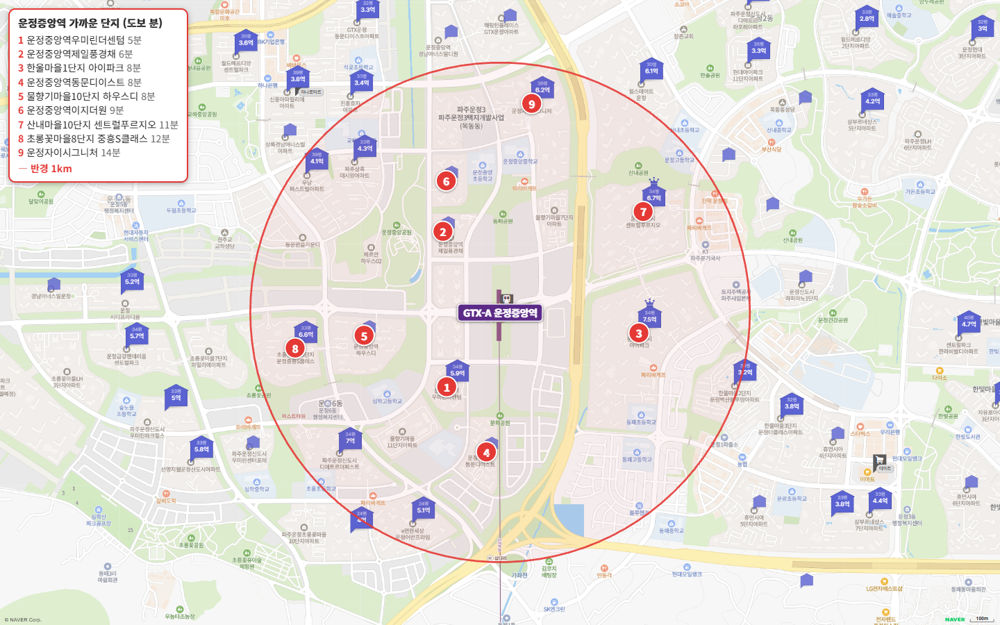
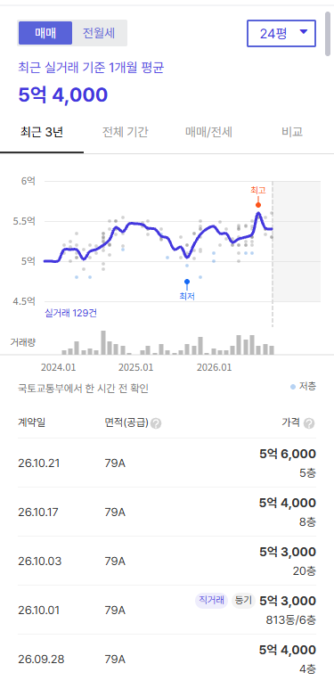
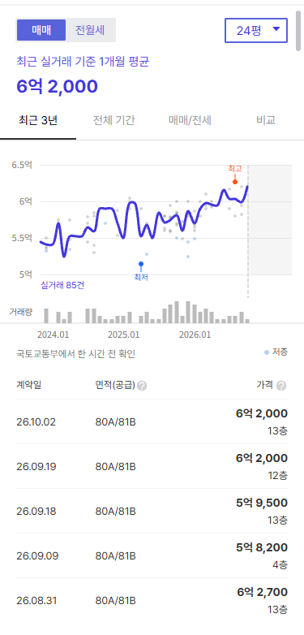
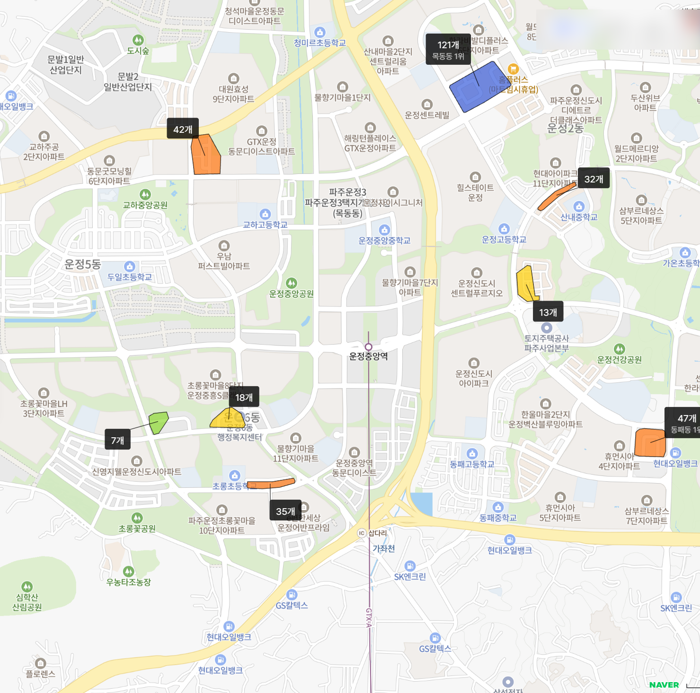

운정중앙역 도보 15분 이내에서 매매 가능 단지는 9곳입니다. 2026년 5~10월 실거래 중위값이 5억대인 곳은 그중 두 곳이에요.

{{chart:moveins:파주}}

| 단지 | 평형 | 5~10월 실거래 | 중위값 | 호가 |
|---|---|---|---|---|
| 초롱꽃마을8단지 중흥S클래스 | 24평형 | 38건, 5억~5억 7,000만 원 | 5억 4,000만 원 | 세 낀 매물 22건 5억 3,000만~6억 원, 실거주 매물 12건 5억 5,000만~6억 원 |
| 운정자이시그니처 ※ | 국평 | 4건, 5억 5,000만~5억 5,833만 원 | 5억 5,200만 원 | 매물 없음 |

※ 2026년 입주한 신축입니다. 입주 직후 거래는 분양가 수준일 수 있어 호가와 차이가 큽니다. 해제·직거래와 시세에서 크게 벗어난 거래는 뺐습니다.

역 도보 5분 우미린더센텀 국평은 신고 7건 가운데 3건이 직거래였습니다. 직거래를 빼면 중위값이 6억 800만 원이라 6억대로 봐야 해요.

**첫 집으로 고른다면 중흥S클래스 24평형부터 볼 만합니다.** 1,262세대 대단지이고, 거래가 38건으로 시세가 또렷하며, 24평형 가운데 갭이 가장 작아요.

## 고른 기준

- 범위: 역에서 도보 15분 이내 매매 가능 단지 전부입니다. 임대 단지 두 곳(물향기마을7단지 행복주택, 물향기마을11단지 국민임대)은 뺐습니다.
- 평형: 24평형(전용 59㎡)이 있으면 24평형, 없으면 국평(전용 84㎡)을 대표로 씁니다.
- 세대수 등급: 1,000세대 이상 대단지는 훌륭, 700세대 이상은 안정, 500세대 이상은 최소선입니다. 500세대 미만 소규모 단지는 매수층이 얇아 하락기에 덜 버티므로 역과 가까워도 권하지 않습니다.
- 출퇴근 등급: 주요 업무지구 네 곳까지 30분 이내는 매우 우수, 1시간 이내는 우수, 1시간 30분 이내는 양호입니다.

## 출퇴근 시간: 광화문 36분, 삼성 64분

| 업무지구 | 소요 시간 | 환승 | 경로 |
|---|---|---|---|
| 광화문 | 36분 | 1회 | GTX-A 서울역 → 1호선 시청역 |
| 여의도 | 42분 | 2회 | GTX-A 서울역 → 1호선 노량진 → 9호선 여의도 |
| 삼성(강남) | 64분 | 3회 | GTX-A 서울역 → 4호선 충무로 → 3호선 교대 → 2호선 삼성 |
| 판교 | 74분 | 2회 | GTX-A 서울역 → 광역버스 명동 → 직행버스 판교 |

GTX-A로 서울역까지 22분이 걸리므로(국토교통부 발표) 광화문과 여의도는 우수 등급입니다.

삼성과 판교는 서울역 환승이 필요해서 1시간을 넘어요. GTX-A 서울역~삼성 구간이 이어지기 전까지는 양호 등급입니다. 광화문·여의도 직장이라면 직주근접 면에서 경쟁력 있는 역이고, 강남 직장이라면 환승 시간을 계산에 넣어야 합니다.

## 도보 15분 이내 매매 가능 단지 9곳

| 단지 | 평형 | 역 도보 | 세대수(등급) | 입주 | 용적률 | 매매 실거래(5~10월) | 세 낀 매물 호가 | 실거주 매물 호가 | 전세(8~10월) | 갭(세 낀 매물) |
|---|---|---|---|---|---|---|---|---|---|---|
| 초롱꽃마을8단지 중흥S클래스 | 24평형 | 12분 | 1,262(훌륭) | 2022 | 171% | 38건(제외 2건) 5억~5.7억, 중위 5억 4,000 | 22건 5.3억~6억 | 12건 5.5억~6억 | 중위 3억 1,500 (22건) | 2억~2.8억 |
| 운정자이시그니처 ※ | 국평 | 14분 | 988(안정) | 2026 | 179% | 4건(제외 1건) 5.5억~5.58억, 중위 5억 5,200 | - | - | 중위 2억 5,000 (1건) | - |
| 운정중앙역 우미린더센텀 ※ | 국평 | 5분 | 418(비추) | 2026 | 199% | 4건(제외 3건) 5.66억~6.11억, 중위 6억 800 | - | 2건 7.05억~7.26억 | 중위 4억 3,000 (32건) | - |
| 한울마을1단지 아이파크 | 24평형 | 8분 | 3,042(훌륭) | 2020 | 185% | 10건 5.8억~6.27억, 중위 6억 500 | 9건 5.6억~6.5억 | 7건 6.1억~6.5억 | 중위 3억 4,000 (15건) | 2억 4,000 |
| 산내마을10단지 센트럴푸르지오 | 국평 | 11분 | 1,956(훌륭) | 2018 | 199% | 55건(제외 5건) 5.95억~7.2억, 중위 6억 6,700 | 34건 5.7억~8억 | 54건 6.55억~8억 | 중위 3억 8,700 (32건) | 2.7억~3.8억 |
| 운정중앙역 제일풍경채 ※ | 국평 | 6분 | 383(비추) | 2026 | 179% | 아직 매매 실거래 없음(입주 직후) | - | - | 중위 4억 2,500 (19건) | - |
| 운정중앙역 동문디이스트 ※ | 국평 | 8분 | 642(최소선) | 2026 | 200% | 아직 매매 실거래 없음(입주 직후) | - | - | 중위 3억 5,000 (5건) | - |
| 운정중앙역 이지더원 ※ | 국평 | 9분 | 379(비추) | 2026 | 182% | 아직 매매 실거래 없음(입주 직후) | - | - | 중위 4억 4,000 (3건) | - |
| 물향기마을10단지 하우스디 ※ | 24평형 | 8분 | 1,012(훌륭) | 2026 | 189% | 아직 매매 실거래 없음(입주 직후) | - | - | - | - |

※ 표시는 입주 2년 안 신축입니다. 입주 직후 거래는 분양가 수준일 수 있어 호가와 차이가 큽니다. 실거래는 2026년 5~10월 대표 평형 신고분이고, 해제·직거래와 시세에서 크게 벗어난 거래(같은 평형, 거래 달 앞뒤 3개월 거래 중위값의 ±20% 밖)는 뺐습니다. 호가는 같은 집이 여러 중개사로 올라온 것을 하나로 셌고, 세입자가 있어 전세를 안고 사는 세 낀 매물과 바로 들어가 살 수 있는 실거주 매물(즉시·협의 입주)로 나눴습니다. 갭은 세 낀 매물의 호가에서 그 집의 전세 보증금을 뺀 값입니다(월세 낀 매물은 뺐습니다). 실거주 매물 수에는 설명 없이 입주가능일만 즉시입주로 적힌 매물이 들어 있습니다.

역세권 단지일수록 2026년 입주한 신축입니다. 도보 9분 이내 신축 다섯 곳 가운데 네 곳은 아직 매매 실거래가 없어요(입주 직후라 손바뀜 전). 손바뀜이 꾸준한 곳은 도보 8~12분 거리, 2018~2022년 입주한 준신축 대단지들입니다.

## 5억대 두 곳

**초롱꽃마을8단지 중흥S클래스 24평형, 중위 5억 4,000만 원.** 1,262세대 대단지이고 2022년 입주, 역 도보 12분입니다. 5~10월 실거래 38건이 5억~5억 7,000만 원 사이라 시세 확인이 쉬워요(해제 1건·직거래 1건 제외). 세 낀 매물 22건 가운데 보증금이 확인된 6건의 갭은 2억~2억 8,000만 원입니다. 배정 초등학교(초롱초)는 도보 20분이라 초품아는 아닙니다.

**운정자이시그니처 국평, 중위 5억 5,200만 원.** 988세대(안정)로 2026년 3월 입주한 1년 차 신축입니다. 직거래 1건을 뺀 국평 거래 4건이 5억 5,000만~5억 5,833만 원이에요. 입주 직후 거래는 분양가 수준일 수 있어 호가와 차이가 클 수 있는데, 현재 국평 매물은 없습니다(매물 잠김). 역 도보 14분이고 단지까지 언덕길이에요.

## 역 도보 5분 신축: 우미린더센텀

**운정중앙역 우미린더센텀 국평, 중위 6억 800만 원.** 역 도보 5분 초역세권으로 9곳 가운데 역과 가장 가깝습니다. 5~10월 국평 신고 7건 가운데 3건(5억 5,803만·5억 7,423만·5억 9,800만 원)이 직거래였고, 이를 뺀 4건은 5억 6,600만~6억 1,100만 원이에요. 지금 매물은 바로 들어가 살 수 있는 집 2건, 호가 7억 500만~7억 2,600만 원입니다. 입주 직후 거래는 분양가 수준일 수 있어 호가와 1억 원 가까이 차이가 납니다.

418세대 소규모 단지라 세대수 등급은 비추예요. 입주민 후기에서도 단지 규모가 작은 점이 아쉬운 점으로 꼽힙니다.

## 6억대 대단지 두 곳

**한울마을1단지 아이파크 24평형, 중위 6억 500만 원.** 3,042세대로 9곳 중 최대 규모이고, 단지 안에 동패초를 품은 초품아입니다. 역 도보 8분이에요. 5~10월 실거래 10건이 5억 8,000만~6억 2,700만 원이고, 전세가율이 56%이고, 보증금이 확인된 세 낀 매물 1건의 갭은 2억 4,000만 원입니다.

**산내마을10단지 센트럴푸르지오 국평, 중위 6억 6,700만 원.** 1,956세대 대단지이고 2018년 입주, 역 도보 11분입니다. 단지 앞 학원가가 도보권이고, 5~10월 실거래가 55건으로 9곳 가운데 가장 많아요.

## 학군과 학원가

| 단지 | 배정초(도보) | 용적률 | 세대수 등급 |
|---|---|---|---|
| 운정중앙역 우미린더센텀 | 물향기초 5분 | 199% | 비추 |
| 운정중앙역 제일풍경채 | 운정중앙초 11분 | 179% | 비추 |
| 한울마을1단지 아이파크 | 동패초 단지 안 | 185% | 훌륭 |
| 운정중앙역 동문디이스트 | 물향기초 8분 | 200% | 최소선 |
| 물향기마을10단지 하우스디 | 물향기초 18분 | 189% | 훌륭 |
| 운정중앙역 이지더원 | 운정중앙초 11분 | 182% | 비추 |
| 산내마을10단지 센트럴푸르지오 | 산내초 13분 | 199% | 훌륭 |
| 초롱꽃마을8단지 중흥S클래스 | 초롱초 20분 | 171% | 훌륭 |
| 운정자이시그니처 | 운정중앙초 7분 | 179% | 안정 |

초품아는 아이파크 하나입니다. 우미린더센텀(물향기초 도보 5분)과 운정자이시그니처(운정중앙초 도보 7분)도 배정 초등학교가 가까워요.

역 반경 1km 안에 학원가 세 곳, 학원 66개가 있습니다. 운정에서 가장 큰 목동동 학원가(121개)는 역 북동쪽 1.5km쯤이에요. 이 지역 매수층의 중심이 학령기 자녀를 둔 30대 실수요층이라, 지금 아이가 없어도 학군은 챙겨 둘 만합니다.

## 생활 인프라: 마트·공원·병원

| 구분 | 시설 | 거리 |
|---|---|---|
| 공원 | 운정중앙공원 | 역 바로 서쪽 |
| 도서관 | 한울도서관 | 차로 3분 |
| 대형마트 | 이마트 파주운정점 | 차로 4분 |
| 공원 | 운정호수공원 | 차로 4분 |
| 체육·공연 | 운정다목적체육관 · 운정행복센터 | 차로 4~6분 |
| 아울렛 | 롯데프리미엄아울렛 파주점 | 차로 6분 |
| 쇼핑몰 | 스타필드빌리지 운정 | 차로 9분 |
| 백화점 | 현대백화점 킨텍스점 | 차로 12분 |
| 대형 병원 | 일산백병원 (운정 종합병원은 예정) | 차로 12분 |

도보로 닿는 생활 인프라는 역 바로 서쪽의 운정중앙공원입니다. 대형마트와 아울렛은 차로 4~6분, 백화점과 대형 병원은 일산까지 차로 12분이에요.

## GTX 호재, 이미 가격에 선반영됐을까

2027년 파주 입주 물량은 {{v:moveins:파주:2027}}로 한 해 적정 입주량({{v:need:파주}})의 {{v:share:파주:2027}}입니다. 해마다 입주 물량과 적정 입주량은 아래 표와 같아요. 그중 1,314세대가 2027년 5월 운정3지구 주상복합 네 블록에 몰려 있습니다.

{{table:moveins:파주}}

파주 매매는 {{v:streak:파주}}, 전세는 {{v:streak:파주:전세}}입니다. 주간 시세 흐름은 아래와 같습니다.

{{chart:weekly:파주}}

{{table:weekly:파주}}

**제 판단으로는 아직 선반영되지 않았습니다.** 손바뀜이 꾸준한 준신축 대단지 24평형이 아직 5억~6억 원대에 거래돼요. 2027년 5월 입주장이 서면서 전셋값이 한 번 조정받을 수 있지만, 그 뒤로는 입주 예정 물량이 거의 없어 신축 희소성이 다시 커집니다.

시군구별 주간·월간 시세는 [경기 리포트 표](/zone/%EA%B2%BD%EA%B8%B0/#weekly-sgg)에서 볼 수 있습니다.

적정 입주량은 주민등록 인구를 가구당 2.5명으로 나눈 가구 수의 2%로 잡았습니다. 매매는 대표 평형의 2026년 5~10월 실거래에서 해제·직거래와 같은 평형 거래 달 앞뒤 3개월 중위값의 ±20% 밖 거래를 뺀 값이고, 전세는 8~10월 월세 없는 전세 실거래의 중위값입니다.
