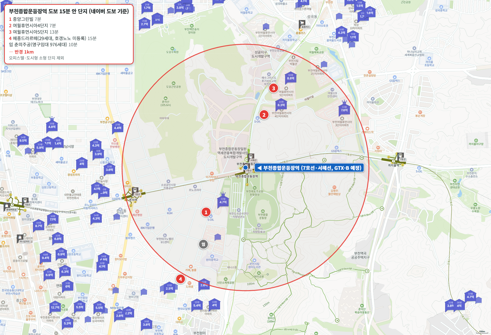
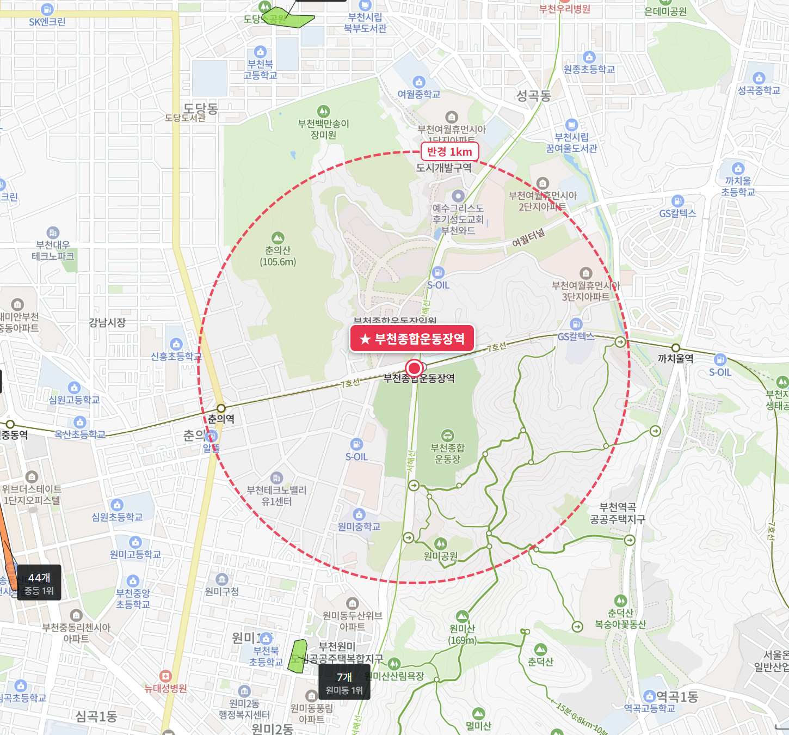

GTX-B 두 번째 편입니다. 부천종합운동장역은 인천대입구·인천시청·부평 다음 역이고, 인천을 지나 경기도에 들어선 첫 역입니다. 지금은 7호선과 서해선이 서는 환승역입니다.

GTX-B 민자구간은 2025년 8월 공사를 시작했고, 부천시 안내의 개통 목표는 2031년입니다.

역에서 도보 15분 이내 아파트는 **4곳**입니다. 역 북쪽은 춘의산, 남쪽은 부천종합운동장과 레포츠공원이라 아파트가 들어설 땅이 적습니다. 4곳 모두 500세대가 안 되고, 899세대 여월휴먼시아3단지가 16분으로 가장 가까운 대단지입니다.

**같은 역인데 원미구 쪽과 오정구 쪽의 시세 흐름이 다릅니다.** 오정구 여월동 국평은 1년째 제자리입니다.

## 출퇴근 시간: 여의도 37분, 광화문 49분

| 업무지구 | 소요 시간 | 환승 | 경로 |
|---|---|---|---|
| 여의도 | 37분 | 2회 | 7호선 온수 → 1호선 신길 → 5호선 여의도 |
| 광화문 | 49분 | 1회 | 7호선 온수 → 1호선 시청 |
| 삼성(강남) | 57분 | 1회 | 7호선 대림 → 2호선 삼성 |
| 판교 | 66분 | 1회 | 7호선 논현 → 신분당선 판교 |

지금도 여의도 37분, 광화문 49분, 삼성 57분으로 세 곳이 1시간 안에 들어 우수입니다. 판교는 66분으로 양호입니다.

개통 뒤 시간은 부천시가 2019년 예비타당성조사 통과 때 밝힌 숫자가 있습니다. 여의도 8분, 서울역 14분입니다.

## 도보 15분 이내 아파트 4곳

| 단지 | 매매 실거래(5~10월) | 평형 | 역 도보 | 세대수(등급) | 입주 | 용적률 | 1년 변동 | 세 낀 매물 호가 | 실거주 매물 호가 | 전세(8~10월) | 갭(세 낀 매물) |
|---|---|---|---|---|---|---|---|---|---|---|---|
| 중앙그린빌 | 없음(마지막 2025년 11월 4억 3,000) | 24평형 | 7분 | 112(비추) | 2002 | 278% | - | 3건 5.1억~5.5억 | 1건 5.1억 | - | 2.2억~3억 |
| 여월휴먼시아4단지 | 8건 7.6억~8.5억, 중위 8억 450 | 국평 | 7분 | 244(비추) | 2010 | 138% | +0.6% | 3건 8.4억~8.5억 | 2건 8.69억~9.2억 | 중위 4억 5,000 (2건) | 3.6억~3.7억 |
| 여월휴먼시아5단지 | 1건 9.4억 | 전용 102㎡ | 13분 | 334(비추) | 2010 | 141% | - | - | 1건 9.4억 | - | - |
| 메종드라르떼 | 없음 | 전용 74㎡ | 15분 | 29(비추) | 2020 | 228% | - | 1건 4.3억 | 4건 4억~4.3억 | - | 8,000만 |

실거래는 2026년 5~10월 대표 평형 신고분이고, 해제·직거래와 시세보다 크게 낮은 거래(같은 평형, 거래 달 앞뒤 3개월 거래 중위값의 80% 미만)는 뺐습니다. 1년 변동은 같은 평형 2026년 5~10월 중위값을 2025년 5~10월 중위값과 견준 값이고, 1년 전 거래가 3건 이상일 때만 적었습니다. 호가는 같은 집이 여러 중개사로 올라온 것을 하나로 셌고, 세입자가 있어 전세를 안고 사는 세 낀 매물과 바로 들어가 살 수 있는 실거주 매물(즉시·협의 입주)로 나눴습니다. 갭은 세 낀 매물의 호가에서 그 집의 전세 보증금을 뺀 값입니다(월세 낀 매물은 뺐습니다). 실거주 매물 수에는 설명 없이 입주가능일만 즉시입주로 적힌 매물이 들어 있습니다.

역 도보 10분에 춘의주공(976세대)이 있지만 영구임대 단지라 표에서 뺐습니다. 국민임대인 여월휴먼시아1단지(17분)·2단지(19분)도 같습니다. 부천월드메르디앙라제스티(14분)와 더로브(15분)는 오피스텔이라 넣지 않았습니다.

도보 15분을 조금 넘는 곳으로는 여월휴먼시아3단지(16분, 899세대), 우민늘사랑2차·두산(19분), 춘의우민늘사랑·우남푸르미아(20분), 이안더부천·성원(21분)이 있습니다.

## 여월휴먼시아4단지 국평, 8억 원에서 1년째 그대로입니다

**여월휴먼시아4단지**는 244세대, 2010년 입주, 역 도보 7분입니다. 용적률이 138%로 낮아 동 간격이 넓습니다.

5~10월 실거래 8건이 7억 6,000만~8억 5,000만 원이고 중위값은 8억 450만 원입니다. 2025년 같은 기간 중위값은 8억 원이었습니다(3건). 세 낀 매물 3건의 갭은 3억 6,000만~3억 7,000만 원입니다.

배정초(성곡초)까지 도보 7분이고, 단지 뒤가 산입니다.

16분 거리의 **여월휴먼시아3단지**(899세대, 2007년)도 같습니다. 국평 5~10월 실거래 14건(직거래 1건 제외)의 중위값이 7억 5,000만 원이고, 1년 전(6건) 7억 4,750만 원에서 0.3% 움직였습니다.

**중앙그린빌**은 112세대, 2002년 입주, 역 도보 7분으로 원미구 춘의동 쪽 단지입니다. 24평형은 올해 5~10월 거래가 없고, 마지막 거래는 2025년 11월 4억 3,000만 원입니다. 지금 매물 호가는 5억 1,000만~5억 5,000만 원입니다.

**여월휴먼시아5단지**(334세대)는 가장 작은 평형이 전용 102㎡라 사회초년생이 보기엔 큽니다. **메종드라르떼**는 29세대 소규모 단지입니다.

네 곳 모두 500세대가 안 되어 거래가 드물고, 그만큼 환금성이 떨어집니다.

## 같은 역, 원미구는 오르고 오정구는 제자리입니다

10월 26일 조사 기준 최근 4주 매매 변동률은 부천 원미구가 +1.65%로 수도권 65곳 가운데 8위입니다. 같은 부천인데 오정구는 +0.17%, 소사구는 +0.26%입니다. 원미구 매매는 {{v:streak:부천 원미구}}이고, 오정구는 {{v:streak:부천 오정구}}입니다.

부천종합운동장역은 원미구 춘의동에 있고, 여월휴먼시아 단지들은 바로 북쪽 오정구 여월동입니다. 역에서 7분 거리인 여월휴먼시아4단지 국평이 1년 동안 0.6% 움직인 것은 오정구 흐름 그대로입니다.

원미구가 함께 오르는 곳은 경기 핵심지(군포·구리·부천 원미구·영통·분당·동안·의왕·광명 등)입니다. 같은 4주 동안 영통 +2.4%, 군포 +2.1%, 구리 +1.4%가 올랐고, 경기 외곽(파주·포천·양주·동두천·의정부·평택·안성·이천·오산·김포·여주) 가운데 파주·포천은 +0.1%입니다.

{{chart:weekly:부천 원미구}}

{{table:weekly:부천}}

## 학군과 학원가

| 단지 | 배정초(도보) | 경사 | 용적률 | 세대수 등급 |
|---|---|---|---|---|
| 중앙그린빌 | 부일초 10분 | 평지 | 278% | 비추 |
| 여월휴먼시아4단지 | 성곡초 7분 | 평지(단지 뒤 산) | 138% | 비추 |
| 여월휴먼시아5단지 | 성곡초 5분 | 평지 | 141% | 비추 |
| 메종드라르떼 | 부일초 3분 | 평지 | 228% | 비추 |

역 반경 1km 안에는 학원가가 없습니다. 가장 가까운 원미동 학원가(7개)가 1.45km입니다.

큰 학원가는 중동(44개)이 차로 7분, 부천에서 가장 큰 상동(104개)이 차로 11분입니다.

## 생활 인프라: 공원·마트·병원

| 구분 | 시설 | 거리 |
|---|---|---|
| 공원 | 부천레포츠공원 | 도보 1분 |
| 체육시설 | 부천종합운동장 | 도보 7분 |
| 도서관 | 부천시립원미도서관 | 도보 11분 |
| 대형마트 | 홈플러스 부천여월점 | 도보 16분 |
| 대형 병원 | 부천성모병원 | 차로 4분 |
| 백화점 | 롯데백화점 중동점 | 차로 6분 |
| 공연장 | 부천아트센터 | 차로 7분 |
| 아울렛 | 뉴코아아울렛 부천점 | 차로 10분 |
| 복합쇼핑몰 | 롯데몰 김포공항점 | 차로 20분 |

역 바로 옆이 레포츠공원과 종합운동장이고, 대학병원(부천성모병원)과 백화점이 차로 10분 안입니다.

## 부천 공급, 3년 합계가 적정물량의 절반에 못 미칩니다

부천의 2027~2029년 입주 물량은 모두 {{v:moveins3:부천}}로 3년 적정물량(한 해 {{v:need:부천}})의 {{v:share3:부천}}입니다. 가장 많은 2027년도 {{v:moveins:부천:2027}}(적정의 {{v:share:부천:2027}})이고, 2028년은 {{v:moveins:부천:2028}}(적정의 {{v:share:부천:2028}})로 줄어듭니다.

{{chart:moveins:부천}}

{{table:moveins:부천}}

**제 판단으로는 원미구가 먼저 오르고 오정구가 따라 오를 차례입니다.** 같은 역을 쓰는 두 동네인데 공급 조건은 부천 전체가 같고, 앞으로 3년 입주는 적정물량의 절반에 못 미칩니다. 여월휴먼시아 국평 8억은 그 부족이 아직 값에 덜 반영된 자리이고, 원미구와 벌어진 차이는 시간이 지나면 좁혀진다고 봅니다.

시군구별 주간·월간 시세는 [경기 리포트 표](/zone/%EA%B2%BD%EA%B8%B0/#weekly-sgg)에서 볼 수 있습니다.

적정물량은 주민등록 인구를 가구당 2.5명으로 나눈 가구 수의 2%로 잡았습니다. 매매는 대표 평형의 2026년 5~10월 실거래에서 해제·직거래와 같은 평형 거래 달 앞뒤 3개월 중위값의 80% 미만 거래를 뺀 값이고, 전세는 8~10월 월세 없는 전세 실거래의 중위값입니다.

## 고른 기준

- 역 위치: 지금의 7호선·서해선 부천종합운동장역 출입구(1~6번)를 역으로 삼았습니다.
- 범위: 네이버 지도 도보 길찾기로 단지 출입구에서 역 출입구까지 15분 이내인 아파트 전부입니다. 임대 전용 단지와 오피스텔은 뺐습니다.
- 평형: 24평형(전용 59㎡)이 있으면 24평형, 없으면 국평(전용 84㎡), 둘 다 없으면 가장 많은 평형을 대표로 씁니다.
- 1년 변동: 같은 평형 2026년 5~10월 실거래 중위값 ÷ 2025년 5~10월 실거래 중위값 - 1입니다. 1년 전 거래가 3건 미만이면 적지 않았습니다.
- 세대수 등급: 1,000세대 이상 대단지는 훌륭, 700세대 이상은 안정, 500세대 이상은 최소선입니다. 500세대 미만 소규모 단지는 거래가 적어 환금성이 떨어집니다.
- 출퇴근 등급: 주요 업무지구 네 곳까지 30분 이내는 매우 우수, 1시간 이내는 우수, 1시간 30분 이내는 양호입니다.
