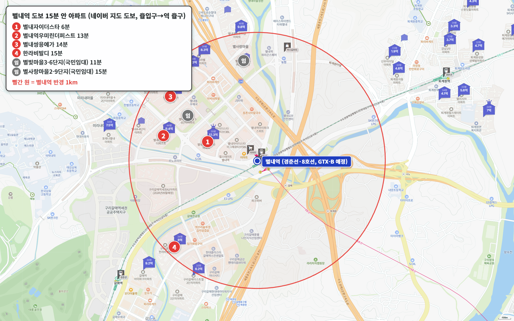
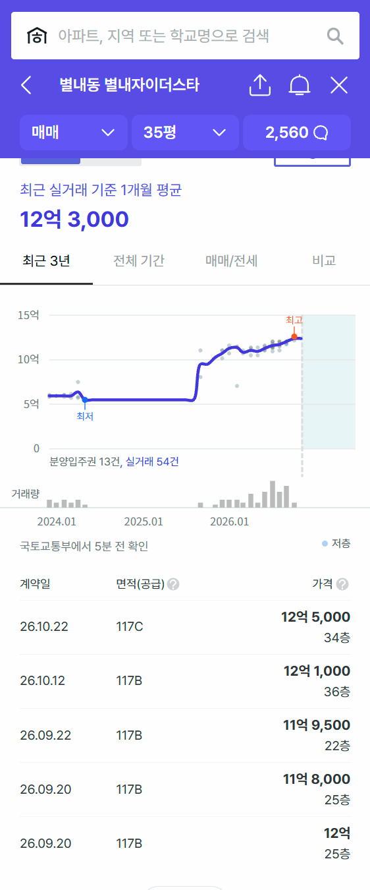
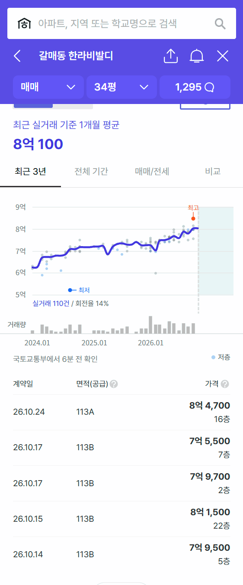
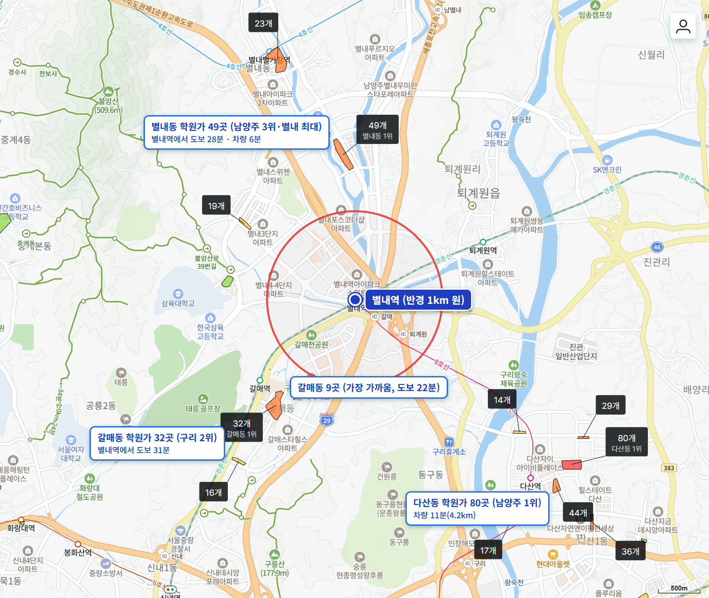

GTX-B 다섯 번째 편이고, B노선 경기도 역 가운데 서울에 가장 가까운 역입니다. 별내역은 지금 경춘선과 8호선이 서는 환승역이고, GTX-B가 같은 역에 섭니다. 역 바로 남쪽이 구리 갈매동이라 남양주와 구리가 한 역을 같이 씁니다.

GTX-B 개통 목표는 국토교통부가 2024년까지 2030년으로 밝혔고, 2026년 10월 30일 보도설명자료에는 별내역을 적어 2031년(잠정)으로 표시했습니다.

역에서 도보 15분 이내 분양 아파트는 **4곳**입니다. 역 바로 앞은 오피스텔과 이마트가 차지하고 있어 아파트 단지는 그 바깥에 있습니다.

**역 앞 신축 국평은 11억 원대, 15분 거리 구리 갈매동 국평은 7억 원대입니다.**

## 출퇴근 시간: 삼성 38분, 광화문 52분

| 업무지구 | 소요 시간 | 환승 | 경로 |
|---|---|---|---|
| 삼성(강남) | 38분 | 1회 | 8호선 잠실 → 2호선 삼성 |
| 광화문 | 52분 | 2회 | 경춘선 상봉 → 7호선 군자 → 5호선 광화문 |
| 판교 | 64분 | 2회 | 경춘선 상봉 → 7호선 논현 → 신분당선 판교 |
| 여의도 | 65분 | 2회 | 경춘선 상봉 → 7호선 군자 → 5호선 여의도 |

8호선 덕분에 삼성이 38분, 광화문이 52분으로 우수입니다. 판교 64분, 여의도 65분은 양호입니다.

개통 뒤 시간은 별내역만 따로 밝힌 공공 자료가 없습니다. 노선 끝 마석역 기준으로 국토교통부는 서울역 27분을 예상했고, 별내역은 마석에서 서울 쪽으로 세 정거장 안쪽입니다.

## 도보 15분 이내 아파트 4곳

| 단지 | 평형 | 역 도보 | 세대수(등급) | 입주 | 용적률 | 매매 실거래(5~10월) | 1년 변동 | 세 낀 매물 호가 | 실거주 매물 호가 | 전세(8~10월) | 갭(세 낀 매물) |
|---|---|---|---|---|---|---|---|---|---|---|---|
| 별내자이더스타 | 국평 | 6분 | 740(안정) | 2023 | 299% | 34건(제외 2건) 10.5억~12.5억, 중위 11억 6,250 | - | 13건 12억~14억 | 9건 12.2억~13억 | 중위 7억 (9건) | 6.2억~7.5억 |
| 별내역우미린더퍼스트 | 전용 102㎡ | 13분 | 396(비추) | 2012 | 206% | 5건 8.1억~8.5억, 중위 8억 3,000 | - | - | 1건 9억 | 중위 6억 3,000 (3건) | - |
| 별내쌍용예가 | 전용 102㎡ | 14분 | 652(최소선) | 2012 | 204% | 14건(제외 1건) 8.35억~9억, 중위 8억 7,250 | +4.2% | 1건 10억 | 4건 8.9억~9.9억 | 중위 5억 7,500 (2건) | - |
| 한라비발디(구리 갈매동) | 국평 | 15분 | 1,075(훌륭) | 2016 | 216% | 31건(제외 1건) 7.4억~8.47억, 중위 7억 7,500 | +7.0% | 13건 7.5억~8.5억 | 7건 7.9억~9억 | 중위 4억 7,300 (7건) | 2.5억~4.35억 |

실거래는 2026년 5~10월 대표 평형 신고분이고, 해제·직거래와 시세보다 크게 낮은 거래(같은 평형, 거래 달 앞뒤 3개월 거래 중위값의 80% 미만)는 뺐습니다. 1년 변동은 같은 평형 2026년 5~10월 중위값을 2025년 5~10월 중위값과 견준 값이고, 1년 전 거래가 3건 이상일 때만 적었습니다. 호가는 같은 집이 여러 중개사로 올라온 것을 하나로 셌고, 세입자가 있어 전세를 안고 사는 세 낀 매물과 바로 들어가 살 수 있는 실거주 매물(즉시·협의 입주)로 나눴습니다. 갭은 세 낀 매물의 호가에서 그 집의 전세 보증금을 뺀 값입니다(월세 낀 매물은 뺐습니다). 실거주 매물 수에는 설명 없이 입주가능일만 즉시입주로 적힌 매물이 들어 있습니다.

LH 임대 단지인 별빛마을3-6단지(787세대, 11분)와 별사랑마을2-9단지(483세대, 15분)는 표에서 뺐습니다. 역 바로 앞 별내역아이파크스위트(1,100실)·힐스테이트별내역(578실) 같은 오피스텔도 넣지 않았습니다.

도보 15분을 조금 넘는 곳으로는 동익미라벨38단지(16분)·39단지(17분), 별내더샵·포레나별내·구리갈매이스트힐2단지(19분), 갈매역아이파크(21분)가 있습니다. 역 남쪽 구리갈매역세권 A1블록 신혼희망타운(1,791세대)이 2028년 9월 입주 예정입니다.

## 역 앞 신축과 갈매 대단지, 국평 값이 4억 원 차이 납니다

**별내자이더스타**는 740세대(안정), 2023년 12월 입주, 역 도보 6분입니다. 국평 5~10월 실거래 34건의 중위값이 11억 6,250만 원이고, 10월 22일 12억 5,000만 원이 마지막 거래입니다. 세 낀 매물 13건 가운데 보증금이 확인된 6건의 갭은 6억 2,000만~7억 5,000만 원입니다. 입주 2년 차라 1년 전 같은 기간 거래가 1건뿐이어서 1년 변동은 적지 않았습니다.

입주민 후기에는 경춘선·8호선 역이 바로 앞이라는 점과 고층 불암산 조망을 꼽는 글이 많습니다. 배정초(한별초)까지 도보 16분으로, 4곳 가운데 학교가 가장 멉니다.

**한라비발디**는 1,075세대 대단지(훌륭), 2016년 입주로 행정구역은 구리 갈매동입니다. 역까지 도보 15분이고 갈매역도 걸어서 갑니다. 국평 5~10월 실거래 31건의 중위값이 7억 7,500만 원으로 1년 전(13건) 7억 2,400만 원보다 7.0% 올랐습니다. 세 낀 매물 13건 가운데 9건의 갭은 2억 5,000만~4억 3,500만 원입니다.

갈매천 산책로와 단지 관리가 좋다는 후기가 많고, 별내역 가는 길에 육교를 건너 돌아간다는 지적이 있습니다.

**별내쌍용예가**(652세대, 2012년, 14분)와 **별내역우미린더퍼스트**(396세대, 2012년, 13분)는 가장 작은 평형이 전용 102㎡입니다. 쌍용예가는 8억 7,250만 원으로 1년 전(4건)보다 4.2% 올랐고, 별내중앙공원 옆이라 조용하다는 후기가 많습니다. 배정초(한별초)까지 쌍용예가 도보 5분, 우미린 7분입니다.

우미린더퍼스트는 500세대가 안 되어 거래가 드물고, 그만큼 환금성이 떨어집니다.

## 남양주 별내와 구리 갈매, 같은 역인데 오른 폭이 다릅니다

구리는 경기 핵심지(군포·구리·부천 원미구·영통·분당·동안·의왕·광명 등)에 듭니다. 11월 2일 조사 기준 최근 12주 매매 변동률은 경기 핵심지가 +3.85%, 경기 외곽(파주·포천·양주·동두천·의정부·평택·안성·이천·오산·김포·여주)이 +0.15%입니다. 구리 매매는 {{v:streak:구리}}이고, 남양주는 {{v:streak:남양주}}입니다.

같은 별내역을 쓰는 단지인데 구리 갈매 한라비발디 국평은 1년 동안 7.0%, 남양주 별내쌍용예가는 4.2% 올랐습니다.

{{chart:weekly:남양주}}

{{table:weekly:남양주}}

## 학군과 학원가

| 단지 | 배정초(도보) | 경사 | 용적률 | 세대수 등급 |
|---|---|---|---|---|
| 별내자이더스타 | 한별초 16분 | 평지 | 299% | 안정 |
| 별내역우미린더퍼스트 | 한별초 7분 | 평지 | 206% | 비추 |
| 별내쌍용예가 | 한별초 5분 | 평지 | 204% | 최소선 |
| 한라비발디 | 산마루초 11분 | 평지 | 216% | 훌륭 |

역 반경 1km 안에는 학원가가 없습니다. 가까운 곳은 갈매동 학원가(9개, 1.3km)이고, 별내에서 가장 큰 별내동 학원가(49개, 남양주 3위)가 차로 6분입니다. 구리 2위 갈매동 학원가(32개)는 걸어서 31분, 남양주에서 가장 큰 다산동(80개)은 차로 11분, 노원 중계동 학원가(232개)는 차로 18분입니다.

## 생활 인프라: 마트·공원·병원

| 구분 | 시설 | 거리 |
|---|---|---|
| 대형마트 | 이마트 별내점 | 도보 1분 |
| 공원 | 어울림공원 | 도보 3분 |
| 공연장 | 별빛극장 | 도보 8분 |
| 도서관 | 별빛도서관 | 도보 21분 |
| 큰 공원 | 별내중앙공원 | 도보 28분 |
| 아울렛 | 모다아울렛 구리남양주점 | 차로 6분 |
| 대형 병원 | 서울의료원 | 차로 12분 |
| 백화점 | 롯데백화점 구리점 | 차로 13분 |

이마트가 역 바로 앞이고, 대형 병원(서울의료원)과 백화점이 차로 15분 안입니다.

## 남양주 공급, 3년 합계가 적정물량에 못 미칩니다

남양주의 2027~2029년 입주 물량은 모두 {{v:moveins3:남양주}}로 3년 적정물량(한 해 {{v:need:남양주}})의 {{v:share3:남양주}}입니다. 2028년 한 해에 {{v:moveins:남양주:2028}}(적정의 {{v:share:남양주:2028}})가 몰리지만, 2027년은 {{v:share:남양주:2027}}, 2029년은 {{v:share:남양주:2029}}에 그칩니다.

{{chart:moveins:남양주}}

{{table:moveins:남양주}}

**제 판단으로는 같은 역을 쓰는 남양주 별내 쪽 단지가 아직 반영이 덜 된 곳입니다.** 구리 갈매가 경기 핵심지 흐름을 따라 먼저 올랐고, 별내쌍용예가는 그보다 덜 올랐습니다. 남양주 3년 입주가 적정물량에 못 미치는 한, 같은 역 안에서 벌어진 차이는 시간이 지나며 좁혀진다고 봅니다.

시군구별 주간·월간 시세는 [경기 리포트 표](/zone/%EA%B2%BD%EA%B8%B0/#weekly-sgg)에서 볼 수 있습니다.

적정물량은 주민등록 인구를 가구당 2.5명으로 나눈 가구 수의 2%로 잡았습니다. 매매는 대표 평형의 2026년 5~10월 실거래에서 해제·직거래와 같은 평형 거래 달 앞뒤 3개월 중위값의 80% 미만 거래를 뺀 값이고, 전세는 8~10월 월세 없는 전세 실거래의 중위값입니다.

## 고른 기준

- 역 위치: 지금의 경춘선·8호선 별내역 출입구를 역으로 삼았습니다. GTX-B는 같은 역에 섭니다.
- 범위: 네이버 지도 도보 길찾기로 단지 출입구에서 역 출입구까지 15분 이내인 분양 아파트 전부입니다. 임대 전용 단지와 오피스텔은 뺐습니다.
- 평형: 24평형(전용 59㎡)이 있으면 24평형, 없으면 국평(전용 84㎡), 둘 다 없으면 가장 작은 평형을 대표로 씁니다.
- 1년 변동: 같은 평형 2026년 5~10월 실거래 중위값 ÷ 2025년 5~10월 실거래 중위값 - 1입니다. 1년 전 거래가 3건 미만이면 적지 않았습니다.
- 세대수 등급: 1,000세대 이상 대단지는 훌륭, 700세대 이상은 안정, 500세대 이상은 최소선입니다. 500세대 미만 소규모 단지는 거래가 적어 환금성이 떨어집니다.
- 출퇴근 등급: 주요 업무지구 네 곳까지 30분 이내는 매우 우수, 1시간 이내는 우수, 1시간 30분 이내는 양호입니다.
