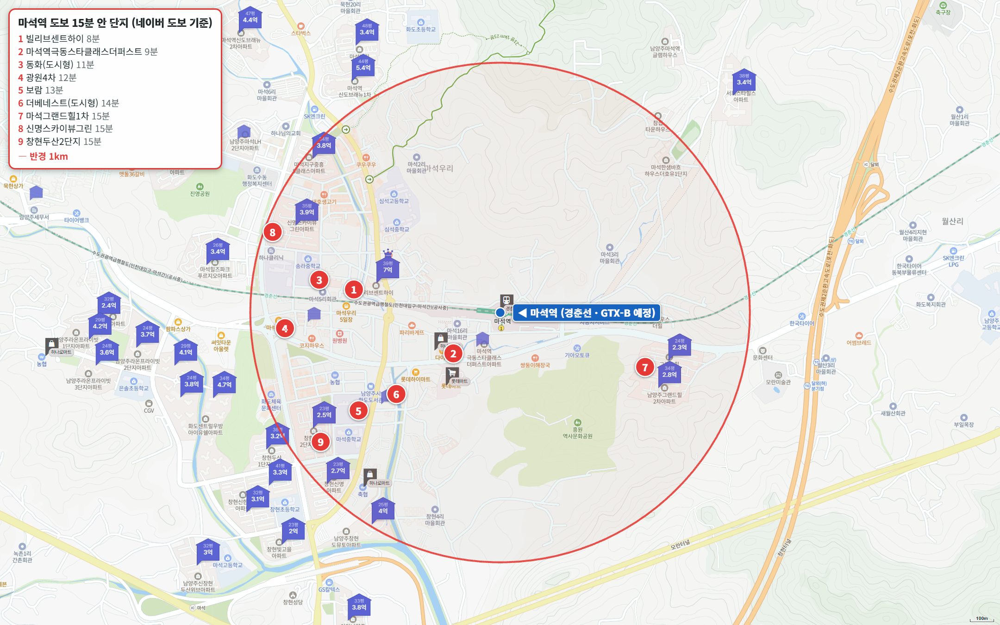
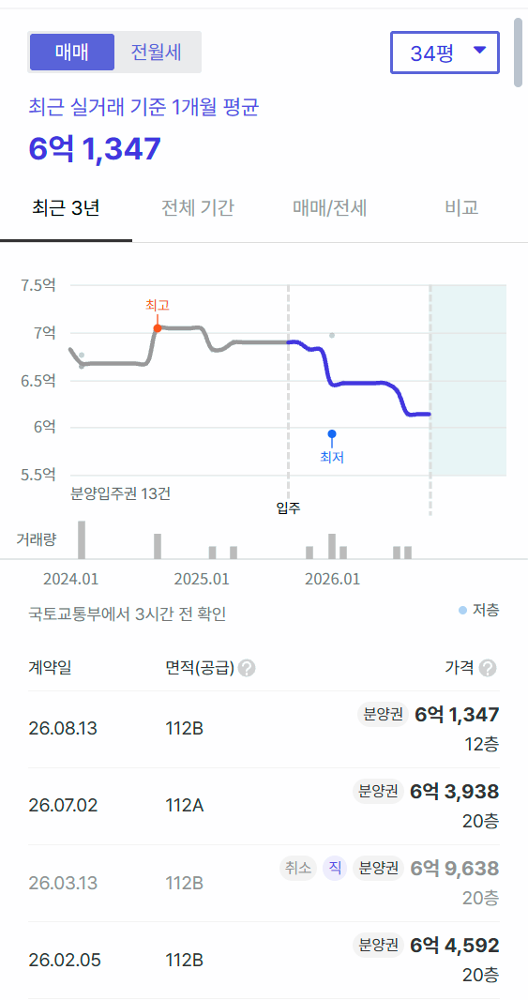
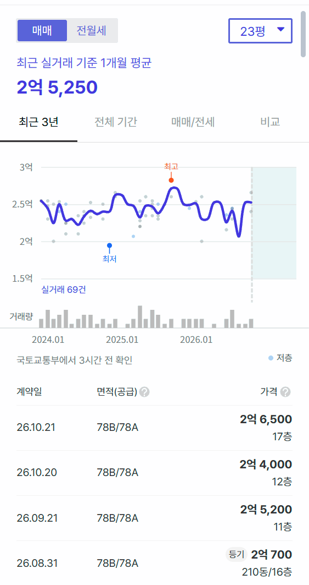
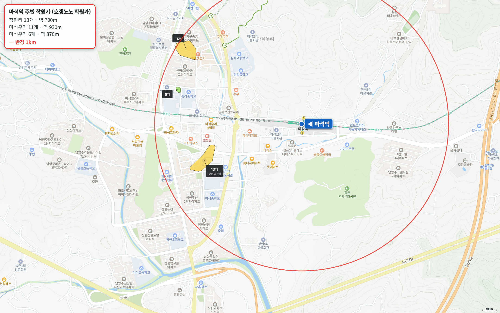

이번 편부터 GTX-B입니다. GTX-B는 인천 송도(인천대입구)에서 남양주 마석까지 82.8km를 잇는 노선이고, 2024년 3월 착공식을 열었습니다. 정부 개통 목표는 2030년이지만, 민자구간 공사가 2025년 8월에야 시작돼 2031년 무렵으로 보는 전망도 있습니다.

마석역은 그 동쪽 끝, 종점입니다. 지금은 경춘선 역이고, GTX-B가 같은 자리에 섭니다.

마석역 도보 15분 이내 아파트는 **9곳**입니다. 그중 500세대가 넘는 단지는 세 곳뿐이고, **그 가운데 두 곳의 24평형 실거래 중위값이 2억 원대입니다.**

이 연재에서 지금까지 본 24평형 가운데 가장 쌉니다.

## 출퇴근 시간: 지금은 경춘선, 개통 뒤 서울역 27분

| 업무지구 | 지금 소요 시간 | 환승 | 지금 경로 |
|---|---|---|---|
| 삼성(강남) | 68분 | 2회 | 경춘선 별내 → 8호선 잠실 → 2호선 삼성 |
| 광화문 | 75분 | 2회 | 경춘선 상봉 → 7호선 군자 → 5호선 광화문 |
| 여의도 | 88분 | 2회 | 경춘선 상봉 → 7호선 군자 → 5호선 여의도 |
| 판교 | 88분 | 2회 | 경춘선 상봉 → 7호선 논현 → 신분당선 판교 |

지금은 네 곳 모두 1시간을 넘고, 1시간 30분 안에 들어 양호입니다. 좌석을 예약하는 ITX-청춘을 타면 광화문 52분, 여의도 64분, 삼성 66분으로 줄어듭니다.

개통 뒤 시간은 국토교통부가 2022년 기본계획을 발표하면서 마석~서울역 27분을 예상 소요 시간으로 내놓았습니다. 종점이라 첫 역에서 앉아서 출발한다는 점은 입주민 후기에도 자주 나옵니다.

## 도보 15분 이내 아파트 9곳

| 단지 | 평형 | 역 도보 | 세대수(등급) | 입주 | 용적률 | 매매 실거래(5~10월) | 세 낀 매물 호가 | 실거주 매물 호가 | 전세(8~10월) | 갭(세 낀 매물) |
|---|---|---|---|---|---|---|---|---|---|---|
| 빌리브센트하이 | 국평(전용 85㎡) | 8분 | 250(비추) | 2025 | 817% | 아직 매매 실거래 없음(분양권 거래만) | - | 9건 6.31억~6.86억 | 중위 4억 3,000 (5건) | - |
| 마석역극동스타클래스더퍼스트 | 24평형 | 9분 | 138(비추) | 2025 | 486% | 아직 매매 실거래 없음 | 1건 4.2억 | 19건 4억~4.56억 | - | - |
| 마석그랜드힐1차 | 24평형 | 15분 | 550(최소선) | 2004 | 193% | 5건 2.08억~2.32억, 중위 2억 2,750 | 5건 2.4억~2.5억 | 9건 2.3억~2.5억 | 1억 8,300 (1건) | 4,000만~7,000만 |
| 신명스카이뷰그린 | 24평형 | 15분 | 657(최소선) | 2005 | 220% | 3건 3억 1,450~3억 2,500, 중위 3억 1,500 | 4건 3.2억~3.3억 | 2건 3.4억~3.5억 | - | 6,000만 |
| 창현두산2단지 | 24평형 | 15분 | 800(안정) | 1997 | 199% | 10건 2.07억~2.65억, 중위 2억 4,150 | 15건 2.3억~3.2억 | 23건 2.3억~3.1억 | 중위 1억 9,500 (4건) | 5,000만~1억 2,000만 |

실거래는 2026년 5~10월 대표 평형 신고분이고, 해제·직거래와 시세보다 크게 낮은 거래(같은 평형, 거래 달 앞뒤 3개월 거래 중위값의 80% 미만)는 뺐습니다. 호가는 같은 집이 여러 중개사로 올라온 것을 하나로 셌고, 세입자가 있어 전세를 안고 사는 세 낀 매물과 바로 들어가 살 수 있는 실거주 매물(즉시·협의 입주)로 나눴습니다. 갭은 세 낀 매물의 호가에서 그 집의 전세 보증금을 뺀 값입니다(월세 낀 매물은 뺐습니다). 실거주 매물 수에는 설명 없이 입주가능일만 즉시입주로 적힌 매물이 들어 있습니다.

나머지 네 곳은 보람(19세대, 1995년, 13분), 광원4차(38세대, 1991년, 12분), 동화(17세대, 2017년, 11분), 더베네스트(49세대, 2021년, 14분)입니다. 동화와 더베네스트는 도시형생활주택입니다. 네 곳 모두 100세대가 안 되는 소규모라 표에서 뺐습니다.

도보 15분을 조금 넘는 곳으로는 마석그랜드힐2차(16분), 창현신명(17분), 마석중흥S클래스(18분), 남양주창현도뮤토(18분)가 있습니다.

## 역 앞 신축 두 곳은 세대수가 적습니다

**빌리브센트하이**는 역 도보 8분, 2025년 9월 입주한 250세대(최고 29층) 단지입니다. 용적률이 817%이고 24평형이 없어 국평이 대표 평형입니다.

아직 매매 실거래는 없고 분양권 거래만 있습니다. 매물 9건이 모두 바로 들어가 살 수 있는 집이고 호가는 6억 3,100만~6억 8,600만 원입니다.

입주민 후기에는 단지 안 상가에 소아과·치과 같은 병원이 다 있고 커뮤니티(헬스장·실내골프연습장)가 좋다는 글이 많습니다.

**마석역극동스타클래스더퍼스트**는 역 도보 9분, 2025년 9월 입주한 138세대 한 동짜리 단지입니다. 24평형 매물 20건 가운데 19건이 즉시입주로 올라와 있고 호가는 4억~4억 5,630만 원입니다. 밤에 불 켜진 집이 적다는 후기가 있을 만큼 아직 입주가 덜 찼습니다.

**두 곳 모두 역에서 가장 가깝지만 500세대가 안 됩니다.** 이 연재 기준으로는 역에 가까워도 권하지 않는 규모입니다.

## 2억대 24평형 두 곳, 창현두산2단지와 마석그랜드힐1차

**창현두산2단지**는 800세대(안정), 1997년 입주(29년 차), 역 도보 15분입니다. 15분 안에서 가장 큰 단지입니다.

5~10월 실거래 10건이 2억 700만~2억 6,500만 원이고 중위값은 2억 4,150만 원입니다. 10월 21일 2억 6,500만 원이 마지막 거래입니다. 세 낀 매물 15건 가운데 보증금이 확인된 8건의 갭은 5,000만~1억 2,000만 원입니다.

배정초(마석초)가 후문에서 도보 1분이라 초품아입니다. 입주민 후기에는 조용하고 녹지가 많으며 고속도로 나들목이 가깝다는 글이 많습니다.

시세 화면을 보면 2024년부터 3년 가까이 2억~2억 7,000만 원 사이를 오가고 있습니다. **GTX-B 착공(2024년 3월) 뒤에도 24평형 값은 한 단계 올라서지 않았습니다.**

**마석그랜드힐1차**는 550세대(최소선), 2004년 입주, 역 도보 15분입니다. 5~10월 실거래 5건이 2억 800만~2억 3,200만 원이고 중위값은 2억 2,750만 원입니다. 세 낀 매물 가운데 보증금이 확인된 2건의 갭은 4,000만~7,000만 원입니다.

정문 건너에 광역버스 정류장이 있고 관리가 잘 된다는 후기가 많습니다. 다만 단지가 약간 언덕에 있고, 배정초(마석초)까지 도보 24분으로 멉니다.

**신명스카이뷰그린**은 657세대(최소선), 2005년 입주, 역 도보 15분입니다. 5~10월 실거래 3건의 중위값이 3억 1,500만 원으로 세 곳 가운데 가장 비쌉니다. 배정초(송라초)가 후문에서 도보 2분이고 주변에 초·중·고가 모여 있습니다. 지하주차장이 동과 이어지지 않는다는 점은 단점으로 꼽힙니다.

## 학군과 학원가

| 단지 | 배정초(도보) | 경사 | 용적률 | 세대수 등급 |
|---|---|---|---|---|
| 빌리브센트하이 | 송라초 9분 | 평지 | 817% | 비추 |
| 마석역극동스타클래스더퍼스트 | 마석초 9분 | 평지 | 486% | 비추 |
| 마석그랜드힐1차 | 마석초 24분 | 약간 언덕 | 193% | 최소선 |
| 신명스카이뷰그린 | 송라초 2분 | 평지 | 220% | 최소선 |
| 창현두산2단지 | 마석초 1분 | 평지 | 199% | 안정 |

역 반경 1km 안에 학원가가 세 곳(창현리 13개, 마석우리 11개, 마석우리 6개), 학원 30개가 있습니다. 창현두산2단지와 신명스카이뷰그린 바로 옆입니다.

더 큰 학원가는 호평동(32개)이 5.7km, 평내동(44개)이 6.8km 떨어져 있고, 남양주에서 가장 큰 다산동(81개)은 14km 거리입니다.

## 생활 인프라: 마트·공원·병원

| 구분 | 시설 | 거리 |
|---|---|---|
| 대형마트 | 롯데마트 마석점 | 도보 9분 |
| 병원 | 원병원(응급실) | 도보 11분 |
| 도서관 | 남양주시 화도도서관 | 도보 11분 |
| 체육센터 | 화도체육문화센터 | 도보 17분 |
| 공원 | 모란조각공원 | 도보 17분 |
| 아울렛 | LF 남양주덕소복합아울렛 | 차로 18분 |
| 백화점 | 롯데백화점 구리점 | 차로 22분 |
| 대형 병원 | 남양주한양병원 | 차로 23분 |
| 복합쇼핑몰 | 스타필드 하남 | 차로 25분 |

마트·도서관·병원은 걸어서 닿습니다. 백화점과 복합쇼핑몰은 차로 20분 넘게 가야 합니다.

## 남양주 시세와 공급

마석역이 있는 남양주 매매는 {{v:streak:남양주}}, 전세는 {{v:streak:남양주:전세}}입니다. 남양주 주간 시세 흐름은 아래와 같습니다.

{{chart:weekly:남양주}}

{{table:weekly:남양주}}

남양주의 2027년 입주 물량은 {{v:moveins:남양주:2027}}로 한 해 적정물량({{v:need:남양주}})의 {{v:share:남양주:2027}}이고, 2028년은 {{v:moveins:남양주:2028}}(적정의 {{v:share:남양주:2028}})입니다.

{{chart:moveins:남양주}}

{{table:moveins:남양주}}

**제 판단으로는 마석 24평형 2억대에는 개통 기대가 아직 크게 들어 있지 않습니다.** 착공 뒤 3년 가까이 값이 제자리였고, 개통까지는 4~5년이 남았습니다. 개통 효과가 값에 붙는 때는 공사가 눈에 보이고 개통 날짜가 굳어지는 시점이고, 그해 남양주 입주 물량이 적정물량보다 적으면 그 폭이 커집니다.

시군구별 주간·월간 시세는 [경기 리포트 표](/zone/%EA%B2%BD%EA%B8%B0/#weekly-sgg)에서 볼 수 있습니다.

적정물량은 주민등록 인구를 가구당 2.5명으로 나눈 가구 수의 2%로 잡았습니다. 매매는 대표 평형의 2026년 5~10월 실거래에서 해제·직거래와 같은 평형 거래 달 앞뒤 3개월 중위값의 80% 미만 거래를 뺀 값이고, 전세는 8~10월 월세 없는 전세 실거래의 중위값입니다.

## 고른 기준

- 역 위치: 지금의 경춘선 마석역 출입구(1·2번)를 역으로 삼았습니다. GTX-B는 같은 자리에 섭니다.
- 범위: 네이버 지도 도보 길찾기로 단지 출입구에서 역 출입구까지 15분 이내인 아파트 전부입니다.
- 평형: 24평형(전용 59㎡)이 있으면 24평형, 없으면 국평(전용 84㎡)을 대표로 씁니다.
- 세대수 등급: 1,000세대 이상 대단지는 훌륭, 700세대 이상은 안정, 500세대 이상은 최소선입니다. 500세대 미만 소규모 단지는 역과 가까워도 권하지 않습니다.
- 출퇴근 등급: 주요 업무지구 네 곳까지 30분 이내는 매우 우수, 1시간 이내는 우수, 1시간 30분 이내는 양호입니다.
