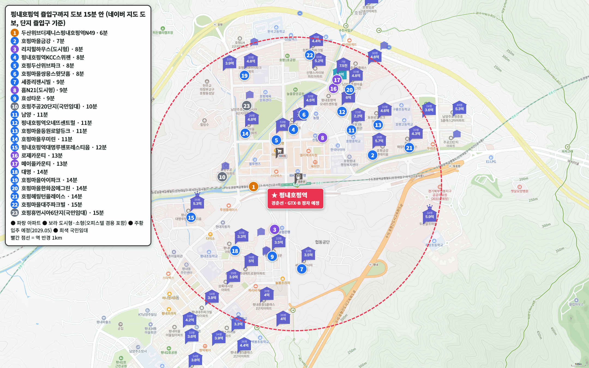
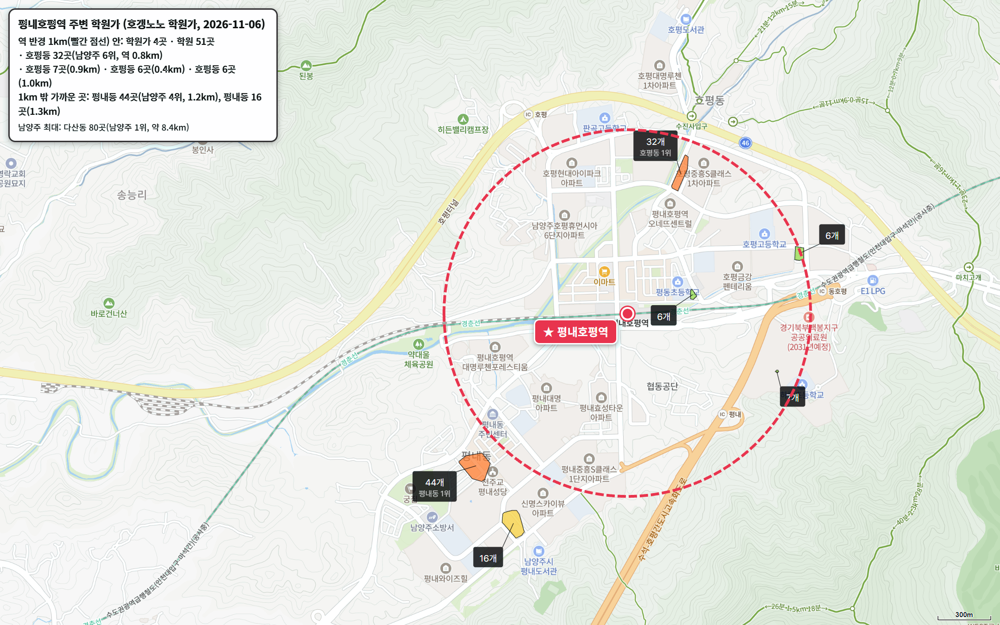

GTX-B 세 번째 편입니다. 평내호평역은 동쪽 끝 마석역 바로 다음, 서울 쪽으로 첫 역입니다. 상봉~마석 구간은 경춘선 선로를 함께 쓰기 때문에 지금의 경춘선 평내호평역에 GTX-B가 섭니다.

GTX-B 민자구간은 2025년 8월 공사를 시작했고, 국토교통부가 밝힌 개통 목표는 2030년입니다.

역에서 도보 15분 이내 분양 아파트는 **16곳**입니다. 평내동과 호평동 택지지구가 역 양쪽으로 붙어 있어 이 연재에서 가장 많습니다.

**같은 역, 같은 24평형인데 지난 1년 상승률이 17%와 2%로 갈렸습니다.** 호평마을우미린은 1년 동안 17.0% 올랐고, 평내호평역오네뜨센트럴은 1.8%에 그쳤습니다.

## 출퇴근 시간: 삼성 59분, 광화문 66분

| 업무지구 | 소요 시간 | 환승 | 경로 |
|---|---|---|---|
| 삼성(강남) | 59분 | 2회 | 경춘선 별내 → 8호선 잠실 → 2호선 삼성 |
| 광화문 | 66분 | 2회 | 경춘선 상봉 → 7호선 군자 → 5호선 광화문 |
| 판교 | 75분 | 2회 | 경춘선 상봉 → 7호선 논현 → 신분당선 판교 |
| 여의도 | 79분 | 2회 | 경춘선 상봉 → 7호선 군자 → 5호선 여의도 |

오전 8시에 나서면 삼성이 59분으로 우수이고, 광화문·판교·여의도는 1시간 30분 안이라 양호입니다. 좌석을 예약하는 ITX-청춘을 타면 광화문 48분, 여의도 61분으로 줄어듭니다.

개통 뒤 시간은 평내호평역만 따로 밝힌 공공 자료가 없습니다. 한 정거장 바깥인 마석역 기준으로 국토교통부는 서울역 27분, 기획재정부는 청량리 23분을 예상했습니다.

## 도보 15분 이내 아파트 16곳

| 단지 | 매매 실거래(5~10월) | 평형 | 역 도보 | 세대수(등급) | 입주 | 용적률 | 1년 변동 | 세 낀 매물 호가 | 실거주 매물 호가 | 전세(8~10월) | 갭(세 낀 매물) |
|---|---|---|---|---|---|---|---|---|---|---|---|
| 호평마을금강 | 8건 4.67억~5.75억, 중위 5억 4,250 | 국평 | 7분 | 892(안정) | 2004 | 215% | +16.8% | 6건 5.1억~6.2억 | 7건 5억~7.2억 | 중위 3억 3,600 (5건) | 1.9억~2.25억 |
| 호평두산위브파크 | 1건 8억 | 전용 152㎡ | 8분 | 119(비추) | 2009 | 397% | - | 2건 8.5억~9억 | - | - | 2억~3억 |
| 평내호평역KCC스위첸 | 5건 5.5억~6억, 중위 5억 9,900 | 24평형 | 8분 | 333(비추) | 2017 | 229% | +7.0% | - | 1건 6.3억 | - | - |
| 호평마을쌍용스윗닷홈 | 1건 4.5억 | 국평 | 8분 | 184(비추) | 2006 | 298% | - | - | 6건 4.5억~5.3억 | 중위 3억 5,000 (3건) | - |
| 효성타운 | 7건(제외 1건) 2.87억~3.2억, 중위 3억 500 | 24평형 | 9분 | 607(최소선) | 1998 | 314% | +4.0% | 5건 3.4억~3.5억 | 2건 3.25억~3.3억 | - | 1억~1.2억 |
| 세종리젠시빌 | 3건 2.6억~2.84억, 중위 2억 7,300 | 24평형 | 9분 | 312(비추) | 2000 | 316% | +1.1% | 1건 2.9억 | 3건 2.9억~3억 | 중위 2억 2,000 (2건) | - |
| 남양 | 없음 | 전용 63㎡ | 11분 | 220(비추) | 1984 | - | - | 10건 2.1억~2.65억 | 5건 2.5억~2.9억 | - | 9,000만~1.25억 |
| 호평마을우미린 | 6건(제외 1건) 3.95억~4.75억, 중위 4억 2,000 | 24평형 | 11분 | 352(비추) | 2004 | 215% | +17.0% | 6건 4억~5.2억 | 8건 4.5억~5.4억 | 중위 3억 1,300 (4건) | 1억~2억 |
| 평내호평역오네뜨센트럴 | 10건 4.65억~5.3억, 중위 4억 8,850 | 24평형 | 11분 | 616(최소선) | 2019 | 238% | +1.8% | 5건 4.8억~6억 | 5건 5.3억~6.1억 | 중위 3억 5,200 (8건) | 1.3억~1.9억 |
| 호평마을동원로얄듀크 | 22건(제외 2건) 3.75억~5.3억, 중위 4억 4,100 | 국평 | 11분 | 593(최소선) | 2005 | 219% | +8.2% | 7건 4.5억~5.9억 | 10건 4.5억~5.8억 | 중위 3억 5,000 (7건) | 1억~1.9억 |
| 평내호평역대명루첸포레스티움 | 57건(제외 2건) 4.6억~5.45억, 중위 5억 700 | 24평형 | 12분 | 1,008(훌륭) | 2020 | 229% | +5.7% | 6건 5.1억~5.5억 | 6건 5.4억~5.7억 | 중위 3억 8,000 (28건) | - |
| 대명 | 10건(제외 1건) 2.65억~3.25억, 중위 2억 8,600 | 24평형 | 14분 | 664(최소선) | 2000 | 252% | +6.7% | 7건 2.7억~3.3억 | 3건 3.1억~3.2억 | 2억 1,000 (1건) | 6,000만~7,000만 |
| 호평마을한화꿈에그린 | 11건(제외 1건) 3.8억~4.85억, 중위 4억 5,500 | 국평 | 14분 | 414(비추) | 2005 | 219% | +7.1% | 5건 4.3억~5.8억 | 4건 4.3억~5.8억 | 중위 3억 8,000 (4건) | 8,300만~2.1억 |
| 호평해링턴플레이스 | 15건 3.9억~5.1억, 중위 4억 2,500 | 국평 | 14분 | 607(최소선) | 2004 | 219% | +6.6% | 13건 3.95억~4.8억 | 13건 3.9억~5.1억 | 중위 3억 5,000 (4건) | 1.1억~1.7억 |
| 호평마을아이파크 | 15건(제외 3건) 4.15억~5.2억, 중위 4억 7,500 | 국평 | 14분 | 920(안정) | 2004 | 209% | +7.5% | 7건 4.5억~5.2억 | 10건 4.6억~5.5억 | 중위 3억 4,300 (2건) | 9,000만~2.2억 |
| 호평마을대주파크빌 | 10건(제외 3건) 4억~5억, 중위 4억 5,000 | 국평 | 15분 | 673(최소선) | 2004 | 214% | +10.0% | 5건 4.4억~5억 | 19건 4.2억~6억 | 중위 3억 4,300 (4건) | 1.15억~1.45억 |

실거래는 2026년 5~10월 대표 평형 신고분이고, 해제·직거래와 시세보다 크게 낮은 거래(같은 평형, 거래 달 앞뒤 3개월 거래 중위값의 80% 미만)는 뺐습니다. 1년 변동은 같은 평형 2026년 5~10월 중위값을 2025년 5~10월 중위값과 견준 값이고, 1년 전 거래가 3건 이상일 때만 적었습니다. 호가는 같은 집이 여러 중개사로 올라온 것을 하나로 셌고, 세입자가 있어 전세를 안고 사는 세 낀 매물과 바로 들어가 살 수 있는 실거주 매물(즉시·협의 입주)로 나눴습니다. 갭은 세 낀 매물의 호가에서 그 집의 전세 보증금을 뺀 값입니다(월세 낀 매물은 뺐습니다). 실거주 매물 수에는 설명 없이 입주가능일만 즉시입주로 적힌 매물이 들어 있습니다.

역 도보 6분에는 두산위브더제니스평내호평역N49(548세대)가 2029년 5월 입주를 앞두고 있습니다. 호평마을주공20단지(456세대, 10분)는 국민임대라 표에서 뺐고, 리치힐하우스·홈N21·로제카운티·메이플카운티는 원룸형 도시형생활주택이라 넣지 않았습니다.

도보 15분을 조금 넘는 곳으로는 e편한세상평내메트로원·호평마을신명스카이뷰하트·평내마을중흥S클래스1단지·두산알프하임(16분)이 있습니다.

## 1년 상승률이 갈린 24평형 세 곳

**평내호평역대명루첸포레스티움**은 1,008세대 대단지(훌륭), 2020년 입주, 역 도보 12분입니다. 16곳 가운데 유일하게 1,000세대를 넘고, 5~10월 24평형 실거래가 57건으로 거래도 가장 많습니다. 중위값은 5억 700만 원으로 1년 전(34건) 4억 7,950만 원보다 5.7% 올랐습니다. 배정초(평내초)까지 도보 8분, 평지 단지입니다.

**호평마을우미린**은 352세대, 2004년 입주, 역 도보 11분입니다. 24평형 중위값이 4억 2,000만 원으로 1년 전(7건) 3억 5,900만 원에서 17.0% 올랐습니다. 16곳 가운데 가장 많이 올랐고, 국평 위주인 호평마을금강(892세대, 7분)도 16.8%로 비슷합니다.

**평내호평역오네뜨센트럴**은 616세대, 2019년 입주, 역 도보 11분입니다. 24평형 중위값이 4억 8,850만 원으로 1년 전(7건) 4억 8,000만 원에서 1.8% 움직였습니다. 2019년 입주한 신축인데 2004년 입주한 우미린보다 덜 올랐습니다. 배정초(평동초)는 도보 7분입니다.

**세종리젠시빌**(312세대, 9분)도 24평형이 1년 동안 1.1%로 거의 제자리입니다.

역에서 가장 가까운 **평내호평역KCC스위첸**(333세대, 2017년, 8분)은 24평형 중위값이 5억 9,900만 원으로 16곳 가운데 가장 비쌉니다.

500세대가 안 되는 단지(호평두산위브파크·KCC스위첸·쌍용스윗닷홈·세종리젠시빌·남양·우미린·한화꿈에그린)는 거래가 드물어 그만큼 환금성이 떨어집니다.

## 학군과 학원가

| 단지 | 배정초(도보) | 경사 | 용적률 | 세대수 등급 |
|---|---|---|---|---|
| 호평마을금강 | 평동초 1분 | 평지 | 215% | 안정 |
| 호평두산위브파크 | 평동초 9분 | 평지 | 397% | 비추 |
| 평내호평역KCC스위첸 | 평동초 9분 | 평지 | 229% | 비추 |
| 호평마을쌍용스윗닷홈 | 평동초 6분 | 평지 | 298% | 비추 |
| 효성타운 | 평내초 13분 | 약간 언덕 | 314% | 최소선 |
| 세종리젠시빌 | 백봉초 16분 | 약간 언덕 | 316% | 비추 |
| 남양 | 구룡초 9분 | 평지 | - | 비추 |
| 호평마을우미린 | 판곡초 10분 | 평지 | 215% | 비추 |
| 평내호평역오네뜨센트럴 | 평동초 7분 | 평지 | 238% | 최소선 |
| 호평마을동원로얄듀크 | 구룡초 6분 | 약간 언덕 | 219% | 최소선 |
| 평내호평역대명루첸포레스티움 | 평내초 8분 | 평지 | 229% | 훌륭 |
| 대명 | 평내초 3분 | 약간 언덕 | 252% | 최소선 |
| 호평마을한화꿈에그린 | 구룡초 9분 | 평지 | 219% | 비추 |
| 호평해링턴플레이스 | 구룡초 5분 | 평지 | 219% | 최소선 |
| 호평마을아이파크 | 판곡초 2분 | 약간 언덕 | 209% | 안정 |
| 호평마을대주파크빌 | 판곡초 3분 | 약간 언덕 | 214% | 최소선 |

역 반경 1km 안에 호평동 학원가 네 곳, 학원 51개가 있습니다. 가장 큰 곳(32개)이 역에서 800m쯤입니다. 남양주에서 네 번째로 큰 평내동 학원가(44개)는 1.2km, 남양주에서 가장 큰 다산동(80개)은 8.4km 떨어져 있습니다.

## 생활 인프라: 마트·공원·병원

| 구분 | 시설 | 거리 |
|---|---|---|
| 대형마트 | 이마트 남양주점 | 도보 5분 |
| 공원 | 늘을중앙공원 | 도보 10분 |
| 체육센터 | 호평체육문화센터 | 도보 10분 |
| 도서관 | 남양주시평내도서관 | 차로 3분 |
| 아울렛 | 현대프리미엄아울렛 스페이스원 | 차로 15분 |
| 공연장 | 다산아트홀 | 차로 15분 |
| 대형 병원 | 남양주한양병원 | 차로 18분 |
| 백화점 | 롯데백화점 구리점 | 차로 19분 |

이마트가 역에서 걸어서 5분이고, 공원과 체육센터도 도보 10분입니다. 백화점과 대형 병원은 차로 20분 가까이 가야 합니다.

## 남양주 공급, 3년 합계가 적정물량에 못 미칩니다

남양주의 2027~2029년 입주 물량은 모두 {{v:moveins3:남양주}}로 3년 적정물량(한 해 {{v:need:남양주}})의 {{v:share3:남양주}}입니다. 2028년 한 해에 {{v:moveins:남양주:2028}}(적정의 {{v:share:남양주:2028}})가 몰리지만, 앞뒤 해는 2027년 {{v:share:남양주:2027}}, 2029년 {{v:share:남양주:2029}}에 그칩니다.

{{chart:moveins:남양주}}

{{table:moveins:남양주}}

남양주 매매는 {{v:streak:남양주}}, 전세는 {{v:streak:남양주:전세}}입니다.

{{chart:weekly:남양주}}

{{table:weekly:남양주}}

**제 판단으로는 오네뜨센트럴·세종리젠시빌처럼 지난 1년 거의 오르지 않은 단지가 아직 반영이 덜 된 곳입니다.** 같은 역, 같은 공급 조건인데 우미린·금강이 먼저 16~17% 올랐습니다. 남양주 3년 입주가 적정물량에 못 미치는 한, 먼저 오른 단지와 벌어진 차이는 시간이 지나며 좁혀진다고 봅니다. 2028년 입주장에 전셋값이 한 번 흔들려도 3년을 합치면 남양주는 공급 부족입니다.

시군구별 주간·월간 시세는 [경기 리포트 표](/zone/%EA%B2%BD%EA%B8%B0/#weekly-sgg)에서 볼 수 있습니다.

적정물량은 주민등록 인구를 가구당 2.5명으로 나눈 가구 수의 2%로 잡았습니다. 매매는 대표 평형의 2026년 5~10월 실거래에서 해제·직거래와 같은 평형 거래 달 앞뒤 3개월 중위값의 80% 미만 거래를 뺀 값이고, 전세는 8~10월 월세 없는 전세 실거래의 중위값입니다.

## 고른 기준

- 역 위치: 지금의 경춘선 평내호평역 출입구를 역으로 삼았습니다. GTX-B는 같은 역에 섭니다.
- 범위: 네이버 지도 도보 길찾기로 단지 출입구에서 역 출입구까지 15분 이내인 분양 아파트 전부입니다. 임대 전용 단지, 원룸형 도시형생활주택, 입주 전 단지는 뺐습니다.
- 평형: 24평형(전용 59㎡)이 있으면 24평형, 없으면 국평(전용 84㎡), 둘 다 없으면 세대가 가장 많은 평형을 대표로 씁니다.
- 1년 변동: 같은 평형 2026년 5~10월 실거래 중위값 ÷ 2025년 5~10월 실거래 중위값 - 1입니다. 1년 전 거래가 3건 미만이면 적지 않았습니다.
- 단지 이름: 실거래 신고에 옛 이름으로 남은 단지는 지금 이름으로 적었습니다(호평마을우미이노스빌 → 호평마을우미린, 호평마을효성백년가약 → 호평해링턴플레이스).
- 세대수 등급: 1,000세대 이상 대단지는 훌륭, 700세대 이상은 안정, 500세대 이상은 최소선입니다. 500세대 미만 소규모 단지는 거래가 적어 환금성이 떨어집니다.
- 출퇴근 등급: 주요 업무지구 네 곳까지 30분 이내는 매우 우수, 1시간 이내는 우수, 1시간 30분 이내는 양호입니다.
