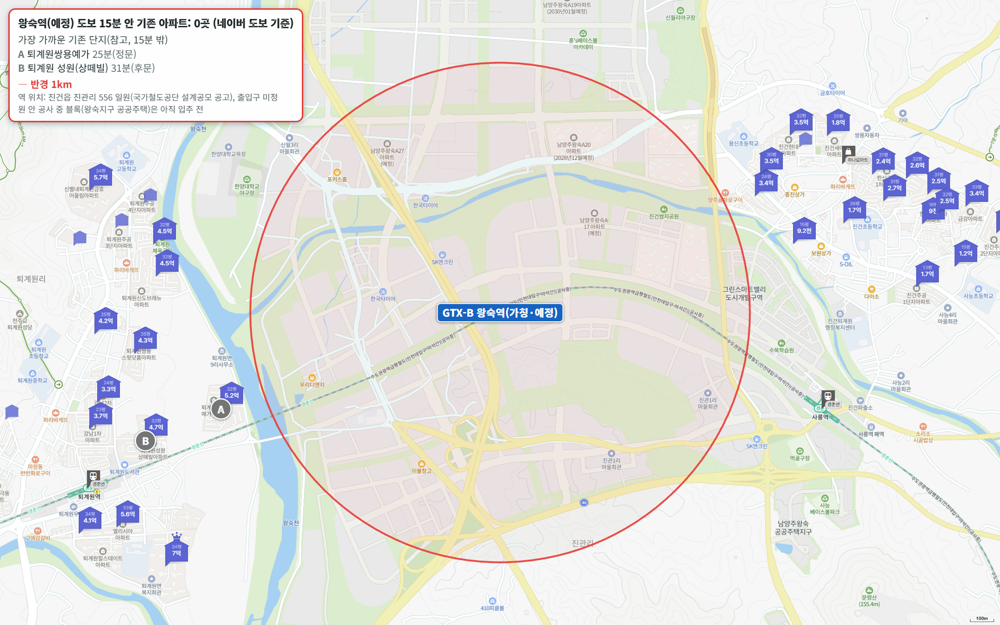
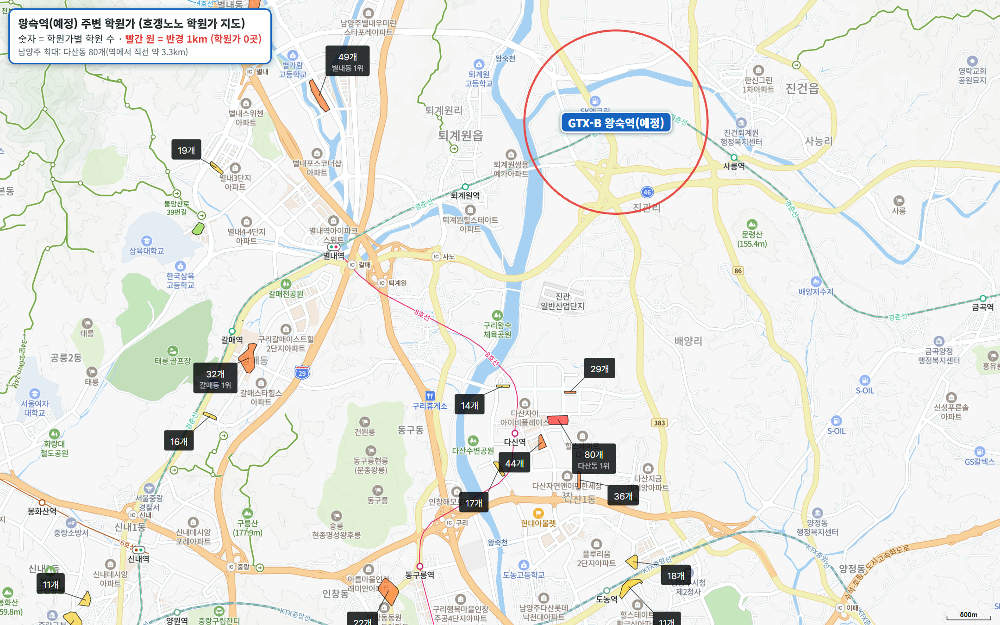

GTX-B 네 번째 편입니다. 왕숙역은 아직 없는 역입니다. 3기 신도시 남양주왕숙지구 안, 경춘선 퇴계원역과 사릉역 사이에 새로 짓는 역이고, 경춘선과 GTX-B가 함께 섭니다. 국가철도공단이 2026년 9월 역사 설계공모를 냈고, 당선작은 12월에 나옵니다.

GTX-B 개통 목표는 국토교통부가 2024년까지 2030년으로 밝혔고, 2026년 10월 30일 보도설명자료에는 2031년(잠정)으로 적었습니다.

역 예정지에서 도보 15분 이내 기존 아파트는 **0곳**입니다. 역 둘레가 모두 공사 중인 왕숙지구라, 가장 가까운 기존 단지인 퇴계원쌍용예가도 25분입니다. **역 반경 1km 안 첫 입주는 2028년 12월**로 잡혀 있습니다.

## 출퇴근 시간: 지금은 버스로 나가야 합니다

| 업무지구 | 지금 소요 시간 | 환승 | 지금 경로 |
|---|---|---|---|
| 삼성(강남) | 72분 | 2회 | 땡큐11번 버스 → 8호선 다산 → 2호선 잠실 |
| 광화문 | 81분 | 3회 | 땡큐30번 버스 → 경춘선 퇴계원 → 경의중앙선 망우 → 1호선 회기 |
| 판교 | 94분 | 3회 | 땡큐30번 버스 → 경춘선 퇴계원 → 7호선 상봉 → 신분당선 논현 |
| 여의도 | 96분 | 3회 | 땡큐30번 버스 → 경춘선 퇴계원 → 경의중앙선 망우 → 5호선 왕십리 |

역 예정지가 공사 부지라 모든 경로에 버스 정류장까지 걷는 시간(20분 안팎)이 들어 있습니다. 삼성 72분, 광화문 81분은 양호이고, 판교와 여의도는 1시간 30분을 넘습니다.

개통 뒤 시간은 국토교통부 왕숙 광역교통개선대책(2020년)이 밝힌 숫자가 있습니다. 서울역 방면이 45분에서 25분으로, 강남역 방면이 70분에서 45분으로 줄어듭니다(GTX-B만이 아니라 대책 전체를 시행했을 때 기준). 9호선 연장선 환승도 계획에 들어 있습니다.

## 도보 15분 이내 기존 아파트 0곳

역 예정지는 진건읍 진관리 556 일원입니다. 출입구가 아직 정해지지 않아 이 지점을 역으로 삼았습니다. 왕숙지구 안 도로가 아직 없어서, 진건읍 쪽 기존 단지는 직선 1.1~1.2km인데도 걸어서 44분 이상 돌아가야 합니다.

가장 가까운 기존 단지 두 곳을 참고로 적습니다. 둘 다 왕숙천 건너 퇴계원읍에 있습니다.

| 단지 | 매매 실거래(5~10월) | 평형 | 역 도보 | 세대수(등급) | 입주 | 용적률 | 1년 변동 | 세 낀 매물 호가 | 실거주 매물 호가 | 전세(8~10월) | 갭(세 낀 매물) |
|---|---|---|---|---|---|---|---|---|---|---|---|
| 퇴계원쌍용예가 | 19건(제외 1건) 4.3억~5억, 중위 4억 6,500 | 국평 | 25분 | 552(최소선) | 2007 | 269% | - | 5건 4.5억~5.3억 | - | 중위 3억 4,800 (10건) | 1.5억~2.05억 |
| 퇴계원성원상떼빌 | 7건(제외 1건) 3.55억~4.05억, 중위 3억 6,000 | 24평형 | 31분 | 731(안정) | 1999 | 264% | +5.9% | 1건 4.2억 | - | 중위 3억 300 (2건) | 1.7억 |

실거래는 2026년 5~10월 대표 평형 신고분이고, 해제·직거래와 시세보다 크게 낮은 거래(같은 평형, 거래 달 앞뒤 3개월 거래 중위값의 80% 미만)는 뺐습니다. 1년 변동은 같은 평형 2026년 5~10월 중위값을 2025년 5~10월 중위값과 견준 값이고, 1년 전 거래가 3건 이상일 때만 적었습니다. 호가는 같은 집이 여러 중개사로 올라온 것을 하나로 셌고, 세입자가 있어 전세를 안고 사는 세 낀 매물과 바로 들어가 살 수 있는 실거주 매물(즉시·협의 입주)로 나눴습니다. 갭은 세 낀 매물의 호가에서 그 집의 전세 보증금을 뺀 값입니다(월세 낀 매물은 뺐습니다).

**퇴계원쌍용예가**는 552세대(최소선), 2007년 입주입니다. 24평형은 50세대뿐이라 국평이 대표 평형입니다. 국평 5~10월 실거래 19건의 중위값이 4억 6,500만 원이고, 지금 나온 국평 매물 5건은 모두 세입자가 있는 집입니다. 24평형은 8월 4억 700만 원에 거래됐습니다.

입주민 후기에는 왕숙천 산책로와 조경이 좋다는 글, 왕숙지구 바로 맞은편이라 개발 효과를 가장 먼저 볼 단지라는 기대가 많습니다. 주변 상권이 아직 부족하고 단지 앞 도로 공사가 이어진다는 지적도 있습니다.

**퇴계원성원상떼빌**은 731세대(안정), 1999년 입주로 경춘선 퇴계원역 역세권 단지입니다. 24평형 중위값이 3억 6,000만 원으로 1년 전(4건) 3억 4,000만 원보다 5.9% 올랐습니다. 지하주차장이 동끼리 이어지지 않고, 선로 가까운 동은 열차 소음이 들린다는 후기가 있습니다.

## 역 둘레를 채울 왕숙지구 블록

| 블록 | 세대수 | 공급 유형 | 입주 예정 | 역 예정지 직선거리 |
|---|---|---|---|---|
| A-23 | 520 | 공고 전 | 미정 | 0.37km |
| A-17 | 379 | 민간참여 공공분양(24평형) | 2029년 7월(보도 기준) | 0.56km |
| A-24 | 589 | 신혼희망타운 390 · 행복주택 199 | 2028년 12월 | 0.64km |
| A-20 | 961 | 신혼희망타운 634 · 장기임대 327 | 2028년 12월(본청약 공고 전) | 0.75km |
| B-17 | 491 | 공공분양 | 2028년 12월 | 0.80km |
| A-25 | 1,298 | 공고 전 | 미정 | 0.84km |
| S-12 | 391 | 공공분양 | 2029년 12월(사전청약 기준) | 0.92km |
| S-11 | 546 | 공공분양 | 2029년 12월(사전청약 기준) | 0.97km |
| A-19 | 1,015 | 공공분양(나눔형) | 미정(본청약 2028년 6월로 연기) | 1.27km |

입주 예정은 LH 입주자모집공고와 사전청약 공고 기준이고, 공고가 없는 블록은 미정으로 적었습니다. 역 반경 1km 안에서 입주 시기가 공고로 정해진 곳은 A-24·B-17블록(2028년 12월)입니다. 진접 쪽 왕숙지구에서는 B-1·B-2블록 왕숙푸르지오더퍼스트(1,147세대)가 2028년 5~6월, A-1·A-2블록(1,237세대)이 2028년 8월에 먼저 입주합니다.

역 예정지와 블록 사이 도로가 아직 없어 블록까지의 도보 시간은 직선거리로만 적었습니다.

## 학군과 학원가

| 단지 | 배정초(도보) | 경사 | 용적률 | 세대수 등급 |
|---|---|---|---|---|
| 퇴계원쌍용예가 | 도제원초 12분 | 평지 | 269% | 최소선 |
| 퇴계원성원상떼빌 | 도제원초 6분 | 약간 언덕 | 264% | 안정 |

역 반경 1km는 물론 2km 안에도 학원가가 없습니다. 남양주에서 가장 큰 다산동 학원가(80개)가 직선 3.3km, 차로 12분이고, 별내동(49개)이 차로 9분입니다.

## 생활 인프라: 지금은 차로 가야 합니다

| 구분 | 시설 | 거리 |
|---|---|---|
| 큰 공원 | 다산중앙공원 | 차로 9분 |
| 대형마트 | 이마트 별내점 | 차로 11분 |
| 공연장 | 별빛극장 | 차로 12분 |
| 아울렛 | 현대프리미엄아울렛 스페이스원 | 차로 13분 |
| 체육센터 | 남양주체육문화센터 | 차로 13분 |
| 백화점 | 롯데백화점 구리점 | 차로 17분 |
| 대형 병원 | 남양주한양병원 | 차로 17분 |
| 도서관 | 퇴계원도서관 | 도보 33분 |

역 예정지 둘레는 공사 부지라 걸어서 닿는 생활 인프라가 없습니다. 왕숙지구 상업용지와 자족시설이 채워지기 전까지는 다산·별내까지 차로 나가야 합니다.

## 남양주 공급, 3년 합계가 적정물량에 못 미칩니다

남양주의 2027~2029년 입주 물량은 모두 {{v:moveins3:남양주}}로 3년 적정물량(한 해 {{v:need:남양주}})의 {{v:share3:남양주}}입니다. 왕숙지구 첫 입주가 몰리는 2028년 한 해에는 {{v:moveins:남양주:2028}}(적정물량의 {{v:share:남양주:2028}})가 잡혀 있지만, 2027년은 {{v:share:남양주:2027}}, 2029년은 {{v:share:남양주:2029}}에 그칩니다.

{{chart:moveins:남양주}}

{{table:moveins:남양주}}

남양주 매매는 {{v:streak:남양주}}, 전세는 {{v:streak:남양주:전세}}입니다.

{{chart:weekly:남양주}}

{{table:weekly:남양주}}

**제 판단으로는 2028년 하반기 왕숙지구 입주장이 서면 퇴계원·진건 일대 전셋값이 먼저 조정받습니다.** 다만 앞뒤 해 입주가 적어 3년을 합치면 남양주는 공급 부족이고, 입주장은 길지 않습니다. GTX-B 개통은 그 뒤인 2031년 무렵(잠정)이라 개통 효과와 입주장이 시기상 겹치지 않습니다.

시군구별 주간·월간 시세는 [경기 리포트 표](/zone/%EA%B2%BD%EA%B8%B0/#weekly-sgg)에서 볼 수 있습니다.

적정물량은 주민등록 인구를 가구당 2.5명으로 나눈 가구 수의 2%로 잡았습니다. 매매는 대표 평형의 2026년 5~10월 실거래에서 해제·직거래와 같은 평형 거래 달 앞뒤 3개월 중위값의 80% 미만 거래를 뺀 값이고, 전세는 8~10월 월세 없는 전세 실거래의 중위값입니다.

## 고른 기준

- 역 위치: 개통 전이라 출입구가 없습니다. 국가철도공단 설계공모 공고의 진건읍 진관리 556 일원을 역으로 삼았습니다.
- 범위: 네이버 지도 도보 길찾기로 15분 이내인 기존 아파트 전부입니다. 없어서 가장 가까운 기존 단지 두 곳을 참고로 적었습니다.
- 평형: 24평형(전용 59㎡)이 있으면 24평형, 없거나 세대가 아주 적으면 국평(전용 84㎡)을 대표로 씁니다.
- 1년 변동: 같은 평형 2026년 5~10월 실거래 중위값 ÷ 2025년 5~10월 실거래 중위값 - 1입니다. 1년 전 거래가 3건 미만이면 적지 않았습니다.
- 세대수 등급: 1,000세대 이상 대단지는 훌륭, 700세대 이상은 안정, 500세대 이상은 최소선입니다. 500세대 미만 소규모 단지는 거래가 적어 환금성이 떨어집니다.
- 출퇴근 등급: 주요 업무지구 네 곳까지 30분 이내는 매우 우수, 1시간 이내는 우수, 1시간 30분 이내는 양호입니다.
